## Key numbers

| | |
|---|---|
| Files collected by eight regional teams (round 1) | 2,557 (1,894 of 2,160 listed sources captured) |
| Round-2 candidates / with text / entered the collection / usable | 2,075 / 1,720 / 1,641 / 1,626 (Tables 50, 51; Figure 50) |
| Documents annotated / usable (text readable, on topic) | 3,295 / 3,165 (128 duplicate captures removed at assembly) |
| About robots or embodied AI ("embodied-AI set") | 1,603: 509 research papers and 810 legal texts of instrument class (822 documents carry the governance flag) |
| About AI in general ("general-AI set") | 1,015: 48 research papers, 409 governance documents |
| In neither set (rated not about AI, mostly round-2 sector law) | 547 (Table 1), excluded from every set comparison |
| **Principal instruments reaching robots** (the headline unit: legal texts minus commencement orders, levies, exemptions, incorporation decisions, corrigenda, stubs and catalogue pages) | **505** of the 810 legal texts; 408 rated robot-relevant; 395 whose text contains autonomy or AI provisions; 153 that name AI explicitly (Table 53b) |
| **Principal binding instruments reaching robots** | **195** of 291 binding legal texts; 168 robot-relevant; 194 counted once per instrument family; 140 with autonomy or AI provisions; 15 naming AI explicitly (Table 53b); 182 of the 195 in force (Table 33b) |
| Precision audit of the v3 binding set (random n = 100, read by an independent auditor) | 54% distinct, binding and substantive (Wilson 44 to 63), implying about 161 (132 to 190) of the 299 v3 texts; the rule-based unit keeps 61% (51 to 70) of the same sample (Table 62) |
| Countries with any document / with a principal embodied instrument / with a principal binding embodied instrument | 116 / 56 / 38 (Table S08); 60 jurisdictions on the comparable unit of every legal text (58 countries plus the EU and the international layer; Table 53) |
| Share of usable documents from Europe / in English / in Chinese | 42% (1,332) / 75% (2,373) / 9% (278) |
| Labelling | AI model under a fixed 39-field codebook; no person read or labelled any document; seven reliability checks (five on round-1 samples, two on a round-2 sample; Part F); the round-2 collectors and the reviewers were AI agents |

**How to read this report.** Every label was produced by a language model; no person read or labelled any document. The round-2 collectors, the six adversarial reviewers of the previous version and the precision auditor were also AI agents (Claude) working in one Claude Code session, so none of the checks in Part F is a human validation. Counts of instruments are counts *in this collection*, on a stated counting unit: the headline unit is the principal instrument (Section 4), and every number that uses another unit says so. Round 1 of the collection sought research on robots and official texts on AI in general; round 2 harvested legal databases for instruments. Because the two rounds differ in genre, length and capture quality, every embodied-versus-general comparison is given pooled and then within collection round or within genre, and the text says which version survives. Percentages are given as counts wherever a group has fewer than 30 documents. The glossary defines the terms; the supplement holds the codebook, the reliability detail, the instrument lists, the version history (S10) and the precision audit (S13); the companion report describes round 2.

## Five findings and one methodological result

1. **Binding law reaches robots through the law of the machine classes they belong to, and most of it says nothing about AI.** Within this collection, 505 principal instruments reach robots, 195 of them legally binding and 182 of those in force (Tables 53b, 33b). The binding layer is aviation, road-vehicle, machinery, workplace-safety and product law: on the comparable unit of every binding text, 207 of 291 are regulations or decrees and 71 statutes (Table S01); among the 195 principal binding instruments, drones are addressed by 107 and automated road vehicles by 67, industrial manipulators by 13 and delivery robots by 15 (Table 7). Only 140 of the 195 contain any provision about autonomy or automation, and 15 name artificial intelligence (Table 53b). El Salvador's Robotic Technologies Law is the only robotics statute captured; two robot-titled statutes known to exist (Korea's 2008 Intelligent Robots Act, cited by 9 documents, and Hangzhou's 2026 embodied-robot regulation, located by a collector) were not read. (Figures 4, 6; Tables 2, 7, 33, 33b, 53b.)
2. **Research and rules point at different robots, and this survives the change of counting unit.** Companion and social robots are the subject of 43% of robot research papers (219 of 509) but 3% of principal instruments (15 of 505), none binding; drones are 6% of research and 42% of instruments (214; 107 binding); self-driving vehicles 12% and 40% (201; 67 binding). The gaps are far outside their bootstrap intervals (+40 points, interval 36 to 45; −36, −41 to −31; −27, −33 to −22). Humanoids have 170 documents, 20 principal instruments and no binding instrument (gap +19, interval 15 to 23); industrial manipulators are at parity (−3, interval −7 to +1). (Figures 18, 40; Tables 7, 22.)
3. **What is distinctive about robot governance is the body; the "ethical core deficit" reported for v3 is a composition effect of round 2.** Within principal instruments (505 vs 372), physical safety (83% vs 9%), autonomy-level control (60% vs 10%), conformity assessment (66% vs 19%), human-robot proximity (33% vs 0.3%) and liability for physical damage (27% vs 3%) are far more often raised in robot instruments, and ten of fourteen core principles are raised less often (Table 21). Within the round-1 instruments alone (61 vs 245) none of the fourteen core principles differs after Holm correction, while all six embodied-specific items do; within round-2 instruments (444 vs 127) ten core principles are lower (Table 20b). With collection round added to the adjusted model (Table 20), eight core principles remain lower, two (non-maleficence 2.6, human oversight 1.7) higher and four do not differ; physical safety (odds ratio 45), liability (21), autonomy-level control (17), conformity (6) and dual use (3) remain the distinctive items, and proximity is not estimable (4 general documents). The tools follow the body: licensing and registration (adjusted odds ratio 4.1), insurance (7.0), conformity assessment (4.2) and references to standards (3.9) belong to robot instruments; oversight bodies (0.51), self-regulation (0.51), labelling (0.53) and international cooperation (0.59) to general-AI instruments. (Figures 20, 24, 38, 39; Tables 20, 20b, 21, 34.)
4. **Specification lags mention, measured on texts that can specify anything.** On content-analysed captures, physical safety is set out in detail by 62% of the 195 principal binding instruments, 33% of 207 soft-law instruments and 33% of 77 drafts; the scope pages of 62 technical standards name it in 95% and treat it in depth in 68%, but scope pages are a separate measurement and are never pooled with substantive texts. Autonomy-level control is raised by 57 to 66% of instruments of every type and set out in detail by 25% of binding instruments, 21% of guidance, 23% of standards' scope pages and 31% of drafts; liability for physical damage is absent from standards. (Figure 23; Tables 9, 35.)
5. **Regions differ most in tools; the newest shift is toward industrial policy and away from personhood; compliance machinery grows within the original collection.** On a common population of 1,576 embodied documents in six regions, 34 of 38 principles and mechanisms differ after Holm correction (Table 29), led by references to standards, licensing and beneficence; but the genre mix differs by region, and within research outputs only 2 of 14 core principles differ by region while within principal instruments 12 of 14 do (Table 29b), so regional differences on values belong to the instrument layer, and within it to the mix of standards and strategies each region supplies, not to the research literature. Between 2020 to 2024 and 2025 to 2026, after adjustment for genre and region, industrial policy rises (odds ratio 1.7, Holm p = 0.03) and legal personhood falls (0.39, Holm p = 0.04); the fall of ethics discourse does not survive adjustment. Risk-based tiering and the conformity-assessment mechanism grow by 31% and 26% a year within round-1 documents and by 10% and 5% a year with round as a covariate (Table 30); the pooled declines of proximity and liability (Table 17) coincide with the arrival of round-2 sector law and are not reported as trends. "Embodied AI" vocabulary rises from 1% of embodied documents in 2024 to 13% in 2026. (Figures 21, 25, 29 to 34, 42; Tables 16, 17, 28 to 31.)

**Methodological result: the collection strategy changes instrument counts by an order of magnitude and reverses several conclusions.** On the comparable unit of every legal text, round 2 raised embodied instruments from 65 to 810 and binding embodied instruments from 5 to 291 (Table 53). The rise is a property of where the teams searched, not of the world; within the round-1 documents the v2 results (no core-principle deficit, compliance machinery growing about 30% a year) still hold, and within round 2 they do not (Tables 20b, 30). Reported as a finding about method, not about governance (Section 3).

## 1. Scope, questions and definitions

The brief asked for a metric-heavy analysis of AI governance in the context of robotics, physical AI and embodied AI: development over time, regional differences, dominant views and principles, the newest trends, and how different robot types are governed, with a taxonomy of robots, a taxonomy of documents (including governance-instrument status) and a document dashboard. The study has gone through four versions, each after a set of independent adversarial reviews; the version history and the before-and-after comparisons are in supplement S10 and the review logs, and are referenced here only where a comparison between the two collection rounds is itself the result.

The object of study is the governance of the machine classes in which embodied AI is deployed: robots, automated road vehicles, unmanned aircraft, industrial and medical machines and autonomous weapons. Most of the binding instruments that reach these machines are machine-class rules (aviation, road vehicle, machinery, product safety) with no AI content; the AI-content tiers in Table 53b report how many instruments contain autonomy or AI provisions and how many name AI explicitly, so that the reader can choose the construct.

Definitions used throughout:

- **Usable documents** (3,165): annotated documents with readable text that are neither failed captures nor off-topic.
- **Embodied-AI set** (1,603): usable documents rated at least moderately relevant to embodied-AI governance (2 or 3 on a 0 to 3 scale) or carrying at least one robot-type label, and not rated "not about AI"; 1,374 by relevance alone (Table 32). A strict definition (relevance only) is reported as a sensitivity.
- **General-AI set** (1,015): usable documents about AI in general, rated 0 or 1 with no robot-type label. The 547 usable documents in neither set (Table 1) are mostly round-2 sector law rated not about AI; they enter only the all-document counts.
- **Legal texts** (1,696 usable; 810 in the embodied set): every usable document of instrument class (binding instrument, soft-law instrument or standard, proposal or draft). This is the comparable unit for comparisons with v2 and v3 (Table 53) and the unit of the instrument lists S01 to S03.
- **Principal instruments** (505 in the embodied set, 372 in the general-AI set; Table 21): legal texts minus commencement orders, levy and fee instruments, individual exemptions, directions, approvals and permits, definitions-only parts, tables of contents, EEA Joint Committee incorporation decisions, language-version corrigenda, byte-identical duplicate texts, catalogue or landing pages and metadata stubs under 150 words. Amendments count. This is the headline unit for every instrument count (Section 4).
- **Instrument families** group a principal instrument with its yearly renewals, successive versions and parts within one jurisdiction; family-level counts are reported as a further tier (Table 53b).
- **Robot-relevant instruments** are principal instruments rated relevance 2 or 3 (408; 168 binding); **instruments with embodied provisions** are rated 0 or 1 but carry a robot-type label (97; 27 binding) and are mostly sector or general law with an incidental robot provision (Table 33).
- **AI-content tiers**: *autonomy or AI provisions* means the full text contains at least two mentions of autonomous or automated operation, remote piloting, self-driving or AI terms; *names AI explicitly* means at least two mentions of artificial intelligence, machine learning, algorithms or their equivalents in the document's language (Table 53b).
- **Governance documents** (1,709 usable; 822 in the embodied set, 409 in the general-AI set) are the documents the annotation flagged as governing or prescribing (an annotation field, not the instrument class; it includes a few reports and web pages and misses a few legal texts). They are the base of the lifecycle, binding-nature and mechanism-share tables (Tables 2, 4, 10) and are always labelled as such.
- **Regions** follow the issuing jurisdiction (first author's country for research; Europe for EU bodies; International for ISO, IEC, IEEE, UN, OECD, UNESCO and WHO): Europe (including Russia), Asia, North America, Latin America and the Caribbean, Middle East, Africa, Oceania, International.
- **Content-analysed captures** are substantive or partial captures; catalogue, committee and landing pages are excluded from the principal unit and from every statement about what instruments say. Statistics about what instruments specify in depth (Table 9, Figure 23) use content-analysed captures of at least 150 words; technical standards are annotated on their public scope text only and are reported as a separate measurement.
- **Collection round**: round 1 is the regional teams' collection (675 embodied and 803 general-AI usable documents; Table 20b); round 2 is the legal-database and collector-agent collection (1,626 usable documents, 928 embodied and 212 general-AI; Tables 20b, 56). Round enters the adjusted models as a covariate and the stratified tables as a stratum.

## 2. Data and methods in brief

The full pipeline is in the supplement (S1). In round 1 the eight regional teams listed 2,160 sources and captured 1,894 as 2,557 files; files were converted to text, deduplicated (hash, URL, title, prefix and prose similarity, then a second pass on normalised title and jurisdiction), and every document was annotated by Claude Sonnet 5.5 against a 39-field codebook as a fixed system prompt with a JSON schema. Governance documents were re-annotated in v2 with the collectors' cover block stripped, minimal metadata and up to 110,000 characters of text.

Round 2 searched for instruments rather than discourse. Nine collector agents (Claude subagents working from regional, thematic and standards briefs with exclusion lists of the round-1 holdings) and scripted harvests of seven legal databases (EUR-Lex through CELLAR, legislation.gov.uk, the Japanese e-Gov law API, the Chinese State Council policy library, the Australian Federal Register of Legislation, the US eCFR and the Brazilian Câmara API) produced 2,075 de-duplicated candidates. Texts were fetched from the primary URL with documented fallbacks and a recovered-fetch pass; 1,720 yielded text (16 of them standards' scope pages through a committee mirror) and 355 did not (272 HTTP errors or thin pages, 46 blocked hosts, 37 failed fetches; Tables 51 and 52). All 1,720 were annotated under the same blind, extended-excerpt policy, model and prompt hash as the v2 governance re-annotation; 1,641 entered the collection after the assembly de-duplication and 1,626 are usable (Figure 50). The agreement between the blind labels and the collectors' catalogue metadata (binding nature 93% of 1,608, kappa 0.85; jurisdiction 98%; year within one year 94%; document class 77%, kappa 0.66; Tables 57 and 58) is a consistency check, not a validation: the collectors were AI agents and harvest scripts, not people.

Four v4 corrections apply to both rounds. First, the excerpt cleaner introduced in v2 (which drops short lines near the top of a text that carry no digit, capital letter or sentence punctuation) deleted most of the text of Chinese, Japanese and Korean documents, because those scripts have no whitespace words or ASCII full stops: a median of 24% of each Chinese document reached the model, and 97 Chinese documents naming robots or AI had none of those terms in the model input (AI researcher's review). A character-aware cleaner (lines containing CJK characters are never dropped; policy tag `cjk_clean=v4`) was written and every Chinese, Japanese and Korean document (376 round-2 and 46 round-1 documents) was re-annotated; 57 of the 422 changed embodied-set membership and the number rated not about AI fell from 205 to 160 (review log). Second, the counting unit (Section 4) and the AI-content tiers were assigned from documented title and capture rules (`scripts/07c_v4_units_and_tiers.py`). Third, status and class rules that the model got wrong at scale were added: standards still in development (AWI, WD, CD, DIS, FDIS and similar designations) are not published instruments; mandatory Chinese GB standards are binding; CCW working papers, chair's summaries and rolling texts are position documents, not draft instruments; proposals whose adopted act is in the collection are superseded. Fourth, the governance expert's audit of 159 v3 rows (108 with at least one error, 68%; 98 with a material one, 62%; the released row table has 165 rows, 119 with an error code and 107 material; a risk-stratified sample, so an upper bound for the whole set) was converted into 157 documented doc-level corrections on 91 documents (`data/manual_overrides_v4.csv`: 50 counting-unit, 32 relevance, 32 robot-type, 17 status, 14 class, 7 year and 5 binding-nature corrections). The 79 field corrections on 27 round-1 documents and the 128 duplicate captures removed in earlier versions are unchanged.

Two measurements were added. A stratified sample of 160 round-2 documents (116 English, 29 Chinese, 6 Japanese; 63 binding, 52 soft-law, 23 drafts; 27 landing pages; median 848 words) was re-annotated by a second model (Claude Opus 5.5) and by a same-model re-run (Part F, supplement S4.7). An independent auditor read a simple random sample of 100 of the 299 v3 binding embodied texts against five yes-or-no criteria and the result is compared with the rule-based unit on the same documents (Table 62; supplement S13).

Statistics use Wilson intervals; chi-square tests with a Monte-Carlo p-value for sparse tables and Fisher's exact test for sparse 2 by 2 tables; bias-corrected Cramér's V with bootstrap intervals; logistic regression adjusting for document class, region, collection round and year, with a sparse-cell flag where one set contributes fewer than five events (such odds ratios are reported as not estimable); Mantel-Haenszel tests stratified by class; bootstrap intervals for the governance-gap index and for regional distances, with split-half noise floors. Holm correction is applied within one family per table (Tables 8, 10, 15, 16, 17, 20, 28, 29 and 34) and within each stratum for the stratified tables (20b, 21); no correction spans tables. Model inputs for round 2, the CJK re-annotation, the governance re-annotation and the blind reliability run are stored under `annotations/<run>/_inputs/`; `data/run_manifest.json` records models, prompt hashes, excerpt policies, counts and cost per annotation folder (Claude Code CLI 2.1.314; about 334 USD of model calls in all).

## 3. What collection round 2 changed, on the comparable unit

*Table 53. Before/after on the comparable unit (every text of instrument class): v2 (original collection) versus v3/v4 (original plus round 2), content-analysed documents only*

| measure                                   |   v2 |   v3 |   added |   ratio |
|:------------------------------------------|-----:|-----:|--------:|--------:|
| Documents (annotated)                     | 1656 | 3295 |    1639 |    1.99 |
| Usable documents                          | 1538 | 3165 |    1627 |    2.06 |
| Embodied-AI set                           |  675 | 1603 |     928 |    2.37 |
| General-AI set                            |  806 | 1015 |     209 |    1.26 |
| Governance documents (incl. reports)      |  343 | 1709 |    1366 |    4.98 |
| Governance instruments, all               |  345 | 1696 |    1351 |    4.92 |
| Governance instruments, embodied-AI set   |   65 |  810 |     745 |   12.46 |
| Robot-specific instruments (relevance 2+) |   34 |  699 |     665 |   20.56 |
| Binding instruments, all                  |   34 |  702 |     668 |   20.65 |
| Binding instruments, embodied-AI set      |    5 |  291 |     286 |   58.2  |
| Binding instruments, robot-specific       |    4 |  254 |     250 |   63.5  |
| Soft-law instruments, embodied-AI set     |   50 |  411 |     361 |    8.22 |
| Proposals and drafts, embodied-AI set     |   10 |  108 |      98 |   10.8  |
| Government reports, embodied-AI set       |   24 |   97 |      73 |    4.04 |
| Jurisdictions with an embodied instrument |   30 |   60 |      30 |    2    |

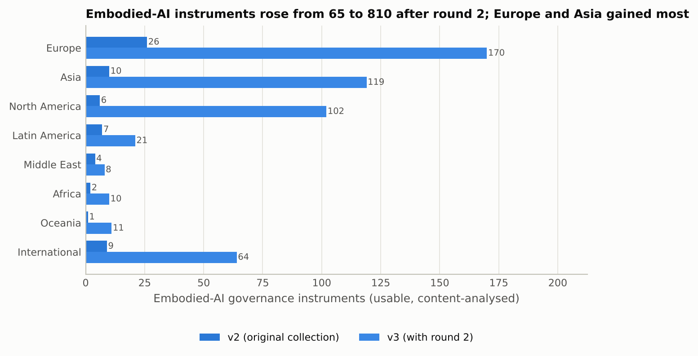

<em class="cap">Figure 51. Embodied-AI governance instruments by jurisdiction region, v2 (original collection) versus v3 (with round 2).</em>

Table 53 compares the collection before and after round 2 on the unit the two versions share, every legal text of instrument class. Embodied-AI instruments went from 65 to 810, robot-specific instruments from 34 to 699, binding embodied instruments from 5 to 291 (robot-specific and binding from 4 to 254), soft-law instruments from 50 to 411, drafts from 10 to 108 and government reports from 24 to 97; jurisdictions with an embodied instrument went from 30 to 60. The general-AI set grew from 806 to 1,015 and the research literature by one paper. Table 54 and Figure 51 give the additions by region and Table 55 by robot group, with the v4 column on the principal unit (505 principal instruments; 195 binding): Europe 26 to 170 (binding 1 to 63), Asia 10 to 119 (0 to 32), North America 6 to 102 (1 to 65), the international layer 9 to 64 (0 to 5), Oceania 1 to 11 (0 to 7); vehicles and field machines absorbed most of it (48 to 389 instruments, binding 5 to 174) and humanoids none of the binding layer (9 to 20 instruments, 0 binding).

These ratios are consequences of collection design, not findings about the world. Round 1 asked regional teams to search the web for material about embodied AI; round 2 queried legal databases for instruments that name the machines. The binding share among settled embodied instruments (286 legally binding, 236 voluntary, 254 standards against 79, 258 and 20 in the general set; Cramér's V 0.41) and the doubling of jurisdictions follow from that choice and are reported here rather than in the findings. The order-of-magnitude change is nevertheless the study's clearest methodological result: within the instrument genre, the embodied side is now 444 of 505 round-2 (88%) and the general side 127 of 372 (34%; Table 20b); round-2 texts are shorter (median about 850 words against about 2,650 for round 1, master table), 254 of the 1,626 usable round-2 documents are landing pages and 379 are in Chinese, Japanese or Korean, so every pooled embodied-versus-general contrast is also a round-1-versus-round-2 contrast. Parts C and E therefore place each pooled result next to its within-round or within-genre version and say which survives.

## 4. Counting units and constructs

*Table 53b. How many instruments reach robots depends on the counting unit and the construct: the same collection under successively stricter definitions (v4)*

| tier                                                                                                                                  |   count |
|:--------------------------------------------------------------------------------------------------------------------------------------|--------:|
| All legal texts of instrument class, embodied-AI set                                                                                  |     810 |
| Principal instruments (amendments kept; commencement, levy, exemption, incorporation, corrigenda, stubs and catalogue pages excluded) |     505 |
| Principal instruments rated robot-relevant (relevance 2 or 3)                                                                         |     408 |
| Principal embodied instruments whose text contains autonomy or AI provisions                                                          |     395 |
| Principal embodied instruments whose text names AI explicitly                                                                         |     153 |
| Binding legal texts, embodied-AI set                                                                                                  |     291 |
| Principal binding instruments, embodied-AI set                                                                                        |     195 |
| Principal binding instruments rated robot-relevant (relevance 2 or 3)                                                                 |     168 |
| Principal binding instruments counted once per instrument family                                                                      |     194 |
| Principal binding instruments with autonomy or AI provisions in the text                                                              |     140 |
| Principal binding instruments naming AI explicitly                                                                                    |      15 |

How many instruments reach robots depends on what is counted. Table 53b gives the same collection under successively stricter units. Every legal text in the embodied set: 810. Principal instruments (amendments kept; commencement orders, levies, exemptions, incorporation decisions, corrigenda, stubs and catalogue pages excluded): 505. Principal instruments rated robot-relevant: 408. Principal instruments whose text contains autonomy or AI provisions: 395; naming AI explicitly: 153. For binding law: 291 texts, 195 principal instruments, 168 robot-relevant, 194 once per instrument family, 140 with autonomy or AI provisions and 15 naming AI explicitly. The excluded texts are not errors of the collection but of the unit (master table, `instrument_unit`): among the 810 embodied legal texts, 222 are catalogue or landing pages (191 of them technical standards captured as catalogue entries), 42 are amendments (kept), 35 are stubs under 150 words, 30 are ancillary instruments (commencement orders, levies, exemptions, approvals, directions), 10 dependent parts, 6 EEA incorporation decisions and 2 language corrigenda; among the 291 binding texts, 28 are ancillary, 25 stubs, 28 catalogue pages, 7 dependent parts, 6 incorporation decisions and 2 corrigenda. Australia is the clearest case: 47 embodied legal texts on the comparable unit, 6 principal instruments, because the Federal Register harvest returned register entries for individual CASA exemptions, directions, area approvals and levy instruments (Table 4).

*Table 62. Independent precision audit of 100 randomly sampled v3 binding embodied instruments versus the v4 rule-based counting unit, on the same documents (Wilson 95% intervals)*

| criterion                                                | audit_share    | rule_share     |   agreement |   kappa |   rule_passes_audit_fails |   audit_passes_rule_fails |
|:---------------------------------------------------------|:---------------|:---------------|------------:|--------:|--------------------------:|--------------------------:|
| distinct instrument (audit a)                            | 67% (57 to 75) | 74% (65 to 82) |        0.79 |    0.5  |                        14 |                         7 |
| distinct, binding and embodied-substantive (audit a+b+c) | 54% (44 to 63) | 61% (51 to 70) |        0.77 |    0.53 |                        15 |                         8 |
| a+b+c and autonomy/AI provision (audit a+b+c+d)          | 53% (43 to 62) | 46% (37 to 56) |        0.71 |    0.42 |                        11 |                        18 |

The rule-based unit was checked against an independent reading. The auditor's random sample of 100 of the 299 v3 binding embodied texts found 67% to be distinct instruments (Wilson 57 to 75), 97% binding, 56% to contain substantive embodied provisions (46 to 65), 67% to contain autonomy or AI content and 14% to name AI explicitly (9 to 22); 54% passed the three criteria of distinct, binding and substantive together (44 to 63), which implies about 161 such instruments (132 to 190) in the v3 set of 299. On the same 100 documents the v4 rules keep 61% (51 to 70) as principal binding instruments; agreement with the auditor is 77% (kappa 0.53), with 15 documents the rules keep and the auditor rejects and 8 the auditor keeps and the rules exclude (Table 62). The rules therefore remove most but not all of the inflation: the v4 counts of 195 and 168 should be read as upper bounds on the number of distinct, binding, substantive instruments, with the audit's 161 (132 to 190) as the independent estimate for the v3 population. The eight counting-unit rules the auditor proposed, and which of them v4 implements, are in supplement S13.

*Table 33. Embodied-AI governance instruments by tier and capture quality (n=505; 'fraction seen' is the share of the text inside the v1 excerpt)*

| tier                                                           | doc_class           |   n |   substantive |   partial |   landing |   median_fraction_seen |
|:---------------------------------------------------------------|:--------------------|----:|--------------:|----------:|----------:|-----------------------:|
| general-AI instrument with embodied provisions (relevance 0-1) | Binding instrument  |  27 |            22 |         5 |         0 |                   0.09 |
| general-AI instrument with embodied provisions (relevance 0-1) | Soft-law instrument |  64 |            63 |         1 |         0 |                   0.51 |
| general-AI instrument with embodied provisions (relevance 0-1) | Proposal or draft   |   6 |             6 |         0 |         0 |                   0.33 |
| robot-specific instrument (relevance 2-3)                      | Binding instrument  | 168 |           153 |        15 |         0 |                   0.56 |
| robot-specific instrument (relevance 2-3)                      | Soft-law instrument | 176 |           112 |        64 |         0 |                   1    |
| robot-specific instrument (relevance 2-3)                      | Proposal or draft   |  64 |            48 |        16 |         0 |                   1    |

Table 33 splits the 505 principal instruments by relevance tier and capture quality. The 408 robot-relevant instruments are 168 binding (153 substantive captures, 15 partial), 176 soft-law instruments and standards (112 substantive, 64 partial) and 64 drafts; the 97 instruments with embodied provisions (27 binding, 64 soft-law, 6 drafts) are mostly sector or general law in which robots appear as an example, a list entry or a scope clause, and only a few are AI instruments in the ordinary sense (the AI Act, its Digital Omnibus amendment, the two US executive orders). No landing page remains in the principal unit. The median share of a text that the annotation excerpt covered is 0.56 for robot-relevant binding instruments and 0.09 for binding instruments with embodied provisions, which are long consolidated statutes: the labels of the longest texts rest on the first 100,000 characters plus two short slices, and a full-text pass is listed as future work.

## 5. Part A. The document landscape

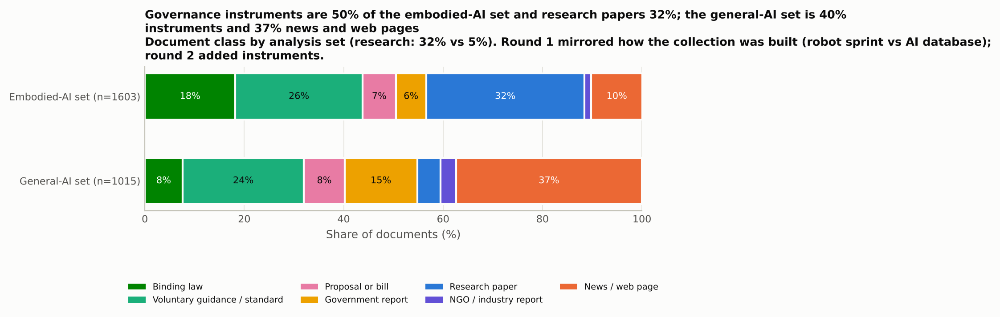

<em class="cap">Figure 01. Document classes in the embodied-AI set and the general-AI set, usable documents only (n in the axis labels).</em>

The embodied-AI set is half legal texts (810 of 1,603) and a third research papers (509), with news and web pages (165), drafts (108), government reports (97) and grey literature (22) making up the rest; its issuers are academic (516) but also national executives (276), standards bodies (228), intergovernmental bodies (217), regulators (179) and legislatures (91). The general-AI set is 37% news, web pages and press releases (380 of 1,015), 24% soft-law instruments (248) and 15% government reports (148), with 48 research papers; its issuers are intergovernmental bodies (382), national executives (323), regulators (121) and legislatures (62). The split mirrors the collection design: round 1's robot sprint drew on academic literature and its database on official sources, and round 2 added legal texts almost exclusively (745 of the 810 embodied legal texts and 444 of the 505 principal instruments are round-2 captures), which is why every comparison in Parts C and D is made within genre, within round or adjusted for both.

*Table 01. Document types by analysis set (usable documents)*

| doc_type                                       |   Embodied-AI set |   General-AI set |   Other |   total |
|:-----------------------------------------------|------------------:|-----------------:|--------:|--------:|
| Regulation or decree                           |               209 |               60 |     299 |     568 |
| Web page informational                         |               116 |              234 |      27 |     377 |
| Journal article                                |               246 |               32 |      10 |     288 |
| Technical standard                             |               254 |               21 |       8 |     283 |
| Policy guideline or code of practice           |                84 |               83 |      70 |     237 |
| National strategy or action plan               |                89 |               85 |      22 |     196 |
| Government report or review                    |                57 |              116 |       9 |     182 |
| Press release or government news               |                32 |              126 |       2 |     160 |
| Statute or act                                 |                71 |               12 |      34 |     117 |
| Conference paper                               |               105 |                4 |       3 |     112 |
| Bill or draft law                              |                36 |               40 |      27 |     103 |
| Intergovernmental recommendation or resolution |                27 |               39 |      14 |      80 |
| Consultation or white paper                    |                38 |               38 |       0 |      76 |
| Parliamentary material                         |                30 |               33 |       4 |      67 |
| Preprint or working paper                      |                47 |                3 |       3 |      53 |
| Industry or ngo report                         |                19 |               30 |       1 |      50 |
| Book or chapter                                |                42 |                1 |       2 |      45 |
| Editorial or commentary                        |                35 |                4 |       6 |      45 |
| Ethical framework or principles                |                 8 |               15 |       0 |      23 |
| Review or survey article                       |                21 |                1 |       0 |      22 |
| Blog or opinion                                |                10 |               12 |       0 |      22 |
| Thesis or dissertation                         |                12 |                3 |       0 |      15 |
| News article                                   |                 8 |                4 |       0 |      12 |
| Procurement or internal policy                 |                 0 |                8 |       4 |      12 |
| Other                                          |                 3 |                6 |       1 |      10 |
| Court decision or judicial notice              |                 3 |                4 |       1 |       8 |
| International treaty or convention             |                 1 |                1 |       0 |       2 |

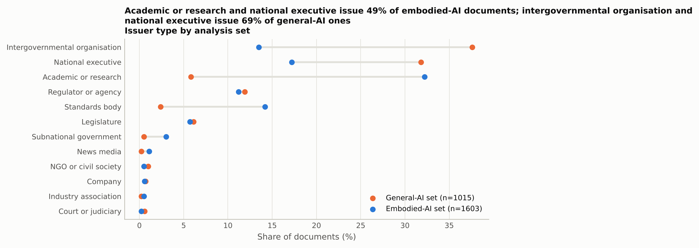

<em class="cap">Figure 03. Issuer types by set.</em>

Regulators and agencies issue 179 embodied documents and 121 general-AI ones; legislatures 91 and 62; standards bodies 228 and 24. In the original collection the institutions that apply robot rules were present mainly as authors of general-AI rules; after round 2 they are present as authors of robot rules.

### 5.1 Instruments: lifecycle and binding nature

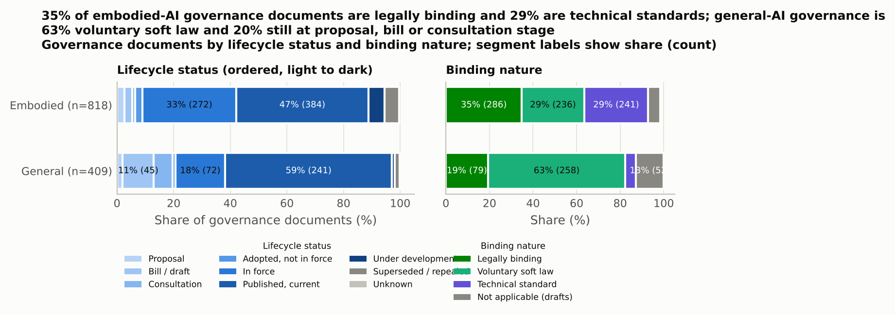

<em class="cap">Figure 04. Governance documents: lifecycle status (left) and binding nature (right), embodied-AI set vs general-AI set (n in the axis labels).</em>

*Table 02. Governance documents: lifecycle status by binding nature and set*

| setname         | instrument_status                 |   legally_binding |   not_applicable |   technical_standard_mandated |   technical_standard_voluntary |   voluntary_soft_law |
|:----------------|:----------------------------------|------------------:|-----------------:|------------------------------:|-------------------------------:|---------------------:|
| Embodied-AI set | adopted_not_yet_in_force          |                 5 |                0 |                             8 |                              7 |                    1 |
| Embodied-AI set | consultation_open                 |                 0 |                3 |                             0 |                              0 |                    5 |
| Embodied-AI set | draft_or_bill_under_consideration |                 0 |               22 |                             0 |                              0 |                    1 |
| Embodied-AI set | in_force                          |               260 |                0 |                             5 |                              0 |                    7 |
| Embodied-AI set | proposal_or_concept               |                 0 |                5 |                             0 |                              0 |                   16 |
| Embodied-AI set | published_current                 |                 1 |                1 |                             0 |                            179 |                  203 |
| Embodied-AI set | superseded_or_repealed            |                20 |               11 |                             0 |                              8 |                    3 |
| Embodied-AI set | under_development                 |                 0 |                0 |                             0 |                             47 |                    0 |
| Embodied-AI set | withdrawn_or_lapsed               |                 0 |                4 |                             0 |                              0 |                    0 |
| General-AI set  | adopted_not_yet_in_force          |                 4 |                0 |                             0 |                              0 |                    0 |
| General-AI set  | consultation_open                 |                 0 |                9 |                             0 |                              0 |                   18 |
| General-AI set  | draft_or_bill_under_consideration |                 0 |               38 |                             0 |                              0 |                    7 |
| General-AI set  | in_force                          |                69 |                0 |                             0 |                              0 |                    3 |
| General-AI set  | proposal_or_concept               |                 0 |                1 |                             0 |                              0 |                    7 |
| General-AI set  | published_current                 |                 1 |                1 |                             0 |                             16 |                  223 |
| General-AI set  | superseded_or_repealed            |                 4 |                3 |                             0 |                              0 |                    0 |
| General-AI set  | under_development                 |                 0 |                0 |                             0 |                              4 |                    0 |
| General-AI set  | unknown                           |                 1 |                0 |                             0 |                              0 |                    0 |
| Other           | adopted_not_yet_in_force          |                19 |                0 |                             0 |                              0 |                    0 |
| Other           | draft_or_bill_under_consideration |                 0 |               21 |                             0 |                              0 |                    0 |
| Other           | in_force                          |               253 |                0 |                             0 |                              0 |                    3 |
| Other           | published_current                 |                 0 |                2 |                             0 |                              8 |                  102 |
| Other           | superseded_or_repealed            |                63 |                5 |                             0 |                              0 |                    1 |
| Other           | withdrawn_or_lapsed               |                 0 |                1 |                             0 |                              0 |                    0 |

Of the 822 documents in the embodied set that carry the governance flag, 384 are published and current, 272 in force, 42 superseded, 47 under development (standards in preparation), 23 bills, 21 proposals, 21 adopted but not yet in force, 8 open consultations and 4 lapsed; by binding nature 286 are legally binding, 241 voluntary technical standards, 236 voluntary soft law, 13 mandatory standards and 46 have no binding nature yet. The general-AI governance documents (409) are more legislative in their pending items (45 bills, 27 open consultations) and far less binding in their settled ones (72 in force; 258 voluntary, 79 binding). The embodied set's higher binding share (Cramér's V 0.41 on the 2 by 3 table of binding, voluntary and standard; Section 3) is what round 2 was designed to find and is not a finding about anyone's propensity to legislate.

*Table 33b. Binding instruments in the embodied-AI set after corrections, with relevance tier and capture quality*

| doc_id      | title_en                                                                                             | jurisdiction_country   |   year_final | instrument_status        |   relevance | page_quality         | embodied_categories                                                                                                                                                          |
|:------------|:-----------------------------------------------------------------------------------------------------|:-----------------------|-------------:|:-------------------------|------------:|:---------------------|:-----------------------------------------------------------------------------------------------------------------------------------------------------------------------------|
| D0005       | Robotic Technologies Law (Decree No. 340)                                                            | SV                     |         2025 | in_force                 |           3 | substantive_document | professional_service_robots; care_assistive_robots; mobile_industrial_logistics; autonomous_road_vehicles; collaborative_robots; industrial_manipulators; educational_robots |
| D0016       | Resolution 710/2024 - Creation of the Unit of Artificial Intelligence Applied to Security (UIAAS)    | AR                     |         2024 | in_force                 |           2 | substantive_document | drones_uas; security_policing_robots                                                                                                                                         |
| D0228       | Law No. (9) of 2023 Regulating the Operation of Autonomous Vehicles in the Emirate of Dubai          | AE                     |         2023 | in_force                 |           3 | substantive_document | autonomous_road_vehicles                                                                                                                                                     |
| D0915       | Executive Order on the Safe, Secure, and Trustworthy Development and Use of Artificial Intelligence  | US                     |         2023 | superseded_or_repealed   |           1 | substantive_document | autonomous_road_vehicles; surgical_medical_robots                                                                                                                            |
| D1291       | Regulation (EU) 2024/1689 laying down harmonised rules on artificial intelligence (Artificial Intell | EU                     |         2024 | in_force                 |           2 | substantive_document | autonomous_road_vehicles; drones_uas; surgical_medical_robots; care_assistive_robots; industrial_manipulators                                                                |
| R2-82f8813a | Civil Aviation Regulations 2016                                                                      | MY                     |         2016 | in_force                 |           1 | substantive_document | drones_uas                                                                                                                                                                   |
| R2-d2567eac | Civil Aviation Directive 6011 Part (I) – Unmanned Aircraft System Remote Pilot Training Organisation | MY                     |         2022 | in_force                 |           2 | substantive_document | drones_uas; agricultural_robots                                                                                                                                              |
| R2-723e3d80 | Civil Aviation Directive 6011 Part (II) – Unmanned Aircraft System Agricultural UAS Operations       | MY                     |         2022 | in_force                 |           3 | substantive_document | drones_uas; agricultural_robots                                                                                                                                              |
| R2-1617d407 | Civil Aviation Directive 6011 Part (V) – Unmanned Aircraft System Special UAS Project                | MY                     |         2022 | in_force                 |           3 | substantive_document | drones_uas                                                                                                                                                                   |
| R2-0ea46a4c | Decree No. 288/2025/ND-CP providing the management of unmanned aircraft and other aerial vehicles    | VN                     |         2025 | in_force                 |           2 | substantive_document | drones_uas                                                                                                                                                                   |
| R2-d0d19353 | Law on People's Air Defense No. 49/2024/QH15                                                         | VN                     |         2024 | in_force                 |           2 | substantive_document | drones_uas; military_autonomous_weapons                                                                                                                                      |
| R2-f67080c2 | Standards Document: Operation of Aircraft – Part IV – International Operations (Remotely Piloted Air | FJ                     |         2025 | in_force                 |           3 | substantive_document | drones_uas                                                                                                                                                                   |
| R2-5de2dafe | Civil Aviation Rules Part 102 — Unmanned Aircraft and Remotely Piloted Aircraft Systems              | PG                     |         2025 | in_force                 |           2 | substantive_document | drones_uas                                                                                                                                                                   |
| R2-c5eb5314 | Civil Aviation Safety Regulations 1998                                                               | AU                     |         1998 | in_force                 |           2 | partial_or_excerpt   | drones_uas                                                                                                                                                                   |
| R2-873de2ab | Part 101 (Unmanned Aircraft and Rockets) Manual of Standards 2019                                    | AU                     |         2019 | in_force                 |           2 | partial_or_excerpt   | drones_uas                                                                                                                                                                   |
| R2-ab6b4f47 | Civil Aviation Safety Amendment (Remotely Piloted Aircraft and Model Aircraft—Registration and Accre | AU                     |         2019 | in_force                 |           2 | partial_or_excerpt   | drones_uas                                                                                                                                                                   |
| R2-295bf91b | Air Navigation (Aircraft Noise) Regulations 2018                                                     | AU                     |         2018 | in_force                 |           1 | partial_or_excerpt   | drones_uas                                                                                                                                                                   |
| R2-35fea8b3 | Part 101 Gyrogliders and Parasails, Unmanned Aircraft (including Balloons), Kites, and Rockets - Ope | NZ                     |         2025 | in_force                 |           2 | partial_or_excerpt   | drones_uas; other_embodied                                                                                                                                                   |
| R2-2b0fd47f | Part 774—The Commerce Control List (15 CFR Part 774, including Supplement No. 1)                     | US                     |         2026 | in_force                 |           1 | partial_or_excerpt   | military_autonomous_weapons                                                                                                                                                  |
| R2-675a9e05 | 15 CFR Part 742—Control Policy—CCL Based Controls                                                    | US                     |         2026 | in_force                 |           1 | substantive_document | drones_uas; military_autonomous_weapons; space_or_extreme_environment                                                                                                        |
| R2-8a885ff8 | Part 596—Automatic Emergency Braking Test Devices                                                    | US                     |         2024 | in_force                 |           2 | substantive_document | autonomous_road_vehicles                                                                                                                                                     |
| R2-e589d498 | 14 CFR Part 47—Aircraft Registration                                                                 | US                     |         2025 | in_force                 |           1 | substantive_document | drones_uas                                                                                                                                                                   |
| R2-c5427e07 | Part 107—Small Unmanned Aircraft Systems (14 CFR)                                                    | US                     |         2021 | in_force                 |           3 | substantive_document | drones_uas                                                                                                                                                                   |
| R2-459e8712 | Part 89—Remote Identification of Unmanned Aircraft                                                   | US                     |         2021 | in_force                 |           2 | substantive_document | drones_uas                                                                                                                                                                   |
| R2-f3b175ef | Part 48—Registration and Marking Requirements for Small Unmanned Aircraft                            | US                     |         2021 | in_force                 |           2 | substantive_document | drones_uas                                                                                                                                                                   |
| R2-0d0ca0f5 | PART 124—COUNTER-UNMANNED AIRCRAFT SYSTEM AUTHORITY FOR STATE, LOCAL, TRIBAL, AND TERRITORIAL LAW EN | US                     |         2026 | in_force                 |           2 | substantive_document | drones_uas; security_policing_robots                                                                                                                                         |
| R2-022998ee | FAR Part 40—Information Security and Supply Chain Security (Subpart 40.2 Security Prohibitions and E | US                     |         2024 | in_force                 |           2 | substantive_document | drones_uas                                                                                                                                                                   |
| R2-12e32782 | Part 102-33—Management of Government Aircraft                                                        | US                     |         2025 | in_force                 |           1 | substantive_document | drones_uas                                                                                                                                                                   |
| R2-9c282a09 | 49 CFR Part 830—Notification and Reporting of Aircraft Accidents or Incidents and Overdue Aircraft,  | US                     |         2022 | in_force                 |           2 | substantive_document | drones_uas                                                                                                                                                                   |
| R2-f9c66a43 | 15 CFR Part 791—Securing the Information and Communications Technology and Services Supply Chain (in | US                     |         2025 | in_force                 |           2 | substantive_document | autonomous_road_vehicles; drones_uas                                                                                                                                         |
| R2-ddd7d9c2 | Commission Implementing Regulation (EU) 2019/947 of 24 May 2019 on the rules and procedures for the  | EU                     |         2019 | in_force                 |           3 | substantive_document | drones_uas                                                                                                                                                                   |
| R2-6c14c9c2 | Commission Delegated Regulation (EU) 2019/945 on unmanned aircraft systems and on third-country oper | EU                     |         2019 | in_force                 |           3 | substantive_document | drones_uas                                                                                                                                                                   |
| R2-b0d4346b | Commission Delegated Regulation (EU) 2024/1107 laying down detailed rules for the continuing airwort | EU                     |         2024 | in_force                 |           2 | substantive_document | drones_uas                                                                                                                                                                   |
| R2-0383c9ff | Commission Delegated Regulation (EU) 2024/1108 of 13 March 2024 amending Regulation (EU) No 748/2012 | EU                     |         2024 | in_force                 |           2 | substantive_document | drones_uas                                                                                                                                                                   |
| R2-d85d64e1 | Commission Implementing Regulation (EU) 2024/1109 on competent authority requirements and administra | EU                     |         2024 | in_force                 |           2 | substantive_document | drones_uas                                                                                                                                                                   |
| R2-b4af497c | Commission Implementing Regulation (EU) 2022/425 of 14 March 2022 amending Implementing Regulation ( | EU                     |         2022 | in_force                 |           2 | substantive_document | drones_uas                                                                                                                                                                   |
| R2-a283b42e | Commission Implementing Regulation (EU) 2024/1110 amending Regulation (EU) No 748/2012 as regards th | EU                     |         2024 | in_force                 |           3 | substantive_document | drones_uas                                                                                                                                                                   |
| R2-77acbca3 | Commission Implementing Decision (EU) 2024/2103 of 30 July 2024 on harmonised standard for direct re | EU                     |         2024 | in_force                 |           2 | substantive_document | drones_uas                                                                                                                                                                   |
| R2-c5c7a0a6 | Commission Implementing Regulation (EU) 2026/1821 amending Implementing Regulation (EU) 2015/1018 as | EU                     |         2026 | adopted_not_yet_in_force |           2 | substantive_document | drones_uas                                                                                                                                                                   |
| R2-e039001f | Commission Implementing Regulation (EU) 2022/1426 of 5 August 2022 laying down rules for the applica | EU                     |         2022 | in_force                 |           3 | substantive_document | autonomous_road_vehicles                                                                                                                                                     |
| R2-c47d3176 | Commission Implementing Regulation (EU) 2026/481 of 3 March 2026 amending Implementing Regulation (E | EU                     |         2026 | in_force                 |           3 | substantive_document | autonomous_road_vehicles                                                                                                                                                     |
| R2-984ee7c4 | Commission Delegated Regulation (EU) 2022/2236 amending Annexes I, II, IV and V to Regulation (EU) 2 | EU                     |         2022 | in_force                 |           2 | substantive_document | autonomous_road_vehicles                                                                                                                                                     |
| R2-80171de4 | Directive 2006/42/EC of the European Parliament and of the Council of 17 May 2006 on machinery, and  | EU                     |         2006 | in_force                 |           2 | substantive_document | industrial_manipulators; collaborative_robots; mobile_industrial_logistics                                                                                                   |
| R2-6db84260 | Commission Implementing Decision (EU) 2020/480 of 1 April 2020 amending Implementing Decision (EU) 2 | EU                     |         2020 | in_force                 |           2 | substantive_document | agricultural_robots; mobile_industrial_logistics                                                                                                                             |
| R2-885d8000 | Commission Implementing Decision (EU) 2024/1329 of 13 May 2024 amending and correcting Implementing  | EU                     |         2024 | in_force                 |           2 | substantive_document | mobile_industrial_logistics; agricultural_robots; industrial_manipulators                                                                                                    |
| R2-7bb2229f | Regulation (EU) 2023/1230 on machinery and repealing Directive 2006/42/EC and Council Directive 73/3 | EU                     |         2023 | in_force                 |           3 | substantive_document | industrial_manipulators; collaborative_robots; mobile_industrial_logistics; professional_service_robots; other_embodied                                                      |
| R2-98aa0eab | Regulation (EU) 2025/14 on the approval and market surveillance of non-road mobile machinery circula | EU                     |         2025 | in_force                 |           2 | substantive_document | other_embodied                                                                                                                                                               |
| R2-710c5344 | Commission Implementing Decision (EU) 2026/2015 of 4 September 2026 amending and repealing Commissio | EU                     |         2026 | in_force                 |           2 | substantive_document | industrial_manipulators; mobile_industrial_logistics; agricultural_robots                                                                                                    |
| R2-833ba7e9 | Council Directive 93/42/EEC of 14 June 1993 concerning medical devices                               | EU                     |         1993 | superseded_or_repealed   |           1 | substantive_document | surgical_medical_robots                                                                                                                                                      |
| R2-87faf76a | Regulation (EU) 2017/745 of the European Parliament and of the Council of 5 April 2017 on medical de | EU                     |         2017 | in_force                 |           1 | substantive_document | surgical_medical_robots; rehabilitation_exoskeleton_prosthetic                                                                                                               |
| R2-80ec293b | Commission Regulation (EU) 2015/562 of 8 April 2015 amending Regulation (EU) No 347/2012 with regard | EU                     |         2015 | in_force                 |           2 | substantive_document | autonomous_road_vehicles                                                                                                                                                     |
| R2-d37cc122 | Commission Implementing Regulation (EU) 2021/666 of 22 April 2021 amending Regulation (EU) No 923/20 | EU                     |         2021 | in_force                 |           2 | substantive_document | drones_uas                                                                                                                                                                   |
| R2-14ad2059 | Commission Implementing Regulation (EU) 2021/665 amending Implementing Regulation (EU) 2017/373 as r | EU                     |         2021 | in_force                 |           2 | substantive_document | drones_uas                                                                                                                                                                   |
| R2-210faac2 | Commission Implementing Regulation (EU) 2021/664 of 22 April 2021 on a regulatory framework for the  | EU                     |         2021 | in_force                 |           2 | substantive_document | drones_uas                                                                                                                                                                   |
| R2-34d7721c | Commission Regulation (EU) 2019/543 of 3 April 2019 amending Annex IV to Regulation (EC) No 661/2009 | EU                     |         2019 | in_force                 |           1 | substantive_document | autonomous_road_vehicles                                                                                                                                                     |
| R2-2b891013 | Commission Delegated Regulation (EU) 2021/1341 on type-approval of motor vehicles with regard to dri | EU                     |         2021 | in_force                 |           2 | substantive_document | autonomous_road_vehicles                                                                                                                                                     |
| R2-11555522 | Commission Delegated Regulation (EU) 2022/545 on type-approval of motor vehicles with regard to thei | EU                     |         2022 | in_force                 |           1 | substantive_document | autonomous_road_vehicles                                                                                                                                                     |
| R2-457d18eb | Commission Implementing Regulation (EU) 2021/646 on type-approval of motor vehicles with regard to t | EU                     |         2021 | in_force                 |           2 | substantive_document | autonomous_road_vehicles                                                                                                                                                     |
| R2-b6c5f44e | Commission Delegated Regulation (EU) 2021/1958 laying down test procedures and technical requirement | EU                     |         2021 | in_force                 |           2 | substantive_document | autonomous_road_vehicles                                                                                                                                                     |
| R2-ada72e0e | Commission Implementing Regulation (EU) 2020/746 of 4 June 2020 amending Implementing Regulation (EU | EU                     |         2020 | in_force                 |           2 | substantive_document | drones_uas                                                                                                                                                                   |
| R2-3e221bc0 | Commission Implementing Regulation (EU) 2021/1166 of 15 July 2021 amending Implementing Regulation ( | EU                     |         2021 | in_force                 |           2 | substantive_document | drones_uas                                                                                                                                                                   |
| R2-9c6e8103 | Commission Implementing Regulation (EU) 2020/639 of 12 May 2020 amending Implementing Regulation (EU | EU                     |         2020 | in_force                 |           2 | substantive_document | drones_uas                                                                                                                                                                   |
| R2-0c29bfda | Regulation (EU) 2026/1744 amending Regulations (EU) 2024/1689, (EU) 2018/1139 and (EU) 2023/1230 as  | EU                     |         2026 | in_force                 |           2 | substantive_document | industrial_manipulators; collaborative_robots; surgical_medical_robots; drones_uas; autonomous_road_vehicles                                                                 |
| R2-2e97da82 | Interim Regulations on the Administration of Unmanned Aircraft Flights                               | CN                     |         2023 | in_force                 |           3 | substantive_document | drones_uas; agricultural_robots                                                                                                                                              |
| R2-118bce75 | Road Traffic Act                                                                                     | JP                     |         1960 | in_force                 |           2 | substantive_document | autonomous_road_vehicles; delivery_robots                                                                                                                                    |
| R2-2f6acdc5 | Road Traffic Act Enforcement Order                                                                   | JP                     |         1960 | in_force                 |           2 | partial_or_excerpt   | autonomous_road_vehicles; delivery_robots                                                                                                                                    |
| R2-47723d4c | Civil Aeronautics Act (Aviation Act) of Japan                                                        | JP                     |         1952 | in_force                 |           2 | substantive_document | drones_uas                                                                                                                                                                   |
| R2-16343b99 | Road Traffic Act Enforcement Regulations                                                             | JP                     |         1960 | in_force                 |           2 | substantive_document | autonomous_road_vehicles; delivery_robots                                                                                                                                    |
| R2-dd7f8d70 | Order on Road Signs, Lane Markings and Road Markings                                                 | JP                     |         2026 | in_force                 |           1 | substantive_document | delivery_robots                                                                                                                                                              |
| R2-f57251ed | Ordinance on Industrial Safety and Health                                                            | JP                     |         1972 | in_force                 |           2 | partial_or_excerpt   | industrial_manipulators; mobile_industrial_logistics; collaborative_robots                                                                                                   |
| R2-31fbdf75 | Ordinance for Enforcement of the Act on Efficiency of Distribution of Goods                          | JP                     |         2005 | in_force                 |           1 | substantive_document | mobile_industrial_logistics; industrial_manipulators                                                                                                                         |
| R2-15dba33a | Road Act Enforcement Regulations                                                                     | JP                     |         2026 | in_force                 |           1 | substantive_document | autonomous_road_vehicles                                                                                                                                                     |
| R2-431b7f3a | Ministerial Ordinance Establishing Technical Standards for Railways                                  | JP                     |         2001 | in_force                 |           1 | substantive_document | autonomous_maritime_or_rail                                                                                                                                                  |
| R2-d3b0fc1c | Act on Special Measures for the Reconstruction and Revitalization of Fukushima                       | JP                     |         2012 | in_force                 |           1 | partial_or_excerpt   | space_or_extreme_environment                                                                                                                                                 |
| R2-7d33c29c | National Strategic Special Zones Act                                                                 | JP                     |         2013 | in_force                 |           2 | partial_or_excerpt   | autonomous_road_vehicles; drones_uas                                                                                                                                         |
| R2-03e6e0ff | Cabinet Office Ordinance Specifying Demonstration Projects etc. under Article 25-2 of the National S | JP                     |         2020 | in_force                 |           2 | substantive_document | autonomous_road_vehicles; drones_uas                                                                                                                                         |
| R2-ee6d92ca | Remote Islands Development Act                                                                       | JP                     |         1953 | in_force                 |           1 | substantive_document | care_assistive_robots; drones_uas                                                                                                                                            |
| R2-59a29a12 | Ordinance for Enforcement of the National Strategic Special Zones Act                                | JP                     |         2014 | in_force                 |           1 | substantive_document | surgical_medical_robots; care_assistive_robots                                                                                                                               |
| R2-3ce1939d | Road Vehicles Act (Act on Road Transport Vehicles)                                                   | JP                     |         1951 | in_force                 |           2 | substantive_document | autonomous_road_vehicles                                                                                                                                                     |
| R2-fad4ccaf | Enforcement Regulation of the Road Vehicles Act                                                      | JP                     |         1951 | in_force                 |           2 | partial_or_excerpt   | autonomous_road_vehicles                                                                                                                                                     |
| R2-46f20dd6 | Passenger Motor Vehicle Transport Business Transport Regulations                                     | JP                     |         2026 | in_force                 |           2 | substantive_document | autonomous_road_vehicles                                                                                                                                                     |
| R2-f47247d3 | Enforcement Regulations of the Freight Forwarding Business Act                                       | JP                     |         1990 | in_force                 |           1 | substantive_document | autonomous_road_vehicles                                                                                                                                                     |
| R2-fe102091 | Enforcement Regulations of the Motor Truck Transportation Business Act                               | JP                     |         1990 | in_force                 |           1 | substantive_document | autonomous_road_vehicles                                                                                                                                                     |
| R2-aa8d88b9 | Ordinance on Transport Safety in the Freight Motor Vehicle Transportation Business                   | JP                     |         1990 | in_force                 |           2 | substantive_document | autonomous_road_vehicles                                                                                                                                                     |
| R2-2b6aea0b | Ordinance on Type Designation of Devices (Road Vehicle Equipment)                                    | JP                     |         1998 | in_force                 |           2 | substantive_document | autonomous_road_vehicles                                                                                                                                                     |
| R2-ce2171ab | Ordinance for Enforcement of the National Strategic Special Zones Act (MLIT-related)                 | JP                     |         2014 | in_force                 |           1 | substantive_document | autonomous_road_vehicles                                                                                                                                                     |
| R2-d97f5421 | Automated Vehicles Act 2024                                                                          | GB                     |         2024 | in_force                 |           3 | substantive_document | autonomous_road_vehicles                                                                                                                                                     |
| R2-5a3159c0 | The Automated Vehicles (Marketing Restrictions) Regulations 2026                                     | GB                     |         2026 | adopted_not_yet_in_force |           3 | substantive_document | autonomous_road_vehicles                                                                                                                                                     |
| R2-6140944d | The Road Vehicles (Construction and Use) (Automated Vehicles) Order 2022                             | GB                     |         2022 | in_force                 |           3 | substantive_document | autonomous_road_vehicles                                                                                                                                                     |
| R2-4ef7d8d3 | Air Traffic Management and Unmanned Aircraft Act 2021                                                | GB                     |         2021 | in_force                 |           2 | substantive_document | drones_uas                                                                                                                                                                   |
| R2-fbfa4dd7 | The Unmanned Aircraft (Market Surveillance Authority) Regulations 2025                               | GB                     |         2025 | in_force                 |           2 | substantive_document | drones_uas                                                                                                                                                                   |
| R2-2abf00a7 | The Unmanned Aircraft (Amendment) (EU Exit) Regulations 2020                                         | GB                     |         2020 | in_force                 |           2 | substantive_document | drones_uas                                                                                                                                                                   |
| R2-0322d77f | The Air Navigation (Minimum Age for Operators of Small Unmanned Aircraft) Regulations 2019           | GB                     |         2019 | in_force                 |           2 | substantive_document | drones_uas                                                                                                                                                                   |
| R2-5e3b65c9 | Beijing Municipal Measures for Safety Assessment of Autonomous Vehicles (Trial)                      | CN                     |         2025 | in_force                 |           3 | substantive_document | autonomous_road_vehicles                                                                                                                                                     |
| R2-e53e2440 | Beijing Measures for Safety Inspection of Pilot Vehicles in Autonomous Vehicle Road Application (Tri | CN                     |         2025 | in_force                 |           3 | substantive_document | autonomous_road_vehicles                                                                                                                                                     |
| R2-2344fe88 | Notice of the General Office of the Hunan Provincial People's Government on Issuing Several Policy M | CN                     |         2024 | in_force                 |           2 | substantive_document | drones_uas; delivery_robots; autonomous_road_vehicles                                                                                                                        |
| R2-eac3219d | § 21a Procedures and competent authorities in the "open" operational category under Implementing Reg | DE                     |          nan | in_force                 |           2 | substantive_document | drones_uas                                                                                                                                                                   |
| R2-02ef2598 | Ministerial Decree of 28 February 2018 - Implementing Rules and Operational Tools for Road Testing o | IT                     |         2018 | in_force                 |           3 | substantive_document | autonomous_road_vehicles                                                                                                                                                     |
| R2-cc3a603e | Instruction VEH 2022/07: Authorisation of research tests or trials with automated driving vehicles o | ES                     |         2022 | in_force                 |           3 | substantive_document | autonomous_road_vehicles                                                                                                                                                     |
| R2-e957136a | Royal Decree 1036/2017 of 15 December regulating the civil use of remotely piloted aircraft          | ES                     |         2017 | superseded_or_repealed   |           2 | substantive_document | drones_uas                                                                                                                                                                   |
| R2-c11308f4 | Act of 26 September 2018 amending the Road Traffic Act 1994 to enable experiments with automated sys | NL                     |         2018 | in_force                 |           3 | substantive_document | autonomous_road_vehicles                                                                                                                                                     |
| R2-b73cce0b | NFM Decree 11/2017 (IV. 12.) amending KöHÉM Decrees 5/1990 and 6/1990 on technical inspection and te | HU                     |         2017 | in_force                 |           3 | substantive_document | autonomous_road_vehicles                                                                                                                                                     |
| R2-eadb3869 | Regulation on Type Approval of Motor Vehicles with Regard to the Automated Driving System of Fully A | TR                     |         2024 | in_force                 |           3 | substantive_document | autonomous_road_vehicles                                                                                                                                                     |
| R2-4cac38c9 | Council of State, Summary Judge Order of 18 May 2020, No. 440442 – Drone Surveillance (La Quadrature | FR                     |         2020 | in_force                 |           2 | substantive_document | drones_uas; security_policing_robots                                                                                                                                         |
| R2-6ecde273 | Decision No. 2021-817 DC of 20 May 2021 - Law for Comprehensive Security Preserving Freedoms         | FR                     |         2021 | in_force                 |           2 | substantive_document | drones_uas; security_policing_robots                                                                                                                                         |
| R2-fcdcfae6 | Decision No. 2021-834 DC of 20 January 2022 - Law on criminal responsibility and internal security   | FR                     |         2022 | in_force                 |           2 | substantive_document | drones_uas; security_policing_robots                                                                                                                                         |
| R2-7fa23c8d | Russian Government Resolution No. 1415 of 26 Nov 2018 on the Experiment on Pilot Operation of Highly | RU                     |         2018 | superseded_or_repealed   |           3 | substantive_document | autonomous_road_vehicles                                                                                                                                                     |
| R2-6da0ddec | Royal Decree 517/2024 of 4 June developing the legal regime for the civil use of unmanned aircraft s | ES                     |         2024 | in_force                 |           2 | substantive_document | drones_uas                                                                                                                                                                   |
| R2-f16a72e1 | UN Regulation No 157 – Uniform provisions concerning the approval of vehicles with regards to Automa | INT                    |         2021 | in_force                 |           3 | substantive_document | autonomous_road_vehicles                                                                                                                                                     |
| R2-66142fe4 | Automated and Electric Vehicles Act 2018                                                             | GB                     |         2018 | in_force                 |           3 | substantive_document | autonomous_road_vehicles                                                                                                                                                     |
| R2-f8592e32 | The Air Navigation Order 2016                                                                        | GB                     |         2016 | in_force                 |           1 | substantive_document | drones_uas                                                                                                                                                                   |
| R2-e8e3e681 | Commission Implementing Regulation (EU) 2019/947 of 24 May 2019 on the rules and procedures for the  | GB                     |         2019 | in_force                 |           2 | substantive_document | drones_uas                                                                                                                                                                   |
| R2-08a1ad4b | Commission Delegated Regulation (EU) 2019/945 of 12 March 2019 on unmanned aircraft systems and on t | GB                     |         2019 | in_force                 |           2 | substantive_document | drones_uas                                                                                                                                                                   |
| R2-3811ea49 | S.I. No. 563/2015 - Irish Aviation Authority (Small Unmanned Aircraft (Drones) and Rockets) Order, 2 | IE                     |         2015 | superseded_or_repealed   |           2 | substantive_document | drones_uas                                                                                                                                                                   |
| R2-4fa6065a | Ordinance (2017:309) on trial activities with automated vehicles                                     | SE                     |         2017 | superseded_or_repealed   |           3 | substantive_document | autonomous_road_vehicles                                                                                                                                                     |
| R2-4300b76f | Act amending the Road Traffic Act (Revision of trial schemes for self-driving motor vehicles and sel | DK                     |         2025 | in_force                 |           3 | substantive_document | autonomous_road_vehicles; delivery_robots                                                                                                                                    |
| R2-e74e320b | Executive Order on trials with self-driving motor vehicles                                           | DK                     |         2025 | in_force                 |           3 | substantive_document | autonomous_road_vehicles                                                                                                                                                     |
| R2-18066a4a | Executive Order on supplementary provisions to EU Regulation 2019/947 on rules and procedures for th | DK                     |         2020 | in_force                 |           2 | substantive_document | drones_uas                                                                                                                                                                   |
| R2-36f79aa1 | Regulation on the Operation of Remotely Piloted Aircraft No. 990/2017                                | IS                     |         2017 | superseded_or_repealed   |           2 | substantive_document | drones_uas                                                                                                                                                                   |
| R2-11e0efaf | Regulation on the operation of unmanned aircraft and unmanned aircraft systems                       | IS                     |         2024 | in_force                 |           2 | substantive_document | drones_uas                                                                                                                                                                   |
| R2-be225994 | Regulations Amending the Canadian Aviation Regulations (Remotely Piloted Aircraft Systems): SOR/2019 | CA                     |         2018 | in_force                 |           3 | substantive_document | drones_uas                                                                                                                                                                   |
| R2-3a3314f7 | Regulations Amending the Canadian Aviation Regulations (RPAS – Beyond Visual Line-of-Sight and Other | CA                     |         2025 | in_force                 |           3 | substantive_document | drones_uas                                                                                                                                                                   |
| R2-ab778283 | O. Reg. 306/15: Pilot Project - Automated Vehicles                                                   | CA                     |         2025 | in_force                 |           3 | substantive_document | autonomous_road_vehicles                                                                                                                                                     |
| R2-2a34bcd4 | O. Reg. 161/25: Pilot Project - Automated Commercial Motor Vehicles                                  | CA                     |         2025 | in_force                 |           3 | substantive_document | autonomous_road_vehicles                                                                                                                                                     |
| R2-1cc83318 | Order No. 2018-16 of the Minister of Transport — Pilot Project on Autonomous Buses and Minibuses     | CA                     |         2018 | superseded_or_repealed   |           3 | substantive_document | autonomous_road_vehicles                                                                                                                                                     |
| R2-4a23d4bc | B.C. Reg. 63/2024 – Order in Council 147/2024 (Motor Vehicle Amendment Act, 2023 brought into force; | CA                     |         2024 | in_force                 |           2 | substantive_document | autonomous_road_vehicles                                                                                                                                                     |
| R2-28459b8b | CAR-UAR Unmanned Aircraft (UA) Recreational Flights, Issue 04                                        | AE                     |         2025 | in_force                 |           2 | substantive_document | drones_uas                                                                                                                                                                   |
| R2-0d86786b | Law No. (4) of 2020 Regulating Unmanned Aircraft in the Emirate of Dubai                             | AE                     |         2020 | in_force                 |           3 | substantive_document | drones_uas                                                                                                                                                                   |
| R2-6adfafc8 | Decision No. 1412/2023 Issuing the Regulation Governing Unmanned Aircraft Systems (Drones)           | OM                     |         2023 | in_force                 |           3 | substantive_document | drones_uas                                                                                                                                                                   |
| R2-b72982f8 | Part 21 - Remotely Piloted Aircraft System (RPAS)                                                    | NG                     |         2023 | in_force                 |           2 | partial_or_excerpt   | drones_uas                                                                                                                                                                   |
| R2-351926f5 | Rwanda Civil Aviation Regulations Part 27: Unmanned Aircraft Systems                                 | RW                     |         2026 | in_force                 |           3 | substantive_document | drones_uas                                                                                                                                                                   |
| R2-9a89dd96 | Ghana Civil Aviation (Safety) Directives, 2016 – Part 28: Remotely Piloted Aircraft Systems          | GH                     |         2016 | in_force                 |           3 | substantive_document | drones_uas                                                                                                                                                                   |
| R2-b068f0c0 | The Civil Aviation (Remotely Piloted Aircraft Systems) (Amendment) Regulations, 2020                 | TZ                     |         2020 | in_force                 |           2 | substantive_document | drones_uas                                                                                                                                                                   |
| R2-93cc2a83 | The Civil Aviation (Remotely Piloted Aircraft Systems) (Amendment) Regulations, 2023                 | TZ                     |         2023 | in_force                 |           2 | partial_or_excerpt   | drones_uas                                                                                                                                                                   |
| R2-66e4d71c | The Civil Aviation (Unmanned Aircraft Systems) Regulations, 2022                                     | UG                     |         2022 | in_force                 |           2 | substantive_document | drones_uas                                                                                                                                                                   |
| R2-83a4b662 | DECEA Ordinance No. 2,094/DNOR8 of 18 March 2026 – ICA 100-40 Unmanned Aircraft and Access to Brazil | BR                     |         2026 | adopted_not_yet_in_force |           3 | substantive_document | drones_uas                                                                                                                                                                   |
| R2-e4e60299 | Resolution 880/2019 - Regulation of Unmanned Aerial Vehicles (UAV) and Unmanned Aerial Vehicle Syste | AR                     |         2019 | superseded_or_repealed   |           2 | partial_or_excerpt   | drones_uas                                                                                                                                                                   |
| R2-66d1186f | Law No. 30740, Law regulating the use and operations of remotely piloted aircraft systems (RPAS)     | PE                     |         2018 | in_force                 |           3 | substantive_document | drones_uas                                                                                                                                                                   |
| R2-c3888d81 | Supreme Decree No. 012-2026-MTC approving the Regulation of Law No. 30740 regulating the use and ope | PE                     |         2026 | adopted_not_yet_in_force |           3 | substantive_document | drones_uas                                                                                                                                                                   |
| R2-8991668e | Official Mexican Standard NOM-107-SCT3-2019, establishing requirements to operate a remotely piloted | MX                     |         2019 | in_force                 |           3 | substantive_document | drones_uas                                                                                                                                                                   |
| R2-9c4dc434 | Civil Aviation Law                                                                                   | MX                     |         2025 | in_force                 |           1 | substantive_document | drones_uas                                                                                                                                                                   |
| R2-d012a8fb | Presidential Resolution approving DINACIA Resolutions No. 595-2024 and 663-2024 (authorization of DR | UY                     |         2026 | in_force                 |           2 | substantive_document | drones_uas; delivery_robots                                                                                                                                                  |
| R2-bcb83a37 | The Civil Aviation [(No. 19) Unmanned Aircraft Systems] Regulations, 2016                            | TT                     |         2016 | in_force                 |           2 | substantive_document | drones_uas                                                                                                                                                                   |
| R2-2a896e72 | RDAC 101 Unmanned Aircraft Systems (UAS) - Resolution No. DGAC-DGAC-2024-0100-R                      | EC                     |         2024 | in_force                 |           3 | substantive_document | drones_uas                                                                                                                                                                   |
| R2-9afd6f5a | De Novo Classification Order for ReWalk Powered Exoskeleton (K131798)                                | US                     |         2014 | in_force                 |           2 | substantive_document | rehabilitation_exoskeleton_prosthetic                                                                                                                                        |
| R2-322c6200 | Workplace Safety and Health Regulation, Manitoba Regulation 217/2006                                 | CA                     |         2006 | in_force                 |           2 | substantive_document | industrial_manipulators                                                                                                                                                      |
| R2-06573313 | Part 12: Tools, Machinery and Equipment (BC Occupational Health and Safety Regulation)               | CA                     |         2022 | in_force                 |           1 | substantive_document | industrial_manipulators                                                                                                                                                      |
| R2-fd1469ee | Occupational Health and Safety Code (Alberta Regulation 191/2021)                                    | CA                     |         2021 | in_force                 |           2 | substantive_document | industrial_manipulators; mobile_industrial_logistics                                                                                                                         |
| R2-c1a0fce3 | Regulatory Standard NR 12 - Occupational Safety in Machinery and Equipment                           | BR                     |         2022 | in_force                 |           2 | substantive_document | industrial_manipulators; collaborative_robots; agricultural_robots                                                                                                           |
| R2-7c6034a5 | UN Regulation No 155 – Uniform provisions concerning the approval of vehicles with regards to cybers | INT                    |         2021 | in_force                 |           2 | substantive_document | autonomous_road_vehicles                                                                                                                                                     |
| R2-77e55f86 | UN Regulation No 156 – Uniform provisions concerning the approval of vehicles with regards to softwa | INT                    |         2021 | in_force                 |           2 | substantive_document | autonomous_road_vehicles                                                                                                                                                     |
| R2-bc159f08 | UN Regulation No 152 – Uniform provisions concerning the approval of motor vehicles with regard to t | INT                    |         2020 | in_force                 |           2 | substantive_document | autonomous_road_vehicles                                                                                                                                                     |
| R2-a586cca8 | UN/ECE Regulation No 79 — Uniform provisions concerning the approval of vehicles with regard to stee | INT                    |         2018 | in_force                 |           2 | substantive_document | autonomous_road_vehicles                                                                                                                                                     |
| R2-98d55e2b | FAA Reauthorization Act of 2024 (Public Law 118-63)                                                  | US                     |         2024 | in_force                 |           2 | partial_or_excerpt   | drones_uas                                                                                                                                                                   |
| R2-03dffb43 | Public Law 115-254 (FAA Reauthorization Act of 2018), H.R. 302                                       | US                     |         2018 | in_force                 |           1 | partial_or_excerpt   | drones_uas                                                                                                                                                                   |
| R2-7e501c83 | FAA Modernization and Reform Act of 2012 (Public Law 112-95)                                         | US                     |         2012 | in_force                 |           1 | partial_or_excerpt   | drones_uas                                                                                                                                                                   |
| R2-1b00f0cb | 6 U.S. Code § 124n - Protection of certain facilities and assets from unmanned aircraft              | US                     |         2025 | in_force                 |           2 | substantive_document | drones_uas; security_policing_robots                                                                                                                                         |
| R2-fb1d4b44 | 49 U.S. Code § 44809 - Exception for limited recreational operations of unmanned aircraft            | US                     |         2024 | in_force                 |           2 | substantive_document | drones_uas                                                                                                                                                                   |
| R2-44b2fa61 | 18 U.S. Code § 39B - Unsafe operation of unmanned aircraft                                           | US                     |         2018 | in_force                 |           2 | substantive_document | drones_uas                                                                                                                                                                   |
| R2-e0b61aab | 49 U.S. Code § 44810 - Airport safety and airspace hazard mitigation and enforcement                 | US                     |         2024 | in_force                 |           2 | substantive_document | drones_uas                                                                                                                                                                   |
| R2-ac756a44 | Public Safety and Homeland Security Bureau Announces Addition of Uncrewed Aircraft Systems (UAS) and | US                     |         2025 | in_force                 |           2 | substantive_document | drones_uas                                                                                                                                                                   |
| R2-69068222 | Alabama SB226 Enrolled Act: Automated Driving System-Equipped Motor Vehicles                         | US                     |         2024 | in_force                 |           3 | substantive_document | autonomous_road_vehicles                                                                                                                                                     |
| R2-803015db | HB 2422 – Personal Delivery Devices                                                                  | US                     |         2018 | in_force                 |           3 | substantive_document | delivery_robots                                                                                                                                                              |
| R2-91089001 | Arizona Revised Statutes 13-3729. Unlawful operation of model or unmanned aircraft; state preemption | US                     |          nan | in_force                 |           2 | substantive_document | drones_uas                                                                                                                                                                   |
| R2-2ccae4d0 | Act 468 of 2019 (HB 1561): An Act to Authorize the Operation of Autonomous Vehicles or Fully Autonom | US                     |         2019 | in_force                 |           3 | substantive_document | autonomous_road_vehicles                                                                                                                                                     |
| R2-18be461c | Personal Delivery Device Act (Arkansas HB 1767, Act 926 of 2021)                                     | US                     |         2021 | in_force                 |           3 | substantive_document | delivery_robots                                                                                                                                                              |
| R2-5a3ba5cd | An Act Concerning the Regulation of Aeronautics; To Restrict the Use of Unmanned Aircraft Systems Un | US                     |         2015 | in_force                 |           2 | substantive_document | drones_uas                                                                                                                                                                   |
| R2-0f7421dd | Code of the District of Columbia § 50–2351. Definitions                                              | US                     |          nan | in_force                 |           3 | substantive_document | autonomous_road_vehicles                                                                                                                                                     |
| R2-f60a2aeb | Florida Statutes s. 316.85 – Autonomous vehicles; operation; compliance with traffic and motor vehic | US                     |         2026 | in_force                 |           3 | substantive_document | autonomous_road_vehicles                                                                                                                                                     |
| R2-0e639229 | Florida Statutes 316.2071 Personal delivery devices and mobile carriers                              | US                     |         2018 | in_force                 |           3 | substantive_document | delivery_robots                                                                                                                                                              |
| R2-84e63b91 | Searches and seizure using a drone (F.S. 934.50, Freedom from Unwarranted Surveillance Act)          | US                     |         2026 | in_force                 |           3 | substantive_document | drones_uas; security_policing_robots                                                                                                                                         |
| R2-f51b01be | Unmanned Aircraft Systems Act (Florida Statutes s. 330.41)                                           | US                     |         2026 | in_force                 |           2 | substantive_document | drones_uas; delivery_robots                                                                                                                                                  |
| R2-a846a9fc | Iowa Code §321.514 Definitions (automated driving systems)                                           | US                     |         2019 | in_force                 |           3 | substantive_document | autonomous_road_vehicles                                                                                                                                                     |
| R2-ed0d2da3 | House Bill 7 (2024 Regular Session): AN ACT relating to autonomous vehicles                          | US                     |         2024 | in_force                 |           3 | substantive_document | autonomous_road_vehicles                                                                                                                                                     |
| R2-4c85870b | Maine Revised Statutes Title 25 §4501. Regulation of unmanned aerial vehicles                        | US                     |         2015 | in_force                 |           3 | substantive_document | drones_uas; security_policing_robots                                                                                                                                         |
| R2-f5e63b92 | Executive Order 18-04: Establishing the Governor's Advisory Council on Connected and Automated Vehic | US                     |         2018 | in_force                 |           3 | substantive_document | autonomous_road_vehicles                                                                                                                                                     |
| R2-8e251575 | 626.19 Use of Unmanned Aerial Vehicles (2026 Minnesota Statutes)                                     | US                     |         2025 | in_force                 |           2 | substantive_document | drones_uas; security_policing_robots                                                                                                                                         |
| R2-b53750a0 | Missouri Revised Statutes Section 304.900 – Personal delivery devices, authority to operate          | US                     |         2021 | in_force                 |           3 | substantive_document | delivery_robots                                                                                                                                                              |
| R2-baba510e | 46-5-109 Limitations on unmanned aerial vehicles                                                     | US                     |         2019 | in_force                 |           2 | substantive_document | drones_uas                                                                                                                                                                   |
| R2-b78e9f87 | Nevada Revised Statutes Chapter 482A - Autonomous Vehicles                                           | US                     |         2017 | in_force                 |           3 | substantive_document | autonomous_road_vehicles                                                                                                                                                     |
| R2-7229d3e9 | Nevada Administrative Code Chapter 482A - Autonomous Vehicles                                        | US                     |         2026 | in_force                 |           3 | substantive_document | autonomous_road_vehicles                                                                                                                                                     |
| R2-ba5d81a5 | Nevada Revised Statutes Chapter 493 - General Provisions (Aeronautics, incl. Unmanned Aerial Vehicle | US                     |         2025 | in_force                 |           2 | substantive_document | drones_uas                                                                                                                                                                   |
| R2-785c9ea7 | Article 18. Regulation of Fully Autonomous Vehicles (N.C. Gen. Stat. § 20-400 Definitions)           | US                     |         2017 | in_force                 |           3 | partial_or_excerpt   | autonomous_road_vehicles                                                                                                                                                     |
| R2-1e959e91 | N.C. Gen. Stat. § 15A-300.1 Restrictions on use of unmanned aircraft systems (Article 16B)           | US                     |         2017 | in_force                 |           2 | substantive_document | drones_uas                                                                                                                                                                   |
| R2-b58572ff | N.C. Gen. Stat. § 14-401.24. Unlawful possession and use of unmanned aircraft systems                | US                     |         2023 | in_force                 |           2 | substantive_document | drones_uas                                                                                                                                                                   |
| R2-63dcc910 | Section 4511.513 Operation of personal delivery device on sidewalks and crosswalks                   | US                     |         2021 | in_force                 |           3 | substantive_document | delivery_robots                                                                                                                                                              |
| R2-4f2fca64 | Chapter 837 — Aircraft Operation (Oregon Revised Statutes, 2025 Edition)                             | US                     |         2025 | in_force                 |           2 | substantive_document | drones_uas                                                                                                                                                                   |
| R2-4faa992d | H.B. 101 Autonomous Vehicle Regulations                                                              | US                     |         2019 | in_force                 |           3 | partial_or_excerpt   | autonomous_road_vehicles                                                                                                                                                     |
| R2-ac001dfe | H.B. 217 Personal Delivery Devices                                                                   | US                     |         2018 | in_force                 |           2 | partial_or_excerpt   | delivery_robots                                                                                                                                                              |
| R2-9e5d133d | Automated Vehicle Testing Act (23 V.S.A. Chapter 41, §§ 4201-4203)                                   | US                     |         2019 | in_force                 |           3 | substantive_document | autonomous_road_vehicles                                                                                                                                                     |
| R2-5d8a8c40 | 20 V.S.A. § 4622. Law enforcement use of drones                                                      | US                     |         2016 | in_force                 |           2 | substantive_document | drones_uas; security_policing_robots                                                                                                                                         |
| R2-95eadaba | § 46.2-908.1:1. Personal delivery devices                                                            | US                     |         2020 | in_force                 |           3 | substantive_document | delivery_robots                                                                                                                                                              |
| R2-4076f1d4 | § 19.2-60.1. Use of unmanned aircraft systems by public bodies; search warrant required              | US                     |         2026 | in_force                 |           2 | substantive_document | drones_uas; security_policing_robots                                                                                                                                         |
| R2-115aae90 | § 18.2-121.3. Trespass with an unmanned aircraft system; penalty                                     | US                     |         2025 | in_force                 |           2 | substantive_document | drones_uas                                                                                                                                                                   |
| R2-31fedef2 | Delaware Code Title 11, Chapter 5, Subchapter VII: Specific Offenses Against Public Health, Order an | US                     |         2025 | in_force                 |           1 | substantive_document | drones_uas                                                                                                                                                                   |

Table 33b lists the 195 principal binding instruments in the embodied set: 182 in force, 9 superseded and 4 adopted but not yet in force; 175 substantive captures and 20 partial; 168 rated robot-relevant; issued above all by the United States (56), the European Union (34), Japan (22), the United Kingdom (11) and Canada (9), with 5 from the international layer and 4 each from Malaysia and Australia. On the comparable unit of every binding text (Table S01, 291 rows) the forms are 207 regulations or decrees, 71 statutes, 9 mandatory standards, 3 court decisions and 1 treaty, the last captured only as a depositary status page and therefore outside the principal unit. The five binding instruments of the original collection remain, now alongside road-traffic and automated-driving law, civil-aviation and drone regulations, occupational-safety rules for industrial robots and machinery, and product-safety and medical-device regulation. Status is one field, and it has limits the audit exposed: the Machinery Regulation (EU) 2023/1230 is now coded in force (it applies from January 2027), and the Machinery Directive 2006/42/EC, which governs machinery until that date, is coded in force only after a correction of the audit code that had been applied mechanically and marked it superseded; "in force" and "applicable" are not separated and no applicability date is recorded.

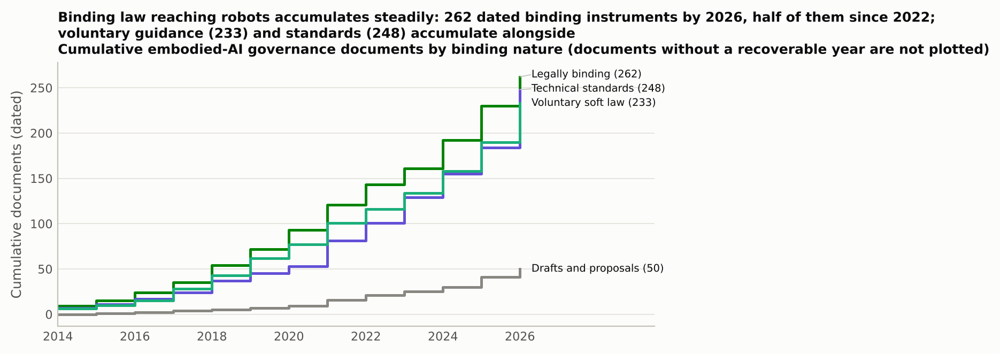

<em class="cap">Figure 06. Cumulative embodied-AI governance documents by binding nature.</em>

Figure 6 accumulates dated embodied legal texts by binding nature (every text of instrument class, not the principal unit): 262 binding texts carry a date up to 2026, 143 of them up to 2022; voluntary guidance reaches 233, technical standards 248 and drafts 50. Two cautions apply. Consolidated statutes harvested from legal databases carry the enactment year or the version year as the annotation found them (Japan's road-traffic and vehicle laws of the 1950s appear at enactment; several of their consolidated texts, Australia's Civil Aviation Safety Regulations and British Columbia's Motor Vehicle Act appear at the 2025 or 2026 compilation date), so the curve mixes the two and the earliest years are not reported as dates of first robot regulation. And the texts that enter the curve include the ancillary and catalogue captures excluded from the headline unit.

### 5.2 Development over time

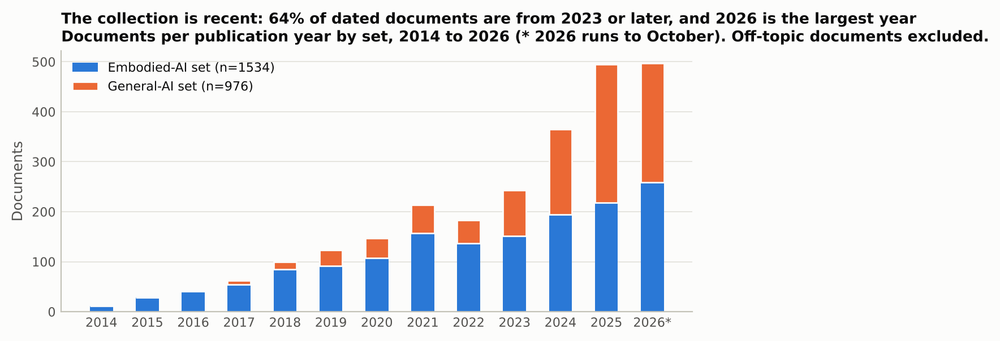

<em class="cap">Figure 02. Documents per publication year by set, 2010 to 2026 (2026 is partial).</em>

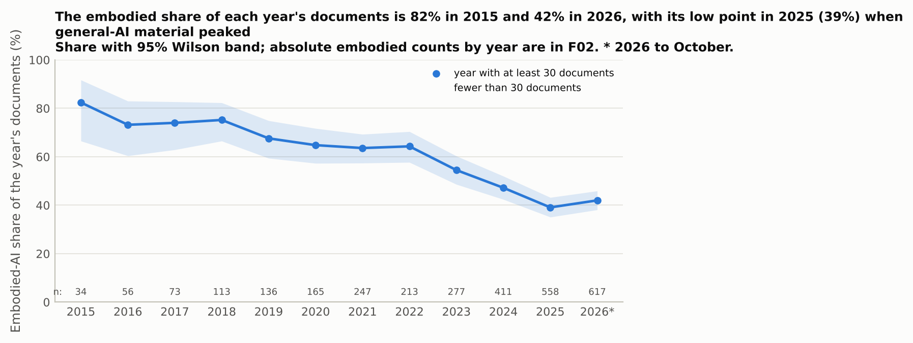

<em class="cap">Figure 05. Share of each year's documents that fall in the embodied-AI set, with 95% Wilson intervals.</em>

The collection is recent: a tenth of usable documents date from 2017 or earlier, the median is 2024, 38% date from 2025 or later and 2026 (to October) is the largest year with 617 usable documents, many of them consolidated texts dated at consolidation. The embodied share of each year's documents falls from 82% in 2015 (28 of 34) to 39% in 2025 (218 of 558) and 42% in 2026 (259 of 617; logistic odds ratio 0.84 per year, interval 0.81 to 0.86), because general-AI strategies and AI Act material arrive in volume from 2023; absolute embodied counts rise every year (137 in 2022, 259 in the first ten months of 2026). Time analyses are restricted to 2014 to 2026 and treat 2026 as partial.

*Table 03. Embodied categories: document counts and first-appearance years (by document type)*

| category                              | level1                     |   n_docs |   first_year_any |   first_year_governance |   n_governance |   first_year_research |   n_research |   median_year |
|:--------------------------------------|:---------------------------|---------:|-----------------:|------------------------:|---------------:|----------------------:|-------------:|--------------:|
| autonomous_road_vehicles              | Vehicles & field           |      427 |             1951 |                    1951 |            290 |                  2013 |           63 |          2022 |
| drones_uas                            | Vehicles & field           |      421 |             1952 |                    1952 |            332 |                  2019 |           32 |          2023 |
| social_companion_robots               | Service & social           |      244 |             2006 |                    2013 |             17 |                  2006 |          219 |          2022 |
| industrial_manipulators               | Industrial & logistics     |      218 |             1972 |                    1972 |            115 |                  2016 |           51 |          2022 |
| care_assistive_robots                 | Service & social           |      217 |             1953 |                    1953 |             58 |                  2006 |          140 |          2022 |
| professional_service_robots           | Service & social           |      208 |             2007 |                    2013 |             82 |                  2013 |           89 |          2023 |
| military_autonomous_weapons           | Security & military        |      192 |             2013 |                    2013 |             74 |                  2016 |           53 |          2023 |
| humanoid_general_purpose              | Humanoid & general-purpose |      168 |             2013 |                    2013 |             32 |                  2015 |          115 |          2024 |
| surgical_medical_robots               | Medical & body-integrated  |      146 |             1993 |                    1993 |             48 |                  2015 |           74 |          2023 |
| collaborative_robots                  | Industrial & logistics     |      114 |             1972 |                    1972 |             41 |                  2017 |           32 |          2023 |
| mobile_industrial_logistics           | Industrial & logistics     |      114 |             1972 |                    1972 |             71 |                  2017 |           16 |          2024 |
| agricultural_robots                   | Vehicles & field           |       82 |             1965 |                    1965 |             49 |                  2016 |           12 |          2023 |
| domestic_household_robots             | Service & social           |       81 |             2006 |                    2013 |             31 |                  2006 |           39 |          2022 |
| rehabilitation_exoskeleton_prosthetic | Medical & body-integrated  |       66 |             1990 |                    1990 |             39 |                  2018 |           15 |          2021 |
| delivery_robots                       | Industrial & logistics     |       60 |             1960 |                    1960 |             41 |                  2016 |           11 |          2023 |
| security_policing_robots              | Security & military        |       58 |             2013 |                    2013 |             28 |                  2016 |           16 |          2023 |
| educational_robots                    | Service & social           |       51 |             2015 |                    2016 |             11 |                  2015 |           35 |          2023 |
| autonomous_maritime_or_rail           | Vehicles & field           |       49 |             2001 |                    2001 |             36 |                  2018 |            5 |          2023 |
| space_or_extreme_environment          | Vehicles & field           |       44 |             2012 |                    2012 |             23 |                  2015 |           16 |          2021 |
| other_embodied                        | Other embodied             |       43 |             1993 |                    1993 |             15 |                  2016 |           24 |          2022 |
| sex_robots                            | Service & social           |       28 |             2006 |                    2017 |              4 |                  2006 |           23 |          2022 |
| biohybrid_or_cyborg                   | Medical & body-integrated  |       13 |             2016 |                    2026 |              1 |                  2016 |           12 |          2022 |
| toys_entertainment_robots             | Service & social           |       11 |             2006 |                    2016 |              5 |                  2006 |            6 |          2018 |

Table 3 gives each robot type's document counts and the earliest year of any document and of any governance document. The governance "first years" of the machine classes (road vehicles 1951, unmanned aircraft 1952, care robots 1953, agricultural machinery 1965, industrial manipulators 1972) are the enactment years of consolidated statutes whose robot provisions were added decades later, and are not reported as findings; version dating of consolidated texts was not done. The discourse categories are informative: care, companion, domestic and humanoid robots enter governance documents in 2013, educational robots in 2016, intimate robots in 2017; biohybrid systems have research attention and one draft. Median years show where attention is now: humanoids and logistics robots 2024, most other types 2022 to 2023.

### 5.3 Geography and language

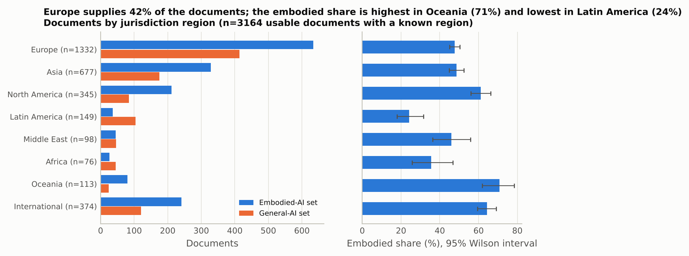

<em class="cap">Figure 07. Documents by jurisdiction region and set (left) and the embodied share within each region (right).</em>

Europe supplies 1,332 usable documents (42%), of which 634 are embodied (48%); Asia 677 (329); the international layer 374 (241); North America 345 (211); Latin America and the Caribbean 149 (36); Oceania 113 (80); the Middle East 98 (45); Africa 76 (27). The embodied share varies by region (Cramér's V 0.19), highest in Oceania (71%), the international layer (64%) and North America (61%) and lowest in Latin America (24%) and Africa (36%): Europe and North America contribute embodied documents through research and vehicle and drone law; the international layer through standards; Latin America and Africa still mainly through general-AI instruments.

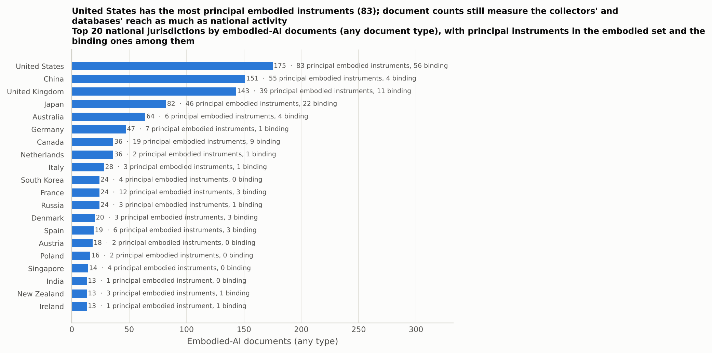

<em class="cap">Figure 08. Top 20 national jurisdictions by embodied-AI documents.</em>

*Table 04. Documents by jurisdiction country (national jurisdictions only; EU and international bodies excluded)*

| country   | country_name             | region                    |   docs |   embodied |   gov_instruments |   embodied_instruments_principal |   binding_embodied |   embodied_instruments |   binding |   research |   median_year |
|:----------|:-------------------------|:--------------------------|-------:|-----------:|------------------:|---------------------------------:|-------------------:|-----------------------:|----------:|-----------:|--------------:|
| US        | United States            | North America             |    286 |        175 |               154 |                               83 |                 56 |                     94 |       110 |         68 |          2024 |
| CN        | China                    | Asia                      |    305 |        151 |               201 |                               55 |                  4 |                    127 |        46 |         20 |          2025 |
| GB        | United Kingdom           | Europe                    |    233 |        143 |                78 |                               39 |                 11 |                     49 |        35 |         77 |          2022 |
| JP        | Japan                    | Asia                      |    148 |         82 |               104 |                               46 |                 22 |                     49 |        64 |         26 |          2021 |
| AU        | Australia                | Oceania                   |     87 |         64 |                15 |                                6 |                  4 |                     47 |         6 |          8 |          2022 |
| DE        | Germany                  | Europe                    |     51 |         47 |                 8 |                                7 |                  1 |                     11 |         1 |         38 |          2023 |
| CA        | Canada                   | North America             |     59 |         36 |                29 |                               19 |                  9 |                     21 |        10 |          8 |          2023 |
| NL        | Netherlands              | Europe                    |     38 |         36 |                 2 |                                2 |                  1 |                      3 |         1 |         32 |          2021 |
| IT        | Italy                    | Europe                    |     36 |         28 |                 8 |                                3 |                  1 |                      4 |         2 |         24 |          2021 |
| KR        | South Korea              | Asia                      |     50 |         24 |                 4 |                                4 |                  0 |                      4 |         0 |         10 |          2024 |
| FR        | France                   | Europe                    |     37 |         24 |                14 |                               12 |                  3 |                     13 |         3 |          7 |          2024 |
| RU        | Russia                   | Europe                    |     28 |         24 |                 3 |                                3 |                  1 |                      2 |         1 |         24 |          2021 |
| DK        | Denmark                  | Europe                    |     20 |         20 |                 3 |                                3 |                  3 |                      3 |         3 |         17 |          2022 |
| ES        | Spain                    | Europe                    |     39 |         19 |                12 |                                6 |                  3 |                      6 |         3 |         11 |          2024 |
| AT        | Austria                  | Europe                    |     20 |         18 |                 2 |                                2 |                  0 |                      3 |         0 |         12 |          2022 |
| PL        | Poland                   | Europe                    |     29 |         16 |                 4 |                                2 |                  0 |                      4 |         1 |         12 |          2024 |
| SG        | Singapore                | Asia                      |     39 |         14 |                18 |                                4 |                  0 |                      5 |         1 |          2 |          2024 |
| IN        | India                    | Asia                      |     25 |         13 |                 5 |                                1 |                  0 |                      2 |         0 |         12 |          2024 |
| NZ        | New Zealand              | Oceania                   |     21 |         13 |                 9 |                                3 |                  1 |                      4 |         1 |          6 |          2023 |
| IE        | Ireland                  | Europe                    |     15 |         13 |                 2 |                                1 |                  1 |                      2 |         2 |         10 |          2023 |
| SE        | Sweden                   | Europe                    |     14 |         12 |                 2 |                                1 |                  1 |                      1 |         1 |          7 |          2021 |
| BR        | Brazil                   | Latin America & Caribbean |     49 |         11 |                28 |                                6 |                  2 |                      6 |         2 |          2 |          2024 |
| MY        | Malaysia                 | Asia                      |     23 |          9 |                 8 |                                4 |                  4 |                      4 |         4 |          4 |          2024 |
| TW        | Taiwan                   | Asia                      |     15 |          9 |                 2 |                                1 |                  0 |                      4 |         1 |          3 |          2019 |
| FI        | Finland                  | Europe                    |     10 |          8 |                 0 |                                0 |                  0 |                      0 |         0 |          9 |          2021 |
| ID        | Indonesia                | Asia                      |     29 |          7 |                 1 |                                0 |                  0 |                      0 |         0 |         17 |          2025 |
| AE        | United Arab Emirates     | Middle East               |     14 |          7 |                 9 |                                3 |                  3 |                      3 |         3 |          1 |          2024 |
| BE        | Belgium                  | Europe                    |      7 |          7 |                 3 |                                3 |                  0 |                      3 |         0 |          3 |          2021 |
| HU        | Hungary                  | Europe                    |      7 |          7 |                 2 |                                2 |                  1 |                      2 |         1 |          3 |          2020 |
| TR        | Türkiye                  | Middle East               |     13 |          6 |                 5 |                                1 |                  1 |                      1 |         1 |          4 |          2024 |
| NG        | Nigeria                  | Africa                    |     12 |          6 |                 5 |                                2 |                  1 |                      2 |         1 |          4 |          2024 |
| IQ        | Iraq                     | Middle East               |      8 |          6 |                 1 |                                0 |                  0 |                      0 |         0 |          6 |          2025 |
| CH        | Switzerland              | Europe                    |      7 |          6 |                 0 |                                0 |                  0 |                      0 |         0 |          6 |          2025 |
| IR        | Iran                     | Middle East               |      7 |          6 |                 0 |                                0 |                  0 |                      0 |         0 |          6 |          2024 |
| AR        | Argentina                | Latin America & Caribbean |     22 |          5 |                11 |                                3 |                  2 |                      5 |         5 |          1 |          2023 |
| PE        | Peru                     | Latin America & Caribbean |     13 |          5 |                 6 |                                3 |                  2 |                      3 |         3 |          1 |          2025 |
| KE        | Kenya                    | Africa                    |     14 |          4 |                 3 |                                0 |                  0 |                      0 |         0 |          3 |          2025 |
| IL        | Israel                   | Middle East               |     12 |          4 |                 8 |                                2 |                  0 |                      2 |         0 |          2 |          2024 |
| SA        | Saudi Arabia             | Middle East               |     12 |          4 |                 7 |                                0 |                  0 |                      0 |         1 |          3 |          2025 |
| ZA        | South Africa             | Africa                    |     11 |          4 |                 4 |                                1 |                  0 |                      2 |         0 |          4 |          2023 |
| CZ        | Czechia                  | Europe                    |      7 |          4 |                 2 |                                2 |                  0 |                      2 |         0 |          3 |          2024 |
| JO        | Jordan                   | Middle East               |      7 |          4 |                 3 |                                0 |                  0 |                      0 |         0 |          4 |          2023 |
| LU        | Luxembourg               | Europe                    |      6 |          4 |                 2 |                                1 |                  0 |                      1 |         0 |          3 |          2025 |
| PT        | Portugal                 | Europe                    |      6 |          4 |                 0 |                                0 |                  0 |                      0 |         0 |          5 |          2023 |
| NO        | Norway                   | Europe                    |      5 |          4 |                 1 |                                1 |                  0 |                      1 |         0 |          4 |          2020 |
| RO        | Romania                  | Europe                    |      4 |          4 |                 0 |                                0 |                  0 |                      0 |         0 |          4 |          2025 |
| PH        | Philippines              | Asia                      |      6 |          3 |                 4 |                                2 |                  0 |                      2 |         0 |          0 |          2025 |
| TH        | Thailand                 | Asia                      |      6 |          3 |                 2 |                                0 |                  0 |                      0 |         1 |          0 |          2025 |
| GR        | Greece                   | Europe                    |      5 |          3 |                 0 |                                0 |                  0 |                      1 |         0 |          2 |          2023 |
| UA        | Ukraine                  | Europe                    |      5 |          3 |                 0 |                                0 |                  0 |                      0 |         0 |          4 |          2025 |
| IS        | Iceland                  | Europe                    |      4 |          3 |                 3 |                                2 |                  2 |                      2 |         2 |          1 |          2022 |
| HK        | Hong Kong                | Asia                      |      3 |          3 |                 0 |                                0 |                  0 |                      0 |         0 |          3 |          2023 |
| TZ        | Tanzania                 | Africa                    |      3 |          3 |                 2 |                                2 |                  2 |                      2 |         2 |          0 |          2023 |
| CO        | Colombia                 | Latin America & Caribbean |     12 |          2 |                 3 |                                0 |                  0 |                      0 |         0 |          2 |          2024 |
| VN        | Vietnam                  | Asia                      |     12 |          2 |                 3 |                                2 |                  2 |                      2 |         3 |          1 |          2025 |
| EG        | Egypt                    | Africa                    |      5 |          2 |                 2 |                                0 |                  0 |                      0 |         0 |          0 |          2025 |
| MX        | Mexico                   | Latin America & Caribbean |      5 |          2 |                 3 |                                2 |                  2 |                      2 |         2 |          2 |          2025 |
| QA        | Qatar                    | Middle East               |      5 |          2 |                 3 |                                1 |                  0 |                      2 |         0 |          0 |          2024 |
| SV        | El Salvador              | Latin America & Caribbean |      4 |          2 |                 2 |                                1 |                  1 |                      1 |         2 |          0 |          2025 |
| EC        | Ecuador                  | Latin America & Caribbean |      3 |          2 |                 2 |                                2 |                  1 |                      2 |         1 |          0 |          2025 |
| FJ        | Fiji                     | Oceania                   |      3 |          2 |                 1 |                                1 |                  1 |                      1 |         1 |          0 |          2025 |
| LB        | Lebanon                  | Middle East               |      3 |          2 |                 1 |                                0 |                  0 |                      0 |         0 |          2 |          2026 |
| BG        | Bulgaria                 | Europe                    |      2 |          2 |                 0 |                                0 |                  0 |                      0 |         0 |          2 |          2024 |
| DZ        | Algeria                  | Africa                    |      2 |          2 |                 0 |                                0 |                  0 |                      0 |         0 |          2 |          2025 |
| HR        | Croatia                  | Europe                    |      2 |          2 |                 0 |                                0 |                  0 |                      0 |         0 |          2 |          2020 |
| MM        | Myanmar                  | Asia                      |      2 |          2 |                 0 |                                0 |                  0 |                      0 |         0 |          1 |          2025 |
| GH        | Ghana                    | Africa                    |     10 |          1 |                 3 |                                1 |                  1 |                      1 |         1 |          1 |          2025 |
| UY        | Uruguay                  | Latin America & Caribbean |     10 |          1 |                 3 |                                1 |                  1 |                      1 |         1 |          0 |          2024 |
| BH        | Bahrain                  | Middle East               |      6 |          1 |                 4 |                                0 |                  0 |                      0 |         0 |          1 |          2024 |
| OM        | Oman                     | Middle East               |      5 |          1 |                 1 |                                1 |                  1 |                      1 |         1 |          0 |          2024 |
| PA        | Panama                   | Latin America & Caribbean |      5 |          1 |                 1 |                                1 |                  0 |                      1 |         0 |          0 |          2025 |
| RW        | Rwanda                   | Africa                    |      5 |          1 |                 3 |                                1 |                  1 |                      1 |         2 |          0 |          2024 |
| CR        | Costa Rica               | Latin America & Caribbean |      4 |          1 |                 2 |                                0 |                  0 |                      0 |         0 |          0 |          2024 |
| JM        | Jamaica                  | Latin America & Caribbean |      3 |          1 |                 2 |                                0 |                  0 |                      0 |         0 |          0 |          2019 |
| LT        | Lithuania                | Europe                    |      3 |          1 |                 0 |                                0 |                  0 |                      0 |         0 |          2 |          2024 |
| PK        | Pakistan                 | Asia                      |      3 |          1 |                 0 |                                0 |                  0 |                      0 |         0 |          1 |          2025 |
| TT        | Trinidad and Tobago      | Latin America & Caribbean |      3 |          1 |                 1 |                                1 |                  1 |                      1 |         1 |          0 |          2026 |
| UG        | Uganda                   | Africa                    |      3 |          1 |                 1 |                                1 |                  1 |                      1 |         1 |          2 |          2024 |
| UZ        | Uzbekistan               | Asia                      |      3 |          1 |                 0 |                                0 |                  0 |                      0 |         0 |          2 |          2025 |
| BD        | Bangladesh               | Asia                      |      2 |          1 |                 1 |                                0 |                  0 |                      0 |         0 |          0 |          2020 |
| EE        | Estonia                  | Europe                    |      2 |          1 |                 1 |                                0 |                  0 |                      0 |         0 |          0 |          2016 |
| GE        | Georgia                  | Middle East               |      2 |          1 |                 0 |                                0 |                  0 |                      0 |         0 |          1 |          2023 |
| HN        | Honduras                 | Latin America & Caribbean |      2 |          1 |                 0 |                                0 |                  0 |                      0 |         0 |          0 |           nan |
| KH        | Cambodia                 | Asia                      |      2 |          1 |                 0 |                                0 |                  0 |                      0 |         0 |          0 |          2025 |
| MU        | Mauritius                | Africa                    |      2 |          1 |                 1 |                                1 |                  0 |                      1 |         0 |          0 |          2022 |
| PG        | Papua New Guinea         | Oceania                   |      2 |          1 |                 2 |                                1 |                  1 |                      1 |         2 |          0 |          2023 |
| SK        | Slovakia                 | Europe                    |      2 |          1 |                 1 |                                1 |                  0 |                      1 |         0 |          1 |          2022 |
| BN        | Brunei Darussalam        | Asia                      |      1 |          1 |                 0 |                                0 |                  0 |                      0 |         0 |          0 |           nan |
| BW        | Botswana                 | Africa                    |      1 |          1 |                 0 |                                0 |                  0 |                      1 |         0 |          0 |          2024 |
| BY        | Belarus                  | Europe                    |      1 |          1 |                 0 |                                0 |                  0 |                      0 |         0 |          1 |          2025 |
| KY        | Cayman Islands           | Latin America & Caribbean |      1 |          1 |                 1 |                                1 |                  0 |                      1 |         0 |          0 |          2017 |
| LK        | Sri Lanka                | Asia                      |      1 |          1 |                 0 |                                0 |                  0 |                      0 |         0 |          1 |          2025 |
| NP        | Nepal                    | Asia                      |      1 |          1 |                 0 |                                0 |                  0 |                      0 |         0 |          0 |          2026 |
| PS        | Palestine                | Middle East               |      1 |          1 |                 0 |                                0 |                  0 |                      0 |         0 |          1 |          2025 |
| RS        | Serbia                   | Europe                    |      1 |          1 |                 0 |                                0 |                  0 |                      0 |         0 |          1 |          2023 |
| CL        | Chile                    | Latin America & Caribbean |      6 |          0 |                 3 |                                0 |                  0 |                      0 |         0 |          0 |          2024 |
| ZM        | Zambia                   | Africa                    |      3 |          0 |                 0 |                                0 |                  0 |                      0 |         0 |          0 |          2024 |
| CU        | Cuba                     | Latin America & Caribbean |      2 |          0 |                 1 |                                0 |                  0 |                      0 |         0 |          0 |          2024 |
| KW        | Kuwait                   | Middle East               |      2 |          0 |                 0 |                                0 |                  0 |                      0 |         0 |          0 |          2026 |
| AD        | Andorra                  | Europe                    |      1 |          0 |                 1 |                                0 |                  0 |                      0 |         0 |          0 |          2024 |
| BB        | Barbados                 | Latin America & Caribbean |      1 |          0 |                 0 |                                0 |                  0 |                      0 |         0 |          0 |          2024 |
| CI        | Côte d'Ivoire            | Africa                    |      1 |          0 |                 0 |                                0 |                  0 |                      0 |         0 |          0 |          2025 |
| CY        | Cyprus                   | Middle East               |      1 |          0 |                 1 |                                0 |                  0 |                      0 |         0 |          0 |          2026 |
| DO        | Dominican Republic       | Latin America & Caribbean |      1 |          0 |                 0 |                                0 |                  0 |                      0 |         0 |          0 |          2023 |
| GY        | Guyana                   | Latin America & Caribbean |      1 |          0 |                 1 |                                0 |                  0 |                      0 |         0 |          0 |          2023 |
| HT        | Haiti                    | Latin America & Caribbean |      1 |          0 |                 0 |                                0 |                  0 |                      0 |         0 |          0 |          2025 |
| LS        | Lesotho                  | Africa                    |      1 |          0 |                 0 |                                0 |                  0 |                      0 |         0 |          0 |          2025 |
| LV        | Latvia                   | Europe                    |      1 |          0 |                 0 |                                0 |                  0 |                      0 |         0 |          1 |          2022 |
| MA        | Morocco                  | Africa                    |      1 |          0 |                 0 |                                0 |                  0 |                      0 |         0 |          0 |          2023 |
| ME        | Montenegro               | Europe                    |      1 |          0 |                 0 |                                0 |                  0 |                      0 |         0 |          0 |          2024 |
| MK        | North Macedonia          | Europe                    |      1 |          0 |                 0 |                                0 |                  0 |                      0 |         0 |          0 |          2025 |
| MN        | Mongolia                 | Asia                      |      1 |          0 |                 0 |                                0 |                  0 |                      0 |         0 |          1 |          2026 |
| MT        | Malta                    | Europe                    |      1 |          0 |                 1 |                                0 |                  0 |                      0 |         0 |          0 |          2019 |
| SI        | Slovenia                 | Europe                    |      1 |          0 |                 0 |                                0 |                  0 |                      0 |         0 |          1 |          2025 |
| TC        | Turks and Caicos Islands | Latin America & Caribbean |      1 |          0 |                 0 |                                0 |                  0 |                      0 |         0 |          1 |          2021 |
| TN        | Tunisia                  | Africa                    |      1 |          0 |                 0 |                                0 |                  0 |                      0 |         0 |          0 |          2018 |

Across 116 countries with any document, 76 contribute a principal instrument, 56 a principal instrument that reaches robots and 38 a principal binding instrument that reaches robots (Table S08). Among national jurisdictions the United States has 83 principal embodied instruments (56 binding), China 55 (4), Japan 46 (22), the United Kingdom 39 (11), Canada 19 (9) and France 12 (3); Australia has 6 (4) on the principal unit against 47 embodied legal texts on the comparable unit. China (305 documents), the United States (286) and the United Kingdom (233) lead on documents; counts measure the collectors' and databases' reach as much as national activity, and China's position rests on one full-text harvest of the State Council policy library (271 of its 305 documents are in Chinese, master table).

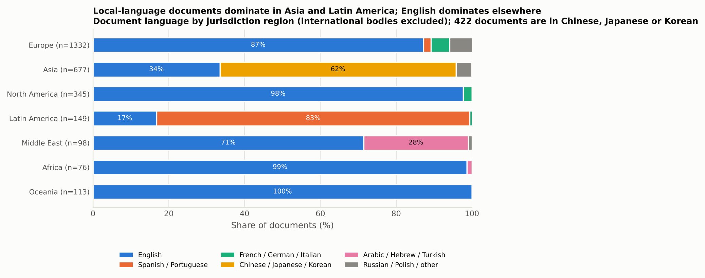

<em class="cap">Figure 10. Document language by jurisdiction region.</em>

*Table 05. Most frequent venues among research outputs (annotated venue field)*

| venue                                                                                                               |   n |   embodied |   median_citations |
|:--------------------------------------------------------------------------------------------------------------------|----:|-----------:|-------------------:|
| arXiv                                                                                                               |  18 |         18 |               18   |
| International Journal of Social Robotics                                                                            |  15 |         15 |               93.5 |
| arXiv (cs.RO)                                                                                                       |  13 |         13 |              253   |
| Frontiers in Robotics and AI                                                                                        |  13 |         13 |               16.5 |
| Ethics and Information Technology                                                                                   |  10 |         10 |                4   |
| AI & Society                                                                                                        |   7 |          6 |               13   |
| Frontiers in Artificial Intelligence and Applications, Vol. 397 (Robophilosophy 2024), IOS Press                    |   6 |          6 |                1   |
| 日本ロボット学会誌 (Journal of the Robotics Society of Japan)                                                                |   5 |          5 |                0   |
| Frontiers in Artificial Intelligence and Applications (IOS Press)                                                   |   4 |          4 |                1   |
| Science and Engineering Ethics                                                                                      |   4 |          4 |              nan   |
| ICRES 2022: 7th International Conference on Robot Ethics and Standards                                              |   4 |          4 |                0   |
| Philosophy & Technology                                                                                             |   4 |          3 |              nan   |
| Frontiers in Artificial Intelligence and Applications, Vol. 366 (Robophilosophy 2022), IOS Press                    |   4 |          4 |                1   |
| AI & SOCIETY                                                                                                        |   4 |          3 |              nan   |
| International Robotics & Automation Journal                                                                         |   3 |          3 |                3   |
| ICRES 2019: International Conference on Robot Ethics and Standards, London                                          |   3 |          3 |                1   |
| Frontiers in Artificial Intelligence and Applications, Vol. 335: Culturally Sustainable Social Robotics (IOS Press) |   3 |          3 |                3   |
| University of Virginia Libra (Online Archive of University of Virginia Scholarship)                                 |   3 |          3 |                0   |
| Journal of the Robotics Society of Japan                                                                            |   3 |          3 |               71   |
| arXiv (cs.CY)                                                                                                       |   3 |          2 |              nan   |
| AI and Ethics                                                                                                       |   3 |          2 |              nan   |
| IEEE Technology and Society Magazine                                                                                |   2 |          2 |                6.5 |
| HRI '24 Companion (ACM/IEEE International Conference on Human-Robot Interaction)                                    |   2 |          2 |                6.5 |
| International Journal of Advanced Computer Science and Applications (IJACSA)                                        |   2 |          2 |               44.5 |
| European Journal of Risk Regulation                                                                                 |   2 |          2 |               14.5 |

English is 75% of usable documents (2,373); Chinese (278), Japanese (107) and Korean are 62% of Asia's documents (422), Spanish and Portuguese 83% of Latin America's (123). Non-English documents are more often legal texts or reports (68% governance documents against 49%) but, among governance documents, less often binding (33% against 45%; Table 19): the multilingual legal record and the English research literature remain different populations. Research venues are robot-ethics venues; median OpenAlex citations are 1.

## 6. Part B. What is governed

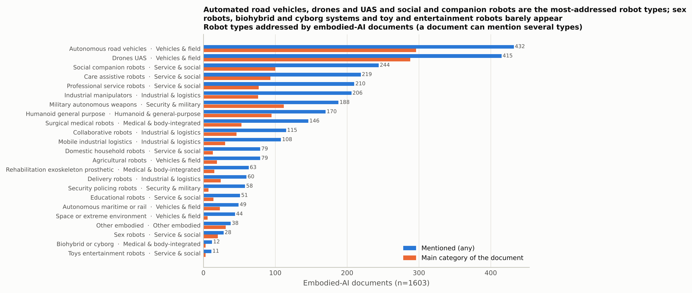

<em class="cap">Figure 11. Embodied-AI categories addressed: any mention and primary category (embodied-AI set).</em>

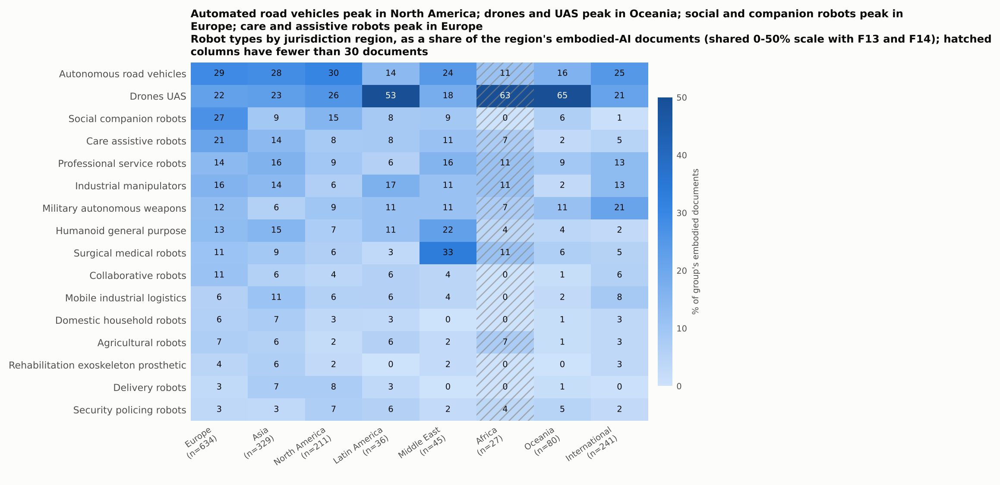

<em class="cap">Figure 12. Embodied categories by jurisdiction region, as a share of the region's embodied-AI documents.</em>

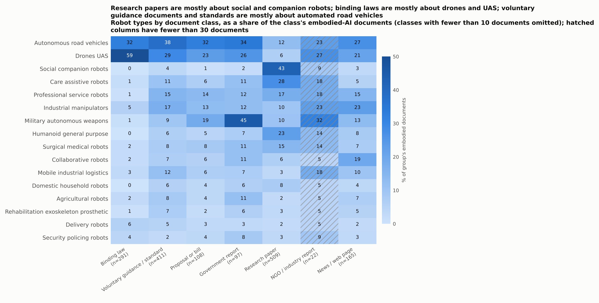

<em class="cap">Figure 13. Embodied categories by document class (share of each class's embodied-AI documents).</em>

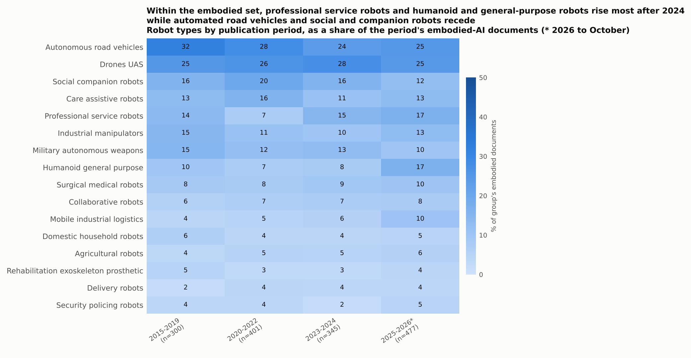

<em class="cap">Figure 14. Embodied categories by publication period (share of the period's embodied-AI documents).</em>

Autonomous road vehicles are the most addressed type (432 documents, 27% of the embodied set), then drones (415), companion and social robots (244), care robots (219), professional service robots (210), industrial manipulators (206), military weapons (188), humanoids (170), surgical robots (146) and collaborative robots (115). Regions attend to different machines (Figure 12): social robots are a European (27%) and North American (15%) topic; humanoids lead in the Middle East (22%) and Asia (15%); surgical robots in the Middle East (33%); drones in Oceania (65%), Africa (63%) and Latin America (53%). Genres attend to different machines (Figure 13): research is social-robot heavy (43%); binding texts address drones (59%) and vehicles (32%); soft-law texts vehicles (38%) and industrial arms (17%); drafts vehicles (32%) and military systems (19%). Over time within the embodied set (Figures 14 and 42): social robots fall from 20% of documents in 2020 to 2022 to 12% in 2025 to 2026; humanoids rise from 8% to 17% and mobile logistics robots from 5% to 11%; vehicles hold at 24 to 28%. The humanoid and logistics rise is partly a harvest effect: the gov.cn harvest searched for "humanoid robots" and "embodied intelligence", and no within-round version of Figure 42 exists, so the period shares are reported as composition-free with respect to genre only.

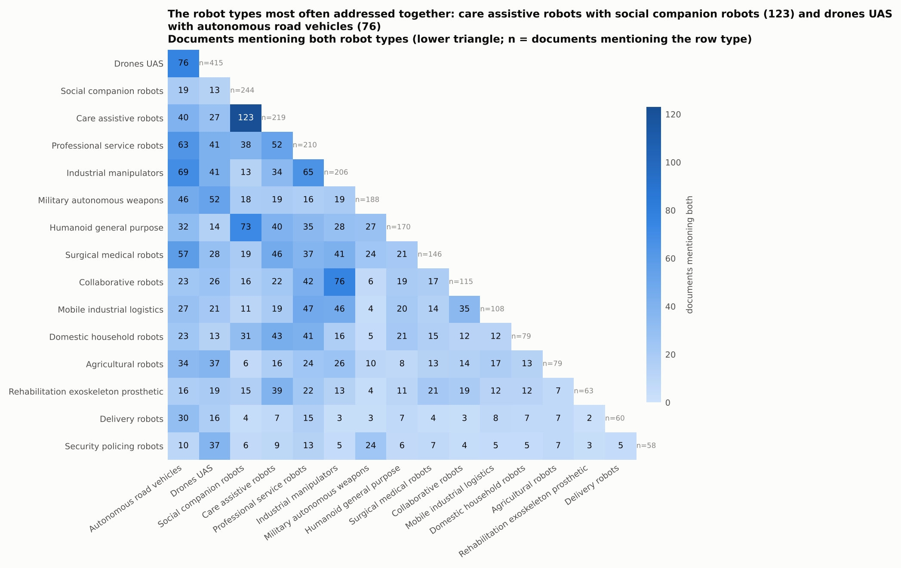

<em class="cap">Figure 16. Co-occurrence of embodied categories within documents (counts of documents carrying both labels).</em>

*Table 06. Most frequent embodied-category pairs (lift = observed/expected under independence)*

| category_a                  | category_b                            |   together |   lift |   jaccard |
|:----------------------------|:--------------------------------------|-----------:|-------:|----------:|
| social_companion_robots     | care_assistive_robots                 |        123 |   3.69 |      0.36 |
| autonomous_road_vehicles    | drones_uas                            |         76 |   0.68 |      0.1  |
| industrial_manipulators     | collaborative_robots                  |         76 |   5.14 |      0.31 |
| social_companion_robots     | humanoid_general_purpose              |         73 |   2.82 |      0.21 |
| autonomous_road_vehicles    | industrial_manipulators               |         69 |   1.24 |      0.12 |
| professional_service_robots | industrial_manipulators               |         65 |   2.41 |      0.19 |
| autonomous_road_vehicles    | professional_service_robots           |         63 |   1.11 |      0.11 |
| autonomous_road_vehicles    | surgical_medical_robots               |         57 |   1.45 |      0.11 |
| drones_uas                  | military_autonomous_weapons           |         52 |   1.07 |      0.09 |
| care_assistive_robots       | professional_service_robots           |         52 |   1.81 |      0.14 |
| professional_service_robots | mobile_industrial_logistics           |         47 |   3.32 |      0.17 |
| industrial_manipulators     | mobile_industrial_logistics           |         46 |   3.31 |      0.17 |
| autonomous_road_vehicles    | military_autonomous_weapons           |         46 |   0.91 |      0.08 |
| care_assistive_robots       | surgical_medical_robots               |         46 |   2.31 |      0.14 |
| care_assistive_robots       | domestic_household_robots             |         43 |   3.98 |      0.17 |
| professional_service_robots | collaborative_robots                  |         42 |   2.79 |      0.15 |
| industrial_manipulators     | surgical_medical_robots               |         41 |   2.19 |      0.13 |
| professional_service_robots | domestic_household_robots             |         41 |   3.96 |      0.17 |
| drones_uas                  | industrial_manipulators               |         41 |   0.77 |      0.07 |
| drones_uas                  | professional_service_robots           |         41 |   0.75 |      0.07 |
| care_assistive_robots       | humanoid_general_purpose              |         40 |   1.72 |      0.11 |
| autonomous_road_vehicles    | care_assistive_robots                 |         40 |   0.68 |      0.07 |
| care_assistive_robots       | rehabilitation_exoskeleton_prosthetic |         39 |   4.53 |      0.16 |
| social_companion_robots     | professional_service_robots           |         38 |   1.19 |      0.09 |
| drones_uas                  | security_policing_robots              |         37 |   2.46 |      0.08 |

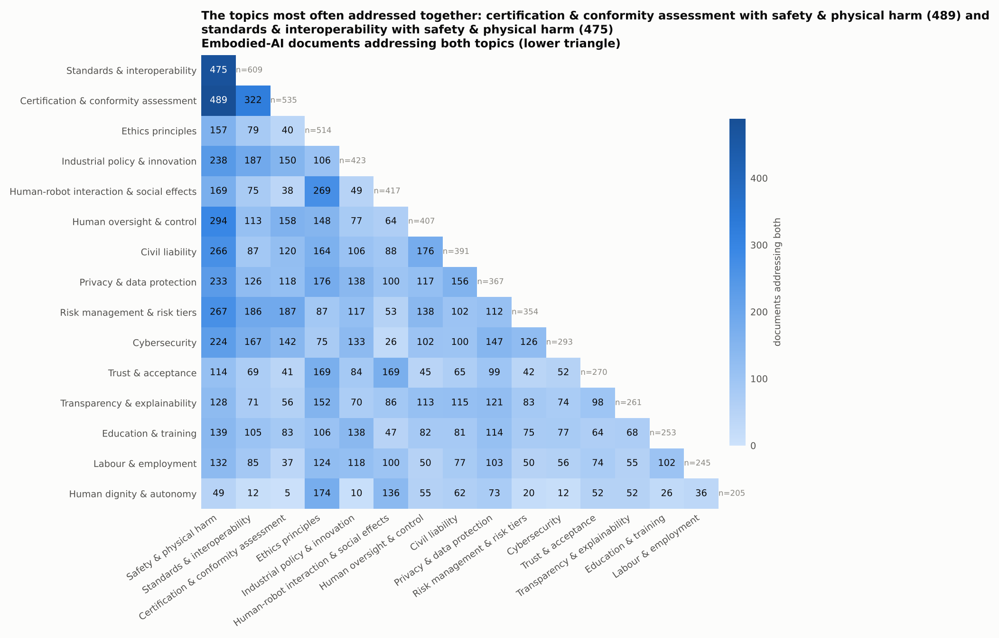

<em class="cap">Figure 17. Co-occurrence of governance topics in embodied-AI documents.</em>

Companion and care robots co-occur in 123 documents (Jaccard 0.36) and industrial manipulators and collaborative robots in 76 (lift 5.1); vehicles and drones co-occur in 76 documents but less often than independence predicts (lift 0.68), because the sector laws round 2 added address one machine at a time. Topics form two poles, ethics with human-robot interaction and physical safety with liability, standards and oversight (Figure 17).

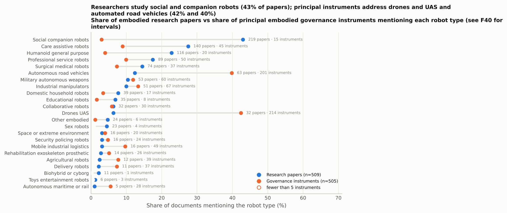

<em class="cap">Figure 18. Research attention versus governance attention by embodied category (share of research outputs vs share of principal governance instruments).</em>

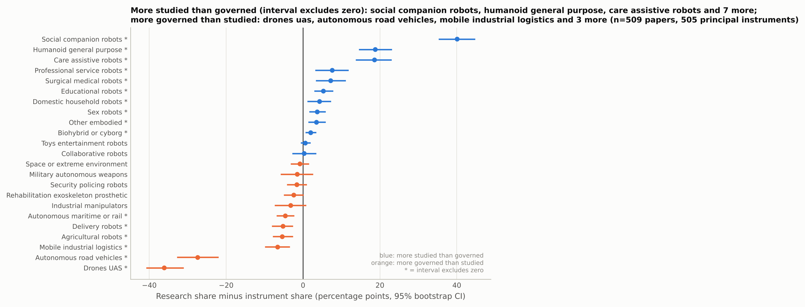

<em class="cap">Figure 40. Governance-gap index with 95% bootstrap intervals (research share minus principal-instrument share by robot type); the title names the categories whose interval excludes zero.</em>

*Table 07. Governance-gap index per category: share among embodied research outputs (n=509) minus share among embodied governance instruments (n=505)*

| category                              | level1                     |   research_pct |   n_research |   instrument_pct |   n_instruments |   binding_instruments |   gap_index |
|:--------------------------------------|:---------------------------|---------------:|-------------:|-----------------:|----------------:|----------------------:|------------:|
| social_companion_robots               | Service & social           |           43   |          219 |              3   |              15 |                     0 |        40.1 |
| humanoid_general_purpose              | Humanoid & general-purpose |           22.8 |          116 |              4   |              20 |                     0 |        18.8 |
| care_assistive_robots                 | Service & social           |           27.5 |          140 |              8.9 |              45 |                     4 |        18.6 |
| professional_service_robots           | Service & social           |           17.5 |           89 |              9.9 |              50 |                     2 |         7.6 |
| surgical_medical_robots               | Medical & body-integrated  |           14.5 |           74 |              7.3 |              37 |                     6 |         7.2 |
| educational_robots                    | Service & social           |            6.9 |           35 |              1.6 |               8 |                     1 |         5.3 |
| domestic_household_robots             | Service & social           |            7.7 |           39 |              3.4 |              17 |                     0 |         4.3 |
| sex_robots                            | Service & social           |            4.5 |           23 |              0.8 |               4 |                     0 |         3.7 |
| other_embodied                        | Other embodied             |            4.7 |           24 |              1.2 |               6 |                     3 |         3.5 |
| biohybrid_or_cyborg                   | Medical & body-integrated  |            2.2 |           11 |              0.2 |               1 |                     0 |         2   |
| toys_entertainment_robots             | Service & social           |            1.2 |            6 |              0.6 |               3 |                     0 |         0.6 |
| collaborative_robots                  | Industrial & logistics     |            6.3 |           32 |              5.9 |              30 |                     6 |         0.3 |
| space_or_extreme_environment          | Vehicles & field           |            3.1 |           16 |              4   |              20 |                     2 |        -0.8 |
| military_autonomous_weapons           | Security & military        |           10.4 |           53 |             11.9 |              60 |                     3 |        -1.5 |
| security_policing_robots              | Security & military        |            3.1 |           16 |              4.8 |              24 |                    11 |        -1.6 |
| rehabilitation_exoskeleton_prosthetic | Medical & body-integrated  |            2.8 |           14 |              5.1 |              26 |                     2 |        -2.4 |
| industrial_manipulators               | Industrial & logistics     |           10   |           51 |             13.3 |              67 |                    13 |        -3.2 |
| autonomous_maritime_or_rail           | Vehicles & field           |            1   |            5 |              5.5 |              28 |                     1 |        -4.6 |
| delivery_robots                       | Industrial & logistics     |            2.2 |           11 |              7.3 |              37 |                    15 |        -5.2 |
| agricultural_robots                   | Vehicles & field           |            2.4 |           12 |              7.7 |              39 |                     7 |        -5.4 |
| mobile_industrial_logistics           | Industrial & logistics     |            3.1 |           16 |              9.7 |              49 |                     9 |        -6.6 |
| autonomous_road_vehicles              | Vehicles & field           |           12.4 |           63 |             39.8 |             201 |                    67 |       -27.4 |
| drones_uas                            | Vehicles & field           |            6.3 |           32 |             42.4 |             214 |                   107 |       -36.1 |

*Table 22. Governance-gap index with 95% bootstrap confidence intervals (2,000 resamples of research outputs n=509 and governance instruments n=505 separately)*

| category                              | level1                     |   research_pct |   n_research |   instrument_pct |   n_instruments |   gap_index |   ci_low |   ci_high | ci_excludes_zero   |
|:--------------------------------------|:---------------------------|---------------:|-------------:|-----------------:|----------------:|------------:|---------:|----------:|:-------------------|
| social_companion_robots               | Service & social           |           43   |          219 |              3   |              15 |        40.1 |     35.5 |      44.6 | True               |
| humanoid_general_purpose              | Humanoid & general-purpose |           22.8 |          116 |              4   |              20 |        18.8 |     14.7 |      23   | True               |
| care_assistive_robots                 | Service & social           |           27.5 |          140 |              8.9 |              45 |        18.6 |     13.9 |      22.9 | True               |
| professional_service_robots           | Service & social           |           17.5 |           89 |              9.9 |              50 |         7.6 |      3.4 |      11.7 | True               |
| surgical_medical_robots               | Medical & body-integrated  |           14.5 |           74 |              7.3 |              37 |         7.2 |      3.5 |      11   | True               |
| educational_robots                    | Service & social           |            6.9 |           35 |              1.6 |               8 |         5.3 |      3.1 |       7.7 | True               |
| domestic_household_robots             | Service & social           |            7.7 |           39 |              3.4 |              17 |         4.3 |      1.3 |       7.1 | True               |
| sex_robots                            | Service & social           |            4.5 |           23 |              0.8 |               4 |         3.7 |      1.8 |       5.7 | True               |
| other_embodied                        | Other embodied             |            4.7 |           24 |              1.2 |               6 |         3.5 |      1.6 |       5.7 | True               |
| biohybrid_or_cyborg                   | Medical & body-integrated  |            2.2 |           11 |              0.2 |               1 |         2   |      0.8 |       3.3 | True               |
| toys_entertainment_robots             | Service & social           |            1.2 |            6 |              0.6 |               3 |         0.6 |     -0.4 |       1.8 | False              |
| collaborative_robots                  | Industrial & logistics     |            6.3 |           32 |              5.9 |              30 |         0.3 |     -2.6 |       3.3 | False              |
| space_or_extreme_environment          | Vehicles & field           |            3.1 |           16 |              4   |              20 |        -0.8 |     -3   |       1.4 | False              |
| military_autonomous_weapons           | Security & military        |           10.4 |           53 |             11.9 |              60 |        -1.5 |     -5.6 |       2.5 | False              |
| security_policing_robots              | Security & military        |            3.1 |           16 |              4.8 |              24 |        -1.6 |     -4   |       0.8 | False              |
| rehabilitation_exoskeleton_prosthetic | Medical & body-integrated  |            2.8 |           14 |              5.1 |              26 |        -2.4 |     -4.8 |      -0   | False              |
| industrial_manipulators               | Industrial & logistics     |           10   |           51 |             13.3 |              67 |        -3.2 |     -7.2 |       0.7 | False              |
| autonomous_maritime_or_rail           | Vehicles & field           |            1   |            5 |              5.5 |              28 |        -4.6 |     -6.7 |      -2.4 | True               |
| delivery_robots                       | Industrial & logistics     |            2.2 |           11 |              7.3 |              37 |        -5.2 |     -7.9 |      -2.8 | True               |
| agricultural_robots                   | Vehicles & field           |            2.4 |           12 |              7.7 |              39 |        -5.4 |     -7.7 |      -2.8 | True               |
| mobile_industrial_logistics           | Industrial & logistics     |            3.1 |           16 |              9.7 |              49 |        -6.6 |     -9.7 |      -3.6 | True               |
| autonomous_road_vehicles              | Vehicles & field           |           12.4 |           63 |             39.8 |             201 |       -27.4 |    -32.6 |     -22.1 | True               |
| drones_uas                            | Vehicles & field           |            6.3 |           32 |             42.4 |             214 |       -36.1 |    -40.6 |     -31.2 | True               |

The governance-gap index (research share minus principal-instrument share; Tables 7 and 22) separates three groups, and the bootstrap intervals of 16 of the 23 categories exclude zero. Studied far more than governed: social and companion robots (+40 points, interval 36 to 45; 15 instruments, none binding), care robots (+19, 14 to 23; 45 instruments, 4 binding), humanoids (+19, 15 to 23; 20 instruments, none binding), professional service and surgical robots (+8 and +7) and educational, domestic and intimate robots (+4 to +5). Near parity: collaborative robots, military weapons, security robots, exoskeletons and industrial manipulators (−3, interval −7 to +1). Governed far more than studied: drones (−36, interval −41 to −31; 214 instruments, 107 binding), autonomous road vehicles (−27, interval −33 to −22; 201 instruments, 67 binding) and, by small margins, logistics, agricultural, delivery (37 instruments, 15 binding) and maritime robots. The ordering is the same as on the v3 unit (supplement S10), so it does not depend on the ancillary captures. The pattern has an explanation: vehicles, drones and field machines inherited transport and aviation regimes, whereas social robots raise questions (deception, attachment, dignity, vulnerable users) without a regulatory home of their own. General regimes do apply to them (general product-safety law, toy-safety rules, data protection, the AI Act's transparency and vulnerability provisions, the consumer-robot standard UL 3300); the gap is in robot-specific instruments, not in the absence of any law, and the Toy Safety Regulation (EU) 2025/2509 and California SB 243 are among the instruments located by collectors and not read (Part F).

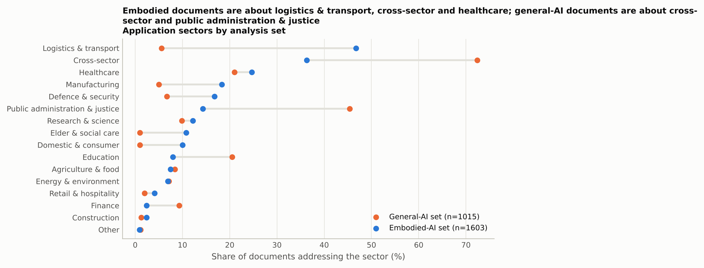

<em class="cap">Figure 19. Application sectors by set.</em>

Embodied documents are sectoral (logistics and transport 47%, health 25%, manufacturing 18%, defence 17%, elder and social care 11%); general-AI documents are cross-cutting (72%) and about public administration (45%).

## 7. Part C. How robots are governed: principles, tools, framings

### 7.1 Principles: pooled, within genre, within round, adjusted

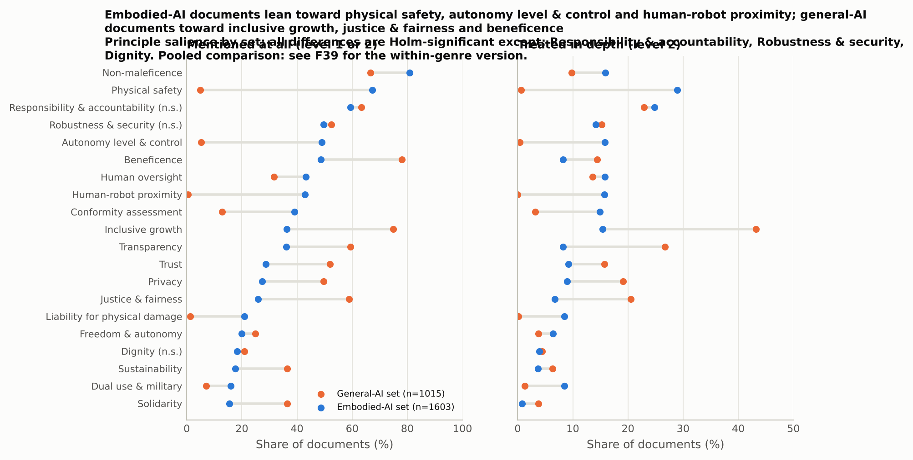

<em class="cap">Figure 20. Principle salience by set; asterisks mark differences that remain significant after Holm correction.</em>

*Table 08. Principle presence (level >= 1) and substantive treatment (level 2): embodied-AI set (n=1603) vs general-AI set (n=1015); chi-square/Fisher tests with Holm correction*

| principle                           | label                           | group             |   embodied_any_pct |   general_any_pct |   embodied_substantive_pct |   general_substantive_pct |   diff_any_pp | test       |      p |   p_holm | significant_holm_05   |
|:------------------------------------|:--------------------------------|:------------------|-------------------:|------------------:|---------------------------:|--------------------------:|--------------:|:-----------|-------:|---------:|:----------------------|
| non_maleficence                     | Non-maleficence                 | core              |               80.8 |              66.6 |                       15.9 |                       9.8 |          14.2 | chi-square | 0      |   0      | True                  |
| physical_safety                     | Physical safety                 | embodied-specific |               67.3 |               4.9 |                       28.9 |                       0.6 |          62.4 | chi-square | 0      |   0      | True                  |
| responsibility_accountability       | Responsibility & accountability | core              |               59.3 |              63.3 |                       24.8 |                      22.9 |          -4   | chi-square | 0.046  |   0.1381 | False                 |
| robustness_security                 | Robustness & security           | core              |               49.7 |              52.4 |                       14.2 |                      15.2 |          -2.7 | chi-square | 0.1924 |   0.2029 | False                 |
| autonomy_level_control              | Autonomy level & control        | embodied-specific |               49   |               5.2 |                       15.8 |                       0.4 |          43.7 | chi-square | 0      |   0      | True                  |
| beneficence                         | Beneficence                     | core              |               48.7 |              78   |                        8.2 |                      14.4 |         -29.4 | chi-square | 0      |   0      | True                  |
| human_oversight                     | Human oversight                 | core              |               43.2 |              31.7 |                       15.8 |                      13.6 |          11.5 | chi-square | 0      |   0      | True                  |
| human_robot_proximity               | Human-robot proximity           | embodied-specific |               42.9 |               0.4 |                       15.7 |                       0   |          42.5 | chi-square | 0      |   0      | True                  |
| conformity_assessment_certification | Conformity assessment           | embodied-specific |               39.1 |              12.8 |                       14.9 |                       3.2 |          26.3 | chi-square | 0      |   0      | True                  |
| inclusive_growth                    | Inclusive growth                | core              |               36.2 |              74.9 |                       15.4 |                      43.2 |         -38.6 | chi-square | 0      |   0      | True                  |
| transparency                        | Transparency                    | core              |               36.1 |              59.4 |                        8.2 |                      26.7 |         -23.4 | chi-square | 0      |   0      | True                  |
| trust                               | Trust                           | core              |               28.7 |              51.9 |                        9.2 |                      15.7 |         -23.2 | chi-square | 0      |   0      | True                  |
| privacy                             | Privacy                         | core              |               27.3 |              49.7 |                        9   |                      19.1 |         -22.4 | chi-square | 0      |   0      | True                  |
| justice_fairness                    | Justice & fairness              | core              |               25.9 |              58.9 |                        6.7 |                      20.5 |         -33   | chi-square | 0      |   0      | True                  |
| liability_for_physical_damage       | Liability for physical damage   | embodied-specific |               21   |               1.3 |                        8.5 |                       0.1 |          19.7 | chi-square | 0      |   0      | True                  |
| freedom_autonomy                    | Freedom & autonomy              | core              |               19.9 |              24.8 |                        6.4 |                       3.8 |          -4.9 | chi-square | 0.0034 |   0.0137 | True                  |
| dignity                             | Dignity                         | core              |               18.2 |              20.9 |                        3.9 |                       4.4 |          -2.7 | chi-square | 0.1014 |   0.2029 | False                 |
| sustainability                      | Sustainability                  | core              |               17.7 |              36.5 |                        3.7 |                       6.3 |         -18.7 | chi-square | 0      |   0      | True                  |
| dual_use_military                   | Dual use & military             | embodied-specific |               15.9 |               7   |                        8.5 |                       1.3 |           8.9 | chi-square | 0      |   0      | True                  |
| solidarity                          | Solidarity                      | core              |               15.4 |              36.4 |                        0.8 |                       3.8 |         -20.9 | chi-square | 0      |   0      | True                  |

Pooled over all documents, 17 of 20 principle differences between the sets survive Holm correction (accountability, robustness and dignity do not). Pooled comparisons are, however, mostly comparisons of genres and, in this collection, of collection rounds. Four further analyses settle what survives.

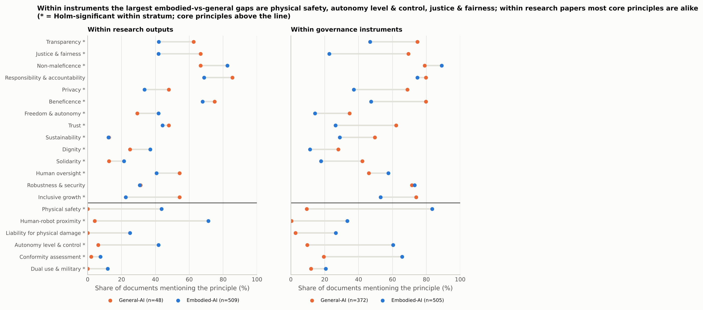

<em class="cap">Figure 39. Embodied vs general principle presence within research outputs and within governance instruments (genre-stratified).</em>

*Table 21. Embodied vs general comparison within each document genre (Holm correction within stratum)*

| stratum                 | item                                | kind      |   n_embodied |   n_general |   embodied_pct |   general_pct |   diff_pp | test       |      p |   p_holm |
|:------------------------|:------------------------------------|:----------|-------------:|------------:|---------------:|--------------:|----------:|:-----------|-------:|---------:|
| Research outputs        | Transparency                        | principle |          509 |          48 |           42   |          62.5 |     -20.5 | chi-square | 0.0099 |   0.3175 |
| Research outputs        | Justice & fairness                  | principle |          509 |          48 |           41.8 |          66.7 |     -24.8 | chi-square | 0.0016 |   0.0521 |
| Research outputs        | Non-maleficence                     | principle |          509 |          48 |           82.5 |          66.7 |      15.8 | chi-square | 0.0128 |   0.3953 |
| Research outputs        | Responsibility & accountability     | principle |          509 |          48 |           68.8 |          85.4 |     -16.7 | chi-square | 0.0247 |   0.7155 |
| Research outputs        | Privacy                             | principle |          509 |          48 |           33.6 |          47.9 |     -14.3 | chi-square | 0.0669 |   1      |
| Research outputs        | Beneficence                         | principle |          509 |          48 |           67.8 |          75   |      -7.2 | chi-square | 0.3864 |   1      |
| Research outputs        | Freedom & autonomy                  | principle |          509 |          48 |           41.8 |          29.2 |      12.7 | chi-square | 0.1198 |   1      |
| Research outputs        | Trust                               | principle |          509 |          48 |           44.2 |          47.9 |      -3.7 | chi-square | 0.7317 |   1      |
| Research outputs        | Sustainability                      | principle |          509 |          48 |           12.2 |          12.5 |      -0.3 | chi-square | 1      |   1      |
| Research outputs        | Dignity                             | principle |          509 |          48 |           36.9 |          25   |      11.9 | chi-square | 0.1361 |   1      |
| Research outputs        | Solidarity                          | principle |          509 |          48 |           21.4 |          12.5 |       8.9 | chi-square | 0.2033 |   1      |
| Research outputs        | Human oversight                     | principle |          509 |          48 |           40.7 |          54.2 |     -13.5 | chi-square | 0.097  |   1      |
| Research outputs        | Robustness & security               | principle |          509 |          48 |           30.8 |          31.2 |      -0.4 | chi-square | 1      |   1      |
| Research outputs        | Inclusive growth                    | principle |          509 |          48 |           22.4 |          54.2 |     -31.8 | chi-square | 0      |   0.0001 |
| Research outputs        | Physical safety                     | principle |          509 |          48 |           43.6 |           0   |      43.6 | chi-square | 0      |   0      |
| Research outputs        | Human-robot proximity               | principle |          509 |          48 |           71.3 |           4.2 |      67.1 | chi-square | 0      |   0      |
| Research outputs        | Liability for physical damage       | principle |          509 |          48 |           25   |           0   |      25   | chi-square | 0.0002 |   0.0058 |
| Research outputs        | Autonomy level & control            | principle |          509 |          48 |           41.8 |           6.2 |      35.6 | chi-square | 0      |   0.0001 |
| Research outputs        | Conformity assessment               | principle |          509 |          48 |            7.5 |           2.1 |       5.4 | Fisher     | 0.2372 |   1      |
| Research outputs        | Dual use & military                 | principle |          509 |          48 |           11.8 |           0   |      11.8 | chi-square | 0.0229 |   0.6878 |
| Research outputs        | Audits impact assessment            | mechanism |          509 |          48 |           11.6 |          12.5 |      -0.9 | chi-square | 1      |   1      |
| Research outputs        | Conformity assessment certification | mechanism |          509 |          48 |            3.3 |           2.1 |       1.3 | Fisher     | 1      |   1      |
| Research outputs        | Data governance requirements        | mechanism |          509 |          48 |            3.7 |           4.2 |      -0.4 | Fisher     | 0.7005 |   1      |
| Research outputs        | Education training programs         | mechanism |          509 |          48 |            9.2 |          14.6 |      -5.3 | Fisher     | 0.2102 |   1      |
| Research outputs        | Funding or incentives               | mechanism |          509 |          48 |            2.4 |           8.3 |      -6   | Fisher     | 0.0408 |   1      |
| Research outputs        | Human oversight requirement         | mechanism |          509 |          48 |            5.1 |           4.2 |       0.9 | Fisher     | 1      |   1      |
| Research outputs        | Incident reporting                  | mechanism |          509 |          48 |            2.4 |           0   |       2.4 | Fisher     | 0.6122 |   1      |
| Research outputs        | Insurance requirement               | mechanism |          509 |          48 |            2   |           2.1 |      -0.1 | Fisher     | 1      |   1      |
| Research outputs        | International cooperation           | mechanism |          509 |          48 |            5.3 |          10.4 |      -5.1 | Fisher     | 0.1821 |   1      |
| Research outputs        | Liability regime                    | mechanism |          509 |          48 |           12   |           6.2 |       5.7 | chi-square | 0.34   |   1      |
| Research outputs        | Licensing registration              | mechanism |          509 |          48 |            1.6 |           4.2 |      -2.6 | Fisher     | 0.2102 |   1      |
| Research outputs        | Oversight body creation             | mechanism |          509 |          48 |            2.8 |           8.3 |      -5.6 | Fisher     | 0.0604 |   1      |
| Research outputs        | Prohibitions bans                   | mechanism |          509 |          48 |            2.2 |           0   |       2.2 | Fisher     | 0.611  |   1      |
| Research outputs        | Risk based tiering                  | mechanism |          509 |          48 |            2   |           8.3 |      -6.4 | Fisher     | 0.0255 |   0.7155 |
| Research outputs        | Self regulation codes               | mechanism |          509 |          48 |            6.5 |           6.2 |       0.2 | Fisher     | 1      |   1      |
| Research outputs        | Technical standards reference       | mechanism |          509 |          48 |            9.8 |           4.2 |       5.7 | Fisher     | 0.2973 |   1      |
| Research outputs        | Testing sandboxes                   | mechanism |          509 |          48 |            3.7 |           4.2 |      -0.4 | Fisher     | 0.7005 |   1      |
| Research outputs        | Transparency disclosure labelling   | mechanism |          509 |          48 |            5.7 |          10.4 |      -4.7 | Fisher     | 0.2011 |   1      |
| Governance instruments  | Transparency                        | principle |          505 |         372 |           46.7 |          74.7 |     -28   | chi-square | 0      |   0      |
| Governance instruments  | Justice & fairness                  | principle |          505 |         372 |           22.6 |          69.4 |     -46.8 | chi-square | 0      |   0      |
| Governance instruments  | Non-maleficence                     | principle |          505 |         372 |           89.1 |          79   |      10.1 | chi-square | 0.0001 |   0.0006 |
| Governance instruments  | Responsibility & accountability     | principle |          505 |         372 |           74.7 |          79.8 |      -5.2 | chi-square | 0.0857 |   0.2952 |
| Governance instruments  | Privacy                             | principle |          505 |         372 |           37.2 |          68.8 |     -31.6 | chi-square | 0      |   0      |
| Governance instruments  | Beneficence                         | principle |          505 |         372 |           47.3 |          79.8 |     -32.5 | chi-square | 0      |   0      |
| Governance instruments  | Freedom & autonomy                  | principle |          505 |         372 |           14.3 |          34.7 |     -20.4 | chi-square | 0      |   0      |
| Governance instruments  | Trust                               | principle |          505 |         372 |           26.3 |          62.1 |     -35.8 | chi-square | 0      |   0      |
| Governance instruments  | Sustainability                      | principle |          505 |         372 |           28.9 |          49.5 |     -20.6 | chi-square | 0      |   0      |
| Governance instruments  | Dignity                             | principle |          505 |         372 |           11.3 |          28   |     -16.7 | chi-square | 0      |   0      |
| Governance instruments  | Solidarity                          | principle |          505 |         372 |           17.8 |          42.2 |     -24.4 | chi-square | 0      |   0      |
| Governance instruments  | Human oversight                     | principle |          505 |         372 |           57.6 |          46   |      11.7 | chi-square | 0.0008 |   0.0073 |
| Governance instruments  | Robustness & security               | principle |          505 |         372 |           73.1 |          71.5 |       1.6 | chi-square | 0.6631 |   0.6631 |
| Governance instruments  | Inclusive growth                    | principle |          505 |         372 |           52.9 |          73.9 |     -21.1 | chi-square | 0      |   0      |
| Governance instruments  | Physical safety                     | principle |          505 |         372 |           83.4 |           9.4 |      74   | chi-square | 0      |   0      |
| Governance instruments  | Human-robot proximity               | principle |          505 |         372 |           33.3 |           0.3 |      33   | chi-square | 0      |   0      |
| Governance instruments  | Liability for physical damage       | principle |          505 |         372 |           26.5 |           2.7 |      23.8 | chi-square | 0      |   0      |
| Governance instruments  | Autonomy level & control            | principle |          505 |         372 |           60.4 |           9.7 |      50.7 | chi-square | 0      |   0      |
| Governance instruments  | Conformity assessment               | principle |          505 |         372 |           65.7 |          19.4 |      46.4 | chi-square | 0      |   0      |
| Governance instruments  | Dual use & military                 | principle |          505 |         372 |           20.6 |          11.8 |       8.8 | chi-square | 0.0009 |   0.0073 |
| Governance instruments  | Audits impact assessment            | mechanism |          505 |         372 |           42.6 |          57.5 |     -15   | chi-square | 0      |   0.0002 |
| Governance instruments  | Conformity assessment certification | mechanism |          505 |         372 |           42   |          11.8 |      30.2 | chi-square | 0      |   0      |
| Governance instruments  | Data governance requirements        | mechanism |          505 |         372 |           20.4 |          36.3 |     -15.9 | chi-square | 0      |   0      |
| Governance instruments  | Education training programs         | mechanism |          505 |         372 |           35   |          52.7 |     -17.6 | chi-square | 0      |   0      |
| Governance instruments  | Funding or incentives               | mechanism |          505 |         372 |           30.1 |          46.2 |     -16.1 | chi-square | 0      |   0      |
| Governance instruments  | Human oversight requirement         | mechanism |          505 |         372 |           26.7 |          21   |       5.8 | chi-square | 0.059  |   0.2952 |
| Governance instruments  | Incident reporting                  | mechanism |          505 |         372 |           24.4 |          15.9 |       8.5 | chi-square | 0.0029 |   0.02   |
| Governance instruments  | Insurance requirement               | mechanism |          505 |         372 |           15.4 |           1.9 |      13.6 | chi-square | 0      |   0      |
| Governance instruments  | International cooperation           | mechanism |          505 |         372 |           34.1 |          55.9 |     -21.9 | chi-square | 0      |   0      |
| Governance instruments  | Liability regime                    | mechanism |          505 |         372 |           11.3 |           5.4 |       5.9 | chi-square | 0.0033 |   0.02   |
| Governance instruments  | Licensing registration              | mechanism |          505 |         372 |           43.8 |          10.2 |      33.5 | chi-square | 0      |   0      |
| Governance instruments  | Oversight body creation             | mechanism |          505 |         372 |           37.6 |          56.2 |     -18.6 | chi-square | 0      |   0      |
| Governance instruments  | Prohibitions bans                   | mechanism |          505 |         372 |           21   |          11.8 |       9.2 | chi-square | 0.0005 |   0.0052 |
| Governance instruments  | Risk based tiering                  | mechanism |          505 |         372 |           18.2 |          23.1 |      -4.9 | chi-square | 0.0895 |   0.2952 |
| Governance instruments  | Self regulation codes               | mechanism |          505 |         372 |            7.3 |          23.7 |     -16.3 | chi-square | 0      |   0      |
| Governance instruments  | Technical standards reference       | mechanism |          505 |         372 |           65   |          34.9 |      30   | chi-square | 0      |   0      |
| Governance instruments  | Testing sandboxes                   | mechanism |          505 |         372 |           36.4 |          30.4 |       6.1 | chi-square | 0.0716 |   0.2952 |
| Governance instruments  | Transparency disclosure labelling   | mechanism |          505 |         372 |           20.4 |          42.2 |     -21.8 | chi-square | 0      |   0      |
| Government reports      | Transparency                        | principle |           97 |         148 |           57.7 |          69.6 |     -11.9 | chi-square | 0.0774 |   1      |
| Government reports      | Justice & fairness                  | principle |           97 |         148 |           55.7 |          75   |     -19.3 | chi-square | 0.0026 |   0.0563 |
| Government reports      | Non-maleficence                     | principle |           97 |         148 |           90.7 |          64.9 |      25.9 | chi-square | 0      |   0.0003 |
| Government reports      | Responsibility & accountability     | principle |           97 |         148 |           80.4 |          69.6 |      10.8 | chi-square | 0.0825 |   1      |
| Government reports      | Privacy                             | principle |           97 |         148 |           41.2 |          61.5 |     -20.2 | chi-square | 0.0029 |   0.0612 |
| Government reports      | Beneficence                         | principle |           97 |         148 |           69.1 |          83.1 |     -14   | chi-square | 0.0156 |   0.2805 |
| Government reports      | Freedom & autonomy                  | principle |           97 |         148 |           19.6 |          34.5 |     -14.9 | chi-square | 0.0175 |   0.298  |
| Government reports      | Trust                               | principle |           97 |         148 |           53.6 |          68.9 |     -15.3 | chi-square | 0.022  |   0.352  |
| Government reports      | Sustainability                      | principle |           97 |         148 |           34   |          43.9 |      -9.9 | chi-square | 0.1576 |   1      |
| Government reports      | Dignity                             | principle |           97 |         148 |           27.8 |          23.6 |       4.2 | chi-square | 0.5573 |   1      |
| Government reports      | Solidarity                          | principle |           97 |         148 |           28.9 |          45.9 |     -17.1 | chi-square | 0.0109 |   0.2189 |
| Government reports      | Human oversight                     | principle |           97 |         148 |           71.1 |          39.2 |      31.9 | chi-square | 0      |   0.0001 |
| Government reports      | Robustness & security               | principle |           97 |         148 |           63.9 |          63.5 |       0.4 | chi-square | 1      |   1      |
| Government reports      | Inclusive growth                    | principle |           97 |         148 |           67   |          85.8 |     -18.8 | chi-square | 0.0008 |   0.022  |
| Government reports      | Physical safety                     | principle |           97 |         148 |           76.3 |           2.7 |      73.6 | chi-square | 0      |   0      |
| Government reports      | Human-robot proximity               | principle |           97 |         148 |           32   |           0   |      32   | chi-square | 0      |   0      |
| Government reports      | Liability for physical damage       | principle |           97 |         148 |           37.1 |           1.4 |      35.8 | chi-square | 0      |   0      |
| Government reports      | Autonomy level & control            | principle |           97 |         148 |           69.1 |           4.1 |      65   | chi-square | 0      |   0      |
| Government reports      | Conformity assessment               | principle |           97 |         148 |           52.6 |          14.9 |      37.7 | chi-square | 0      |   0      |
| Government reports      | Dual use & military                 | principle |           97 |         148 |           48.5 |           8.1 |      40.3 | chi-square | 0      |   0      |
| Government reports      | Audits impact assessment            | mechanism |           97 |         148 |           45.4 |          43.2 |       2.1 | chi-square | 0.8455 |   1      |
| Government reports      | Conformity assessment certification | mechanism |           97 |         148 |           18.6 |          10.8 |       7.7 | chi-square | 0.127  |   1      |
| Government reports      | Data governance requirements        | mechanism |           97 |         148 |           14.4 |          18.9 |      -4.5 | chi-square | 0.4606 |   1      |
| Government reports      | Education training programs         | mechanism |           97 |         148 |           39.2 |          50.7 |     -11.5 | chi-square | 0.1021 |   1      |
| Government reports      | Funding or incentives               | mechanism |           97 |         148 |           27.8 |          54.7 |     -26.9 | chi-square | 0.0001 |   0.0017 |
| Government reports      | Human oversight requirement         | mechanism |           97 |         148 |           36.1 |          11.5 |      24.6 | chi-square | 0      |   0.0003 |
| Government reports      | Incident reporting                  | mechanism |           97 |         148 |           12.4 |           2   |      10.3 | chi-square | 0.0024 |   0.0562 |
| Government reports      | Insurance requirement               | mechanism |           97 |         148 |           11.3 |           1.4 |      10   | chi-square | 0.0018 |   0.0434 |
| Government reports      | International cooperation           | mechanism |           97 |         148 |           59.8 |          50   |       9.8 | chi-square | 0.1698 |   1      |
| Government reports      | Liability regime                    | mechanism |           97 |         148 |           17.5 |           4.1 |      13.5 | chi-square | 0.0009 |   0.0232 |
| Government reports      | Licensing registration              | mechanism |           97 |         148 |           14.4 |           2   |      12.4 | chi-square | 0.0005 |   0.0135 |
| Government reports      | Oversight body creation             | mechanism |           97 |         148 |           32   |          47.3 |     -15.3 | chi-square | 0.0243 |   0.3643 |
| Government reports      | Prohibitions bans                   | mechanism |           97 |         148 |           27.8 |           6.8 |      21.1 | chi-square | 0      |   0.0004 |
| Government reports      | Risk based tiering                  | mechanism |           97 |         148 |           16.5 |          16.2 |       0.3 | chi-square | 1      |   1      |
| Government reports      | Self regulation codes               | mechanism |           97 |         148 |           12.4 |          12.2 |       0.2 | chi-square | 1      |   1      |
| Government reports      | Technical standards reference       | mechanism |           97 |         148 |           36.1 |          20.9 |      15.1 | chi-square | 0.0137 |   0.2607 |
| Government reports      | Testing sandboxes                   | mechanism |           97 |         148 |           34   |          25   |       9   | chi-square | 0.1664 |   1      |
| Government reports      | Transparency disclosure labelling   | mechanism |           97 |         148 |           20.6 |          22.3 |      -1.7 | chi-square | 0.878  |   1      |
| News and communications | Transparency                        | principle |          165 |         380 |           17.6 |          39.7 |     -22.2 | chi-square | 0      |   0      |
| News and communications | Justice & fairness                  | principle |          165 |         380 |           12.7 |          42.9 |     -30.2 | chi-square | 0      |   0      |
| News and communications | Non-maleficence                     | principle |          165 |         380 |           74.5 |          55.3 |      19.3 | chi-square | 0      |   0.0007 |
| News and communications | Responsibility & accountability     | principle |          165 |         380 |           41.8 |          41.8 |      -0   | chi-square | 1      |   1      |
| News and communications | Privacy                             | principle |          165 |         380 |           10.9 |          28.2 |     -17.2 | chi-square | 0      |   0.0004 |
| News and communications | Beneficence                         | principle |          165 |         380 |           58.8 |          77.4 |     -18.6 | chi-square | 0      |   0.0004 |
| News and communications | Freedom & autonomy                  | principle |          165 |         380 |            6.1 |          11.6 |      -5.5 | chi-square | 0.068  |   0.6799 |
| News and communications | Trust                               | principle |          165 |         380 |           21.2 |          36.6 |     -15.4 | chi-square | 0.0006 |   0.0106 |
| News and communications | Sustainability                      | principle |          165 |         380 |           20   |          25.8 |      -5.8 | chi-square | 0.1789 |   1      |
| News and communications | Dignity                             | principle |          165 |         380 |            5.5 |          13.2 |      -7.7 | chi-square | 0.0121 |   0.1694 |
| News and communications | Solidarity                          | principle |          165 |         380 |            7.3 |          32.4 |     -25.1 | chi-square | 0      |   0      |
| News and communications | Human oversight                     | principle |          165 |         380 |           31.5 |          13.2 |      18.4 | chi-square | 0      |   0      |
| News and communications | Robustness & security               | principle |          165 |         380 |           33.3 |          32.1 |       1.2 | chi-square | 0.8558 |   1      |
| News and communications | Inclusive growth                    | principle |          165 |         380 |           53.3 |          76.8 |     -23.5 | chi-square | 0      |   0      |
| News and communications | Physical safety                     | principle |          165 |         380 |           67.9 |           1.1 |      66.8 | chi-square | 0      |   0      |
| News and communications | Human-robot proximity               | principle |          165 |         380 |           35.8 |           0   |      35.8 | chi-square | 0      |   0      |
| News and communications | Liability for physical damage       | principle |          165 |         380 |           12.1 |           0.3 |      11.9 | chi-square | 0      |   0      |
| News and communications | Autonomy level & control            | principle |          165 |         380 |           38.8 |           1.3 |      37.5 | chi-square | 0      |   0      |
| News and communications | Conformity assessment               | principle |          165 |         380 |           31.5 |           6.8 |      24.7 | chi-square | 0      |   0      |
| News and communications | Dual use & military                 | principle |          165 |         380 |           17   |           3.2 |      13.8 | chi-square | 0      |   0      |
| News and communications | Audits impact assessment            | mechanism |          165 |         380 |           13.3 |          15   |      -1.7 | chi-square | 0.7074 |   1      |
| News and communications | Conformity assessment certification | mechanism |          165 |         380 |           16.4 |           3.4 |      12.9 | chi-square | 0      |   0      |
| News and communications | Data governance requirements        | mechanism |          165 |         380 |            4.2 |           5.5 |      -1.3 | chi-square | 0.6799 |   1      |
| News and communications | Education training programs         | mechanism |          165 |         380 |           17   |          33.7 |     -16.7 | chi-square | 0.0001 |   0.0021 |
| News and communications | Funding or incentives               | mechanism |          165 |         380 |           24.8 |          30.5 |      -5.7 | chi-square | 0.2143 |   1      |
| News and communications | Human oversight requirement         | mechanism |          165 |         380 |           11.5 |           5.3 |       6.3 | chi-square | 0.0155 |   0.2013 |
| News and communications | Incident reporting                  | mechanism |          165 |         380 |            6.7 |           2.6 |       4   | chi-square | 0.0448 |   0.493  |
| News and communications | Insurance requirement               | mechanism |          165 |         380 |            6.7 |           0   |       6.7 | Fisher     | 0      |   0      |
| News and communications | International cooperation           | mechanism |          165 |         380 |           24.8 |          34.7 |      -9.9 | chi-square | 0.0294 |   0.3525 |
| News and communications | Liability regime                    | mechanism |          165 |         380 |            4.8 |           1.1 |       3.8 | Fisher     | 0.0093 |   0.1402 |
| News and communications | Licensing registration              | mechanism |          165 |         380 |           21.8 |           1.6 |      20.2 | chi-square | 0      |   0      |
| News and communications | Oversight body creation             | mechanism |          165 |         380 |           15.8 |          34.7 |     -19   | chi-square | 0      |   0.0003 |
| News and communications | Prohibitions bans                   | mechanism |          165 |         380 |           10.9 |           9.7 |       1.2 | chi-square | 0.7928 |   1      |
| News and communications | Risk based tiering                  | mechanism |          165 |         380 |            5.5 |          14.7 |      -9.3 | chi-square | 0.0034 |   0.0546 |
| News and communications | Self regulation codes               | mechanism |          165 |         380 |            5.5 |          10.5 |      -5.1 | chi-square | 0.0821 |   0.7387 |
| News and communications | Technical standards reference       | mechanism |          165 |         380 |           23   |           8.9 |      14.1 | chi-square | 0      |   0.0004 |
| News and communications | Testing sandboxes                   | mechanism |          165 |         380 |           18.2 |          13.2 |       5   | chi-square | 0.1642 |   1      |
| News and communications | Transparency disclosure labelling   | mechanism |          165 |         380 |            4.2 |          13.2 |      -8.9 | chi-square | 0.003  |   0.0502 |

Within principal instruments (505 vs 372; Table 21), the embodied-specific considerations differ sharply: physical safety 83% vs 9%, autonomy-level control 60% vs 10%, conformity assessment 66% vs 19%, proximity 33% vs 0.3%, liability for physical damage 27% vs 3%, dual use 21% vs 12% (all Holm-significant). Ten of fourteen core principles are also raised less often in robot instruments (transparency 47% vs 75%, justice and fairness 23% vs 69%, privacy 37% vs 69%, beneficence 47% vs 80%, trust 26% vs 62%, inclusive growth 53% vs 74%, sustainability, solidarity, freedom and dignity); non-maleficence (89% vs 79%) and human oversight (58% vs 46%) are raised more often; accountability (75% vs 80%) and robustness (73% vs 72%) do not differ. Within research papers (509 vs 48), four of the six embodied-specific items differ (conformity assessment and dual use do not), inclusive growth is lower in robot papers (22% vs 54%) and no other core principle differs.

*Table 20b. Principle presence (level 1 or 2), embodied-AI set vs general-AI set, within each collection round and within governance instruments of each round (Holm within stratum): shows which contrasts depend on the round-2 additions*

| stratum                         | principle                       | group             |   n_embodied |   n_general |   embodied_pct |   general_pct |   diff_pp | test       |      p |   p_holm | significant_holm_05   |
|:--------------------------------|:--------------------------------|:------------------|-------------:|------------:|---------------:|--------------:|----------:|:-----------|-------:|---------:|:----------------------|
| Round 1, all usable documents   | Transparency                    | core              |          675 |         803 |           43.7 |          59.4 |     -15.7 | chi-square | 0      |   0      | True                  |
| Round 1, all usable documents   | Justice & fairness              | core              |          675 |         803 |           43.1 |          59.2 |     -16   | chi-square | 0      |   0      | True                  |
| Round 1, all usable documents   | Non-maleficence                 | core              |          675 |         803 |           81.9 |          68.9 |      13.1 | chi-square | 0      |   0      | True                  |
| Round 1, all usable documents   | Responsibility & accountability | core              |          675 |         803 |           66.1 |          63   |       3.1 | chi-square | 0.2422 |   0.2422 | False                 |
| Round 1, all usable documents   | Privacy                         | core              |          675 |         803 |           37.3 |          50.4 |     -13.1 | chi-square | 0      |   0      | True                  |
| Round 1, all usable documents   | Beneficence                     | core              |          675 |         803 |           70.4 |          79.6 |      -9.2 | chi-square | 0.0001 |   0.0003 | True                  |
| Round 1, all usable documents   | Freedom & autonomy              | core              |          675 |         803 |           38.2 |          25.2 |      13.1 | chi-square | 0      |   0      | True                  |
| Round 1, all usable documents   | Trust                           | core              |          675 |         803 |           46.5 |          51.3 |      -4.8 | chi-square | 0.0747 |   0.1494 | False                 |
| Round 1, all usable documents   | Sustainability                  | core              |          675 |         803 |           19.6 |          33.9 |     -14.3 | chi-square | 0      |   0      | True                  |
| Round 1, all usable documents   | Dignity                         | core              |          675 |         803 |           33.6 |          21.7 |      12   | chi-square | 0      |   0      | True                  |
| Round 1, all usable documents   | Solidarity                      | core              |          675 |         803 |           23.7 |          35.4 |     -11.7 | chi-square | 0      |   0      | True                  |
| Round 1, all usable documents   | Human oversight                 | core              |          675 |         803 |           40.9 |          32.8 |       8.1 | chi-square | 0.0015 |   0.0058 | True                  |
| Round 1, all usable documents   | Robustness & security           | core              |          675 |         803 |           39.7 |          49.9 |     -10.2 | chi-square | 0.0001 |   0.0005 | True                  |
| Round 1, all usable documents   | Inclusive growth                | core              |          675 |         803 |           34.8 |          75.5 |     -40.7 | chi-square | 0      |   0      | True                  |
| Round 1, all usable documents   | Physical safety                 | embodied-specific |          675 |         803 |           48   |           2.9 |      45.1 | chi-square | 0      |   0      | True                  |
| Round 1, all usable documents   | Human-robot proximity           | embodied-specific |          675 |         803 |           63.3 |           0.4 |      62.9 | chi-square | 0      |   0      | True                  |
| Round 1, all usable documents   | Liability for physical damage   | embodied-specific |          675 |         803 |           23.9 |           0.4 |      23.5 | chi-square | 0      |   0      | True                  |
| Round 1, all usable documents   | Autonomy level & control        | embodied-specific |          675 |         803 |           41.5 |           5.2 |      36.3 | chi-square | 0      |   0      | True                  |
| Round 1, all usable documents   | Conformity assessment           | embodied-specific |          675 |         803 |           14.4 |          10.7 |       3.7 | chi-square | 0.0405 |   0.1214 | False                 |
| Round 1, all usable documents   | Dual use & military             | embodied-specific |          675 |         803 |           15.3 |           5.5 |       9.8 | chi-square | 0      |   0      | True                  |
| Round 2, all usable documents   | Transparency                    | core              |          928 |         212 |           30.5 |          59.4 |     -28.9 | chi-square | 0      |   0      | True                  |
| Round 2, all usable documents   | Justice & fairness              | core              |          928 |         212 |           13.4 |          58   |     -44.7 | chi-square | 0      |   0      | True                  |
| Round 2, all usable documents   | Non-maleficence                 | core              |          928 |         212 |           80.1 |          58   |      22   | chi-square | 0      |   0      | True                  |
| Round 2, all usable documents   | Responsibility & accountability | core              |          928 |         212 |           54.3 |          64.2 |      -9.8 | chi-square | 0.0115 |   0.0344 | True                  |
| Round 2, all usable documents   | Privacy                         | core              |          928 |         212 |           19.9 |          46.7 |     -26.8 | chi-square | 0      |   0      | True                  |
| Round 2, all usable documents   | Beneficence                     | core              |          928 |         212 |           32.9 |          72.2 |     -39.3 | chi-square | 0      |   0      | True                  |
| Round 2, all usable documents   | Freedom & autonomy              | core              |          928 |         212 |            6.6 |          23.6 |     -17   | chi-square | 0      |   0      | True                  |
| Round 2, all usable documents   | Trust                           | core              |          928 |         212 |           15.7 |          54.2 |     -38.5 | chi-square | 0      |   0      | True                  |
| Round 2, all usable documents   | Sustainability                  | core              |          928 |         212 |           16.4 |          46.2 |     -29.8 | chi-square | 0      |   0      | True                  |
| Round 2, all usable documents   | Dignity                         | core              |          928 |         212 |            7   |          17.9 |     -10.9 | chi-square | 0      |   0      | True                  |
| Round 2, all usable documents   | Solidarity                      | core              |          928 |         212 |            9.4 |          40.1 |     -30.7 | chi-square | 0      |   0      | True                  |
| Round 2, all usable documents   | Human oversight                 | core              |          928 |         212 |           44.9 |          27.8 |      17.1 | chi-square | 0      |   0      | True                  |
| Round 2, all usable documents   | Robustness & security           | core              |          928 |         212 |           57   |          61.8 |      -4.8 | chi-square | 0.2313 |   0.4518 | False                 |
| Round 2, all usable documents   | Inclusive growth                | core              |          928 |         212 |           37.3 |          72.6 |     -35.4 | chi-square | 0      |   0      | True                  |
| Round 2, all usable documents   | Physical safety                 | embodied-specific |          928 |         212 |           81.4 |          12.7 |      68.6 | chi-square | 0      |   0      | True                  |
| Round 2, all usable documents   | Human-robot proximity           | embodied-specific |          928 |         212 |           28   |           0.5 |      27.5 | chi-square | 0      |   0      | True                  |
| Round 2, all usable documents   | Liability for physical damage   | embodied-specific |          928 |         212 |           18.9 |           4.7 |      14.1 | chi-square | 0      |   0      | True                  |
| Round 2, all usable documents   | Autonomy level & control        | embodied-specific |          928 |         212 |           54.4 |           5.2 |      49.2 | chi-square | 0      |   0      | True                  |
| Round 2, all usable documents   | Conformity assessment           | embodied-specific |          928 |         212 |           57.1 |          20.8 |      36.4 | chi-square | 0      |   0      | True                  |
| Round 2, all usable documents   | Dual use & military             | embodied-specific |          928 |         212 |           16.4 |          12.7 |       3.6 | chi-square | 0.2259 |   0.4518 | False                 |
| Round 1, governance instruments | Transparency                    | core              |           61 |         245 |           83.6 |          83.3 |       0.3 | chi-square | 1      |   1      | False                 |
| Round 1, governance instruments | Justice & fairness              | core              |           61 |         245 |           68.9 |          76.3 |      -7.5 | chi-square | 0.2989 |   1      | False                 |
| Round 1, governance instruments | Non-maleficence                 | core              |           61 |         245 |           91.8 |          89   |       2.8 | chi-square | 0.681  |   1      | False                 |
| Round 1, governance instruments | Responsibility & accountability | core              |           61 |         245 |           75.4 |          86.9 |     -11.5 | chi-square | 0.0417 |   0.5008 | False                 |
| Round 1, governance instruments | Privacy                         | core              |           61 |         245 |           77   |          80.8 |      -3.8 | chi-square | 0.6313 |   1      | False                 |
| Round 1, governance instruments | Beneficence                     | core              |           61 |         245 |           91.8 |          84.9 |       6.9 | chi-square | 0.2323 |   1      | False                 |
| Round 1, governance instruments | Freedom & autonomy              | core              |           61 |         245 |           47.5 |          42.9 |       4.7 | chi-square | 0.6062 |   1      | False                 |
| Round 1, governance instruments | Trust                           | core              |           61 |         245 |           80.3 |          69   |      11.3 | chi-square | 0.1109 |   1      | False                 |
| Round 1, governance instruments | Sustainability                  | core              |           61 |         245 |           62.3 |          52.7 |       9.6 | chi-square | 0.2264 |   1      | False                 |
| Round 1, governance instruments | Dignity                         | core              |           61 |         245 |           34.4 |          33.9 |       0.5 | chi-square | 1      |   1      | False                 |
| Round 1, governance instruments | Solidarity                      | core              |           61 |         245 |           52.5 |          46.1 |       6.3 | chi-square | 0.4571 |   1      | False                 |
| Round 1, governance instruments | Human oversight                 | core              |           61 |         245 |           65.6 |          56.7 |       8.8 | chi-square | 0.2677 |   1      | False                 |
| Round 1, governance instruments | Robustness & security           | core              |           61 |         245 |           93.4 |          78.4 |      15.1 | chi-square | 0.0117 |   0.1632 | False                 |
| Round 1, governance instruments | Inclusive growth                | core              |           61 |         245 |           90.2 |          76.3 |      13.8 | chi-square | 0.0277 |   0.3598 | False                 |
| Round 1, governance instruments | Physical safety                 | embodied-specific |           61 |         245 |           57.4 |           6.5 |      50.8 | chi-square | 0      |   0      | True                  |
| Round 1, governance instruments | Human-robot proximity           | embodied-specific |           61 |         245 |           39.3 |           0.4 |      38.9 | Fisher     | 0      |   0      | True                  |
| Round 1, governance instruments | Liability for physical damage   | embodied-specific |           61 |         245 |           24.6 |           0.8 |      23.8 | Fisher     | 0      |   0      | True                  |
| Round 1, governance instruments | Autonomy level & control        | embodied-specific |           61 |         245 |           49.2 |          11.8 |      37.3 | chi-square | 0      |   0      | True                  |
| Round 1, governance instruments | Conformity assessment           | embodied-specific |           61 |         245 |           59   |          18.4 |      40.6 | chi-square | 0      |   0      | True                  |
| Round 1, governance instruments | Dual use & military             | embodied-specific |           61 |         245 |           37.7 |          10.2 |      27.5 | chi-square | 0      |   0      | True                  |
| Round 2, governance instruments | Transparency                    | core              |          444 |         127 |           41.7 |          58.3 |     -16.6 | chi-square | 0.0013 |   0.0092 | True                  |
| Round 2, governance instruments | Justice & fairness              | core              |          444 |         127 |           16.2 |          55.9 |     -39.7 | chi-square | 0      |   0      | True                  |
| Round 2, governance instruments | Non-maleficence                 | core              |          444 |         127 |           88.7 |          59.8 |      28.9 | chi-square | 0      |   0      | True                  |
| Round 2, governance instruments | Responsibility & accountability | core              |          444 |         127 |           74.5 |          66.1 |       8.4 | chi-square | 0.078  |   0.1561 | False                 |
| Round 2, governance instruments | Privacy                         | core              |          444 |         127 |           31.8 |          45.7 |     -13.9 | chi-square | 0.0052 |   0.0311 | True                  |
| Round 2, governance instruments | Beneficence                     | core              |          444 |         127 |           41.2 |          70.1 |     -28.9 | chi-square | 0      |   0      | True                  |
| Round 2, governance instruments | Freedom & autonomy              | core              |          444 |         127 |            9.7 |          18.9 |      -9.2 | chi-square | 0.0072 |   0.0359 | True                  |
| Round 2, governance instruments | Trust                           | core              |          444 |         127 |           18.9 |          48.8 |     -29.9 | chi-square | 0      |   0      | True                  |
| Round 2, governance instruments | Sustainability                  | core              |          444 |         127 |           24.3 |          43.3 |     -19   | chi-square | 0      |   0.0004 | True                  |
| Round 2, governance instruments | Dignity                         | core              |          444 |         127 |            8.1 |          16.5 |      -8.4 | chi-square | 0.0086 |   0.0359 | True                  |
| Round 2, governance instruments | Solidarity                      | core              |          444 |         127 |           13.1 |          34.6 |     -21.6 | chi-square | 0      |   0      | True                  |
| Round 2, governance instruments | Human oversight                 | core              |          444 |         127 |           56.5 |          25.2 |      31.3 | chi-square | 0      |   0      | True                  |
| Round 2, governance instruments | Robustness & security           | core              |          444 |         127 |           70.3 |          58.3 |      12   | chi-square | 0.0146 |   0.0439 | True                  |
| Round 2, governance instruments | Inclusive growth                | core              |          444 |         127 |           47.7 |          69.3 |     -21.5 | chi-square | 0      |   0.0003 | True                  |
| Round 2, governance instruments | Physical safety                 | embodied-specific |          444 |         127 |           86.9 |          15   |      72   | chi-square | 0      |   0      | True                  |
| Round 2, governance instruments | Human-robot proximity           | embodied-specific |          444 |         127 |           32.4 |           0   |      32.4 | chi-square | 0      |   0      | True                  |
| Round 2, governance instruments | Liability for physical damage   | embodied-specific |          444 |         127 |           26.8 |           6.3 |      20.5 | chi-square | 0      |   0      | True                  |
| Round 2, governance instruments | Autonomy level & control        | embodied-specific |          444 |         127 |           61.9 |           5.5 |      56.4 | chi-square | 0      |   0      | True                  |
| Round 2, governance instruments | Conformity assessment           | embodied-specific |          444 |         127 |           66.7 |          21.3 |      45.4 | chi-square | 0      |   0      | True                  |
| Round 2, governance instruments | Dual use & military             | embodied-specific |          444 |         127 |           18.2 |          15   |       3.3 | chi-square | 0.4679 |   0.4679 | False                 |

Table 20b repeats the contrast within each collection round. Within the round-1 instruments alone (61 embodied vs 245 general), none of the fourteen core principles differs after Holm correction (transparency 84% vs 83%, privacy 77% vs 81%, justice 69% vs 76%, accountability 75% vs 87% with Holm p = 0.50), while all six embodied-specific items do (physical safety 57% vs 7%, conformity 59% vs 18%, autonomy-level control 49% vs 12%, proximity 39% vs 0.4%, dual use 38% vs 10%, liability 25% vs 1%). Within the round-2 instruments (444 vs 127), thirteen core principles differ, ten of them lower in robot instruments (justice 16% vs 56%, beneficence 41% vs 70%, trust 19% vs 49%, solidarity, inclusive growth, sustainability, transparency 42% vs 58%, privacy, freedom, dignity) and three higher (non-maleficence, human oversight, robustness). The "ethical core deficit" of robot rules therefore exists in the database-harvested sector law of round 2 and not in the collector-found instruments of round 1; it is a composition effect, and the within-round-1 result reproduces the v2 reading that the core does not differ once genre is held constant. Across all documents the picture is mixed in round 1 (twelve core principles differ, four of them higher in embodied documents) and uniform in round 2 (thirteen differ, all but two lower), so the pooled all-document contrasts of Table 8 should be read with Table 20b beside them.

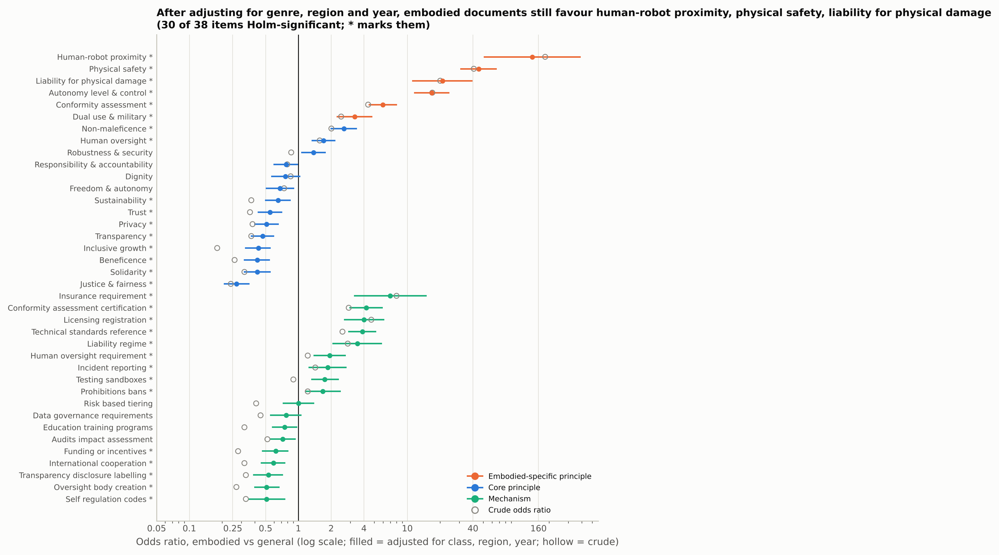

<em class="cap">Figure 38. Crude and covariate-adjusted odds ratios (embodied vs general) for principles and mechanisms, adjusting for document class, region and year.</em>

*Table 20. Embodied-AI set vs general-AI set: crude and covariate-adjusted odds ratios (logistic regression adjusting for document class, jurisdiction region, collection round and publication year; usable documents with a known year)*

| item                                           | group             |    n |   events |   events_embodied |   events_general |   sparse_cell |   crude_or |   adjusted_or |   ci_low |   ci_high |      p |   p_holm | significant_holm_05   |
|:-----------------------------------------------|:------------------|-----:|---------:|------------------:|-----------------:|--------------:|-----------:|--------------:|---------:|----------:|-------:|---------:|:----------------------|
| principle: Transparency                        | core              | 2526 |     1154 |               564 |              590 |             0 |       0.37 |          0.47 |     0.37 |      0.59 | 0      |   0      | True                  |
| principle: Justice & fairness                  | core              | 2526 |      991 |               409 |              582 |             0 |       0.24 |          0.27 |     0.21 |      0.35 | 0      |   0      | True                  |
| principle: Non-maleficence                     | core              | 2526 |     1916 |              1254 |              662 |             0 |       2.01 |          2.61 |     2.01 |      3.41 | 0      |   0      | True                  |
| principle: Responsibility & accountability     | core              | 2526 |     1544 |               915 |              629 |             0 |       0.79 |          0.77 |     0.6  |      0.98 | 0.0336 |   0.1345 | False                 |
| principle: Privacy                             | core              | 2526 |      929 |               433 |              496 |             0 |       0.38 |          0.51 |     0.4  |      0.65 | 0      |   0      | True                  |
| principle: Beneficence                         | core              | 2526 |     1527 |               760 |              767 |             0 |       0.26 |          0.42 |     0.32 |      0.54 | 0      |   0      | True                  |
| principle: Freedom & autonomy                  | core              | 2526 |      568 |               316 |              252 |             0 |       0.74 |          0.68 |     0.51 |      0.9  | 0.008  |   0.0644 | False                 |
| principle: Trust                               | core              | 2526 |      975 |               455 |              520 |             0 |       0.36 |          0.55 |     0.43 |      0.7  | 0      |   0      | True                  |
| principle: Sustainability                      | core              | 2526 |      637 |               276 |              361 |             0 |       0.37 |          0.65 |     0.5  |      0.84 | 0.0009 |   0.01   | True                  |
| principle: Dignity                             | core              | 2526 |      500 |               291 |              209 |             0 |       0.85 |          0.76 |     0.57 |      1.03 | 0.0765 |   0.2295 | False                 |
| principle: Solidarity                          | core              | 2526 |      598 |               241 |              357 |             0 |       0.32 |          0.42 |     0.32 |      0.55 | 0      |   0      | True                  |
| principle: Human oversight                     | core              | 2526 |      989 |               670 |              319 |             0 |       1.57 |          1.7  |     1.34 |      2.15 | 0      |   0.0002 | True                  |
| principle: Robustness & security               | core              | 2526 |     1298 |               774 |              524 |             0 |       0.86 |          1.38 |     1.08 |      1.76 | 0.0096 |   0.067  | False                 |
| principle: Inclusive growth                    | core              | 2526 |     1308 |               567 |              741 |             0 |       0.18 |          0.43 |     0.33 |      0.55 | 0      |   0      | True                  |
| principle: Physical safety                     | embodied-specific | 2526 |     1082 |              1036 |               46 |             0 |      40.75 |         45.18 |    31.2  |     65.42 | 0      |   0      | True                  |
| principle: Human-robot proximity               | embodied-specific | 2526 |      672 |               668 |                4 |             1 |     184.04 |        140.4  |    51.13 |    385.58 | 0      |   0      | True                  |
| principle: Liability for physical damage       | embodied-specific | 2526 |      343 |               330 |               13 |             0 |      20.04 |         20.96 |    11.23 |     39.12 | 0      |   0      | True                  |
| principle: Autonomy level & control            | embodied-specific | 2526 |      809 |               757 |               52 |             0 |      16.96 |         16.69 |    11.67 |     23.87 | 0      |   0      | True                  |
| principle: Conformity assessment               | embodied-specific | 2526 |      722 |               599 |              123 |             0 |       4.37 |          5.94 |     4.47 |      7.89 | 0      |   0      | True                  |
| principle: Dual use & military                 | embodied-specific | 2526 |      323 |               252 |               71 |             0 |       2.47 |          3.28 |     2.28 |      4.72 | 0      |   0      | True                  |
| mechanism: Audits impact assessment            | mechanism         | 2526 |      718 |               nan |              nan |           nan |       0.52 |          0.72 |     0.56 |      0.93 | 0.0106 |   0.067  | False                 |
| mechanism: Conformity assessment certification | mechanism         | 2526 |      381 |               nan |              nan |           nan |       2.9  |          4.19 |     2.98 |      5.88 | 0      |   0      | True                  |
| mechanism: Data governance requirements        | mechanism         | 2526 |      352 |               nan |              nan |           nan |       0.45 |          0.77 |     0.56 |      1.05 | 0.1013 |   0.2295 | False                 |
| mechanism: Education training programs         | mechanism         | 2526 |      710 |               nan |              nan |           nan |       0.32 |          0.75 |     0.58 |      0.96 | 0.0236 |   0.1181 | False                 |
| mechanism: Funding or incentives               | mechanism         | 2526 |      629 |               nan |              nan |           nan |       0.28 |          0.62 |     0.47 |      0.8  | 0.0003 |   0.004  | True                  |
| mechanism: Human oversight requirement         | mechanism         | 2526 |      344 |               nan |              nan |           nan |       1.22 |          1.94 |     1.4  |      2.68 | 0.0001 |   0.0009 | True                  |
| mechanism: Incident reporting                  | mechanism         | 2526 |      237 |               nan |              nan |           nan |       1.43 |          1.86 |     1.26 |      2.73 | 0.0017 |   0.0173 | True                  |
| mechanism: Insurance requirement               | mechanism         | 2526 |      128 |               nan |              nan |           nan |       7.96 |          6.98 |     3.28 |     14.86 | 0      |   0      | True                  |
| mechanism: International cooperation           | mechanism         | 2526 |      749 |               nan |              nan |           nan |       0.32 |          0.59 |     0.46 |      0.75 | 0      |   0.0004 | True                  |
| mechanism: Liability regime                    | mechanism         | 2526 |      178 |               nan |              nan |           nan |       2.84 |          3.47 |     2.08 |      5.78 | 0      |   0      | True                  |
| mechanism: Licensing registration              | mechanism         | 2526 |      387 |               nan |              nan |           nan |       4.67 |          4.01 |     2.66 |      6.06 | 0      |   0      | True                  |
| mechanism: Oversight body creation             | mechanism         | 2526 |      687 |               nan |              nan |           nan |       0.27 |          0.51 |     0.4  |      0.66 | 0      |   0      | True                  |
| mechanism: Prohibitions bans                   | mechanism         | 2526 |      266 |               nan |              nan |           nan |       1.22 |          1.68 |     1.17 |      2.42 | 0.0054 |   0.0484 | True                  |
| mechanism: Risk based tiering                  | mechanism         | 2526 |      310 |               nan |              nan |           nan |       0.41 |          1    |     0.73 |      1.38 | 0.984  |   0.984  | False                 |
| mechanism: Self regulation codes               | mechanism         | 2526 |      245 |               nan |              nan |           nan |       0.33 |          0.51 |     0.35 |      0.75 | 0.0005 |   0.0057 | True                  |
| mechanism: Technical standards reference       | mechanism         | 2526 |      876 |               nan |              nan |           nan |       2.54 |          3.86 |     2.92 |      5.09 | 0      |   0      | True                  |
| mechanism: Testing sandboxes                   | mechanism         | 2526 |      518 |               nan |              nan |           nan |       0.9  |          1.75 |     1.33 |      2.31 | 0.0001 |   0.0009 | True                  |
| mechanism: Transparency disclosure labelling   | mechanism         | 2526 |      424 |               nan |              nan |           nan |       0.33 |          0.53 |     0.39 |      0.71 | 0      |   0.0003 | True                  |

*Table 34. Core principles: Mantel-Haenszel odds ratios (embodied vs general) stratified by document class, with Holm correction*

| principle                       |   strata |   mh_odds_ratio |   ci_low |   ci_high |      p |   p_holm |
|:--------------------------------|---------:|----------------:|---------:|----------:|-------:|---------:|
| Transparency                    |        7 |            0.28 |     0.23 |      0.34 | 0      |   0      |
| Justice & fairness              |        7 |            0.16 |     0.13 |      0.2  | 0      |   0      |
| Non-maleficence                 |        7 |            1.78 |     1.45 |      2.18 | 0      |   0      |
| Responsibility & accountability |        7 |            0.55 |     0.46 |      0.67 | 0      |   0      |
| Privacy                         |        7 |            0.26 |     0.22 |      0.32 | 0      |   0      |
| Beneficence                     |        7 |            0.26 |     0.21 |      0.31 | 0      |   0      |
| Freedom & autonomy              |        7 |            0.4  |     0.31 |      0.5  | 0      |   0      |
| Trust                           |        7 |            0.29 |     0.24 |      0.36 | 0      |   0      |
| Sustainability                  |        7 |            0.43 |     0.35 |      0.52 | 0      |   0      |
| Dignity                         |        7 |            0.53 |     0.42 |      0.68 | 0      |   0      |
| Solidarity                      |        7 |            0.3  |     0.24 |      0.38 | 0      |   0      |
| Human oversight                 |        7 |            1.38 |     1.15 |      1.66 | 0.0003 |   0.0006 |
| Robustness & security           |        7 |            0.94 |     0.78 |      1.14 | 0.5592 |   0.5592 |
| Inclusive growth                |        7 |            0.29 |     0.24 |      0.35 | 0      |   0      |

Adjusting for document class, region, collection round and year (Table 20; 2,526 usable documents with a known year), the embodied-specific considerations keep large odds ratios: physical safety 45 (interval 31 to 65), liability for physical damage 21 (11 to 39), autonomy-level control 17 (12 to 24), conformity assessment 6.0 (4.5 to 7.9) and dual use 3.3 (2.3 to 4.7); human-robot proximity rests on 4 general documents and is flagged as a sparse cell, so its odds ratio is not estimable and is not quoted. Among the core principles, ten of fourteen differ after Holm correction: non-maleficence (2.6) and human oversight (1.7) are higher in embodied documents; transparency (0.47), justice and fairness (0.27), privacy (0.51), beneficence (0.42), trust (0.55), sustainability (0.65), solidarity (0.42) and inclusive growth (0.43) lower; accountability (0.77), freedom (0.68), dignity (0.76) and robustness (1.38) do not differ. Without round as a covariate (v3) thirteen differed. The Mantel-Haenszel analysis stratified by class (Table 34) agrees with the pooled within-genre tables but does not control for round, and is reported for completeness.

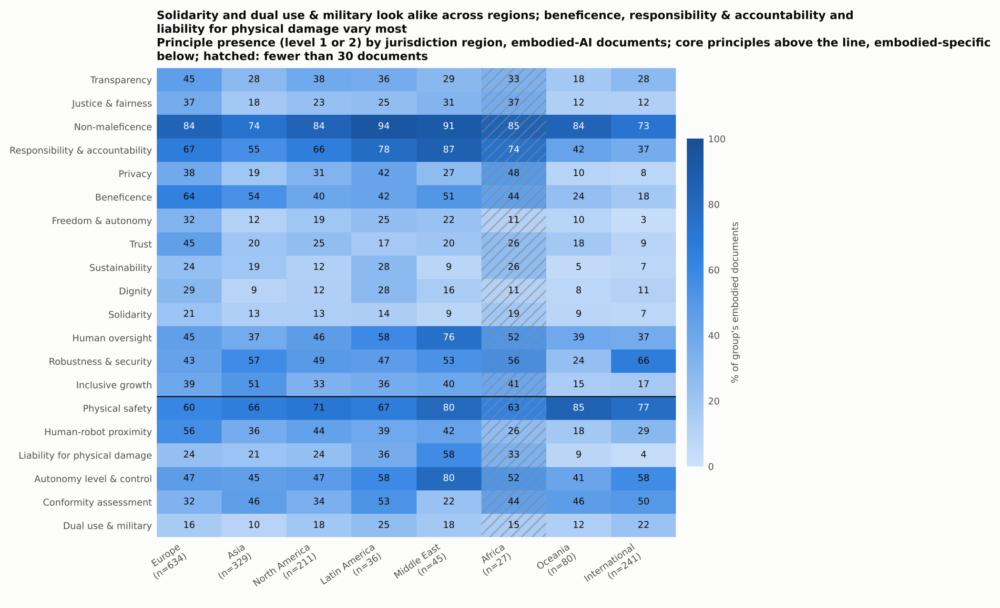

<em class="cap">Figure 21. Principle presence by jurisdiction region among embodied-AI documents (core principles above the line, embodied-specific below).</em>

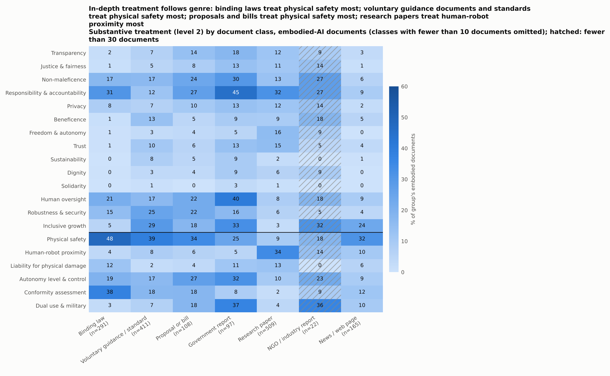

<em class="cap">Figure 22. Substantive treatment (level 2) of principles by document class among embodied-AI documents.</em>

By region (Figure 21), liability for physical damage runs from 4% (international layer) to 58% (Middle East), human oversight from 37% to 76% and autonomy-level control from 41% (Oceania) to 80% (Middle East); beneficence runs from 18% to 64% and trust from 9% to 45%, but the region profiles mix genres (Section 8). By class (Figure 22), in-depth treatment follows function: binding texts operationalise physical safety (48%) and conformity assessment (38%); drafts accountability and autonomy-level control (27% each); research proximity (34%) and accountability (32%).

### 7.2 Operationalisation of the embodied-specific considerations

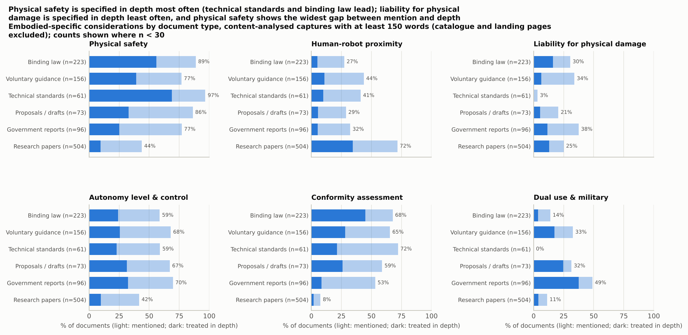

<em class="cap">Figure 23. Embodied-specific considerations by document type, content-analysed captures of at least 150 words only (catalogue and landing pages excluded): share mentioning (light) and treating in depth (dark); counts shown where n is below 30.</em>

*Table 09. Embodied-specific principles by instrument type (embodied-AI documents, content-analysed captures only; catalogue and landing pages excluded)*

| group                |   n | principle                           | label                         |   any_pct |   substantive_pct |
|:---------------------|----:|:------------------------------------|:------------------------------|----------:|------------------:|
| Binding instruments  | 195 | physical_safety                     | Physical safety               |      89.2 |              61.5 |
| Binding instruments  | 195 | human_robot_proximity               | Human-robot proximity         |      29.7 |               5.6 |
| Binding instruments  | 195 | liability_for_physical_damage       | Liability for physical damage |      33.3 |              17.9 |
| Binding instruments  | 195 | autonomy_level_control              | Autonomy level & control      |      61   |              24.6 |
| Binding instruments  | 195 | conformity_assessment_certification | Conformity assessment         |      70.3 |              47.2 |
| Binding instruments  | 195 | dual_use_military                   | Dual use & military           |      15.9 |               4.1 |
| Soft-law instruments | 207 | physical_safety                     | Physical safety               |      73.4 |              32.9 |
| Soft-law instruments | 207 | human_robot_proximity               | Human-robot proximity         |      37.7 |               9.7 |
| Soft-law instruments | 207 | liability_for_physical_damage       | Liability for physical damage |      27.5 |               4.8 |
| Soft-law instruments | 207 | autonomy_level_control              | Autonomy level & control      |      57   |              20.3 |
| Soft-law instruments | 207 | conformity_assessment_certification | Conformity assessment         |      60.9 |              24.6 |
| Soft-law instruments | 207 | dual_use_military                   | Dual use & military           |      25.1 |              13.5 |
| Technical standards  |  62 | physical_safety                     | Physical safety               |      95.2 |              67.7 |
| Technical standards  |  62 | human_robot_proximity               | Human-robot proximity         |      40.3 |               9.7 |
| Technical standards  |  62 | liability_for_physical_damage       | Liability for physical damage |       3.2 |               0   |
| Technical standards  |  62 | autonomy_level_control              | Autonomy level & control      |      59.7 |              22.6 |
| Technical standards  |  62 | conformity_assessment_certification | Conformity assessment         |      71   |              21   |
| Technical standards  |  62 | dual_use_military                   | Dual use & military           |       0   |               0   |
| Proposals / drafts   |  77 | physical_safety                     | Physical safety               |      84.4 |              32.5 |
| Proposals / drafts   |  77 | human_robot_proximity               | Human-robot proximity         |      27.3 |               5.2 |
| Proposals / drafts   |  77 | liability_for_physical_damage       | Liability for physical damage |      19.5 |               5.2 |
| Proposals / drafts   |  77 | autonomy_level_control              | Autonomy level & control      |      66.2 |              31.2 |
| Proposals / drafts   |  77 | conformity_assessment_certification | Conformity assessment         |      57.1 |              24.7 |
| Proposals / drafts   |  77 | dual_use_military                   | Dual use & military           |      32.5 |              24.7 |
| Research outputs     | 509 | physical_safety                     | Physical safety               |      43.6 |               9.4 |
| Research outputs     | 509 | human_robot_proximity               | Human-robot proximity         |      71.3 |              34.4 |
| Research outputs     | 509 | liability_for_physical_damage       | Liability for physical damage |      25   |              12.8 |
| Research outputs     | 509 | autonomy_level_control              | Autonomy level & control      |      41.8 |               9.6 |
| Research outputs     | 509 | conformity_assessment_certification | Conformity assessment         |       7.5 |               1.8 |
| Research outputs     | 509 | dual_use_military                   | Dual use & military           |      11.8 |               4.3 |

*Table 35. Governance documents (n=351): label prevalence under the v1 excerpt annotation and the v2 extended, metadata-blind annotation, with per-document agreement*

| label                                 |   v1_excerpt_pct |   v2_extended_blind_pct |   agreement |
|:--------------------------------------|-----------------:|------------------------:|------------:|
| legally binding (binding_nature)      |            12    |                   14    |       0.952 |
| in force (instrument_status)          |             8.8  |                   10.5  |       0.966 |
| is governance document                |            99.7  |                   98    |       0.977 |
| any embodied category                 |            14.5  |                   17.9  |       0.926 |
| relevance >= 2                        |             9.7  |                    9.7  |       0.983 |
| physical safety mentioned             |            14.5  |                   16.2  |       0.937 |
| physical safety in depth              |             4.3  |                    4.3  |       1     |
| autonomy-level control mentioned      |            12    |                   17.9  |       0.906 |
| autonomy-level control in depth       |             0.9  |                    2    |       0.989 |
| conformity assessment mechanism       |            11.4  |                   15.1  |       0.923 |
| risk-based tiering mechanism          |            19.7  |                   25.1  |       0.895 |
| technical standards referenced        |            35.6  |                   43.3  |       0.872 |
| liability regime mechanism            |             3.7  |                    7.1  |       0.96  |
| mechanisms per document (mean)        |             4.87 |                    5.64 |     nan     |
| topics per document (mean)            |             6.36 |                    6.83 |     nan     |
| robot types per document (mean)       |             0.43 |                    0.68 |     nan     |
| named instruments per document (mean) |             1.25 |                    1.78 |     nan     |

Table 9 and Figure 23 show which document types move the six considerations from mention to specification, computed on content-analysed captures only (Table 9 on the instrument classes of the embodied set with catalogue and landing pages excluded; Figure 23 on every capture of at least 150 words including government reports, so the two n differ). Principal binding instruments (n = 195) mention physical safety in 89% of cases and specify it in 62%, conformity assessment in 70% and 47%, autonomy-level control in 61% and 25%, liability for physical damage in 33% and 18%, proximity in 30% and 6%. Soft-law instruments (n = 207) mention physical safety in 73% and specify it in 33%, autonomy-level control in 57% and 21%. Drafts (n = 77) mention physical safety in 84% and specify it in 33%, autonomy-level control in 66% and 31%, dual use in 33% and 25% (the autonomous-weapons drafts). The 62 technical standards with a content-analysed scope page name physical safety in 95% and treat it in depth in 68%, autonomy-level control in 60% and 23%, liability in 3% (never in depth) and dual use never; these shares describe scope statements of 62 standards, not normative text, and the remaining 192 of the 254 standards in the embodied governance documents are catalogue pages that are excluded from every depth statistic. Autonomy-level control is therefore the consideration with the widest gap between mention and specification in binding law (61 points mentioned, 25 specified), and the v2 observation that nothing yet specified it no longer holds. Table 35 (unchanged since v2) records what the extended, blind re-annotation of governance documents changed: mechanisms per document rose from 4.9 to 5.6 and robot types from 0.4 to 0.7, while binding and in-force labels changed for fewer than 5% of documents.

### 7.3 Tools: governance mechanisms

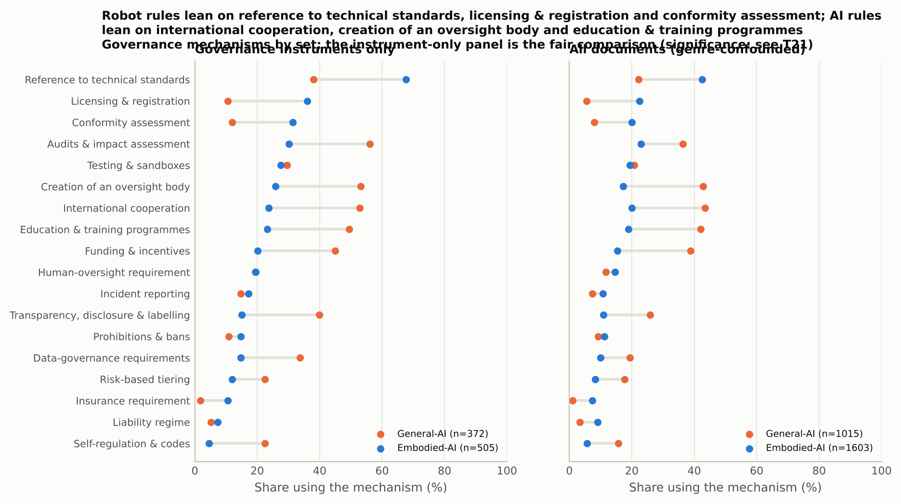

<em class="cap">Figure 24. Governance mechanisms by set: principal governance instruments only (left, the fair comparison) and all documents (right, genre-confounded).</em>

*Table 10. Governance mechanisms by set (all usable documents; instrument-only shares for governance documents, embodied n=822, general n=409)*

| mechanism                           |   embodied_pct |   general_pct |   embodied_instruments_pct |   general_instruments_pct | test       |      p |   p_holm |
|:------------------------------------|---------------:|--------------:|---------------------------:|--------------------------:|:-----------|-------:|---------:|
| technical_standards_reference       |           42.6 |          22.2 |                       67.6 |                      38.1 | chi-square | 0      |   0      |
| audits_impact_assessment            |           23   |          36.4 |                       30.2 |                      56   | chi-square | 0      |   0      |
| licensing_registration              |           22.4 |           5.5 |                       36   |                      10.5 | chi-square | 0      |   0      |
| conformity_assessment_certification |           20   |           8   |                       31.4 |                      12   | chi-square | 0      |   0      |
| international_cooperation           |           20   |          43.5 |                       23.7 |                      52.8 | chi-square | 0      |   0      |
| testing_sandboxes                   |           19.4 |          20.8 |                       27.5 |                      29.6 | chi-square | 0.4149 |   0.4149 |
| education_training_programs         |           19   |          42   |                       23.2 |                      49.4 | chi-square | 0      |   0      |
| oversight_body_creation             |           17.3 |          42.8 |                       25.8 |                      53.1 | chi-square | 0      |   0      |
| funding_or_incentives               |           15.4 |          38.8 |                       20.2 |                      45   | chi-square | 0      |   0      |
| human_oversight_requirement         |           14.6 |          11.7 |                       19.5 |                      19.3 | chi-square | 0.0415 |   0.1245 |
| prohibitions_bans                   |           11.2 |           9.2 |                       14.8 |                      10.8 | chi-square | 0.1052 |   0.2105 |
| transparency_disclosure_labelling   |           10.9 |          25.8 |                       15   |                      39.9 | chi-square | 0      |   0      |
| incident_reporting                  |           10.7 |           7.3 |                       17.2 |                      14.7 | chi-square | 0.0041 |   0.0164 |
| data_governance_requirements        |            9.9 |          19.4 |                       14.7 |                      33.7 | chi-square | 0      |   0      |
| liability_regime                    |            9.1 |           3.3 |                        7.4 |                       5.1 | chi-square | 0      |   0      |
| risk_based_tiering                  |            8.3 |          17.7 |                       11.9 |                      22.5 | chi-square | 0      |   0      |
| insurance_requirement               |            7.4 |           1   |                       10.6 |                       1.7 | chi-square | 0      |   0      |
| self_regulation_codes               |            5.7 |          15.7 |                        4.6 |                      22.5 | chi-square | 0      |   0      |

Among principal instruments (505 vs 372; Table 21), robot instruments refer to technical standards (65% vs 35%) and use licensing and registration (44% vs 10%), conformity assessment (42% vs 12%), insurance requirements (15% vs 2%), incident reporting (24% vs 16%), prohibitions (21% vs 12%) and liability regimes (11% vs 5%) significantly more often; general-AI instruments rely on audits (58% vs 43%), international cooperation (56% vs 34%), oversight bodies (56% vs 38%), education (53% vs 35%), funding (46% vs 30%), labelling (42% vs 20%), data governance (36% vs 20%) and self-regulation (24% vs 7%); human-oversight requirements, risk tiering (18% vs 23%) and testing and sandboxes (36% vs 30%) do not differ. The adjusted models (Table 20) confirm insurance (odds ratio 7.0), conformity assessment (4.2), licensing and registration (4.1), references to standards (3.9), liability regimes (3.5), human-oversight requirements (1.9), incident reporting (1.9), testing and sandboxes (1.7) and prohibitions (1.7) as the mechanisms associated with embodied documents after genre, region, round and year, and oversight bodies (0.51), self-regulation (0.51), labelling (0.53), international cooperation (0.59) and funding (0.62) as those of general-AI documents; audits (0.72), risk tiering (1.00), data governance and education do not differ after correction. No within-round table exists for mechanisms, so these contrasts carry the same caution as the pooled principle contrasts: within the instrument genre the embodied side is 88% round 2.

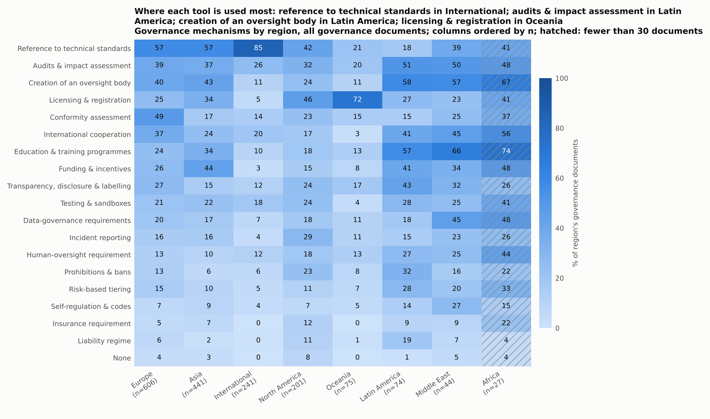

<em class="cap">Figure 25. Governance mechanisms by jurisdiction region (all governance documents).</em>

*Table 29. Regional divergence of principles and mechanisms on the same population (embodied documents in six regions): bias-corrected Cramer's V with bootstrap 95% CIs, Monte-Carlo chi-square where cells are sparse, Holm correction*

| item                                            | population                    |    n |   v_bias_corrected |   ci_low |   ci_high | test                     |      p |   p_holm |
|:------------------------------------------------|:------------------------------|-----:|-------------------:|---------:|----------:|:-------------------------|-------:|---------:|
| mechanism: Reference to technical standards     | embodied documents, 6 regions | 1576 |              0.353 |    0.31  |     0.398 | chi-square               | 0      |   0      |
| mechanism: Licensing & registration             | embodied documents, 6 regions | 1576 |              0.34  |    0.298 |     0.399 | chi-square               | 0      |   0      |
| principle: Beneficence                          | embodied documents, 6 regions | 1576 |              0.333 |    0.297 |     0.387 | chi-square               | 0      |   0      |
| principle: Trust                                | embodied documents, 6 regions | 1576 |              0.298 |    0.255 |     0.353 | chi-square               | 0      |   0      |
| mechanism: Liability regime                     | embodied documents, 6 regions | 1576 |              0.277 |    0.213 |     0.354 | chi-square               | 0      |   0      |
| principle: Freedom & autonomy                   | embodied documents, 6 regions | 1576 |              0.268 |    0.227 |     0.315 | chi-square               | 0      |   0      |
| principle: Privacy                              | embodied documents, 6 regions | 1576 |              0.262 |    0.219 |     0.306 | chi-square               | 0      |   0      |
| principle: Responsibility & accountability      | embodied documents, 6 regions | 1576 |              0.245 |    0.202 |     0.3   | chi-square               | 0      |   0      |
| principle: Liability for physical damage        | embodied documents, 6 regions | 1576 |              0.241 |    0.21  |     0.285 | chi-square               | 0      |   0      |
| principle: Inclusive growth                     | embodied documents, 6 regions | 1576 |              0.232 |    0.196 |     0.288 | chi-square               | 0      |   0      |
| principle: Human-robot proximity                | embodied documents, 6 regions | 1576 |              0.229 |    0.188 |     0.285 | chi-square               | 0      |   0      |
| principle: Dignity                              | embodied documents, 6 regions | 1576 |              0.224 |    0.186 |     0.28  | chi-square               | 0      |   0      |
| principle: Justice & fairness                   | embodied documents, 6 regions | 1576 |              0.223 |    0.185 |     0.277 | chi-square               | 0      |   0      |
| mechanism: Funding & incentives                 | embodied documents, 6 regions | 1576 |              0.216 |    0.177 |     0.262 | chi-square               | 0      |   0      |
| principle: Robustness & security                | embodied documents, 6 regions | 1576 |              0.199 |    0.156 |     0.257 | chi-square               | 0      |   0      |
| mechanism: Prohibitions & bans                  | embodied documents, 6 regions | 1576 |              0.184 |    0.129 |     0.26  | chi-square               | 0      |   0      |
| mechanism: Insurance requirement                | embodied documents, 6 regions | 1576 |              0.176 |    0.143 |     0.237 | chi-square               | 0      |   0      |
| principle: Sustainability                       | embodied documents, 6 regions | 1576 |              0.176 |    0.145 |     0.229 | chi-square               | 0      |   0      |
| principle: Transparency                         | embodied documents, 6 regions | 1576 |              0.173 |    0.132 |     0.236 | chi-square               | 0      |   0      |
| mechanism: Incident reporting                   | embodied documents, 6 regions | 1576 |              0.171 |    0.126 |     0.237 | chi-square               | 0      |   0      |
| mechanism: Risk-based tiering                   | embodied documents, 6 regions | 1576 |              0.164 |    0.102 |     0.241 | chi-square               | 0      |   0      |
| mechanism: Creation of an oversight body        | embodied documents, 6 regions | 1576 |              0.159 |    0.118 |     0.221 | chi-square               | 0      |   0      |
| principle: Conformity assessment                | embodied documents, 6 regions | 1576 |              0.151 |    0.111 |     0.207 | chi-square               | 0      |   0      |
| principle: Physical safety                      | embodied documents, 6 regions | 1576 |              0.149 |    0.11  |     0.202 | chi-square               | 0      |   0      |
| principle: Solidarity                           | embodied documents, 6 regions | 1576 |              0.137 |    0.091 |     0.188 | chi-square               | 0      |   0      |
| principle: Non-maleficence                      | embodied documents, 6 regions | 1576 |              0.134 |    0.089 |     0.196 | chi-square               | 0      |   0.0001 |
| principle: Human oversight                      | embodied documents, 6 regions | 1576 |              0.131 |    0.09  |     0.189 | chi-square               | 0      |   0.0001 |
| principle: Autonomy level & control             | embodied documents, 6 regions | 1576 |              0.128 |    0.091 |     0.187 | chi-square               | 0      |   0.0002 |
| mechanism: Education & training programmes      | embodied documents, 6 regions | 1576 |              0.124 |    0.083 |     0.183 | chi-square               | 0      |   0.0004 |
| mechanism: International cooperation            | embodied documents, 6 regions | 1576 |              0.107 |    0.071 |     0.167 | chi-square               | 0.0005 |   0.0044 |
| mechanism: Human-oversight requirement          | embodied documents, 6 regions | 1576 |              0.103 |    0.045 |     0.178 | chi-square               | 0.001  |   0.0077 |
| mechanism: Data-governance requirements         | embodied documents, 6 regions | 1576 |              0.097 |    0.06  |     0.146 | chi-square               | 0.0021 |   0.0144 |
| principle: Dual use & military                  | embodied documents, 6 regions | 1576 |              0.092 |    0.046 |     0.155 | chi-square               | 0.0038 |   0.0226 |
| mechanism: Testing & sandboxes                  | embodied documents, 6 regions | 1576 |              0.087 |    0.051 |     0.154 | chi-square               | 0.0062 |   0.0311 |
| mechanism: Conformity assessment                | embodied documents, 6 regions | 1576 |              0.07  |    0.019 |     0.138 | chi-square               | 0.034  |   0.1359 |
| mechanism: Audits & impact assessment           | embodied documents, 6 regions | 1576 |              0.059 |    0     |     0.137 | chi-square               | 0.0746 |   0.2237 |
| mechanism: Transparency, disclosure & labelling | embodied documents, 6 regions | 1576 |              0.054 |    0     |     0.147 | chi-square               | 0.1019 |   0.2237 |
| mechanism: Self-regulation & codes              | embodied documents, 6 regions | 1576 |              0.028 |    0     |     0.108 | chi-square (Monte Carlo) | 0.8803 |   0.8803 |

*Table 15. Regional divergence: association between region and principle presence (embodied-AI documents) or mechanism presence (governance documents); Cramer's V with Holm-corrected chi-square p*

| item                                          | label                               |   cramers_v |      p |   min_region_pct |   max_region_pct |   p_holm |
|:----------------------------------------------|:------------------------------------|------------:|-------:|-----------------:|-----------------:|---------:|
| principle:beneficence                         | Beneficence                         |       0.339 | 0      |             17.8 |             63.9 |   0      |
| mechanism:technical_standards_reference       | Technical standards reference       |       0.333 | 0      |             17.6 |             85.5 |   0      |
| mechanism:conformity_assessment_certification | Conformity assessment certification |       0.333 | 0      |             14.1 |             48.5 |   0      |
| mechanism:funding_or_incentives               | Funding or incentives               |       0.323 | 0      |              2.9 |             48.1 |   0      |
| mechanism:licensing_registration              | Licensing registration              |       0.315 | 0      |              5.4 |             72   |   0      |
| mechanism:education_training_programs         | Education training programs         |       0.307 | 0      |             10   |             74.1 |   0      |
| principle:trust                               | Trust                               |       0.304 | 0      |              9.1 |             44.6 |   0      |
| mechanism:oversight_body_creation             | Oversight body creation             |       0.296 | 0      |             10.7 |             66.7 |   0      |
| principle:freedom_autonomy                    | Freedom & autonomy                  |       0.275 | 0      |              3.3 |             32   |   0      |
| principle:privacy                             | Privacy                             |       0.269 | 0      |              7.9 |             41.7 |   0      |
| principle:responsibility_accountability       | Responsibility & accountability     |       0.253 | 0      |             36.5 |             86.7 |   0      |
| principle:liability_for_physical_damage       | Liability for physical damage       |       0.248 | 0      |              3.7 |             57.8 |   0      |
| principle:inclusive_growth                    | Inclusive growth                    |       0.24  | 0      |             15   |             51.1 |   0      |
| principle:human_robot_proximity               | Human-robot proximity               |       0.237 | 0      |             17.5 |             55.5 |   0      |
| mechanism:international_cooperation           | International cooperation           |       0.233 | 0      |              2.7 |             55.6 |   0      |
| principle:dignity                             | Dignity                             |       0.232 | 0      |              7.5 |             28.7 |   0      |
| principle:justice_fairness                    | Justice & fairness                  |       0.231 | 0      |             12.4 |             37.1 |   0      |
| mechanism:prohibitions_bans                   | Prohibitions bans                   |       0.214 | 0      |              5.9 |             32.4 |   0      |
| principle:robustness_security                 | Robustness & security               |       0.208 | 0      |             23.8 |             66.4 |   0      |
| mechanism:data_governance_requirements        | Data governance requirements        |       0.195 | 0      |              7.1 |             48.1 |   0      |
| mechanism:liability_regime                    | Liability regime                    |       0.193 | 0.0002 |              0.4 |             18.9 |   0.001  |
| mechanism:transparency_disclosure_labelling   | Transparency disclosure labelling   |       0.19  | 0      |             11.6 |             43.2 |   0      |
| principle:sustainability                      | Sustainability                      |       0.186 | 0      |              5   |             27.8 |   0      |
| principle:transparency                        | Transparency                        |       0.184 | 0      |             17.5 |             45.4 |   0      |
| mechanism:incident_reporting                  | Incident reporting                  |       0.181 | 0      |              4.1 |             28.9 |   0      |
| mechanism:risk_based_tiering                  | Risk based tiering                  |       0.177 | 0      |              4.6 |             33.3 |   0      |
| mechanism:insurance_requirement               | Insurance requirement               |       0.17  | 0.0002 |              0   |             22.2 |   0.001  |
| mechanism:human_oversight_requirement         | Human oversight requirement         |       0.166 | 0      |             10   |             44.4 |   0      |
| principle:conformity_assessment_certification | Conformity assessment               |       0.163 | 0      |             22.2 |             52.8 |   0      |
| principle:physical_safety                     | Physical safety                     |       0.161 | 0      |             60.3 |             85   |   0      |
| principle:solidarity                          | Solidarity                          |       0.15  | 0      |              7.5 |             21.5 |   0      |
| principle:non_maleficence                     | Non-maleficence                     |       0.147 | 0      |             72.6 |             94.4 |   0.0001 |
| principle:human_oversight                     | Human oversight                     |       0.145 | 0      |             36.9 |             75.6 |   0.0001 |
| mechanism:audits_impact_assessment            | Audits impact assessment            |       0.143 | 0      |             20   |             51.4 |   0.0001 |
| mechanism:self_regulation_codes               | Self regulation codes               |       0.142 | 0      |              4.1 |             27.3 |   0.0001 |
| principle:autonomy_level_control              | Autonomy level & control            |       0.142 | 0      |             41.2 |             80   |   0.0001 |
| mechanism:testing_sandboxes                   | Testing sandboxes                   |       0.12  | 0.001  |              4   |             40.7 |   0.0019 |
| principle:dual_use_military                   | Dual use & military                 |       0.111 | 0.0038 |              9.7 |             25   |   0.0038 |

On a common population (1,576 embodied documents in six regions; Table 29), 34 of 38 items diverge by region after Holm correction (bias-corrected V 0.09 to 0.35): references to standards (0.35), licensing and registration (0.34), beneficence (0.33), trust (0.30), liability regimes (0.28), freedom, privacy, accountability and liability for physical damage (0.24 to 0.27) lead; the conformity-assessment mechanism (0.07), audits (0.06), labelling (0.05) and self-regulation (0.03) do not differ detectably. The common population holds genre constant across regions in name only: the international layer is standards and has no research outputs, the Middle East is 69% research, Oceania is drone regulation. Table 29b repeats the statistics within one genre at a time, keeping the regions with at least 20 documents of that genre. Within research outputs (484 papers from Europe, Asia, North America and the Middle East), 2 of 14 core principles differ by region after Holm correction (human oversight, V 0.23, from 28% in North America to 77% in the Middle East; inclusive growth, 0.17), 4 of 6 embodied-specific considerations do (liability for physical damage 0.28, human-robot proximity 0.25, autonomy-level control 0.20, physical safety 0.17) and 1 of 11 mechanisms (liability regimes, 0.38); beneficence and transparency have V 0.00, justice 0.03, privacy 0.09 and trust 0.11. Within principal instruments (476 from Europe, Asia, North America, Latin America and the international layer), 12 of 14 core principles differ (beneficence 0.43, sustainability 0.34, inclusive growth 0.34, trust 0.28, privacy 0.24) and 14 of 18 mechanisms (funding 0.39, standards references 0.26, prohibitions 0.25), while physical safety, human-robot proximity, autonomy-level control, conformity assessment and dual use do not. The pattern reverses between genres: research papers share an ethical vocabulary and differ on the body, instruments share the body and differ on values and tools. The within-instrument contrast is itself a mix of instrument types, with the standards-heavy international layer at the low end of every value item (beneficence 23%, trust 9%) and Asia's strategies and guidelines at the high end (beneficence 75%, inclusive growth 74%), so the v3 statement that regions differ on values is retained only in this qualified form: among principal instruments, and not separable from the kinds of instrument each region's databases supply. The research-only distance matrix (Table 31) agrees: Europe and North America are 0.01 apart on research outputs.

*Table 29b. Regional divergence within one genre (research outputs, n=484; regions with at least 20 documents of that genre: Europe, Asia, North America, Middle East): bias-corrected Cramer's V, Holm correction*

| population       | item                                          | label                               |   n |   cramers_v |      p |   min_region_pct |   max_region_pct |   p_holm | significant_holm_05   | regions                                                       |
|:-----------------|:----------------------------------------------|:------------------------------------|----:|------------:|-------:|-----------------:|-----------------:|---------:|:----------------------|:--------------------------------------------------------------|
| research outputs | principle:transparency                        | Transparency                        | 484 |       0     | 0.82   |             37.5 |             44   |   1      | False                 | Europe (305), Asia (84), North America (64), Middle East (31) |
| research outputs | principle:justice_fairness                    | Justice & fairness                  | 484 |       0.026 | 0.3428 |             32.1 |             45.3 |   1      | False                 | Europe (305), Asia (84), North America (64), Middle East (31) |
| research outputs | principle:non_maleficence                     | Non-maleficence                     | 484 |       0.081 | 0.1017 |             73.4 |             93.5 |   1      | False                 | Europe (305), Asia (84), North America (64), Middle East (31) |
| research outputs | principle:responsibility_accountability       | Responsibility & accountability     | 484 |       0.146 | 0.0041 |             59.4 |             93.5 |   0.0976 | False                 | Europe (305), Asia (84), North America (64), Middle East (31) |
| research outputs | principle:privacy                             | Privacy                             | 484 |       0.092 | 0.0691 |             19.4 |             37.7 |   1      | False                 | Europe (305), Asia (84), North America (64), Middle East (31) |
| research outputs | principle:beneficence                         | Beneficence                         | 484 |       0     | 0.6855 |             58.1 |             70.3 |   1      | False                 | Europe (305), Asia (84), North America (64), Middle East (31) |
| research outputs | principle:freedom_autonomy                    | Freedom & autonomy                  | 484 |       0.112 | 0.0287 |             29   |             46.6 |   0.5749 | False                 | Europe (305), Asia (84), North America (64), Middle East (31) |
| research outputs | principle:trust                               | Trust                               | 484 |       0.11  | 0.0315 |             22.6 |             47.9 |   0.5984 | False                 | Europe (305), Asia (84), North America (64), Middle East (31) |
| research outputs | principle:sustainability                      | Sustainability                      | 484 |       0.055 | 0.2175 |              3.2 |             17.2 |   1      | False                 | Europe (305), Asia (84), North America (64), Middle East (31) |
| research outputs | principle:dignity                             | Dignity                             | 484 |       0.13  | 0.0111 |             22.6 |             42   |   0.2543 | False                 | Europe (305), Asia (84), North America (64), Middle East (31) |
| research outputs | principle:solidarity                          | Solidarity                          | 484 |       0.055 | 0.2143 |              9.7 |             23.4 |   1      | False                 | Europe (305), Asia (84), North America (64), Middle East (31) |
| research outputs | principle:human_oversight                     | Human oversight                     | 484 |       0.232 | 0      |             28.1 |             77.4 |   0.0001 | True                  | Europe (305), Asia (84), North America (64), Middle East (31) |
| research outputs | principle:robustness_security                 | Robustness & security               | 484 |       0.126 | 0.0137 |             27.2 |             44   |   0.3011 | False                 | Europe (305), Asia (84), North America (64), Middle East (31) |
| research outputs | principle:inclusive_growth                    | Inclusive growth                    | 484 |       0.166 | 0.0009 |             17.2 |             36.9 |   0.0237 | True                  | Europe (305), Asia (84), North America (64), Middle East (31) |
| research outputs | principle:physical_safety                     | Physical safety                     | 484 |       0.17  | 0.0007 |             39   |             74.2 |   0.0182 | True                  | Europe (305), Asia (84), North America (64), Middle East (31) |
| research outputs | principle:human_robot_proximity               | Human-robot proximity               | 484 |       0.254 | 0      |             48.4 |             79   |   0      | True                  | Europe (305), Asia (84), North America (64), Middle East (31) |
| research outputs | principle:liability_for_physical_damage       | Liability for physical damage       | 484 |       0.277 | 0      |             19.3 |             67.7 |   0      | True                  | Europe (305), Asia (84), North America (64), Middle East (31) |
| research outputs | principle:autonomy_level_control              | Autonomy level & control            | 484 |       0.202 | 0      |             29.7 |             77.4 |   0.0013 | True                  | Europe (305), Asia (84), North America (64), Middle East (31) |
| research outputs | principle:conformity_assessment_certification | Conformity assessment               | 484 |       0.103 | 0.3094 |              0   |             13.1 |   1      | False                 | Europe (305), Asia (84), North America (64), Middle East (31) |
| research outputs | principle:dual_use_military                   | Dual use & military                 | 484 |       0     | 0.9762 |              9.7 |             12.5 |   1      | False                 | Europe (305), Asia (84), North America (64), Middle East (31) |
| research outputs | mechanism:audits_impact_assessment            | Audits impact assessment            | 484 |       0.092 | 0.0695 |              8.9 |             19   |   1      | False                 | Europe (305), Asia (84), North America (64), Middle East (31) |
| research outputs | mechanism:conformity_assessment_certification | Conformity assessment certification | 484 |       0.067 | 0.6301 |              0   |              6   |   1      | False                 | Europe (305), Asia (84), North America (64), Middle East (31) |
| research outputs | mechanism:data_governance_requirements        | Data governance requirements        | 484 |       0     | 0.9385 |              0   |              4.8 |   1      | False                 | Europe (305), Asia (84), North America (64), Middle East (31) |
| research outputs | mechanism:education_training_programs         | Education training programs         | 484 |       0.06  | 0.1921 |              7.2 |             14.1 |   1      | False                 | Europe (305), Asia (84), North America (64), Middle East (31) |
| research outputs | mechanism:human_oversight_requirement         | Human oversight requirement         | 484 |       0.165 | 0.027  |              2.6 |             13.1 |   0.5669 | False                 | Europe (305), Asia (84), North America (64), Middle East (31) |
| research outputs | mechanism:international_cooperation           | International cooperation           | 484 |       0.06  | 0.6778 |              3.1 |              9.7 |   1      | False                 | Europe (305), Asia (84), North America (64), Middle East (31) |
| research outputs | mechanism:liability_regime                    | Liability regime                    | 484 |       0.381 | 0      |              4.7 |             58.1 |   0      | True                  | Europe (305), Asia (84), North America (64), Middle East (31) |
| research outputs | mechanism:self_regulation_codes               | Self regulation codes               | 484 |       0     | 0.9555 |              3.2 |              9.5 |   1      | False                 | Europe (305), Asia (84), North America (64), Middle East (31) |
| research outputs | mechanism:technical_standards_reference       | Technical standards reference       | 484 |       0.082 | 0.0985 |              0   |             14.3 |   1      | False                 | Europe (305), Asia (84), North America (64), Middle East (31) |
| research outputs | mechanism:testing_sandboxes                   | Testing sandboxes                   | 484 |       0.113 | 0.2384 |              0   |              9.5 |   1      | False                 | Europe (305), Asia (84), North America (64), Middle East (31) |
| research outputs | mechanism:transparency_disclosure_labelling   | Transparency disclosure labelling   | 484 |       0.108 | 0.2674 |              3.1 |             10.7 |   1      | False                 | Europe (305), Asia (84), North America (64), Middle East (31) |

*Table 29b. Regional divergence within one genre (principal instruments, n=476; regions with at least 20 documents of that genre: Europe, Asia, North America, Latin America & Caribbean, International): bias-corrected Cramer's V, Holm correction*

| population            | item                                          | label                               |   n |   cramers_v |      p |   min_region_pct |   max_region_pct |   p_holm | significant_holm_05   | regions                                                                                           |
|:----------------------|:----------------------------------------------|:------------------------------------|----:|------------:|-------:|-----------------:|-----------------:|---------:|:----------------------|:--------------------------------------------------------------------------------------------------|
| principal instruments | principle:transparency                        | Transparency                        | 476 |       0.176 | 0.0009 |             37.8 |             60.6 |   0.0154 | True                  | Europe (170), Asia (119), North America (102), Latin America & Caribbean (21), International (64) |
| principal instruments | principle:justice_fairness                    | Justice & fairness                  | 476 |       0.2   | 0.0001 |              9.8 |             34.1 |   0.0025 | True                  | Europe (170), Asia (119), North America (102), Latin America & Caribbean (21), International (64) |
| principal instruments | principle:non_maleficence                     | Non-maleficence                     | 476 |       0.118 | 0.0315 |             81.5 |             93.5 |   0.2833 | False                 | Europe (170), Asia (119), North America (102), Latin America & Caribbean (21), International (64) |
| principal instruments | principle:responsibility_accountability       | Responsibility & accountability     | 476 |       0.215 | 0      |             51.6 |             95.2 |   0.0008 | True                  | Europe (170), Asia (119), North America (102), Latin America & Caribbean (21), International (64) |
| principal instruments | principle:privacy                             | Privacy                             | 476 |       0.241 | 0      |             15.6 |             57.1 |   0.0001 | True                  | Europe (170), Asia (119), North America (102), Latin America & Caribbean (21), International (64) |
| principal instruments | principle:beneficence                         | Beneficence                         | 476 |       0.425 | 0      |             19.6 |             74.8 |   0      | True                  | Europe (170), Asia (119), North America (102), Latin America & Caribbean (21), International (64) |
| principal instruments | principle:freedom_autonomy                    | Freedom & autonomy                  | 476 |       0.208 | 0.0001 |              4.7 |             24.7 |   0.0015 | True                  | Europe (170), Asia (119), North America (102), Latin America & Caribbean (21), International (64) |
| principal instruments | principle:trust                               | Trust                               | 476 |       0.284 | 0      |              9.4 |             43.5 |   0      | True                  | Europe (170), Asia (119), North America (102), Latin America & Caribbean (21), International (64) |
| principal instruments | principle:sustainability                      | Sustainability                      | 476 |       0.335 | 0      |              5.9 |             42   |   0      | True                  | Europe (170), Asia (119), North America (102), Latin America & Caribbean (21), International (64) |
| principal instruments | principle:dignity                             | Dignity                             | 476 |       0.184 | 0.0005 |              3.9 |             19.4 |   0.0093 | True                  | Europe (170), Asia (119), North America (102), Latin America & Caribbean (21), International (64) |
| principal instruments | principle:solidarity                          | Solidarity                          | 476 |       0.169 | 0.0015 |              5.9 |             24.1 |   0.0218 | True                  | Europe (170), Asia (119), North America (102), Latin America & Caribbean (21), International (64) |
| principal instruments | principle:human_oversight                     | Human oversight                     | 476 |       0.169 | 0.0015 |             42   |             76.2 |   0.0218 | True                  | Europe (170), Asia (119), North America (102), Latin America & Caribbean (21), International (64) |
| principal instruments | principle:robustness_security                 | Robustness & security               | 476 |       0.091 | 0.0943 |             63.7 |             82.8 |   0.3133 | False                 | Europe (170), Asia (119), North America (102), Latin America & Caribbean (21), International (64) |
| principal instruments | principle:inclusive_growth                    | Inclusive growth                    | 476 |       0.335 | 0      |             23.4 |             73.9 |   0      | True                  | Europe (170), Asia (119), North America (102), Latin America & Caribbean (21), International (64) |
| principal instruments | principle:physical_safety                     | Physical safety                     | 476 |       0.141 | 0.0091 |             73.9 |             93.8 |   0.0912 | False                 | Europe (170), Asia (119), North America (102), Latin America & Caribbean (21), International (64) |
| principal instruments | principle:human_robot_proximity               | Human-robot proximity               | 476 |       0.024 | 0.3683 |             26.5 |             47.6 |   0.7043 | False                 | Europe (170), Asia (119), North America (102), Latin America & Caribbean (21), International (64) |
| principal instruments | principle:liability_for_physical_damage       | Liability for physical damage       | 476 |       0.214 | 0      |              4.7 |             47.6 |   0.0008 | True                  | Europe (170), Asia (119), North America (102), Latin America & Caribbean (21), International (64) |
| principal instruments | principle:autonomy_level_control              | Autonomy level & control            | 476 |       0.114 | 0.0377 |             52.1 |             71.9 |   0.3017 | False                 | Europe (170), Asia (119), North America (102), Latin America & Caribbean (21), International (64) |
| principal instruments | principle:conformity_assessment_certification | Conformity assessment               | 476 |       0.143 | 0.0083 |             51   |             72.4 |   0.0908 | False                 | Europe (170), Asia (119), North America (102), Latin America & Caribbean (21), International (64) |
| principal instruments | principle:dual_use_military                   | Dual use & military                 | 476 |       0.108 | 0.0486 |             11.8 |             33.3 |   0.3133 | False                 | Europe (170), Asia (119), North America (102), Latin America & Caribbean (21), International (64) |
| principal instruments | mechanism:audits_impact_assessment            | Audits impact assessment            | 476 |       0.207 | 0.0001 |             27.5 |             61.9 |   0.0015 | True                  | Europe (170), Asia (119), North America (102), Latin America & Caribbean (21), International (64) |
| principal instruments | mechanism:conformity_assessment_certification | Conformity assessment certification | 476 |       0.158 | 0.0032 |             29.4 |             51.8 |   0.0379 | True                  | Europe (170), Asia (119), North America (102), Latin America & Caribbean (21), International (64) |
| principal instruments | mechanism:data_governance_requirements        | Data governance requirements        | 476 |       0.162 | 0.0025 |              9.4 |             30   |   0.0324 | True                  | Europe (170), Asia (119), North America (102), Latin America & Caribbean (21), International (64) |
| principal instruments | mechanism:education_training_programs         | Education training programs         | 476 |       0.228 | 0      |             15.6 |             47.6 |   0.0002 | True                  | Europe (170), Asia (119), North America (102), Latin America & Caribbean (21), International (64) |
| principal instruments | mechanism:funding_or_incentives               | Funding or incentives               | 476 |       0.389 | 0      |              0   |             56.3 |   0      | True                  | Europe (170), Asia (119), North America (102), Latin America & Caribbean (21), International (64) |
| principal instruments | mechanism:human_oversight_requirement         | Human oversight requirement         | 476 |       0.109 | 0.0476 |             21.8 |             52.4 |   0.3133 | False                 | Europe (170), Asia (119), North America (102), Latin America & Caribbean (21), International (64) |
| principal instruments | mechanism:incident_reporting                  | Incident reporting                  | 476 |       0.17  | 0.0014 |              6.2 |             38.1 |   0.0216 | True                  | Europe (170), Asia (119), North America (102), Latin America & Caribbean (21), International (64) |
| principal instruments | mechanism:insurance_requirement               | Insurance requirement               | 476 |       0.18  | 0.0006 |              0   |             33.3 |   0.0117 | True                  | Europe (170), Asia (119), North America (102), Latin America & Caribbean (21), International (64) |
| principal instruments | mechanism:international_cooperation           | International cooperation           | 476 |       0.203 | 0.0001 |             16.7 |             45.3 |   0.002  | True                  | Europe (170), Asia (119), North America (102), Latin America & Caribbean (21), International (64) |
| principal instruments | mechanism:liability_regime                    | Liability regime                    | 476 |       0.239 | 0      |              1.6 |             33.3 |   0.0001 | True                  | Europe (170), Asia (119), North America (102), Latin America & Caribbean (21), International (64) |
| principal instruments | mechanism:licensing_registration              | Licensing registration              | 476 |       0.234 | 0      |             18.8 |             66.7 |   0.0001 | True                  | Europe (170), Asia (119), North America (102), Latin America & Caribbean (21), International (64) |
| principal instruments | mechanism:oversight_body_creation             | Oversight body creation             | 476 |       0.24  | 0      |             15.6 |             52.4 |   0.0001 | True                  | Europe (170), Asia (119), North America (102), Latin America & Caribbean (21), International (64) |
| principal instruments | mechanism:prohibitions_bans                   | Prohibitions bans                   | 476 |       0.246 | 0      |              9.2 |             52.4 |   0      | True                  | Europe (170), Asia (119), North America (102), Latin America & Caribbean (21), International (64) |
| principal instruments | mechanism:risk_based_tiering                  | Risk based tiering                  | 476 |       0.234 | 0      |              6.2 |             47.6 |   0.0001 | True                  | Europe (170), Asia (119), North America (102), Latin America & Caribbean (21), International (64) |
| principal instruments | mechanism:self_regulation_codes               | Self regulation codes               | 476 |       0.029 | 0.3521 |              3.1 |             10.1 |   0.7043 | False                 | Europe (170), Asia (119), North America (102), Latin America & Caribbean (21), International (64) |
| principal instruments | mechanism:technical_standards_reference       | Technical standards reference       | 476 |       0.258 | 0      |             33.3 |             76.6 |   0      | True                  | Europe (170), Asia (119), North America (102), Latin America & Caribbean (21), International (64) |
| principal instruments | mechanism:testing_sandboxes                   | Testing sandboxes                   | 476 |       0.102 | 0.0621 |             23.8 |             43.7 |   0.3133 | False                 | Europe (170), Asia (119), North America (102), Latin America & Caribbean (21), International (64) |
| principal instruments | mechanism:transparency_disclosure_labelling   | Transparency disclosure labelling   | 476 |       0.11  | 0.0448 |             13.4 |             28.6 |   0.3133 | False                 | Europe (170), Asia (119), North America (102), Latin America & Caribbean (21), International (64) | Among all governance documents (Figure 25, Table 15), the contrasts in tools are large (standards references from 18% in Latin America to 86% in the international layer; licensing from 5% in the international layer to 72% in Oceania), with the caveat that Africa (27), the Middle East (44), Latin America (74) and Oceania (75) have fewer than 80 governance documents each.

*Table 24. K-means on mechanism vectors of governance documents (n=1652): silhouette and bootstrap stability by k (exploratory)*

|   k |   silhouette |   mean_adjusted_rand_vs_bootstrap |   smallest_cluster |
|----:|-------------:|----------------------------------:|-------------------:|
|   2 |        0.201 |                             0.883 |                669 |
|   3 |        0.204 |                             0.87  |                369 |
|   4 |        0.157 |                             0.912 |                293 |
|   5 |        0.164 |                             0.855 |                193 |
|   6 |        0.167 |                             0.634 |                176 |

K-means bundles of mechanisms (Table 24) have silhouettes of 0.20 or less at every k and are not interpreted.

### 7.4 Framing, stance and the personhood debate

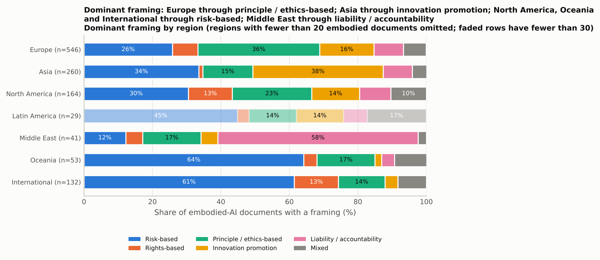

<em class="cap">Figure 26. Dominant governance framing by region (embodied-AI documents with a framing).</em>

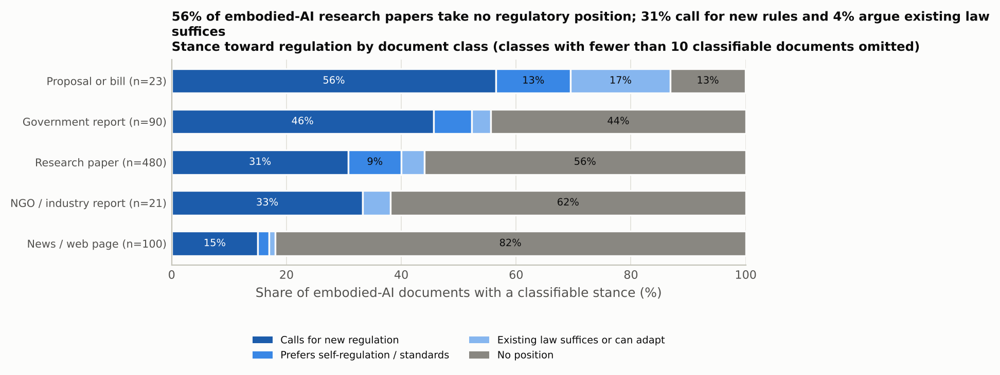

<em class="cap">Figure 27. Stance toward regulation by document class (embodied-AI documents).</em>

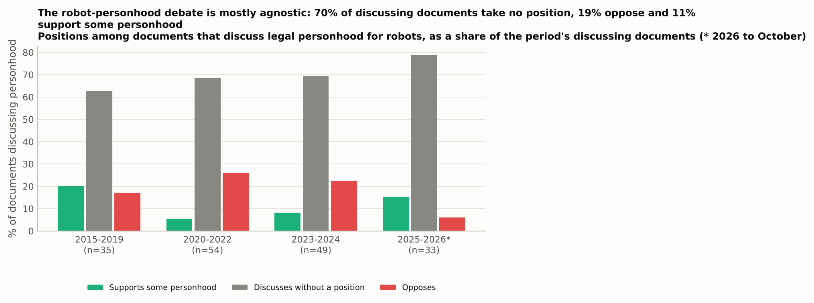

<em class="cap">Figure 28. Positions on robot legal personhood over time (documents that discuss the question).</em>

*Table 12. Robot legal personhood: positions by jurisdiction region (documents discussing it, n=174)*

| study_region              |   discusses_neutral |   opposes |   supports |
|:--------------------------|--------------------:|----------:|-----------:|
| Africa                    |                   4 |         1 |          1 |
| Asia                      |                  23 |         2 |          3 |
| Europe                    |                  57 |        23 |          6 |
| International             |                   3 |         3 |          0 |
| Latin America & Caribbean |                   1 |         1 |          0 |
| Middle East               |                  13 |         2 |          4 |
| North America             |                  18 |         1 |          4 |
| Oceania                   |                   2 |         1 |          1 |

Framing follows the document mix each region contributes. Principle-or-ethics framing leads in Europe (36% of 546 framed embodied documents, risk-based 26%); North America is risk-based (31%) before ethics (23%; n = 164); Asia is innovation-framed (38%) and risk-based (34%) with ethics at 15% (n = 260); Oceania (64% of 53), the international layer (61% of 132) and Latin America (45% of 29) are risk-based; the Middle East is liability-framed (59% of 41, a legal-doctrinal literature on civil liability for smart robots); the association is moderate (Cramér's V 0.24). Among the 480 embodied research papers that take an applicable stance, 56% take no regulatory position, 31% call for new regulation, 9% prefer self-regulation or standards and 4% argue existing law suffices. Legal personhood is discussed in 174 documents (19 supportive, 34 opposed, 121 without a position); its share of embodied documents falls from 10% in 2020 to 2024 to 5% in 2025 to 2026 (adjusted odds ratio 0.39).

### 7.5 Which instruments are cited

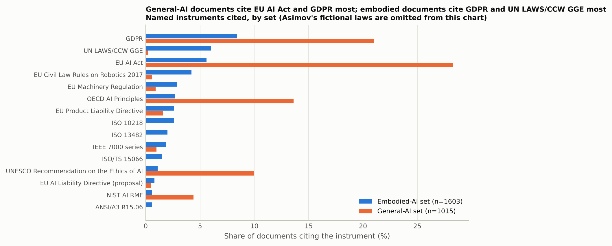

<em class="cap">Figure 29. Most cited named governance instruments, embodied-AI set vs general-AI set.</em>

*Table 13. Named instruments cited, by set (canonicalised from the annotated reference lists)*

| instrument                                   |   embodied_docs |   embodied_pct |   general_docs |   general_pct |
|:---------------------------------------------|----------------:|---------------:|---------------:|--------------:|
| GDPR                                         |             134 |            8.4 |            213 |          21   |
| UN LAWS/CCW GGE                              |              96 |            6   |              2 |           0.2 |
| EU AI Act                                    |              89 |            5.6 |            287 |          28.3 |
| EU Civil Law Rules on Robotics 2017          |              68 |            4.2 |              6 |           0.6 |
| EU Machinery Regulation                      |              46 |            2.9 |              9 |           0.9 |
| OECD AI Principles                           |              43 |            2.7 |            138 |          13.6 |
| EU Product Liability Directive               |              42 |            2.6 |             16 |           1.6 |
| ISO 10218                                    |              42 |            2.6 |              0 |           0   |
| Asimov's Laws of Robotics                    |              40 |            2.5 |              2 |           0.2 |
| ISO 13482                                    |              32 |            2   |              0 |           0   |
| IEEE 7000 series                             |              30 |            1.9 |             10 |           1   |
| ISO/TS 15066                                 |              24 |            1.5 |              0 |           0   |
| UNESCO Recommendation on the Ethics of AI    |              17 |            1.1 |            101 |          10   |
| EU AI Liability Directive (proposal)         |              13 |            0.8 |              5 |           0.5 |
| NIST AI RMF                                  |               9 |            0.6 |             45 |           4.4 |
| ANSI/A3 R15.06                               |               9 |            0.6 |              0 |           0   |
| ISO/IEC 42001                                |               6 |            0.4 |             22 |           2.2 |
| ISO/IEC 22989                                |               6 |            0.4 |             14 |           1.4 |
| US Executive Order 14110                     |               5 |            0.3 |             25 |           2.5 |
| Korea Intelligent Robots Act                 |               5 |            0.3 |              0 |           0   |
| Council of Europe Framework Convention on AI |               5 |            0.3 |             29 |           2.9 |
| Hiroshima Process                            |               4 |            0.2 |             26 |           2.6 |
| Korea AI Basic Act                           |               3 |            0.2 |              9 |           0.9 |
| ISO/IEC 23894                                |               2 |            0.1 |             10 |           1   |
| Japan AI Promotion Act                       |               2 |            0.1 |              5 |           0.5 |
| China Generative AI Measures                 |               2 |            0.1 |              6 |           0.6 |
| Bletchley Declaration                        |               1 |            0.1 |             14 |           1.4 |
| Colorado AI Act                              |               0 |            0   |              0 |           0   |
| Bill of Rights (US AI Blueprint)             |               0 |            0   |              0 |           0   |

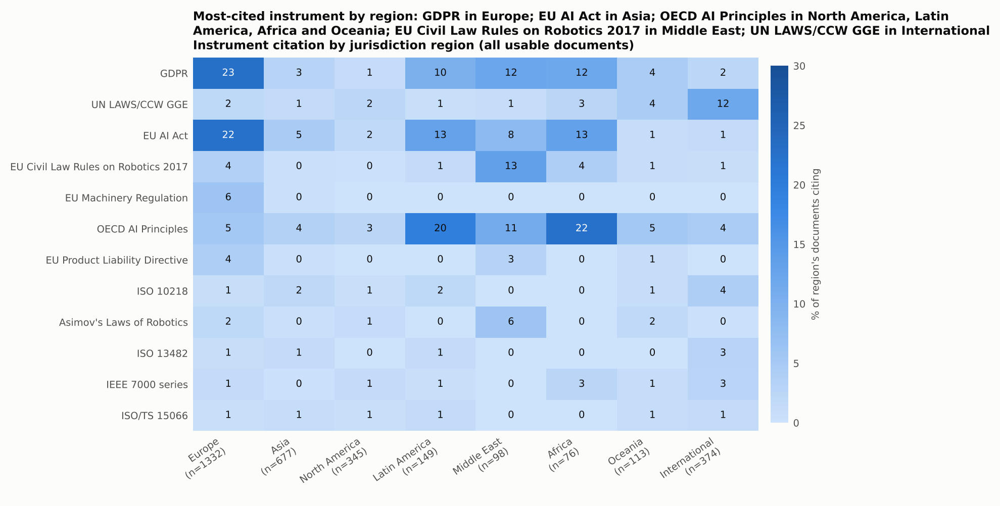

<em class="cap">Figure 30. Instrument citation by jurisdiction region (share of all usable documents in the region).</em>

General-AI documents cite the EU AI Act (28%), the GDPR (21%), the OECD principles (14%) and the UNESCO Recommendation (10%). Embodied documents cite the GDPR (8%), the UN CCW process (6%) and the AI Act (6%) and then a robotics canon the general set does not: the Civil Law Rules on Robotics (4% vs 0.6%), the Machinery Regulation (3% vs 0.9%), the Product Liability Directive (2.6%), ISO 10218 (2.6%), ISO 13482 (2.0%), the IEEE 7000 series (1.9%) and ISO/TS 15066 (1.5%). Asimov's fictional laws are cited by 2.5% of embodied documents and are not an instrument. Only 27% of embodied documents cite any named instrument, against 52% of general-AI documents, because standards and sector regulations rarely cite other instruments by name. By region, the AI Act (22%) and the GDPR (23%) are Europe's references, the OECD principles are Latin America's (20%) and Africa's (22%), the Civil Law Rules are cited most in the Middle East (13%) and the CCW process in the international layer (12%). No ISO robot standard is cited by more than 4% of any region's usable documents (Figure 30).

## 8. Part D. Regional comparison

*Table 14. Regional profiles (embodied-AI documents unless stated)*

| region                    |   documents |   embodied_documents |   embodied_share_pct |   governance_documents |   embodied_governance_documents |   binding_embodied |   research_share_embodied_pct |   median_year | top_categories                                                                          | top_principles                                                                | top_mechanisms                                                                                           | top_languages          |   countries |
|:--------------------------|------------:|---------------------:|---------------------:|-----------------------:|--------------------------------:|-------------------:|------------------------------:|--------------:|:----------------------------------------------------------------------------------------|:------------------------------------------------------------------------------|:---------------------------------------------------------------------------------------------------------|:-----------------------|------------:|
| Europe                    |        1332 |                  634 |                 47.6 |                    606 |                             212 |                 63 |                          48.1 |          2022 | Autonomous road vehicles 29%; Social companion robots 27%; Drones UAS 22%               | Non-maleficence 84%; Responsibility & accountability 67%; Beneficence 64%     | Technical standards reference 32%; Audits impact assessment 24%; Conformity assessment certification 22% | en 1161; fr 27; de 26  |          37 |
| Asia                      |         677 |                  329 |                 48.6 |                    441 |                             199 |                 32 |                          25.5 |          2024 | Autonomous road vehicles 28%; Drones UAS 23%; Professional service robots 16%           | Non-maleficence 74%; Physical safety 66%; Robustness & security 57%           | Technical standards reference 56%; Funding or incentives 27%; Licensing registration 27%                 | zh 278; en 227; ja 107 |          21 |
| North America             |         345 |                  211 |                 61.2 |                    201 |                             115 |                 65 |                          30.3 |          2022 | Autonomous road vehicles 30%; Drones UAS 26%; Social companion robots 15%               | Non-maleficence 84%; Physical safety 71%; Responsibility & accountability 66% | Licensing registration 33%; Technical standards reference 32%; Testing sandboxes 23%                     | en 337; fr 8           |           2 |
| Latin America & Caribbean |         149 |                   36 |                 24.2 |                     74 |                              23 |                 12 |                          13.9 |          2024 | Drones UAS 53%; Industrial manipulators 17%; Autonomous road vehicles 14%               | Non-maleficence 94%; Responsibility & accountability 78%; Physical safety 67% | Licensing registration 56%; Oversight body creation 44%; Audits impact assessment 42%                    | es 79; pt 44; en 25    |          21 |
| Middle East               |          98 |                   45 |                 45.9 |                     44 |                               9 |                  5 |                          68.9 |          2024 | Surgical medical robots 33%; Autonomous road vehicles 24%; Humanoid general purpose 22% | Non-maleficence 91%; Responsibility & accountability 87%; Physical safety 80% | Liability regime 49%; Licensing registration 22%; Technical standards reference 20%                      | en 70; ar 14; tr 7     |          15 |
| Africa                    |          76 |                   27 |                 35.5 |                     27 |                              12 |                  6 |                          29.6 |          2024 | Drones UAS 63%; Industrial manipulators 11%; Professional service robots 11%            | Non-maleficence 85%; Responsibility & accountability 74%; Physical safety 63% | Licensing registration 52%; Audits impact assessment 37%; Education training programs 37%                | en 75; ar 1            |          16 |
| Oceania                   |         113 |                   80 |                 70.8 |                     75 |                              53 |                  7 |                          15   |          2021 | Drones UAS 65%; Autonomous road vehicles 16%; Military autonomous weapons 11%           | Physical safety 85%; Non-maleficence 84%; Conformity assessment 46%           | Licensing registration 65%; Technical standards reference 26%; Audits impact assessment 19%              | en 113                 |           4 |
| International             |         374 |                  241 |                 64.4 |                    241 |                             199 |                  5 |                           0   |          2023 | Autonomous road vehicles 25%; Drones UAS 21%; Military autonomous weapons 21%           | Physical safety 77%; Non-maleficence 73%; Robustness & security 66%           | Technical standards reference 76%; International cooperation 28%; Audits impact assessment 23%           | en 364; fr 5; es 4     |           0 |

<em class="cap">Figure 31. Cosine distance between regional principle, topic and mechanism profiles (embodied documents; regions with at least 30), ordered by average-linkage clustering with n per region; distances below the split-half noise floor (T31b) are within sampling noise.</em>

*Table 23. Pairwise cosine distances between regional embodied-AI profiles with 95% bootstrap intervals (300 resamples within region)*

| region_a                  | region_b                  |   n_a |   n_b |   distance |   ci_low |   ci_high |
|:--------------------------|:--------------------------|------:|------:|-----------:|---------:|----------:|
| Europe                    | North America             |   634 |   211 |      0.038 |    0.026 |     0.06  |
| Asia                      | North America             |   329 |   211 |      0.046 |    0.034 |     0.072 |
| North America             | Latin America & Caribbean |   211 |    36 |      0.051 |    0.048 |     0.098 |
| North America             | Middle East               |   211 |    45 |      0.07  |    0.054 |     0.129 |
| Europe                    | Asia                      |   634 |   329 |      0.073 |    0.059 |     0.096 |
| Europe                    | Latin America & Caribbean |   634 |    36 |      0.09  |    0.067 |     0.156 |
| Asia                      | Latin America & Caribbean |   329 |    36 |      0.091 |    0.075 |     0.149 |
| North America             | Oceania                   |   211 |    80 |      0.095 |    0.066 |     0.159 |
| Asia                      | International             |   329 |   241 |      0.097 |    0.08  |     0.125 |
| Latin America & Caribbean | Middle East               |    36 |    45 |      0.098 |    0.08  |     0.171 |
| Europe                    | Middle East               |   634 |    45 |      0.103 |    0.072 |     0.163 |
| Asia                      | Oceania                   |   329 |    80 |      0.121 |    0.094 |     0.186 |
| Latin America & Caribbean | Oceania                   |    36 |    80 |      0.121 |    0.086 |     0.216 |
| Asia                      | Middle East               |   329 |    45 |      0.125 |    0.088 |     0.196 |
| North America             | International             |   211 |   241 |      0.139 |    0.116 |     0.179 |
| Oceania                   | International             |    80 |   241 |      0.146 |    0.12  |     0.198 |
| Middle East               | Oceania                   |    45 |    80 |      0.168 |    0.132 |     0.263 |
| Europe                    | Oceania                   |   634 |    80 |      0.174 |    0.13  |     0.25  |
| Europe                    | International             |   634 |   241 |      0.198 |    0.169 |     0.235 |
| Latin America & Caribbean | International             |    36 |   241 |      0.202 |    0.167 |     0.271 |
| Middle East               | International             |    45 |   241 |      0.227 |    0.183 |     0.299 |

*Table 23b. Nearest-neighbour region in the point estimate and the share of bootstrap resamples in which it is unchanged*

| region                    |   n | nearest_region   |   stability |
|:--------------------------|----:|:-----------------|------------:|
| Europe                    | 634 | North America    |        1    |
| Asia                      | 329 | North America    |        1    |
| North America             | 211 | Europe           |        0.72 |
| Latin America & Caribbean |  36 | North America    |        0.95 |
| Middle East               |  45 | North America    |        0.96 |
| Oceania                   |  80 | North America    |        0.83 |
| International             | 241 | Asia             |        0.99 |

*Table 31b. Split-half cosine distance within each region (100 random halves): the noise floor below which between-region distances are not distinguishable from sampling variation*

| region                    |   n |   split_half_distance_median |   p95 |
|:--------------------------|----:|-----------------------------:|------:|
| Europe                    | 634 |                        0.005 | 0.008 |
| Asia                      | 329 |                        0.008 | 0.013 |
| North America             | 211 |                        0.015 | 0.022 |
| Latin America & Caribbean |  36 |                        0.067 | 0.111 |
| Middle East               |  45 |                        0.046 | 0.082 |
| Oceania                   |  80 |                        0.033 | 0.054 |
| International             | 241 |                        0.009 | 0.023 |

*Table 31. Cosine distances between regional profiles using research outputs only (regions with at least 15 embodied research outputs: Europe, Asia, North America, Middle East)*

| region        |   Europe |   Asia |   North America |   Middle East |
|:--------------|---------:|-------:|----------------:|--------------:|
| Europe        |    0     |  0.059 |           0.01  |         0.182 |
| Asia          |    0.059 |  0     |           0.067 |         0.085 |
| North America |    0.01  |  0.067 |           0     |         0.189 |
| Middle East   |    0.182 |  0.085 |           0.189 |         0     |

Regional profiles are in Table 14. The cosine distances between regional principle, topic and mechanism profiles (Figure 31; regions with at least 30 embodied documents, ordered by clustering, with n per region) place Europe and North America 0.04 apart (bootstrap interval 0.03 to 0.06) and Asia and North America 0.05 apart (0.03 to 0.07), above North America's split-half noise floor of 0.02 (Table 31b); Europe and Asia are 0.07 apart, the Middle East 0.10 from Europe, Oceania 0.17 and the international layer 0.20, and the international layer stands furthest from everyone. Nearest neighbours are stable under bootstrap for Europe, Asia, the international layer, Latin America and the Middle East (95 to 100% of resamples) and less so for Oceania (83%) and North America (72%; Table 23b). Restricting to research papers (Table 31) brings Europe and North America to 0.01 apart, so their separation in the full profile is a difference in instruments (United States and Canadian vehicle and drone law against EU law and standards) and not in the research literature, whereas the Middle East's distinctiveness (0.18 from Europe) is in the research literature itself. The distances are computed on documents, not on principal instruments, and the regions' instrument counts on the principal unit (Table 54) are small outside Europe, Asia and North America.

In words, with the unit stated: Europe and North America share a social- and care-robot research literature with an ethics framing and now a large body of vehicle and drone law (170 and 102 principal embodied instruments; 63 and 65 binding); Asia is instrument-heavy (199 embodied governance documents, 119 principal instruments, 32 binding) and addresses vehicles, drones and industrial robots under innovation and risk framings; the Middle East is a liability-doctrine literature (research is 69% of its 45 embodied documents) with 8 principal instruments; Latin America is a legislative region (21 principal instruments, 12 binding; drones in 53% of its embodied documents) with thin robot research; Africa is drone regulation (63%) and capacity-building strategy (10 principal instruments, 6 binding); Oceania is Australian and New Zealand drone and vehicle regulation (80 embodied documents, 53 governance documents, but only 11 principal instruments and 7 binding, because 46 of its 48 v3 binding rows were register entries for individual CASA instruments); the international layer is the standards layer (199 embodied governance documents, 64 principal instruments, 5 binding).

## 9. Part E. Trends and the newest documents

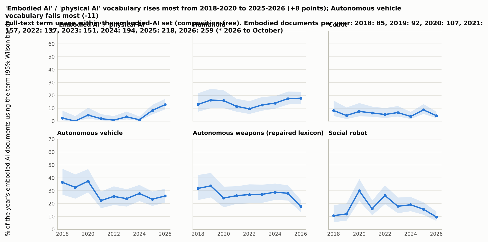

<em class="cap">Figure 33. Full-text term usage within the embodied-AI set by year (composition-free), with 95% Wilson bands and documents per year.</em>

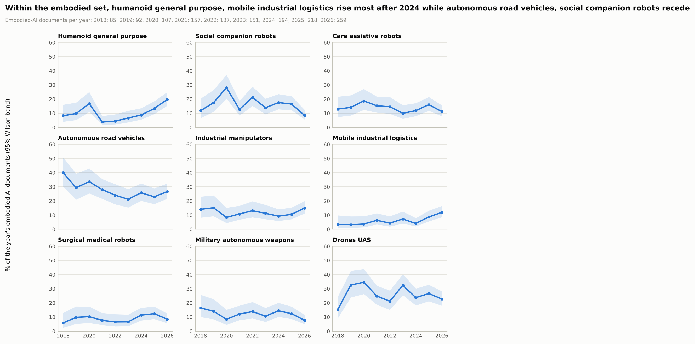

<em class="cap">Figure 42. Robot-type shares within the embodied-AI set by year, with 95% Wilson bands (composition-free trends).</em>

Within the embodied set, the terms "embodied AI" or "physical AI" appear in 1% of 2024 documents (2 of 194), 8% of 2025 documents (18 of 218) and 13% of 2026 documents (33 of 259); humanoid vocabulary is present in 9 to 18% of embodied documents in every year since 2018, highest in 2025 and 2026 (17 to 18%); social-robot vocabulary falls from 30% in 2020 to 10% in 2026; autonomous-vehicle vocabulary holds at 22 to 37%. Robot-type shares (Figure 42) show humanoids and logistics robots rising after 2024 and social robots receding; as noted in Part B, part of the 2025 to 2026 humanoid signal comes from the Chinese harvest terms, and a within-round version is not available.

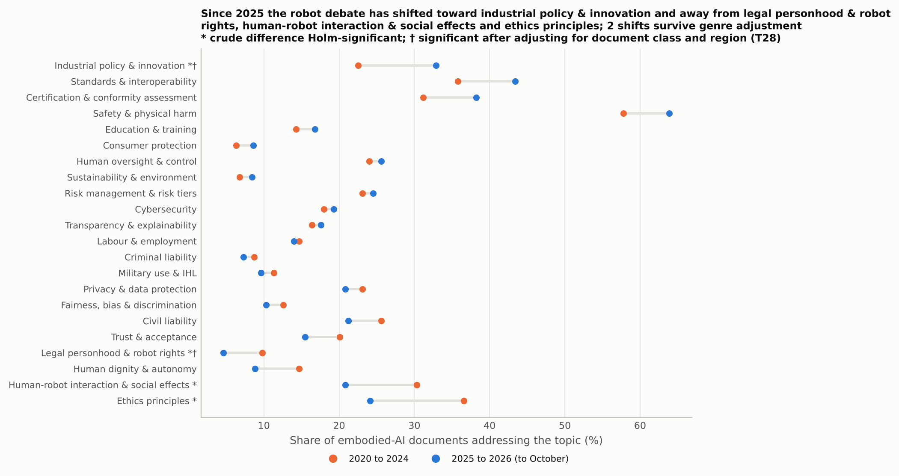

<em class="cap">Figure 34. Governance topics in 2025 to 2026 embodied documents compared with 2020 to 2024: * crude difference Holm-significant; † significant after adjusting for document class and region.</em>

*Table 28. Topic change 2025-26 vs 2020-24 in the embodied set: crude shares, research-only shares, and odds ratios adjusted for document class and region (n=1223)*

| topic                                    |   pct_2020_2024 |   pct_2025_2026 |   change_pp |   research_only_2020_2024 |   research_only_2025_2026 |   adjusted_or |   ci_low |   ci_high |      p |   p_holm |
|:-----------------------------------------|----------------:|----------------:|------------:|--------------------------:|--------------------------:|--------------:|---------:|----------:|-------:|---------:|
| Industrial policy & innovation           |            22.5 |            32.9 |        10.4 |                       8.7 |                      13.5 |          1.69 |     1.24 |      2.31 | 0.001  |   0.0267 |
| Other                                    |             4   |             5.9 |         1.8 |                       4   |                       4.3 |          1.62 |     0.92 |      2.84 | 0.094  |   1      |
| Children & vulnerable groups             |             5.9 |             6.5 |         0.6 |                      13.4 |                      12.1 |          1.58 |     0.95 |      2.65 | 0.0792 |   1      |
| Sustainability & environment             |             6.8 |             8.4 |         1.5 |                       4.7 |                       5   |          1.34 |     0.84 |      2.15 | 0.2175 |   1      |
| Consumer protection                      |             6.3 |             8.6 |         2.3 |                       5.4 |                       8.5 |          1.31 |     0.83 |      2.07 | 0.254  |   1      |
| Transparency & explainability            |            16.4 |            17.6 |         1.3 |                      23.5 |                      33.3 |          1.29 |     0.93 |      1.81 | 0.1291 |   1      |
| Certification & conformity assessment    |            31.2 |            38.2 |         6.9 |                       5.1 |                       5.7 |          1.28 |     0.96 |      1.71 | 0.0922 |   1      |
| Standards & interoperability             |            35.8 |            43.4 |         7.6 |                       8.7 |                      14.2 |          1.23 |     0.9  |      1.67 | 0.1948 |   1      |
| Education & training                     |            14.3 |            16.8 |         2.4 |                       9.7 |                      13.5 |          1.2  |     0.85 |      1.7  | 0.2934 |   1      |
| Trust & acceptance                       |            20.1 |            15.5 |        -4.6 |                      36.5 |                      38.3 |          1.2  |     0.83 |      1.72 | 0.3271 |   1      |
| Safety & physical harm                   |            57.8 |            63.9 |         6.2 |                      28.2 |                      41.1 |          1.16 |     0.88 |      1.53 | 0.3044 |   1      |
| Research ethics                          |             5.8 |             4.8 |        -0.9 |                      13.7 |                      12.1 |          1.16 |     0.66 |      2.04 | 0.6085 |   1      |
| Risk management & risk tiers             |            23.1 |            24.5 |         1.5 |                       9   |                      17.7 |          1.11 |     0.83 |      1.49 | 0.4785 |   1      |
| Labour & employment                      |            14.7 |            14   |        -0.7 |                      18.1 |                      14.9 |          1.11 |     0.78 |      1.6  | 0.5605 |   1      |
| Cybersecurity                            |            18   |            19.3 |         1.3 |                       6.1 |                      10.6 |          1.1  |     0.8  |      1.52 | 0.5641 |   1      |
| Intellectual property                    |             1.9 |             2.5 |         0.6 |                       1.1 |                       2.8 |          1.05 |     0.46 |      2.4  | 0.9125 |   1      |
| Human oversight & control                |            24   |            25.6 |         1.6 |                      15.5 |                      28.4 |          1    |     0.75 |      1.33 | 0.9943 |   1      |
| Fairness, bias & discrimination          |            12.6 |            10.3 |        -2.3 |                      18.4 |                      19.1 |          0.99 |     0.66 |      1.47 | 0.958  |   1      |
| Privacy & data protection                |            23.1 |            20.8 |        -2.3 |                      25.3 |                      21.3 |          0.96 |     0.71 |      1.3  | 0.7911 |   1      |
| Human-robot interaction & social effects |            30.3 |            20.8 |        -9.5 |                      63.9 |                      53.9 |          0.86 |     0.6  |      1.23 | 0.404  |   1      |
| Taxation & economic policy               |             1.9 |             1.5 |        -0.4 |                       2.2 |                       2.1 |          0.73 |     0.27 |      1.97 | 0.5396 |   1      |
| Civil liability                          |            25.6 |            21.2 |        -4.4 |                      33.2 |                      36.9 |          0.72 |     0.53 |      0.98 | 0.0364 |   0.873  |
| Military use & IHL                       |            11.3 |             9.6 |        -1.6 |                       7.6 |                       4.3 |          0.71 |     0.46 |      1.09 | 0.1183 |   1      |
| Human dignity & autonomy                 |            14.7 |             8.8 |        -5.9 |                      31.8 |                      26.2 |          0.68 |     0.44 |      1.04 | 0.075  |   1      |
| Criminal liability                       |             8.7 |             7.3 |        -1.4 |                       9.4 |                       7.1 |          0.67 |     0.42 |      1.06 | 0.0847 |   1      |
| Ethics principles                        |            36.6 |            24.1 |       -12.5 |                      69.3 |                      63.1 |          0.67 |     0.49 |      0.93 | 0.0179 |   0.447  |
| Legal personhood & robot rights          |             9.8 |             4.6 |        -5.2 |                      24.2 |                      14.9 |          0.39 |     0.22 |      0.7  | 0.0015 |   0.0397 |

*Table 16. Governance topics in embodied-AI documents: 2025-2026 (n=477) vs 2020-2024 (n=746)*

| topic                                  |   pct_2020_2024 |   pct_2025_2026 |   change_pp |      p |   p_holm |
|:---------------------------------------|----------------:|----------------:|------------:|-------:|---------:|
| industrial_policy_innovation           |            22.5 |            32.9 |        10.4 | 0.0001 |   0.0021 |
| standards_interoperability             |            35.8 |            43.4 |         7.6 | 0.0093 |   0.2036 |
| certification_conformity_assessment    |            31.2 |            38.2 |         6.9 | 0.015  |   0.3155 |
| safety_physical_harm                   |            57.8 |            63.9 |         6.2 | 0.0367 |   0.7345 |
| education_training                     |            14.3 |            16.8 |         2.4 | 0.2849 |   1      |
| consumer_protection                    |             6.3 |             8.6 |         2.3 | 0.161  |   1      |
| other                                  |             4   |             5.9 |         1.8 | 0.1784 |   1      |
| human_oversight_control                |            24   |            25.6 |         1.6 | 0.5766 |   1      |
| sustainability_environment             |             6.8 |             8.4 |         1.5 | 0.3706 |   1      |
| risk_management_risk_tiers             |            23.1 |            24.5 |         1.5 | 0.6016 |   1      |
| cybersecurity                          |            18   |            19.3 |         1.3 | 0.6124 |   1      |
| transparency_explainability            |            16.4 |            17.6 |         1.3 | 0.6212 |   1      |
| children_vulnerable_groups             |             5.9 |             6.5 |         0.6 | 0.7604 |   1      |
| intellectual_property                  |             1.9 |             2.5 |         0.6 | 0.5806 |   1      |
| taxation_economic_policy               |             1.9 |             1.5 |        -0.4 | 0.7553 |   1      |
| labor_employment                       |            14.7 |            14   |        -0.7 | 0.7982 |   1      |
| research_ethics                        |             5.8 |             4.8 |        -0.9 | 0.5608 |   1      |
| criminal_liability                     |             8.7 |             7.3 |        -1.4 | 0.4536 |   1      |
| military_use_ihl                       |            11.3 |             9.6 |        -1.6 | 0.424  |   1      |
| privacy_data_protection                |            23.1 |            20.8 |        -2.3 | 0.3817 |   1      |
| fairness_bias_discrimination           |            12.6 |            10.3 |        -2.3 | 0.2524 |   1      |
| civil_liability                        |            25.6 |            21.2 |        -4.4 | 0.0885 |   1      |
| trust_acceptance                       |            20.1 |            15.5 |        -4.6 | 0.0512 |   0.9724 |
| legal_personhood_robot_rights          |             9.8 |             4.6 |        -5.2 | 0.0014 |   0.0345 |
| human_dignity_autonomy                 |            14.7 |             8.8 |        -5.9 | 0.0029 |   0.0658 |
| human_robot_interaction_social_effects |            30.3 |            20.8 |        -9.5 | 0.0003 |   0.0074 |
| ethics_principles                      |            36.6 |            24.1 |       -12.5 | 0      |   0.0002 |

Comparing 477 embodied documents from 2025 to 2026 with 746 from 2020 to 2024 (Table 16), the crude shares of industrial policy (+10 points), standards (+8), conformity assessment (+7) and physical safety (+6) rise and those of ethics principles (−13), human-robot interaction (−10), human dignity (−6) and legal personhood (−5) fall; after Holm correction only industrial policy, ethics principles, human-robot interaction and personhood remain, and cybersecurity, which rose in the original collection, moves by 1 point. Adjusted for document class and region (Table 28; 1,223 documents), industrial policy (odds ratio 1.7, interval 1.2 to 2.3, Holm p = 0.03) and personhood (0.39, 0.22 to 0.70, Holm p = 0.04) survive; ethics principles (0.67, Holm p = 0.45) and human-robot interaction (0.86) do not, so the retreat of ethics discourse is composition. Within research papers alone, industrial policy moves from 9% to 14%. Table 28 does not adjust for collection round, and the 2025 to 2026 layer is where round 2's harvests of 2025 and 2026 policy notices and consolidated texts concentrate, so the industrial-policy rise should be read as a change in which documents were written and collected in 2025 to 2026 as much as a change within genres.

*Table 17. Logistic regressions: presence of embodied-specific principles (level >= 1) and two mechanisms on publication year, adjusting for region and document class (embodied-AI documents, 2015-2026)*

| outcome                                        |    n |   events |   odds_ratio_per_year |   ci_low |   ci_high |      p |   p_holm |
|:-----------------------------------------------|-----:|---------:|----------------------:|---------:|----------:|-------:|---------:|
| principle: Physical safety                     | 1496 |      999 |                 0.999 |    0.959 |     1.041 | 0.9725 |   0.9725 |
| principle: Human-robot proximity               | 1496 |      650 |                 0.937 |    0.901 |     0.975 | 0.0012 |   0.0099 |
| principle: Liability for physical damage       | 1496 |      317 |                 0.938 |    0.897 |     0.98  | 0.0044 |   0.0306 |
| principle: Autonomy level & control            | 1496 |      735 |                 0.979 |    0.944 |     1.015 | 0.246  |   0.492  |
| principle: Conformity assessment               | 1496 |      572 |                 1.049 |    1.007 |     1.094 | 0.0233 |   0.1164 |
| principle: Dual use & military                 | 1496 |      244 |                 0.96  |    0.915 |     1.008 | 0.1    |   0.3001 |
| mechanism: Risk based tiering                  | 1496 |      124 |                 1.098 |    1.023 |     1.178 | 0.0097 |   0.0583 |
| mechanism: Conformity assessment certification | 1496 |      291 |                 1.053 |    1.002 |     1.106 | 0.0401 |   0.1605 |

*Table 30. Trend models (odds ratio per year) under five specifications: collapsed region and class covariates; excluding 2026; stated-date documents only; round-1 documents only; collection round as a covariate*

| outcome                                          | sensitivity                              |    n |   events |   odds_ratio_per_year |   ci_low |   ci_high |      p |
|:-------------------------------------------------|:-----------------------------------------|-----:|---------:|----------------------:|---------:|----------:|-------:|
| mechanism: Risk-based tiering                    | all years, collapsed covariates          | 1523 |      129 |                 1.1   |    1.029 |     1.176 | 0.0052 |
| mechanism: Risk-based tiering                    | excluding partial year 2026              | 1264 |      100 |                 1.106 |    1.018 |     1.201 | 0.0166 |
| mechanism: Risk-based tiering                    | documents with a stated date only        | 1297 |      116 |                 1.08  |    1.007 |     1.158 | 0.0316 |
| mechanism: Risk-based tiering                    | round-1 documents only                   |  663 |       37 |                 1.306 |    1.112 |     1.534 | 0.0011 |
| mechanism: Risk-based tiering                    | all years, collection round as covariate | 1523 |      129 |                 1.101 |    1.03  |     1.178 | 0.0048 |
| mechanism: Conformity assessment & certification | all years, collapsed covariates          | 1523 |      300 |                 1.049 |    1.002 |     1.099 | 0.042  |
| mechanism: Conformity assessment & certification | excluding partial year 2026              | 1264 |      241 |                 1.051 |    0.994 |     1.112 | 0.0826 |
| mechanism: Conformity assessment & certification | documents with a stated date only        | 1297 |      261 |                 1.066 |    1.013 |     1.122 | 0.0142 |
| mechanism: Conformity assessment & certification | round-1 documents only                   |  663 |       48 |                 1.262 |    1.1   |     1.449 | 0.0009 |
| mechanism: Conformity assessment & certification | all years, collection round as covariate | 1523 |      300 |                 1.049 |    1.002 |     1.1   | 0.042  |
| principle: Conformity assessment                 | all years, collapsed covariates          | 1523 |      584 |                 1.044 |    1.004 |     1.086 | 0.0327 |
| principle: Conformity assessment                 | excluding partial year 2026              | 1264 |      466 |                 1.037 |    0.989 |     1.088 | 0.1364 |
| principle: Conformity assessment                 | documents with a stated date only        | 1297 |      515 |                 1.042 |    0.999 |     1.088 | 0.0574 |
| principle: Conformity assessment                 | round-1 documents only                   |  663 |       91 |                 1.119 |    1.018 |     1.231 | 0.0195 |
| principle: Conformity assessment                 | all years, collection round as covariate | 1523 |      584 |                 1.046 |    1.005 |     1.088 | 0.0286 |
| principle: Dual use & military                   | all years, collapsed covariates          | 1523 |      248 |                 0.966 |    0.923 |     1.012 | 0.1447 |
| principle: Dual use & military                   | excluding partial year 2026              | 1264 |      217 |                 0.984 |    0.933 |     1.039 | 0.5687 |
| principle: Dual use & military                   | documents with a stated date only        | 1297 |      217 |                 0.969 |    0.922 |     1.019 | 0.2202 |
| principle: Dual use & military                   | round-1 documents only                   |  663 |      102 |                 0.907 |    0.843 |     0.976 | 0.0089 |
| principle: Dual use & military                   | all years, collection round as covariate | 1523 |      248 |                 0.966 |    0.923 |     1.012 | 0.1415 |
| principle: Physical safety                       | all years, collapsed covariates          | 1523 |     1016 |                 1.003 |    0.965 |     1.043 | 0.871  |
| principle: Physical safety                       | excluding partial year 2026              | 1264 |      837 |                 1.002 |    0.956 |     1.05  | 0.9308 |
| principle: Physical safety                       | documents with a stated date only        | 1297 |      889 |                 1.005 |    0.963 |     1.049 | 0.816  |
| principle: Physical safety                       | round-1 documents only                   |  663 |      315 |                 1.024 |    0.97  |     1.082 | 0.3916 |
| principle: Physical safety                       | all years, collection round as covariate | 1523 |     1016 |                 1.004 |    0.965 |     1.045 | 0.8394 |
| principle: Autonomy level & control              | all years, collapsed covariates          | 1523 |      749 |                 0.99  |    0.956 |     1.025 | 0.5637 |
| principle: Autonomy level & control              | excluding partial year 2026              | 1264 |      620 |                 0.985 |    0.945 |     1.027 | 0.4754 |
| principle: Autonomy level & control              | documents with a stated date only        | 1297 |      660 |                 0.987 |    0.95  |     1.024 | 0.4824 |
| principle: Autonomy level & control              | round-1 documents only                   |  663 |      274 |                 1.002 |    0.948 |     1.058 | 0.9465 |
| principle: Autonomy level & control              | all years, collection round as covariate | 1523 |      749 |                 0.99  |    0.957 |     1.025 | 0.5837 |
| principle: Human-robot proximity                 | all years, collapsed covariates          | 1523 |      657 |                 0.935 |    0.901 |     0.971 | 0.0005 |
| principle: Human-robot proximity                 | excluding partial year 2026              | 1264 |      567 |                 0.935 |    0.894 |     0.978 | 0.0032 |
| principle: Human-robot proximity                 | documents with a stated date only        | 1297 |      549 |                 0.921 |    0.883 |     0.96  | 0.0001 |
| principle: Human-robot proximity                 | round-1 documents only                   |  663 |      417 |                 1.004 |    0.946 |     1.065 | 0.8997 |
| principle: Human-robot proximity                 | all years, collection round as covariate | 1523 |      657 |                 0.935 |    0.9   |     0.971 | 0.0005 |
| principle: Liability for physical damage         | all years, collapsed covariates          | 1523 |      326 |                 0.947 |    0.909 |     0.986 | 0.009  |
| principle: Liability for physical damage         | excluding partial year 2026              | 1264 |      283 |                 0.958 |    0.913 |     1.006 | 0.0828 |
| principle: Liability for physical damage         | documents with a stated date only        | 1297 |      289 |                 0.943 |    0.903 |     0.986 | 0.0099 |
| principle: Liability for physical damage         | round-1 documents only                   |  663 |      159 |                 0.998 |    0.937 |     1.063 | 0.9502 |
| principle: Liability for physical damage         | all years, collection round as covariate | 1523 |      326 |                 0.947 |    0.909 |     0.986 | 0.009  |

Trend models on the embodied set (Table 17; 2015 to 2026, 1,496 documents, adjusted for class and region) give, pooled, risk-based tiering rising about 10% a year (odds ratio 1.10, interval 1.02 to 1.18, Holm p = 0.06) and the conformity-assessment mechanism 5% (1.05, Holm p = 0.16), human-robot proximity (0.94, 0.90 to 0.98, Holm p = 0.01) and liability for physical damage (0.94, 0.90 to 0.98, Holm p = 0.03) declining, and physical safety, autonomy-level control and dual use flat. Table 30 shows which of these survive the collection design. Within round-1 documents only (663 documents, the population comparable to v2), risk-based tiering rises 31% a year (1.31, interval 1.11 to 1.53), the conformity-assessment mechanism 26% (1.26, 1.10 to 1.45) and the conformity consideration 12% (1.12, 1.02 to 1.23), reproducing the v2 result; with collection round as a covariate the pooled estimates are 1.10 (1.03 to 1.18, p = 0.005) and 1.05 (1.00 to 1.10, p = 0.04). The v3 statement that the compliance-machinery trend "does not survive" is therefore withdrawn: it is intact in the original population and diluted, not refuted, by the round-2 sector law, whose year profile is flat in these mechanisms. Dual use declines within round 1 (0.91, 0.84 to 0.98) and is flat pooled. Human-robot proximity and liability for physical damage decline pooled (0.94 and 0.95 per year, p = 0.0005 and 0.009) and with round as a covariate (the same values), but are flat within round-1 documents (1.00, interval 0.95 to 1.07, and 1.00, 0.94 to 1.06): the pooled declines coincide with the arrival of round-2 instruments that mention neither, so they are not reported as trends.

The 2025 to 2026 layer of the collection is, read document by document: industrial strategies for humanoids and embodied intelligence (Shanghai, Beijing, Japan's second AI Basic Plan, Israel's draft strategy) and Brazil's humanoid bill; research on oversight and cybersecurity of agentic and multi-robot systems; the conformity layer catching up (ISO/PAS 8800, ISO/IEC TR 5469, ISO 31101, ISO 3691-4, draft ISO 26058, the Commission's draft high-risk guidelines); and, from round 2, the binding sector layer in motion: the UK Automated Vehicles Act 2024 with its marketing-restrictions regulations, Denmark's revised self-driving trial scheme, Japan's consolidated road-traffic and vehicle-safety rules, China's MIIT notice on access, recall and over-the-air upgrades for intelligent connected vehicles, drone regulations in Vietnam, Rwanda, Argentina, Brazil and Peru, and EU regulations on non-road mobile machinery and on amending the AI Act, machinery and aviation rules (Table 59).

## 10. How different robot types are governed

*Table 12. Synthesis by robot group (level-1 taxonomy): documents, instruments and principle emphasis*

| group                      |   documents |   research |   governance_instruments |   binding |   standards |   drafts |   median_year |   physical_safety_any_pct |   liability_any_pct |   proximity_any_pct |   conformity_any_pct |   calls_for_regulation_pct | top_regions                                   |
|:---------------------------|------------:|-----------:|-------------------------:|----------:|------------:|---------:|--------------:|--------------------------:|--------------------:|--------------------:|---------------------:|---------------------------:|:----------------------------------------------|
| Industrial & logistics     |         350 |         88 |                      183 |        34 |          59 |       21 |          2023 |                      74   |                23.1 |                59.1 |                 39.7 |                       14.6 | Europe 150; Asia 91; International 48         |
| Service & social           |         516 |        328 |                      127 |         5 |          48 |       20 |          2023 |                      50   |                19   |                75.8 |                 22.7 |                       19   | Europe 273; Asia 108; North America 62        |
| Medical & body-integrated  |         197 |         91 |                       72 |         7 |          14 |       10 |          2023 |                      79.2 |                38.1 |                56.9 |                 42.6 |                       28.9 | Europe 92; Asia 46; International 18          |
| Humanoid & general-purpose |         170 |        116 |                       32 |         0 |          10 |        5 |          2024 |                      43.5 |                27.1 |                72.4 |                 16.5 |                       31.2 | Europe 82; Asia 49; North America 15          |
| Vehicles & field           |         832 |         96 |                      597 |       266 |         140 |       63 |          2023 |                      82.2 |                25.5 |                25.8 |                 53.7 |                       10.9 | Europe 303; Asia 162; International 124       |
| Security & military        |         222 |         64 |                       91 |        16 |           1 |       20 |          2022 |                      60.8 |                23.9 |                33.3 |                 32   |                       36   | Europe 90; International 51; North America 31 |
| Other embodied             |          38 |         24 |                       10 |         3 |           3 |        3 |          2022 |                      63.2 |                21.1 |                28.9 |                 13.2 |                       21.1 | Europe 22; Middle East 5; North America 3     |

*Table 13. Synthesis by embodied category: documents, instruments and emphasis*

| category                              |   docs |   instruments |   binding |   standards |   physical_safety_any_pct |   liability_any_pct |   privacy_any_pct |   dignity_any_pct | top_primary_topic             | top_mechanism_in_instruments   | instruments_most_cited                                                                      |
|:--------------------------------------|-------:|--------------:|----------:|------------:|--------------------------:|--------------------:|------------------:|------------------:|:------------------------------|:-------------------------------|:--------------------------------------------------------------------------------------------|
| autonomous_road_vehicles              |    432 |           292 |        94 |          72 |                      82.6 |                35.4 |              34.3 |              11.3 | safety_physical_harm          | technical_standards_reference  | GDPR (46); OECD AI Principles (25); EU AI Act (19)                                          |
| drones_uas                            |    415 |           321 |       172 |          51 |                      82.7 |                20   |              35.4 |              10.1 | safety_physical_harm          | technical_standards_reference  | GDPR (35); OECD AI Principles (15); Civil Aviation Safety Regulations 1998 (15)             |
| social_companion_robots               |    244 |            17 |         0 |           1 |                      35.2 |                12.7 |              41   |              49.6 | ethics_principles             | technical_standards_reference  | GDPR (3); EU Civil Law Rules on Robotics 2017 (3); OECD AI Principles (2)                   |
| care_assistive_robots                 |    219 |            57 |         4 |          12 |                      56.2 |                22.8 |              50.7 |              44.3 | ethics_principles             | technical_standards_reference  | ISO 13482 (13); GDPR (13); EU Civil Law Rules on Robotics 2017 (8)                          |
| professional_service_robots           |    210 |            82 |         2 |          38 |                      71   |                24.3 |              35.7 |              16.2 | industrial_policy_innovation  | technical_standards_reference  | GDPR (13); ISO 13482 (12); ISO 10218 (7)                                                    |
| industrial_manipulators               |    206 |           102 |        16 |          33 |                      73.3 |                20.4 |              34   |              18.4 | safety_physical_harm          | technical_standards_reference  | GDPR (26); ISO 10218 (24); EU Machinery Regulation (20)                                     |
| military_autonomous_weapons           |    188 |            69 |         3 |           0 |                      60.6 |                25.5 |              28.2 |              37.8 | military_use_ihl              | international_cooperation      | UN LAWS/CCW GGE (39); GDPR (12); OECD AI Principles (11)                                    |
| humanoid_general_purpose              |    170 |            32 |         0 |          10 |                      43.5 |                27.1 |              34.7 |              41.2 | legal_personhood_robot_rights | technical_standards_reference  | GDPR (4); EU AI Act (3); Hiroshima Process (3)                                              |
| surgical_medical_robots               |    146 |            48 |         6 |           8 |                      82.9 |                45.2 |              46.6 |              34.2 | ethics_principles             | technical_standards_reference  | GDPR (20); EU AI Act (13); OECD AI Principles (11)                                          |
| collaborative_robots                  |    115 |            40 |         6 |           9 |                      82.6 |                18.3 |              35.7 |              19.1 | safety_physical_harm          | technical_standards_reference  | ISO 10218 (13); ISO/TS 15066 (11); EU Machinery Regulation (10)                             |
| mobile_industrial_logistics           |    108 |            65 |         9 |          26 |                      74.1 |                15.7 |              20.4 |               6.5 | industrial_policy_innovation  | technical_standards_reference  | ISO 13482 (9); ISO 10218 (8); EU Machinery Regulation (8)                                   |
| agricultural_robots                   |     79 |            45 |         7 |           8 |                      60.8 |                20.3 |              49.4 |              13.9 | industrial_policy_innovation  | technical_standards_reference  | OECD AI Principles (10); GDPR (8); UNESCO Recommendation on the Ethics of AI (4)            |
| domestic_household_robots             |     79 |            29 |         0 |          13 |                      68.4 |                26.6 |              45.6 |              15.2 | industrial_policy_innovation  | technical_standards_reference  | ISO 13482 (8); ISO 10218 (3); GDPR (3)                                                      |
| rehabilitation_exoskeleton_prosthetic |     63 |            35 |         2 |           8 |                      82.5 |                27   |              39.7 |              28.6 | industrial_policy_innovation  | technical_standards_reference  | ISO 13482 (7); GDPR (6); EU Civil Law Rules on Robotics 2017 (5)                            |
| delivery_robots                       |     60 |            41 |        17 |           1 |                      90   |                46.7 |              38.3 |               6.7 | safety_physical_harm          | technical_standards_reference  | EU Machinery Regulation (2); EU AI Act (2); GDPR (2)                                        |
| security_policing_robots              |     58 |            28 |        13 |           1 |                      70.7 |                20.7 |              56.9 |              24.1 | privacy_data_protection       | licensing_registration         | GDPR (4); UN LAWS/CCW GGE (3); Regulation (EU) 2019/947 (2)                                 |
| educational_robots                    |     51 |            11 |         1 |           2 |                      51   |                15.7 |              51   |              35.3 | ethics_principles             | technical_standards_reference  | GDPR (4); EU Civil Law Rules on Robotics 2017 (3); EU AI Act (3)                            |
| autonomous_maritime_or_rail           |     49 |            36 |         1 |           8 |                      71.4 |                20.4 |              30.6 |              16.3 | industrial_policy_innovation  | technical_standards_reference  | GDPR (8); OECD AI Principles (7); EU Civil Law Rules on Robotics 2017 (5)                   |
| space_or_extreme_environment          |     44 |            22 |         2 |           1 |                      72.7 |                18.2 |              36.4 |              11.4 | industrial_policy_innovation  | funding_or_incentives          | OECD AI Principles (3); GDPR (2); EU AI Act (2)                                             |
| other_embodied                        |     38 |            10 |         3 |           3 |                      63.2 |                21.1 |              21.1 |              18.4 | ethics_principles             | technical_standards_reference  | EU Machinery Regulation (3); IEEE 7000 series (3); EU AI Act (2)                            |
| sex_robots                            |     28 |             4 |         0 |           0 |                      28.6 |                17.9 |              32.1 |              85.7 | ethics_principles             | prohibitions_bans              | EU Civil Law Rules on Robotics 2017 (2); GDPR (1); IEEE P7001 (1)                           |
| biohybrid_or_cyborg                   |     12 |             1 |         0 |           0 |                      33.3 |                25   |              25   |              50   | ethics_principles             | funding_or_incentives          |                                                                                             |
| toys_entertainment_robots             |     11 |             5 |         0 |           2 |                      81.8 |                36.4 |              63.6 |              27.3 | privacy_data_protection       | technical_standards_reference  | EU Civil Law Rules on Robotics 2017 (1); Asimov's Laws of Robotics (1); UN LAWS/CCW GGE (1) |

Tables S12 and S13 count governance-flagged documents on the comparable unit (any mention of the robot type, every legal text); Table 55 gives the principal-unit counts per group and Table 7 per category, and the counts below use those.

- **Industrial and logistics robots.** 350 documents, 131 principal instruments, 29 binding (Table 55): ISO 10218 and ISO/TS 15066 (captured as well as cited), ISO 3691-4 and draft ISO 26058, Israel's SI 395, Brazil's NR-12, the EU machinery rules, Manitoba's and Alberta's occupational-safety codes and Japan's Ordinance on Industrial Safety and Health; physical safety is present in 74% of documents and proximity in 59%; the dominant tool is the reference to standards, and ISO 10218 and the Machinery Regulation are the instruments most cited for industrial manipulators. Governance here is occupational-safety governance.
- **Service and social robots.** 516 documents and the least governed per document: 82 principal instruments, 5 binding. ISO 13482 and ISO 31101 reach professional service and care robots (50 and 45 principal instruments; 2 and 4 binding); social, educational and domestic robots are reached by 15, 8 and 17 instruments and intimate robots by 4, mainly guidance; none of the 15 social-robot instruments is binding. Proximity (76%) and dignity dominate; the GDPR and ISO 13482 are the instruments most cited, so data-protection law and one voluntary standard govern by default, together with general product, toy and consumer law that the collection does not capture as robot documents.
- **Medical and body-integrated robots.** 197 documents, 56 principal instruments, 7 binding: medical-device law and guidance (EU, FDA, Health Canada, MHRA, MFDS, WHO) and the proposed liability instruments; the highest physical-safety (79%) and liability (38%) presence; the strongest Middle Eastern presence.
- **Humanoid and general-purpose robots.** 170 documents, 20 principal instruments and no binding instrument; the v3 "one binding humanoid instrument" was a 34-word stub of a Beijing development-zone subsidy measure and is now classed as soft industrial policy. Legal personhood is the most common primary topic. The gap between the 2025 to 2026 surge in discourse and the thinness of instruments is widest here; Hangzhou's 2026 embodied-robot regulation and the GB/T 48317 humanoid standard series were located and not read.
- **Vehicles and field robots.** The most instrument-dense group (832 documents, 389 principal instruments, 174 binding): road-traffic and automated-driving acts, civil-aviation and drone rules, type-approval and machinery regulation, plus the AI strategies and the AI Act that reference them. It holds 174 of the 195 principal binding instruments, and its documents carry physical safety (82%) and conformity assessment (54%) more than any other group. Driver-assistance rules (automatic emergency braking type approval) are labelled as automated-vehicle instruments because the taxonomy has no driver-assistance category; this is a known limit.
- **Security and military robots.** 222 documents, 79 principal instruments, 14 binding: the UN CCW process (whose working papers and chair's texts are now classed as position documents, not drafts), national security and policing law, drone and counter-drone rules and humanitarian-law commentary; the highest share of documents calling for new regulation (36%).

## 11. Part F. Reliability, validation and coverage

### 11.1 Reliability of the labels

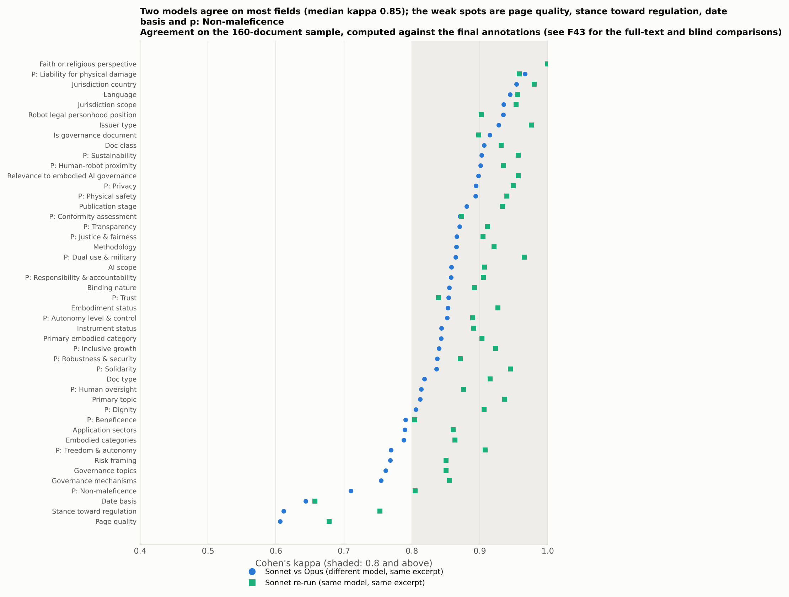

<em class="cap">Figure 35. Annotation reliability on the 160-document sample, computed against the final annotations: inter-model kappa and same-model test-retest kappa per field (shaded band marks kappa at or above 0.8).</em>

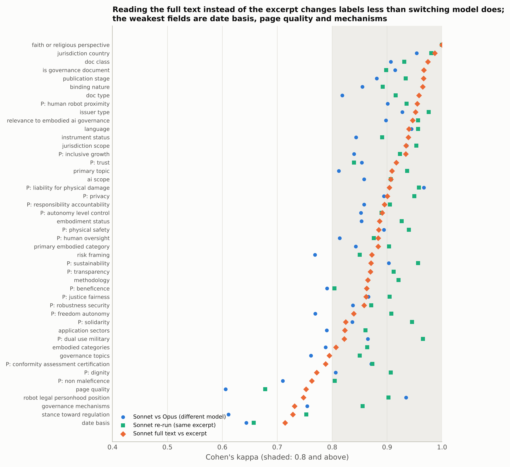

<em class="cap">Figure 43. Per-field kappa for three comparisons: different model on the same excerpt, same model re-run, and same model reading the full text instead of the excerpt.</em>

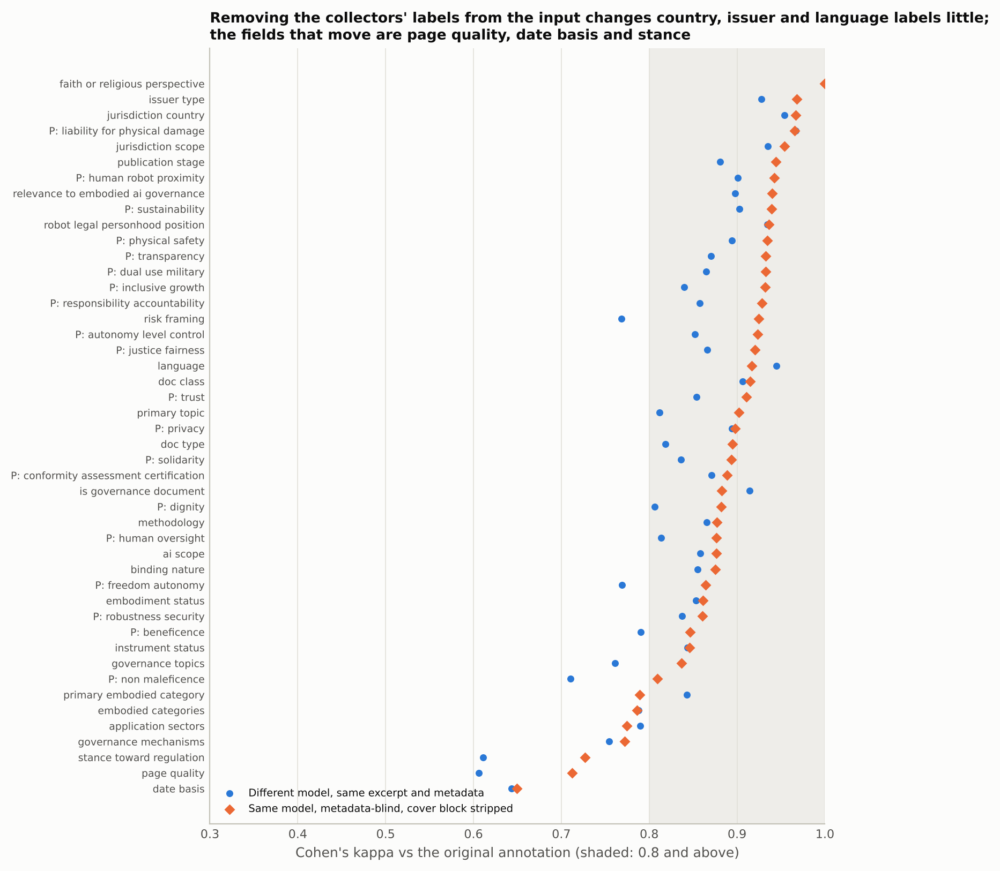

<em class="cap">Figure 44. Per-field kappa for the metadata-blind, header-stripped re-annotation versus the original annotation (leakage check).</em>

*Table 26. Per-field agreement and kappa against the v1 final annotations: independent model on the same excerpt (160 docs); same model re-run (161 docs); same model on the full text (160 docs); same model metadata-blind with the collector cover block stripped (160 docs); and, for governance documents only, the v2 blind extended-excerpt annotation (up to 110,000 characters)*

| field                                         | type        |   n |   agreement_inter_model |   kappa_inter_model |   agreement_retest |   kappa_retest |   agreement_fulltext |   kappa_fulltext |   agreement_blind |   kappa_blind |   agreement_gov_extended |   kappa_gov_extended |
|:----------------------------------------------|:------------|----:|------------------------:|--------------------:|-------------------:|---------------:|---------------------:|-----------------:|------------------:|--------------:|-------------------------:|---------------------:|
| issuer_type                                   | single      | 160 |                   0.944 |               0.928 |              0.981 |          0.976 |                0.962 |            0.951 |             0.975 |         0.968 |                    0.972 |                0.961 |
| date_basis                                    | single      | 160 |                   0.869 |               0.643 |              0.875 |          0.657 |                0.881 |            0.714 |             0.888 |         0.649 |                    0.903 |                0.694 |
| jurisdiction_country                          | single      | 160 |                   0.956 |               0.954 |              0.981 |          0.98  |                0.988 |            0.987 |             0.969 |         0.967 |                    0.997 |                0.997 |
| jurisdiction_scope                            | single      | 160 |                   0.956 |               0.935 |              0.969 |          0.953 |                0.956 |            0.934 |             0.969 |         0.954 |                    0.997 |                0.993 |
| doc_type                                      | single      | 160 |                   0.838 |               0.818 |              0.925 |          0.915 |                0.962 |            0.958 |             0.906 |         0.895 |                    0.92  |                0.905 |
| doc_class                                     | single      | 160 |                   0.931 |               0.906 |              0.95  |          0.931 |                0.981 |            0.974 |             0.938 |         0.915 |                    0.949 |                0.896 |
| is_governance_document                        | single      | 160 |                   0.969 |               0.915 |              0.962 |          0.898 |                0.988 |            0.967 |             0.956 |         0.882 |                    0.977 |               -0.005 |
| instrument_status                             | single      | 160 |                   0.938 |               0.843 |              0.956 |          0.891 |                0.975 |            0.939 |             0.938 |         0.846 |                    0.9   |                0.823 |
| binding_nature                                | single      | 160 |                   0.95  |               0.855 |              0.962 |          0.892 |                0.988 |            0.965 |             0.956 |         0.875 |                    0.917 |                0.831 |
| publication_stage                             | single      | 160 |                   0.931 |               0.881 |              0.962 |          0.934 |                0.981 |            0.966 |             0.969 |         0.944 |                    0.989 |                0.494 |
| ai_scope                                      | single      | 160 |                   0.906 |               0.858 |              0.938 |          0.907 |                0.938 |            0.907 |             0.919 |         0.876 |                    0.906 |                0.763 |
| embodiment_status                             | single      | 160 |                   0.912 |               0.853 |              0.956 |          0.927 |                0.931 |            0.886 |             0.919 |         0.861 |                    0.912 |                0.735 |
| primary_embodied_category                     | single      | 160 |                   0.906 |               0.843 |              0.944 |          0.903 |                0.931 |            0.883 |             0.881 |         0.789 |                    0.937 |                0.658 |
| primary_topic                                 | single      | 160 |                   0.831 |               0.812 |              0.944 |          0.937 |                0.919 |            0.909 |             0.912 |         0.902 |                    0.912 |                0.892 |
| robot_legal_personhood_position               | single      | 160 |                   0.988 |               0.935 |              0.981 |          0.902 |                0.944 |            0.748 |             0.988 |         0.936 |                    0.989 |                0.76  |
| risk_framing                                  | single      | 160 |                   0.806 |               0.768 |              0.875 |          0.85  |                0.894 |            0.872 |             0.938 |         0.925 |                    0.866 |                0.826 |
| stance_toward_regulation                      | single      | 160 |                   0.731 |               0.611 |              0.838 |          0.753 |                0.819 |            0.728 |             0.819 |         0.727 |                    0.892 |                0.548 |
| methodology                                   | single      | 160 |                   0.925 |               0.865 |              0.956 |          0.921 |                0.925 |            0.865 |             0.931 |         0.877 |                    1     |                1     |
| faith_or_religious_perspective                | single      | 160 |                   1     |               1     |              1     |          1     |                1     |            1     |             1     |         1     |                    1     |                1     |
| page_quality                                  | single      | 160 |                   0.825 |               0.606 |              0.862 |          0.678 |                0.9   |            0.752 |             0.881 |         0.713 |                    0.915 |                0.671 |
| language                                      | single      | 160 |                   0.975 |               0.945 |              0.981 |          0.956 |                0.975 |            0.94  |             0.962 |         0.917 |                    0.994 |                0.989 |
| relevance_to_embodied_ai_governance           | ordinal     | 160 |                   0.794 |               0.898 |              0.906 |          0.956 |                0.881 |            0.946 |             0.881 |         0.94  |                    0.869 |                0.882 |
| embodied_categories                           | multi-label | 160 |                   0.879 |               0.788 |              0.933 |          0.864 |                0.892 |            0.807 |             0.885 |         0.786 |                    0.888 |                0.6   |
| application_sectors                           | multi-label | 160 |                   0.848 |               0.79  |              0.912 |          0.861 |                0.868 |            0.823 |             0.863 |         0.774 |                    0.838 |                0.75  |
| governance_topics                             | multi-label | 160 |                   0.714 |               0.761 |              0.814 |          0.85  |                0.79  |            0.795 |             0.801 |         0.837 |                    0.758 |                0.719 |
| governance_mechanisms                         | multi-label | 160 |                   0.63  |               0.754 |              0.865 |          0.855 |                0.811 |            0.732 |             0.805 |         0.772 |                    0.745 |                0.693 |
| principle:transparency                        | ordinal 0-2 | 160 |                   0.844 |               0.87  |              0.894 |          0.912 |                0.844 |            0.869 |             0.919 |         0.932 |                    0.846 |                0.872 |
| principle:justice_fairness                    | ordinal 0-2 | 160 |                   0.862 |               0.866 |              0.9   |          0.905 |                0.85  |            0.862 |             0.919 |         0.921 |                    0.852 |                0.88  |
| principle:non_maleficence                     | ordinal 0-2 | 160 |                   0.794 |               0.71  |              0.888 |          0.805 |                0.838 |            0.763 |             0.894 |         0.809 |                    0.852 |                0.797 |
| principle:responsibility_accountability       | ordinal 0-2 | 160 |                   0.844 |               0.858 |              0.9   |          0.905 |                0.862 |            0.895 |             0.925 |         0.929 |                    0.826 |                0.843 |
| principle:privacy                             | ordinal 0-2 | 160 |                   0.881 |               0.894 |              0.944 |          0.949 |                0.888 |            0.9   |             0.906 |         0.898 |                    0.843 |                0.871 |
| principle:beneficence                         | ordinal 0-2 | 160 |                   0.856 |               0.79  |              0.881 |          0.804 |                0.906 |            0.863 |             0.888 |         0.847 |                    0.883 |                0.886 |
| principle:freedom_autonomy                    | ordinal 0-2 | 160 |                   0.862 |               0.769 |              0.956 |          0.908 |                0.888 |            0.839 |             0.925 |         0.864 |                    0.866 |                0.813 |
| principle:trust                               | ordinal 0-2 | 160 |                   0.888 |               0.854 |              0.888 |          0.839 |                0.919 |            0.916 |             0.919 |         0.911 |                    0.803 |                0.818 |
| principle:sustainability                      | ordinal 0-2 | 160 |                   0.931 |               0.903 |              0.969 |          0.956 |                0.906 |            0.87  |             0.956 |         0.939 |                    0.877 |                0.871 |
| principle:dignity                             | ordinal 0-2 | 160 |                   0.894 |               0.806 |              0.944 |          0.906 |                0.85  |            0.772 |             0.931 |         0.882 |                    0.872 |                0.828 |
| principle:solidarity                          | ordinal 0-2 | 160 |                   0.919 |               0.836 |              0.975 |          0.945 |                0.906 |            0.824 |             0.95  |         0.893 |                    0.877 |                0.815 |
| principle:human_oversight                     | ordinal 0-2 | 160 |                   0.856 |               0.814 |              0.888 |          0.876 |                0.875 |            0.883 |             0.894 |         0.877 |                    0.815 |                0.848 |
| principle:robustness_security                 | ordinal 0-2 | 160 |                   0.869 |               0.837 |              0.9   |          0.871 |                0.862 |            0.858 |             0.894 |         0.861 |                    0.835 |                0.836 |
| principle:inclusive_growth                    | ordinal 0-2 | 160 |                   0.825 |               0.84  |              0.919 |          0.923 |                0.912 |            0.934 |             0.912 |         0.932 |                    0.917 |                0.942 |
| principle:physical_safety                     | ordinal 0-2 | 160 |                   0.919 |               0.894 |              0.956 |          0.94  |                0.912 |            0.885 |             0.95  |         0.935 |                    0.937 |                0.871 |
| principle:human_robot_proximity               | ordinal 0-2 | 160 |                   0.906 |               0.901 |              0.938 |          0.935 |                0.956 |            0.955 |             0.944 |         0.942 |                    0.969 |                0.872 |
| principle:liability_for_physical_damage       | ordinal 0-2 | 160 |                   0.975 |               0.967 |              0.969 |          0.958 |                0.944 |            0.904 |             0.975 |         0.966 |                    0.972 |                0.786 |
| principle:autonomy_level_control              | ordinal 0-2 | 160 |                   0.925 |               0.852 |              0.956 |          0.89  |                0.938 |            0.891 |             0.975 |         0.923 |                    0.897 |                0.667 |
| principle:conformity_assessment_certification | ordinal 0-2 | 160 |                   0.956 |               0.871 |              0.975 |          0.873 |                0.919 |            0.788 |             0.981 |         0.889 |                    0.863 |                0.764 |
| principle:dual_use_military                   | ordinal 0-2 | 160 |                   0.975 |               0.865 |              0.994 |          0.965 |                0.956 |            0.822 |             0.988 |         0.932 |                    0.943 |                0.819 |

*Table 27. Excerpt vs full-text annotation (same model, 160 documents): label prevalence, label counts and agreement*

| item                                            |   excerpt_pct |   fulltext_pct |   diff_pp |   kappa |
|:------------------------------------------------|--------------:|---------------:|----------:|--------:|
| principle: Transparency                         |         50.6  |          53.8  |      3.1  |   0.737 |
| principle: Justice & fairness                   |         43.1  |          48.8  |      5.6  |   0.837 |
| principle: Non-maleficence                      |         74.4  |          73.8  |     -0.6  |   0.723 |
| principle: Responsibility & accountability      |         65    |          66.2  |      1.2  |   0.834 |
| principle: Privacy                              |         46.2  |          47.5  |      1.2  |   0.824 |
| principle: Beneficence                          |         69.4  |          69.4  |      0    |   0.706 |
| principle: Freedom & autonomy                   |         25.6  |          30    |      4.4  |   0.736 |
| principle: Trust                                |         43.8  |          43.8  |      0    |   0.822 |
| principle: Sustainability                       |         27.5  |          30.6  |      3.1  |   0.833 |
| principle: Dignity                              |         21.9  |          27.5  |      5.6  |   0.682 |
| principle: Solidarity                           |         23.1  |          26.9  |      3.7  |   0.8   |
| principle: Human oversight                      |         29.4  |          33.8  |      4.4  |   0.726 |
| principle: Robustness & security                |         40    |          45    |      5    |   0.745 |
| principle: Inclusive growth                     |         57.5  |          59.4  |      1.9  |   0.859 |
| principle: Physical safety                      |         26.9  |          29.4  |      2.5  |   0.846 |
| principle: Human-robot proximity                |         25.6  |          28.7  |      3.1  |   0.921 |
| principle: Liability for physical damage        |         15    |          16.2  |      1.3  |   0.905 |
| principle: Autonomy level & control             |         23.8  |          25.6  |      1.9  |   0.815 |
| principle: Conformity assessment                |         11.2  |          15.6  |      4.4  |   0.706 |
| principle: Dual use & military                  |          7.5  |          11.2  |      3.8  |   0.78  |
| labels: embodied categories (mean per document) |          0.95 |           1.09 |      0.14 | nan     |
| labels: mechanisms (mean per document)          |          2.95 |           3.29 |      0.34 | nan     |
| labels: topics (mean per document)              |          4.78 |           5.18 |      0.41 | nan     |
| labels: sectors (mean per document)             |          2.24 |           2.41 |      0.18 | nan     |
| labels: named instruments (mean per document)   |          0.96 |           1.21 |      0.26 | nan     |
| embodied-set membership                         |         45    |          46.2  |      1.3  |   0.924 |
| governance document                             |         24.4  |          25    |      0.6  |   0.916 |

*Table 27b. Excerpt vs full-text agreement by whether the v1 excerpt truncated the document*

| subset                         |   n |   median_principle_kappa |   doc_class_agreement |   exact_category_set_agreement |   governance_flag_agreement |
|:-------------------------------|----:|-------------------------:|----------------------:|-------------------------------:|----------------------------:|
| truncated by the excerpt       |  97 |                    0.749 |                 0.979 |                          0.722 |                       0.99  |
| fully contained in the excerpt |  63 |                    0.838 |                 0.937 |                          0.889 |                       0.937 |

No person read or labelled any document; the checks below compare the model with itself or with another model. Five comparisons on round-1 samples (Table 26), computed against the annotations the analysis uses: a different model on the same input agrees at a median kappa of 0.85 over 46 fields (minimum 0.61 for page quality; 11 fields below 0.80, mainly the multi-label fields, stance, framing, date basis and three principle levels); the same model re-run agrees at 0.91 (minimum 0.66); the same model reading the full text instead of the excerpt agrees at 0.88 (minimum 0.71) and finds slightly more of everything (0.1 to 0.4 more labels per document), with lower agreement on documents the excerpt truncated (median principle kappa 0.75 vs 0.84; Table 27b); the same model with the collectors' cover block and metadata removed agrees at 0.90 (minimum 0.65 for date basis); and the extended blind re-annotation of governance documents agrees with the original at 0.83, with the largest movements in robot-type labels (0.60), stance (0.55) and publication stage (0.49).

*Table 09b. Reliability variants: quadratic-weighted and unweighted kappa for ordinal fields, and agreement/kappa on the level-2 (treated in depth) threshold for principles, per comparison (round-1 and round-2 samples)*

| comparison                       |   n | field                       |   kappa_quadratic |   kappa_unweighted |   agreement_level2 |   kappa_level2 |
|:---------------------------------|----:|:----------------------------|------------------:|-------------------:|-------------------:|---------------:|
| Opus, round-1 sample             | 160 | relevance (0-3)             |             0.903 |              0.726 |            nan     |        nan     |
| Opus, round-1 sample             | 160 | principles (median over 20) |             0.846 |              0.747 |              0.956 |          0.688 |
| Sonnet re-run, round-1 sample    | 160 | relevance (0-3)             |             0.956 |              0.871 |            nan     |        nan     |
| Sonnet re-run, round-1 sample    | 160 | principles (median over 20) |             0.887 |              0.829 |              0.966 |          0.837 |
| Sonnet full text, round-1 sample | 160 | relevance (0-3)             |             0.94  |              0.819 |            nan     |        nan     |
| Sonnet full text, round-1 sample | 160 | principles (median over 20) |             0.877 |              0.795 |              0.969 |          0.832 |
| Sonnet blind, round-1 sample     | 160 | relevance (0-3)             |             0.939 |              0.838 |            nan     |        nan     |
| Sonnet blind, round-1 sample     | 160 | principles (median over 20) |             0.905 |              0.84  |              0.975 |          0.847 |
| Opus, round-2 sample             | 160 | relevance (0-3)             |             0.932 |              0.755 |            nan     |        nan     |
| Opus, round-2 sample             | 160 | principles (median over 20) |             0.864 |              0.791 |              0.988 |          0.812 |
| Sonnet re-run, round-2 sample    | 160 | relevance (0-3)             |             0.952 |              0.856 |            nan     |        nan     |
| Sonnet re-run, round-2 sample    | 160 | principles (median over 20) |             0.914 |              0.867 |              0.991 |          0.888 |

Two comparisons on a stratified round-2 sample of 160 documents (supplement S4.7) now sit beside them. Against a second model (Claude Opus 5.5) the median kappa over single-label and ordinal fields is 0.86 (0.81 over all 129 fields including the multi-label items); against a same-model re-run it is 0.91 (0.89). The weakest round-2 fields against the second model are page quality (0.53), stance toward regulation (0.65), publication stage (0.66), date basis (0.70), instrument status (0.75) and document type (0.79); the set-defining fields are at 0.83 (AI scope), 0.86 (document class, binding nature, embodiment status) and 0.93 (relevance, quadratic-weighted; 0.76 unweighted); 19 of 20 principle levels are at or above 0.79, solidarity at 0.72; among the multi-label items the weakest are the taxation topic (0.16), the creation of an oversight body (0.35), domestic robots (0.32) and self-regulation (0.43). The re-run reaches 0.84 for AI scope, 0.95 for relevance, 0.89 for instrument status and 0.90 for binding nature, with page quality (0.69) and publication stage (0.66) weakest. Table S09b gives the unweighted and level-2 variants for every comparison: on the "treated in depth" threshold the round-2 principle kappas are 0.81 (second model) and 0.89 (re-run) against 0.69 and 0.84 on the round-1 samples, so the depth scores that Table 9 rests on are at least as stable in round 2 as in round 1. Two limits: the second-model and re-run annotations were produced under the v2 excerpt policy before the character-aware cleaner, so for the 36 Chinese, Japanese and Korean documents in the sample the comparison also includes the cleaner change; and 27 of the 160 are landing pages whose labels agree because there is little to disagree about. The collector-metadata agreement check (Section 2) is a consistency check between model outputs, not an independent reference.

### 11.2 Precision of the instrument counts

The independent precision audit (Section 4; Table 62; supplement S13) read 100 randomly sampled v3 binding embodied texts: 67% distinct instruments, 97% binding, 56% with substantive embodied provisions, 67% with autonomy or AI content, 14% naming AI explicitly; 54% (44 to 63) distinct, binding and substantive together, implying about 161 (132 to 190) such instruments in the v3 set of 299. The failures were individual exemptions, approvals and directions captured as register pages (14), binding regimes with no embodied-specific provision (10), register, catalogue, index or table-of-contents captures (9), ancillary EU and UK acts (8), non-binding Chinese policy documents (3) and definitions-only sections (2); 60 of the 100 belonged to a family with another member in the population. On the same 100 documents the v4 rules keep 61% (51 to 70), agreeing with the auditor on 77% (kappa 0.53). Precision and coverage pull in opposite directions and are reported separately: the v4 counts are upper bounds on distinct, binding, substantive instruments and lower bounds on what exists.

### 11.3 Model-free check: full-text lexicons

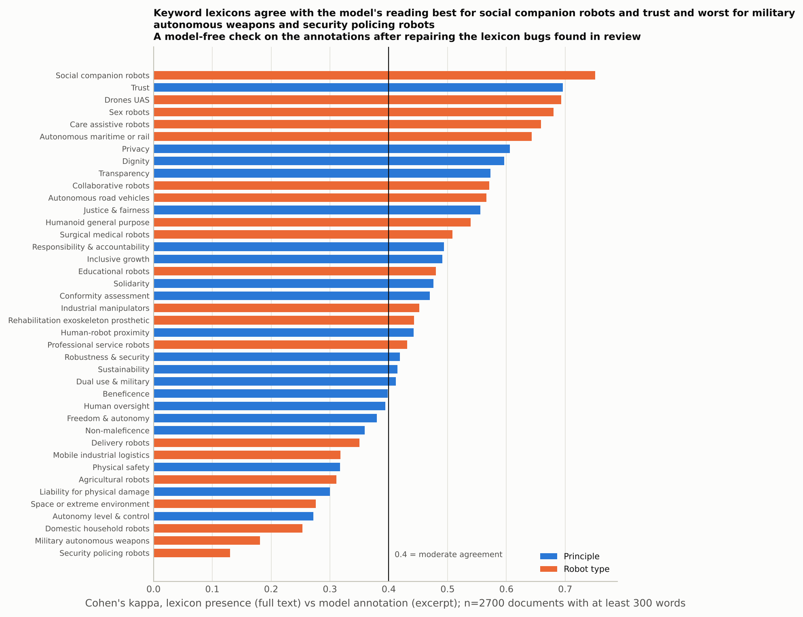

<em class="cap">Figure 36. Lexicon-based measures from full text versus model annotation of the excerpt: agreement and kappa per principle and category.</em>

*Table 18. Agreement between full-text lexicon presence and excerpt-based annotation (documents with >= 300 words, n=2700); 'density05' = at least 0.5 hits per 1,000 words*

| item                                           | label                                 |    n |   annotated_pct |   lexicon_any_pct |   agreement_any |   kappa_any |   agreement_density05 |   kappa_density05 |
|:-----------------------------------------------|:--------------------------------------|-----:|----------------:|------------------:|----------------:|------------:|----------------------:|------------------:|
| principle:transparency                         | Transparency                          | 2700 |            46.7 |              36.9 |           0.79  |       0.573 |                 0.731 |             0.443 |
| principle:justice_fairness                     | Justice & fairness                    | 2700 |            37.7 |              43.4 |           0.785 |       0.556 |                 0.802 |             0.554 |
| principle:non_maleficence                      | Non-maleficence                       | 2700 |            73.6 |              74.1 |           0.753 |       0.359 |                 0.727 |             0.371 |
| principle:responsibility_accountability        | Responsibility & accountability       | 2700 |            61.3 |              64.1 |           0.763 |       0.494 |                 0.727 |             0.452 |
| principle:privacy                              | Privacy                               | 2700 |            35.3 |              46.8 |           0.807 |       0.606 |                 0.793 |             0.55  |
| principle:beneficence                          | Beneficence                           | 2700 |            57.3 |              47.1 |           0.697 |       0.398 |                 0.648 |             0.335 |
| principle:freedom_autonomy                     | Freedom & autonomy                    | 2700 |            21.6 |              29.1 |           0.764 |       0.38  |                 0.792 |             0.269 |
| principle:trust                                | Trust                                 | 2700 |            36   |              35.8 |           0.86  |       0.696 |                 0.821 |             0.576 |
| principle:sustainability                       | Sustainability                        | 2700 |            24.9 |              47.2 |           0.716 |       0.415 |                 0.8   |             0.5   |
| principle:dignity                              | Dignity                               | 2700 |            18.9 |              11.8 |           0.894 |       0.596 |                 0.844 |             0.259 |
| principle:solidarity                           | Solidarity                            | 2700 |            22.8 |              28   |           0.801 |       0.476 |                 0.834 |             0.431 |
| principle:human_oversight                      | Human oversight                       | 2700 |            35.6 |              14.3 |           0.76  |       0.394 |                 0.693 |             0.168 |
| principle:robustness_security                  | Robustness & security                 | 2700 |            48.1 |              43.8 |           0.711 |       0.419 |                 0.679 |             0.347 |
| principle:inclusive_growth                     | Inclusive growth                      | 2700 |            48.1 |              52.5 |           0.745 |       0.491 |                 0.74  |             0.477 |
| principle:physical_safety                      | Physical safety                       | 2700 |            40   |              20.9 |           0.698 |       0.317 |                 0.669 |             0.204 |
| principle:human_robot_proximity                | Human-robot proximity                 | 2700 |            24   |              14.5 |           0.824 |       0.442 |                 0.82  |             0.346 |
| principle:liability_for_physical_damage        | Liability for physical damage         | 2700 |            12.9 |              14.5 |           0.834 |       0.3   |                 0.878 |             0.226 |
| principle:autonomy_level_control               | Autonomy level & control              | 2700 |            27.7 |               9.5 |           0.768 |       0.272 |                 0.745 |             0.111 |
| principle:conformity_assessment_certification  | Conformity assessment                 | 2700 |            31.3 |              31.9 |           0.771 |       0.47  |                 0.796 |             0.469 |
| principle:dual_use_military                    | Dual use & military                   | 2700 |            12   |              32.1 |           0.786 |       0.412 |                 0.906 |             0.605 |
| category:humanoid_general_purpose              | Humanoid general purpose              | 2700 |             5.7 |               8.5 |           0.939 |       0.539 |                 0.964 |             0.61  |
| category:collaborative_robots                  | Collaborative robots                  | 2700 |             3.8 |               3.3 |           0.971 |       0.571 |                 0.973 |             0.489 |
| category:industrial_manipulators               | Industrial manipulators               | 2700 |             7.3 |               6.9 |           0.928 |       0.452 |                 0.939 |             0.361 |
| category:mobile_industrial_logistics           | Mobile industrial logistics           | 2700 |             3.4 |               4.6 |           0.948 |       0.318 |                 0.97  |             0.366 |
| category:delivery_robots                       | Delivery robots                       | 2700 |             1.8 |               1.1 |           0.981 |       0.35  |                 0.986 |             0.335 |
| category:professional_service_robots           | Professional service robots           | 2700 |             6.8 |               5.6 |           0.934 |       0.431 |                 0.944 |             0.367 |
| category:domestic_household_robots             | Domestic household robots             | 2700 |             2.5 |               1.9 |           0.968 |       0.253 |                 0.975 |             0.054 |
| category:social_companion_robots               | Social companion robots               | 2700 |             8.7 |               9.7 |           0.959 |       0.751 |                 0.969 |             0.775 |
| category:care_assistive_robots                 | Care assistive robots                 | 2700 |             7.6 |               6.4 |           0.956 |       0.659 |                 0.958 |             0.61  |
| category:educational_robots                    | Educational robots                    | 2700 |             1.8 |               0.8 |           0.987 |       0.48  |                 0.985 |             0.306 |
| category:sex_robots                            | Sex robots                            | 2700 |             1   |               1.8 |           0.991 |       0.68  |                 0.996 |             0.813 |
| category:surgical_medical_robots               | Surgical medical robots               | 2700 |             5   |               4.7 |           0.954 |       0.508 |                 0.964 |             0.472 |
| category:rehabilitation_exoskeleton_prosthetic | Rehabilitation exoskeleton prosthetic | 2700 |             1.9 |               3.7 |           0.969 |       0.443 |                 0.984 |             0.515 |
| category:autonomous_road_vehicles              | Autonomous road vehicles              | 2700 |            13.3 |              18.1 |           0.885 |       0.566 |                 0.926 |             0.631 |
| category:drones_uas                            | Drones UAS                            | 2700 |            11.6 |              16.4 |           0.926 |       0.693 |                 0.951 |             0.741 |
| category:autonomous_maritime_or_rail           | Autonomous maritime or rail           | 2700 |             1.4 |               1.1 |           0.991 |       0.643 |                 0.99  |             0.515 |
| category:agricultural_robots                   | Agricultural robots                   | 2700 |             2.6 |               0.6 |           0.978 |       0.311 |                 0.975 |             0.104 |
| category:space_or_extreme_environment          | Space or extreme environment          | 2700 |             1.4 |               1.2 |           0.981 |       0.276 |                 0.986 |             0.199 |
| category:military_autonomous_weapons           | Military autonomous weapons           | 2700 |             6.8 |              31.3 |           0.723 |       0.181 |                 0.862 |             0.313 |
| category:security_policing_robots              | Security policing robots              | 2700 |             2   |               0.7 |           0.977 |       0.13  |                 0.98  |             0.099 |

Lexicon presence agrees with annotated presence at 70 to 89% for principles and 72 to 99% for robot types (n = 2,700 documents of at least 300 words; median kappa 0.40 to 0.43, moderate), best for distinctive vocabularies (social and care robots; trust, privacy and dignity) and worst for diffuse concepts (domestic robots, autonomy-level control, liability for physical damage, security robots). The Spearman correlation between annotated and lexicon-based embodied-minus-general differences across the 20 principles is 0.88.

### 11.4 Sensitivity

*Table 19. Headline statistics under alternative document subsets*

| subset                                 |    n |   embodied_share_pct |   governance_share_pct |   binding_share_of_gov_pct |   research_share_embodied_pct |   accountability_any_embodied_pct |   physical_safety_any_embodied_pct |   risk_tiering_gov_pct | top_category             |   median_year |
|:---------------------------------------|-----:|---------------------:|-----------------------:|---------------------------:|------------------------------:|----------------------------------:|-----------------------------------:|-----------------------:|:-------------------------|--------------:|
| All usable documents                   | 3165 |                 50.6 |                   54   |                       41   |                          31.8 |                              59.3 |                               67.3 |                   12.3 | autonomous_road_vehicles |          2024 |
| Collectors' sprint set only            |  877 |                 72.7 |                   12.3 |                        5.6 |                          79.5 |                              65.5 |                               47.8 |                   26.9 | social_companion_robots  |          2023 |
| Collectors' database set only          |  662 |                  5.6 |                   35.6 |                       13.1 |                           2.7 |                              75.7 |                               51.4 |                   25.8 | autonomous_road_vehicles |          2025 |
| Substantive captures only              | 2256 |                 41.5 |                   56   |                       46.8 |                          31.8 |                              74.6 |                               70.7 |                   15.3 | autonomous_road_vehicles |          2024 |
| Confidence >= 0.5 only                 | 3140 |                 50.5 |                   54.4 |                       40.9 |                          31.2 |                              59.5 |                               67.9 |                   12.4 | autonomous_road_vehicles |          2024 |
| Collector tier Core only               |  255 |                 19.2 |                   45.1 |                        8.7 |                          49   |                              79.6 |                               69.4 |                   33   | industrial_manipulators  |          2025 |
| Collector tier Supporting/Context only |  909 |                 57.2 |                   11.9 |                        6.5 |                          80   |                              64.8 |                               47.7 |                   20.4 | social_companion_robots  |          2023 |
| Excluding Europe                       | 1833 |                 52.9 |                   60.2 |                       33.6 |                          21.1 |                              54.5 |                               71.9 |                   11   | drones_uas               |          2024 |
| English only                           | 2373 |                 53.2 |                   49.4 |                       44.5 |                          36.9 |                              59.7 |                               66.6 |                   14.1 | drones_uas               |          2023 |
| Non-English only                       |  792 |                 42.9 |                   67.7 |                       33.2 |                          12.6 |                              57.6 |                               70   |                    8.6 | autonomous_road_vehicles |          2024 |
| All annotated incl. unusable captures  | 3295 |                 49.5 |                   52.7 |                       40.6 |                          32.4 |                              58.8 |                               66.3 |                   12.3 | autonomous_road_vehicles |          2024 |

*Table 32. Headline quantities under alternative definitions of the embodied-AI set*

| definition                                    |    n |   research_share_pct |   governance_documents |   binding |   physical_safety_any_pct |   proximity_any_pct |   accountability_any_pct |   social_robots_research_pct |   social_robots_instruments |   av_instruments |
|:----------------------------------------------|-----:|---------------------:|-----------------------:|----------:|--------------------------:|--------------------:|-------------------------:|-----------------------------:|----------------------------:|-----------------:|
| Embodied set (relevance >= 2 or any category) | 1603 |                 31.8 |                    822 |       195 |                      67.3 |                42.9 |                     59.3 |                         43   |                          17 |              292 |
| Strict embodied set (relevance >= 2 only)     | 1374 |                 32.3 |                    708 |       168 |                      71.3 |                46.2 |                     60.5 |                         43.7 |                          16 |              238 |
| Embodied set, substantive captures only       |  936 |                 31.8 |                    453 |       175 |                      70.7 |                45.8 |                     74.6 |                         38.6 |                          15 |              193 |

Headline quantities are stable across subsets (Table 19) and across definitions of the embodied set (Table 32): under the strict definition (relevance only, 1,374 documents) the research share is 32%, governance documents fall to 708 (168 principal binding instruments) and the social-robot gap is unchanged (44% of research, 16 instruments); restricting to substantive captures (936 documents) leaves 453 governance documents (175 binding) and the same ordering of robot types.

### 11.5 Coverage and known gaps

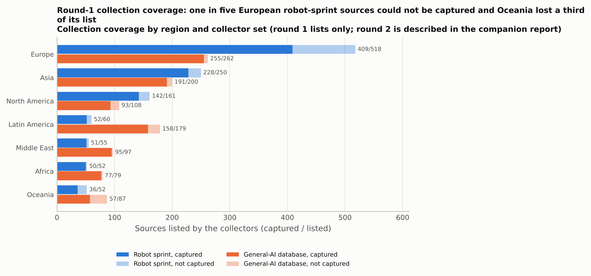

<em class="cap">Figure 37. Collection coverage by region: sources captured versus listed, by collector set.</em>

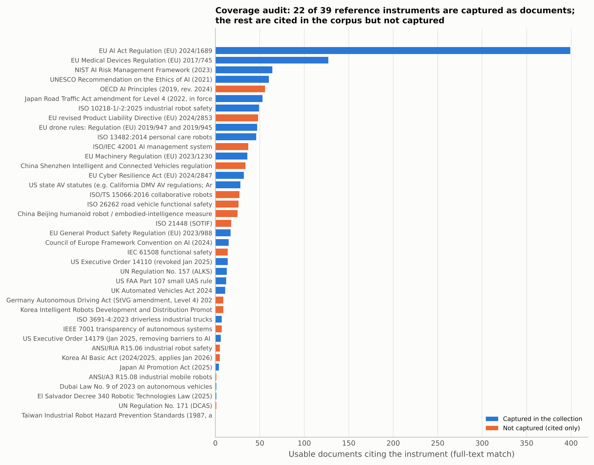

<em class="cap">Figure 41. Coverage audit: documents citing each reference instrument, coloured by whether the instrument itself was captured as a principal instrument with a content-analysed capture.</em>

*Table 25. Coverage audit: reference list of binding instruments and standards relevant to embodied AI, whether each is captured in the collection as a principal instrument with a content-analysed capture (title match) and how many usable documents cite it (full-text regex)*

| instrument                                                                 | jurisdiction   |   year | nature         | status                     | captured_as_document   |   n_title_matches |   n_documents_citing |   pct_citing |
|:---------------------------------------------------------------------------|:---------------|-------:|:---------------|:---------------------------|:-----------------------|------------------:|---------------------:|-------------:|
| UK Automated Vehicles Act 2024                                             | GB             |   2024 | binding        | in_force                   | True                   |                 2 |                   11 |          0.3 |
| Germany Autonomous Driving Act (StVG amendment, Level 4) 2021              | DE             |   2021 | binding        | in_force                   | False                  |                 0 |                    9 |          0.3 |
| Japan Road Traffic Act amendment for Level 4 (2022, in force 2023)         | JP             |   2023 | binding        | in_force                   | True                   |                 6 |                   53 |          1.7 |
| Korea Intelligent Robots Development and Distribution Promotion Act (2008) | KR             |   2008 | binding        | in_force                   | False                  |                 0 |                    9 |          0.3 |
| EU Machinery Regulation (EU) 2023/1230                                     | EU             |   2023 | binding        | adopted_applies_2027       | True                   |                 4 |                   36 |          1.1 |
| EU revised Product Liability Directive (EU) 2024/2853                      | EU             |   2024 | binding        | adopted_transposition_2026 | False                  |                 0 |                   48 |          1.5 |
| EU drone rules: Regulation (EU) 2019/947 and 2019/945                      | EU             |   2019 | binding        | in_force                   | True                   |                14 |                   47 |          1.5 |
| EU Cyber Resilience Act (EU) 2024/2847                                     | EU             |   2024 | binding        | adopted_applies_2027       | True                   |                 1 |                   32 |          1   |
| EU Medical Devices Regulation (EU) 2017/745                                | EU             |   2017 | binding        | in_force                   | True                   |                17 |                  127 |          4   |
| EU General Product Safety Regulation (EU) 2023/988                         | EU             |   2023 | binding        | in_force                   | True                   |                 3 |                   17 |          0.5 |
| UN Regulation No. 157 (ALKS)                                               | INT            |   2021 | binding        | in_force                   | True                   |                 2 |                   13 |          0.4 |
| US FAA Part 107 small UAS rule                                             | US             |   2016 | binding        | in_force                   | True                   |                 2 |                   12 |          0.4 |
| US state AV statutes (e.g. California DMV AV regulations; Arizona EO)      | US             |   2018 | binding        | in_force                   | True                   |                15 |                   28 |          0.9 |
| China Shenzhen Intelligent and Connected Vehicles regulation (2022)        | CN             |   2022 | binding        | in_force                   | False                  |                 0 |                   34 |          1.1 |
| China Beijing humanoid robot / embodied-intelligence measures (2024-2025)  | CN             |   2024 | soft           | published                  | False                  |                 0 |                   25 |          0.8 |
| ISO 10218-1/-2:2025 industrial robot safety                                | INT            |   2025 | standard       | published                  | True                   |                 3 |                   49 |          1.5 |
| ISO/TS 15066:2016 collaborative robots                                     | INT            |   2016 | standard       | published                  | False                  |                 0 |                   27 |          0.9 |
| ISO 13482:2014 personal care robots                                        | INT            |   2014 | standard       | published                  | True                   |                 3 |                   46 |          1.5 |
| ISO 3691-4:2023 driverless industrial trucks                               | INT            |   2023 | standard       | published                  | True                   |                 1 |                    7 |          0.2 |
| IEC 61508 functional safety                                                | INT            |   2010 | standard       | published                  | False                  |                 0 |                   14 |          0.4 |
| ISO 26262 road vehicle functional safety                                   | INT            |   2018 | standard       | published                  | False                  |                 0 |                   26 |          0.8 |
| ISO 21448 (SOTIF)                                                          | INT            |   2022 | standard       | published                  | False                  |                 0 |                   18 |          0.6 |
| ISO/IEC 42001 AI management system                                         | INT            |   2023 | standard       | published                  | False                  |                 0 |                   37 |          1.2 |
| IEEE 7001 transparency of autonomous systems                               | INT            |   2021 | standard       | published                  | False                  |                 0 |                    7 |          0.2 |
| ANSI/RIA R15.06 industrial robot safety                                    | US             |   2012 | standard       | published                  | False                  |                 0 |                    5 |          0.2 |
| ANSI/A3 R15.08 industrial mobile robots                                    | US             |   2020 | standard       | published                  | False                  |                 0 |                    1 |          0   |
| EU AI Act Regulation (EU) 2024/1689                                        | EU             |   2024 | binding        | in_force_phased            | True                   |                25 |                  399 |         12.6 |
| US Executive Order 14110 (revoked Jan 2025)                                | US             |   2023 | binding        | revoked                    | True                   |                 1 |                   14 |          0.4 |
| US Executive Order 14179 (Jan 2025, removing barriers to AI leadership)    | US             |   2025 | binding        | in_force                   | True                   |                 1 |                    6 |          0.2 |
| Japan AI Promotion Act (2025)                                              | JP             |   2025 | binding        | in_force                   | True                   |                 1 |                    4 |          0.1 |
| Korea AI Basic Act (2024/2025, applies Jan 2026)                           | KR             |   2025 | binding        | adopted                    | False                  |                 0 |                    5 |          0.2 |
| Council of Europe Framework Convention on AI (2024)                        | INT            |   2024 | binding_treaty | open_for_signature         | True                   |                 5 |                   15 |          0.5 |
| UNESCO Recommendation on the Ethics of AI (2021)                           | INT            |   2021 | soft           | adopted                    | True                   |                 1 |                   60 |          1.9 |
| OECD AI Principles (2019, rev. 2024)                                       | INT            |   2019 | soft           | adopted                    | False                  |                 0 |                   56 |          1.8 |
| Dubai Law No. 9 of 2023 on autonomous vehicles                             | AE             |   2023 | binding        | in_force                   | True                   |                 1 |                    1 |          0   |
| El Salvador Decree 340 Robotic Technologies Law (2025)                     | SV             |   2025 | binding        | in_force                   | True                   |                 1 |                    1 |          0   |
| Taiwan Industrial Robot Hazard Prevention Standards (1987, amended 2018)   | TW             |   2018 | binding        | in_force                   | False                  |                 0 |                    0 |          0   |
| NIST AI Risk Management Framework (2023)                                   | US             |   2023 | soft           | published                  | True                   |                 2 |                   64 |          2   |
| UN Regulation No. 171 (DCAS)                                               | INT            |   2024 | binding        | in_force                   | False                  |                 0 |                    1 |          0   |

In round 1 the collectors could not capture 266 of 2,160 listed sources, 109 of them in the European robot sprint; 34 captured files were oversized or restricted, 27 recovered. In round 2, 355 of 2,075 candidates yielded no text, most on hosts that serve bot challenges or sit outside the sandbox network policy (eur-lex.europa.eu catalogue pages 59, the Chinese national law database 27, the UNODA library 17, Légifrance 17, the Korean law portal 17, the Taiwanese law portal 11; Table 52); a retry pass after the review of v3 recovered four texts (a Tanzanian RPAS amendment regulation, a GB/T catalogue page and two Korean ministry press pages); the Product Liability Directive 2024/2853, the Toy Safety Regulation 2025/2509 and the Toy Safety Directive 2009/48/EC still returned no text. The coverage audit (Table 25, Figure 41) checks 39 reference instruments and standards (R157 and R171 now separate rows; Taiwan dated 2018; a stricter pattern for US state automated-vehicle statutes) and counts an instrument as captured only when a principal instrument with a content-analysed capture matches its title: 22 are captured as documents in the collection, 16 are cited by documents in the corpus but were not captured, and 1 are neither captured nor cited. On this strict criterion 22 of 39 are captured (11 in v2); on the looser title-family match used in v3, 31 (12 in v2). The 17 not captured are the German Autonomous Driving Act (StVG amendment, 2021), Korea's Intelligent Robots Act (2008) and AI Basic Act, the revised Product Liability Directive (EU) 2024/2853, the Shenzhen intelligent-connected-vehicle regulation (2022), Beijing's humanoid and embodied-intelligence measures, ISO/TS 15066, IEC 61508, ISO 26262, ISO 21448, ISO/IEC 42001, IEEE 7001, ANSI/RIA R15.06, ANSI/A3 R15.08, the OECD AI Principles, Taiwan's industrial-robot hazard prevention standards and UN Regulation No. 171.

Beyond the reference list, the round-2 collectors located and verified instruments that the environment could not read, which are the first targets of a round 3: the Hangzhou regulations on promoting the embodied intelligent robot industry (2026); the Shenzhen regulations on intelligent connected vehicles (2022), on the AI industry (2022) and on the low-altitude economy (2024); Hong Kong's Road Traffic (Autonomous Vehicles) Regulation, Cap. 374AF (2024); Korea's Intelligent Robots Development and Distribution Promotion Act and Enforcement Decree, and the enforcement decree and rule of its Autonomous Vehicles Act; US DoD Directive 3000.09 on autonomy in weapon systems (2023) and California SB 243 on companion chatbots (2025); India's Drone Rules 2021; the EU Product Liability Directive 2024/2853, the Toy Safety Regulation (EU) 2025/2509 and the Toy Safety Directive 2009/48/EC; France's ordonnance 2021-443 and décret 2021-873 on criminal liability for automated vehicles; Switzerland's DETEC ordinance on aircraft of special categories (2022); ANSI/A3 R15.06-2025 and GB/T 48317.1-2026 (humanoid robots, part 1). The Korean, Chinese NPC, Hong Kong, Légifrance, defense.gov and Indian hosts block the environment or serve script-only pages. Their absence, with the jurisdictions round 2 could not reach, is why every instrument count in this report is a lower bound on what exists, even as the precision audit makes it an upper bound on what the collection holds.

## 12. Limitations

The corpus is a purposive multilingual collection, not a census, and its composition drives several ratios: Europe is 42% of usable documents, English 75% and Chinese 9%, the last almost entirely one round-2 harvest of the State Council policy library; the research-to-instrument ratio reflects the sprint, database and round-2 designs; and jurisdiction coverage follows the availability of open legal databases and of hosts the environment could reach (round 2 added 251 embodied documents in Europe and 223 in Asia but 20 in Latin America, 15 in Africa and 10 in the Middle East, Table 54; France, Singapore, Korea, Taiwan, Hong Kong, Brazil and Chile are among the jurisdictions whose portals could not be read), so the regional instrument counts measure API availability as much as law.

Precision. The rule-based counting unit removes most but not all of the inflation that the v3 unit carried: on the audited sample the rules keep 61% where the auditor keeps 54%, and the audit's interval (44 to 63%) is the honest statement of how many of the v3 binding texts were distinct, binding and substantive. The 195 and 168 binding counts are upper bounds. Instrument families are grouped by a normalised title key; 86 near-duplicate title pairs noted in review are only partly merged because distinct parts of one regime are legitimately distinct documents. Status is one field: "in force" and "applicable" are not separated, no applicability date is recorded, the Machinery Directive, which governs machinery until January 2027, was coded superseded by a mechanically applied audit code until that value was corrected to in force, and court decisions and soft law carry lifecycle labels designed for legislation.

Labels. Every label was assigned by a language model; no human validation exists. The seven reliability checks compare model with model and are consistent, not certified; the fields the analysis depends on most are among the weaker ones in round 2 (instrument status 0.75, document type 0.79 against the second model), and the multi-label fields that define mechanisms and robot types have per-label kappas as low as 0.16. The excerpt covered the whole text for only half of the usable documents (median fraction seen 0.99; 21% with under a quarter seen), and the longest statutes, whose robot articles lie beyond the window, are labelled from what the model could see and, in the cases the reviewers found, from what it knew; a full-text pass for texts over 110,000 characters was not done. The excerpt cleaner deleted most of the Chinese, Japanese and Korean text before the model in v3; the v4 re-annotation corrects this for every such document, but the earlier failure shows that the pipeline's checks did not catch a defect that changed 57 of 422 set memberships. The relevance field that defines the sets was produced by the same model that produced the outcomes. The model's confidence field is a page-quality proxy and is not used.

Dating. Consolidated statutes harvested from legal databases carry the enactment year or the version year as the annotation found it; the two are not separated, "first appearance" years for sector law are not reported, time analyses are restricted to 2014 to 2026 and 2026 is partial. Dates are inferred from content for 16% of usable documents; 2,526 of the 2,618 set members have a known year and enter the adjusted models (Table 20).

Design. Collection round is confounded with genre, text length, capture quality and language; the adjusted models carry round as a covariate and the stratified tables report within-round contrasts, but no within-round table exists for mechanisms, robot-type trends (Figure 42) or topic change (Table 28), and the within-genre regional-divergence tables (29b) keep only regions with at least 20 documents of the genre, which leaves four regions in the research panel and five in the instrument panel. Technical standards are annotated on their public scope text only, never on the normative text; 16 of those scope texts were obtained through a committee mirror or written as abstracts by a collector agent (Table 51), and the copyright status of mirrored scope pages was not checked. Statistics about depth therefore describe scope pages for standards. The six embodied-specific items are considerations scored like principles, not principles in the ethical sense.

People and agents. The round-2 collectors, the six adversarial reviewers of v3, the precision auditor and the writers of these documents were AI agents (Claude) run in one Claude Code session; the regional teams of round 1 were people, but their labels were not used as a reference. Nothing in this report has been checked by a lawyer or a domain coder.

Not done, with reasons. Human validation of labels (no human coders in this setting; the protocol is in supplement S4.5). Version dating of consolidated texts (deferred to round 3). Reading the verified-but-unread instruments named in Section 11.5 (hosts block the environment). Stricter title merging of near-duplicate pairs (would merge distinct parts of one regime). A full-text pass for the longest statutes (cost). Measurement-error correction of the headline shares and odds ratios (requires a human-coded sample). Small groups (Africa, the Middle East, Latin America, humanoid and social-robot instruments) are reported as counts, and conclusions about them are correspondingly tentative.

## 13. Conclusions

Within this collection, embodied AI is governed by the law of the machine classes it is deployed in, by technical standards and voluntary guidance, and by the enumeration of robots inside general-AI law. On the headline unit, 505 principal instruments reach robots and 195 are binding, 182 of them in force, almost all vehicle, aviation, workplace, machinery and medical-device rules; 140 of the 195 contain any provision about autonomy or automation, and 15 name AI. How many instruments there are depends on how one counts (810 legal texts, 505 principal instruments, 161 by an independent reading of the v3 set), and how different robot rules look from AI rules depends on which collection one reads: the robot literature's own considerations (physical safety, autonomy-level control, conformity assessment, physical liability) and its tools (standards, licensing, conformity assessment, insurance) distinguish robot instruments from AI instruments in both rounds and after every adjustment, whereas the thinner ethical vocabulary of robot rules is a property of the database-harvested sector law of round 2 and does not appear among the collector-found instruments of round 1. Specification lags mention: binding law and standards' scope pages set out physical safety in roughly six cases in ten, autonomy-level control in one in four. Research and rules point at different robots, with companion and social robots the clearest case of attention without instruments and drones and vehicles of instruments without research. Regions differ in the mix of documents they contribute and in their tools; the claim that they differ on values is not supported once genre is held constant. The frontier is moving toward industrial policy, humanoids and the vocabulary of "physical AI", and away from personhood; compliance machinery grows within the original collection. For governance practice: the operative texts for robots are sector regulation, standards and product law, so attention to transport, aviation and occupational-safety regimes, to ISO/TC 299 and IEC, and to the AI Act's harmonised-standards mandate buys more than new principles; robots that live with people have almost no instruments of their own and are governed by product, toy, data-protection and consumer law that this collection does not capture as robot documents; and autonomy-level control needs the specification that three binding instruments in four still leave open. For method: a study of this kind should state its counting unit, report its construct tiers, and model its own collection design, because the collection strategy changed the headline counts by an order of magnitude and would otherwise have reversed the conclusions.

## Glossary

- **Embodied AI, physical AI.** AI that controls a machine with a body: robots, self-driving vehicles, drones, surgical and factory machines. The object of study here is the governance of these machine classes, whether or not an instrument mentions AI.
- **Governance instrument, rule or policy; legal text.** A law, regulation, decree, bill, strategy, guideline, code, standard or resolution meant to steer behaviour. Research papers and news are not instruments. "Legal text" means every captured document of instrument class, the comparable unit across versions.
- **Principal instrument.** The headline counting unit: a legal text that is not a commencement order, levy or fee instrument, individual exemption, direction, approval or permit, definitions-only part, table of contents, EEA incorporation decision, language corrigendum, duplicate text, catalogue or landing page or stub under 150 words. Amendments count.
- **Instrument family.** A principal instrument with its yearly renewals, successive versions and parts within one jurisdiction, counted once.
- **Robot-relevant; with embodied provisions.** Rated at least moderately relevant to embodied-AI governance (2 or 3 of 3); rated 0 or 1 but carrying a robot-type label.
- **AI-content tiers.** Whether the full text contains autonomy or AI provisions, and whether it names AI explicitly (two or more mentions).
- **Binding law vs voluntary guidance (soft law).** Binding: breaking it has legal consequences. Voluntary: guidance, principles, strategies and codes that cannot be enforced on their own.
- **Technical standard.** A detailed engineering specification (ISO 10218, ISO 13482) that is voluntary unless a law makes it binding by reference or a national standard is declared mandatory (Chinese GB standards). Annotated here on its public scope page only.
- **Conformity assessment.** The pre-market check (testing, certification, CE marking) that a product meets safety rules.
- **Mentioned vs specified in depth.** A principle or consideration is mentioned when named; specified in depth when the document says what must be done, by whom and how it is checked. Depth is measured only on content-analysed captures of at least 150 words.
- **Content-analysed capture; catalogue page; stub.** A substantive or partial capture of a document's text; a catalogue, register, committee or landing page captured in place of the text; a capture under 150 words.
- **Collection round.** Round 1: the regional teams' web collection of research and official texts. Round 2: the harvest of legal databases and collector-agent search for instruments. Round is a covariate in the adjusted models and a stratum in Tables 20b and 30.
- **Governance-gap index.** Share of research papers about a robot type minus the share of principal instruments; positive means studied more than governed.
- **Precision audit.** An independent reading of a random sample of counted instruments against stated criteria, giving the share that genuinely meets the definition, with a sampling interval.
- **Cohen's kappa.** Agreement between two labellers after discounting chance; 0.8 and above is conventionally "almost perfect", 0.6 "substantial", 0.4 "moderate".
- **Holm correction.** Raises the bar for significance when many comparisons are made at once; applied within one table or one stratum.
- **Cramér's V.** Strength of association from 0 to 1; 0.1 small, 0.3 medium; bias-corrected versions remove the inflation small samples produce.
- **Odds ratio.** How much more likely an outcome is in one group than another; 1 means no difference. Adjusted odds ratios allow for other differences between the groups (here document class, region, collection round and year).
- **Wilson interval, bootstrap interval.** The range within which a percentage or difference would most likely fall if the sample were drawn again.

## Appendix. Figure and table index

Figures 1 to 44 (9, 15 and 32 were merged into neighbours) and the round-2 figures 50 to 52 are in `figures/` as PNG and SVG in light and dark variants with their data in `figures/data/`; Figures 23, 31, 39, 40 and 41 were rebuilt in v4 (capture-tier base, dendrogram order and region set, single axis, computed title, strict coverage criterion). Tables T01 to T35 with T20b, the round-2 tables T50 to T62 with T53b and S01 to S13 with S09b are in `tables/`; every statistic is in `data/results.json`, every annotation run in `data/run_manifest.json`. The supplement holds the codebook, taxonomies, reliability detail including the round-2 sample (S4.7), instrument lists, coverage audit, quality-assurance rules and the override file (S8), version history (S10), datasheet and the precision audit (S13); the companion report holds the round-2 inventory, funnel and collector-metadata checks.
