

**Abstract.** Artificial-intelligence governance has been studied quantitatively for software; the governance of machines that act in the world (robots, vehicles, drones, medical and industrial machines) has not. We analyse a purposive multilingual collection of 3,165 usable documents from 116 countries, the European Union and the international standards layer, built by a topical search by eight regional teams and a database-driven search by AI agents and scripted harvests for the binding instruments the first round missed. Every document was labelled by a language model under a fixed codebook; no person read or labelled any document, and the second-round collectors and reviewers of earlier drafts were AI agents. Counted as principal instruments, a documented unit without commencement orders, exemptions, corrigenda, catalogue pages and stubs, the collection holds 505 instruments governing the machine classes in which embodied AI is deployed, 195 of them legally binding; only 15 binding instruments name AI explicitly. The main methodological result is that collection strategy, not coding, decides what such a corpus says: on a comparable unit the database round multiplied the binding count fifty-eight-fold, and the pooled comparison of embodied with general-AI instruments shows a thinner ethical core that does not exist within the first round, so the pooled reversal is a composition effect. What survives within round, within genre and after adjustment is the body: physical safety, autonomy-level control, conformity assessment and liability for physical damage distinguish embodied instruments, as do standards references, licensing and insurance. Research and rules attend to different robots: companion robots are 43% of embodied research papers and 3% of instruments. An independent audit found 54% of an earlier binding set distinct, binding and substantive, so counts are upper bounds on precision and lower bounds on recall. We release codebook, annotations, stored model inputs, run manifest, master table, dashboard and code.

## 1. Introduction

A large literature maps the principles and instruments of AI governance. Reviews of ethics guidelines found convergence on a small set of principles alongside divergence in implementation (Jobin, Ienca and Vayena 2019; Fjeld et al. 2020; Hagendorff 2020; Schiff et al. 2021; Corrêa et al. 2023), and the European Union's AI Act has become the reference point for binding regulation (Veale and Zuiderveen Borgesius 2021; Regulation (EU) 2024/1689). That literature is about software. An older literature on robot law and robot ethics argues that machines which act physically in the world raise distinct problems (Calo 2015; Leenes et al. 2017; Winfield and Jirotka 2018): bodily harm, proximity to people, liability for physical damage, the autonomy that may be delegated to a machine, and certification before market access. The RoboLaw guidelines (Palmerini et al. 2014), the European Parliament's 2017 resolution (European Parliament 2017; Nevejans 2016), the ISO robot-safety standards, the Korean Intelligent Robots Act (2008) and sector regulation for vehicles (Taeihagh and Lim 2019) and drones (Stöcker et al. 2017) are the usual reference points; Holder et al. (2016), Bertolini (2020), Fosch-Villaronga and Mahler (2021) and Salvini et al. (2021) map the regimes in detail.

The two literatures have rarely been brought together with numbers. This paper asks five questions of a purpose-built collection: (Q1) what the documented governance of embodied AI consists of, and how the answer depends on what is counted; (Q2) which robots are governed and which are only studied; (Q3) which considerations, tools and framings distinguish embodied-AI governance from general-AI governance once genre and collection round are accounted for; (Q4) how regions differ; (Q5) what is changing. A sixth question arose from the design: (Q6) how far what such a corpus says depends on how it was collected, since the collection was built in two rounds with the same codebook and model, a topical search by regional teams and a database-driven search for binding instruments, and the two rounds disagree on several conclusions. We make four contributions: a coded multilingual collection whose instrument counts are reported under a documented counting unit and text-based AI-content tiers; a comparison of two collection strategies showing that collection design changes instrument counts by an order of magnitude and reverses conclusions that adjustment for genre does not protect; a coverage audit against a reference list and an independent precision audit, both reusable; and answers to Q1 to Q5, each stated with the stratum in which it holds.

## 2. Background

**From principles to law, and robot law.** Jobin et al. (2019) coded 84 guidelines, Fjeld et al. (2020) organised 36 into eight themes, Schiff et al. (2021) showed sectoral differences and Corrêa et al. (2023) extended the exercise to 200 documents; Hagendorff (2020) argued the guidelines had little effect, which motivated binding instruments and the mechanisms of risk-based tiering, conformity assessment, audits, transparency obligations and oversight bodies, with the OECD (2019) and UNESCO (2021) recommendations as the intergovernmental layer. On the robot side, Calo (2015) identified embodiment, emergence and social valence as what makes robots legally distinctive, Leenes et al. (2017) set out the regulatory challenges and Fosch-Villaronga and Heldeweg (2018) proposed iterative regulation; specific debates concern care robots (Sharkey and Sharkey 2012; van Wynsberghe 2013), the privacy implications of social robots (Lutz, Schöttler and Hoffmann 2019), autonomous weapons (Sparrow 2007) and legal personality (Bryson, Diamantis and Grant 2017; Solaiman 2017). The standards community produced the operative texts (ISO 10218-1 and -2, ISO/TS 15066, ISO 13482 and, recently, ISO 3691-4, ISO 31101, ISO/PAS 8800 and ISO/IEC TR 5469), and the EU Machinery Regulation (Regulation (EU) 2023/1230) and the AI Act's Annex I treat robots as products subject to harmonised standards.

**Related collections.** The OECD.AI Policy Observatory lists more than a thousand national AI policies and instruments but does not separate embodied systems or code content at the level of principles and mechanisms; the AlgorithmWatch inventory covers ethics guidelines only; the Stanford AI Index legislation tracker, the IAPP Global AI Law and Policy Tracker and Digital Policy Alert record legislative events rather than coded texts; the RoboLaw deliverables, Nevejans (2016) and Bertolini (2020) are expert hand-coded mappings of European robotics regimes, and Taeihagh and Lim (2019) and Stöcker et al. (2017) review the vehicle and drone layers. To our knowledge this is the first coded corpus that separates embodied from general-AI governance, scores six embodied-specific considerations at the level of mention and of specification, and reports how its own instrument counts move with the counting unit and the collection strategy.

**Language models as annotators.** Large language models can match crowd workers on text-annotation tasks (Gilardi, Alizadeh and Kubli 2023; Törnberg 2024), but their output is unstable across prompts and versions (Reiss 2023), requires validation against human labels (Pangakis, Wolken and Fasching 2023; Thalken et al. 2023), raises reproducibility concerns for proprietary models (Ollion et al. 2024), and carries measurement error that biases downstream estimates unless corrected (Egami et al. 2023; Angelopoulos et al. 2023). We meet part of that bar (fixed codebook, structured output, stored inputs, consistency checks on both collection rounds, an independent precision audit) and not the rest (no human gold standard, no measurement-error correction); Section 7 states the consequences.

## 3. Data

**Collection round 1.** Eight regional collection teams (Africa; Asia; Europe; Latin America and the Caribbean; Middle East; North America; Oceania; and an international layer assembled across teams) ran a *sprint* for robot-specific sources and a *database* of general AI-governance instruments between 2025 and October 2026, recording 2,160 sources and capturing 1,894 as 2,557 files; 266 sources could not be captured (109 in the European sprint). After conversion, recovery of 27 of 34 oversized or restricted files, and de-duplication by content hash, URL, normalised title, truncated-title prefix and MinHash similarity on prose (Broder 1997), round 1 holds 1,656 canonical documents.

**Collection round 2.** Prompted by the first round's coverage audit, a second round searched official legal databases, government repositories, standards catalogues, treaty-body archives and regulator sites for instruments the teams had not captured. The collectors were nine AI agents (Claude), run as subagents of a single Claude Code session, each with a regional, thematic or standards brief and the round-1 holdings as an exclusion list; seven legal databases were harvested by script (EUR-Lex through CELLAR, legislation.gov.uk, the Japanese e-Gov law API, the Chinese State Council policy library, the Australian Federal Register of Legislation, the US eCFR and the Brazilian Câmara API). No person curated the candidates. After de-duplication on normalised URL and on normalised title plus jurisdiction, 2,075 candidates remained (1,157 from the agents, 918 from the harvests; Table 50 in the companion report). Texts were obtained for 1,720 (1,704 from the issuing source or a fallback and 16 standards' scope pages through a mirror, including four recovered by a later pass with improved routes); 272 candidates returned HTTP errors or script-only pages, 46 sat on hosts that block the sandbox and 37 failed otherwise (Tables 51 and 52), and these 355 remain in an inventory, counted nowhere in this paper. All 1,720 texts were annotated with the metadata-blind, extended-excerpt policy of Section 4; 1,641 entered the master table after assembly de-duplication and 1,626 are usable (Figure 50).

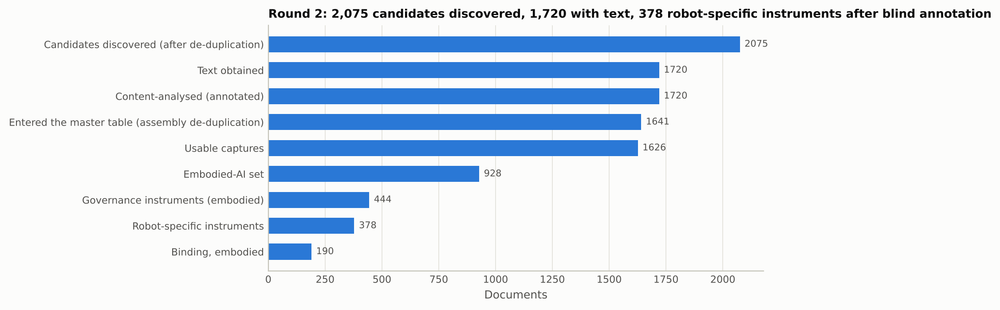

<em class="cap">Figure 50. Round-2 funnel: from de-duplicated candidates to texts obtained, content-analysed documents, usable captures and the instruments the blind annotation found among them.</em>

**Processing and corrections.** With both rounds the collection holds 3,295 canonical documents, 3,165 with readable text on topic; 49 round-1 and 79 round-2 duplicate captures are listed in the release, and byte-identical texts under different identifiers count once. Language was annotated from the text (75% English, 792 non-English documents); Chinese is the second language. The excerpt cleaner first used on the round-2 texts dropped short lines without whitespace-separated words or ASCII sentence punctuation; Chinese, Japanese and Korean paragraphs have neither, so for most Chinese documents only a fraction of the text reached the model (supplement S4.7). A character-aware cleaner (policy tag `cjk_clean=v4` in the run manifest) replaced it and all 376 round-2 and 46 round-1 Chinese, Japanese and Korean documents were re-annotated; 57 of the 422 changed embodied-set membership and the number rated "not about AI" fell from 205 to about 160. Four status and class rules were added after a governance expert's audit of the earlier labels: standards still in development (AWI to FDIS stages) are not published instruments; mandatory Chinese GB standards are binding; CCW working papers and chair's texts are position documents, not draft instruments; proposals whose adopted act is in the collection are superseded. That audit read 159 risk-stratified rows and found an error in 68% and a material error in 62%; its 157 documented document-level corrections (unit, class, status, year, relevance) are applied through a versioned override file (`data/manual_overrides_v4.csv`, supplement S8). DOIs were resolved against OpenAlex (Priem, Piwowar and Orr 2022) for 373 of 581 research outputs.

**Counting unit, construct and capture tier.** The headline unit is the *principal instrument*: a text of instrument class (binding, soft or proposal) that is not a commencement order, levy or fee instrument, individual exemption, direction, approval or permit, definitions-only part, table of contents, EEA Joint Committee incorporation decision, language-version corrigendum, byte-identical duplicate, catalogue or landing page, or metadata stub under 150 words; amendments count. The rules are title- and capture-based (`scripts/07c_v4_units_and_tiers.py`), and the same script groups yearly renewals, successive versions and parts of one regime into *instrument families*. Because most binding instruments that reach robots are rules for machine classes (aviation, road vehicles, machinery, product safety) with no AI content, the object of study is the governance of the machine classes in which embodied AI is deployed, and two text-based tiers accompany every headline count: instruments whose full text contains autonomy or automation provisions (at least two matches of a multilingual pattern for autonomous or automated operation, self-driving, remotely piloted or unmanned, or any explicit AI mention) and instruments that name AI explicitly (at least two mentions of artificial intelligence, machine learning, AI systems, algorithms or neural networks in nine languages). Catalogue and landing pages enter no instrument count; statistics about what instruments specify in depth use content-analysed captures of at least 150 words, and the scope pages on which technical standards were annotated are a separate measurement, never pooled with substantive texts. Table 53b (Section 5.1) shows the collection under each successively stricter definition; every count in this paper names its unit when it is not the principal unit.

**Analysis sets.** The embodied-AI set (n = 1,603) comprises usable documents rated 2 or 3 on a 0 to 3 relevance scale or carrying any robot-type label, excluding documents rated not about AI (the strict set rated 2 or 3 has 1,374 documents, Table 32 in the report); the general-AI set (n = 1,015) comprises documents rated 0 or 1 with no robot-type label; 547 usable documents are in neither set because the annotation judged them not to be about AI (478 of them legal texts, 334 binding, mostly harvested statutes and regulations). The embodied set holds 810 legal texts of instrument class, 505 of them principal instruments: 195 binding, 240 soft law (85 strategies, 71 guidelines, 49 technical standards among them) and 70 proposals or drafts. Of the 505, 408 are robot-relevant (relevance 2 or 3) and 97 are general-AI or general-sector instruments with robot provisions (27 of them binding). The general-AI set holds 372 principal instruments, 66 binding. Collection round is a covariate throughout: 444 of the 505 embodied principal instruments and 190 of the 195 binding ones come from round 2, against 127 of the 372 general instruments. Government reports (259 usable) are kept apart from instruments. Regions follow the issuing jurisdiction; North America combines the United States, Canada and Greenland.

**Comparison with earlier versions of the collection.** Earlier versions of this study used round 1 alone. Supplement S10 sets them against the present collection on the comparable unit of every text of instrument class (Table 53); the comparison describes collection design, not change in the world, and Section 5.2 uses it for that purpose only.

## 4. Methods

**Codebook.** Thirty-nine fields (supplement S2): bibliographic fields; jurisdiction and scope; 28 document types in 8 classes; governance-instrument status (nine states) and binding nature; AI scope and embodiment status; 23 robot types in 7 groups; 16 sectors; 27 topics; 14 core principles (Jobin et al.; OECD) and 6 embodied-specific considerations (physical safety, human-robot proximity, liability for physical damage, autonomy level and control, conformity assessment, dual use), each scored 0 absent, 1 mentioned, 2 specified in depth; 19 mechanisms; named instruments cited; personhood position; framing; stance; methodology; capture quality; relevance.

**Annotation.** Claude Sonnet 5.5 through the Claude Code command-line interface (version 2.1.314), codebook as system prompt, JSON schema enforcing every field, no tools; one prompt hash for every production run, recorded per document with model, policy, cost and timestamp. The first annotation used a 14,000-character excerpt with the collectors' folder, title and language as metadata, and 483 texts carried collectors' labels in a cover block; all 351 round-1 governance documents were then re-annotated with the cover block stripped, metadata reduced to a document identifier and word count, and up to 110,000 characters of text, and every round-2 text was annotated under that policy from the start. Technical standards were annotated on their public scope or abstract text, never on the normative text, and are flagged as such. The run manifest (`data/run_manifest.json`) lists, per annotation folder, model, prompt hash, policy, document count, cost and whether the exact model inputs are stored: they are for the round-2 run (1,736 annotation records, 380 under the character-aware cleaner), the extended round-1 governance run, the Chinese-Japanese-Korean repair and the metadata-blind reliability run, and not for the first round-1 run or the other reliability runs. Cost was 126 USD for round 2, 99 USD for the two round-1 main runs, 36 USD for the extended governance run, 70 USD for the six reliability runs and 2.5 USD for the repair, about 334 USD in all. The round-2 collectors, the six adversarial reviewers of earlier drafts and the precision auditor were AI agents (Claude) in the same environment; no person read or labelled any document.

**Consistency checks.** On round-1 samples: Claude Opus 5.5 on the same first-run input (160 documents); a Sonnet re-run (160); Sonnet on the full text (160); Sonnet metadata-blind and cover-stripped (160); and the extended annotation against the first for governance documents (351). On round 2: a sample of 160 documents stratified by language, document class and text length, including scope-only standards, re-annotated by Claude Opus 5.5 and by a Sonnet re-run under the same policy and prompt (supplement S4.7). Cohen's kappa, quadratic-weighted for ordinal fields and mean per label for multi-label fields; unweighted and level-2 (specified in depth) variants for all six comparisons in Table S09b. The round-2 collectors' catalogue metadata is compared with the blind annotation (Table 57) as a consistency check, not a validation, because the collectors were AI agents of the same model family and the harvests carried per-source constants. No human-coded labels exist for either round.

**Precision audit.** An independent AI agent read a simple random sample of 100 of the 299 documents that the earlier annotation had counted as binding instruments reaching embodied AI and judged each against five criteria from its own text: distinct instrument, binding, substantive embodied provisions, any autonomy or AI provision, explicit AI (supplement S13). Shares carry Wilson intervals; Table 62 compares the audit with the rule-based counting unit on the same documents.

**Lexicons.** Multilingual regular-expression lexicons for robot types, named instruments and principles over full text; an acronym pattern that matched the word "laws", unbounded dual-use and harm patterns and an AI Act pattern that absorbed state AI acts were corrected before use.

**Statistics.** Wilson intervals; chi-square with Monte-Carlo p-values when more than a fifth of expected counts are below five and Fisher's exact test for sparse 2 by 2 tables; bias-corrected Cramér's V (Bergsma 2013) with percentile-bootstrap intervals on a common population; logistic regression of each outcome on set membership adjusting for document class, region, collection round and year, with odds ratios resting on a sparse cell flagged and not interpreted; Mantel-Haenszel tests stratified by class; comparisons within genre and within collection round (Table 20b); bootstrap intervals for the governance-gap index (research share minus principal-instrument share) and for regional cosine distances, with split-half noise floors; logistic trend models on documents dated 2015 to 2026 with five sensitivities (collapsed covariates, excluding the partial year 2026, stated-date documents only, round-1 documents only, collection round as a covariate). Holm correction is applied within families, a family being the tests reported in one table (Tables 8, 10, 16, 17, 20, 28, 29 and 34) or in one stratum of a stratified table (four strata each in Tables 20b and 21): sixteen families of 8 to 38 tests. Consolidated statutes harvested from legal databases carry the enactment year or the version year as the annotation found it, so year-based models inherit enactment dates for provisions added later, and "first appearance" years are not reported.
## 5. Results

### 5.1 How many instruments reach robots depends on the counting unit (Q1)

*Table 53b. How many instruments reach robots depends on the counting unit and the construct: the same collection under successively stricter definitions (v4)*

| tier                                                                                                                                  |   count |
|:--------------------------------------------------------------------------------------------------------------------------------------|--------:|
| All legal texts of instrument class, embodied-AI set                                                                                  |     810 |
| Principal instruments (amendments kept; commencement, levy, exemption, incorporation, corrigenda, stubs and catalogue pages excluded) |     505 |
| Principal instruments rated robot-relevant (relevance 2 or 3)                                                                         |     408 |
| Principal embodied instruments whose text contains autonomy or AI provisions                                                          |     395 |
| Principal embodied instruments whose text names AI explicitly                                                                         |     153 |
| Binding legal texts, embodied-AI set                                                                                                  |     291 |
| Principal binding instruments, embodied-AI set                                                                                        |     195 |
| Principal binding instruments rated robot-relevant (relevance 2 or 3)                                                                 |     168 |
| Principal binding instruments counted once per instrument family                                                                      |     194 |
| Principal binding instruments with autonomy or AI provisions in the text                                                              |     140 |
| Principal binding instruments naming AI explicitly                                                                                    |      15 |

Table 53b reads one collection under successively stricter definitions. The embodied set holds 810 texts of instrument class; 505 are principal instruments. The 305 removed are 222 catalogue or landing pages (mostly standards scope listings), 35 stubs under 150 words, 30 ancillary instruments, 10 dependent parts, 6 EEA incorporation decisions and 2 language copies. Of the 505, 408 are rated robot-relevant, 395 contain autonomy or AI provisions and 153 name AI explicitly. Among binding texts the ladder runs 291, 195 principal (164 principal acts and 31 amendments), 168 robot-relevant, 194 instrument families, 140 with autonomy or AI provisions and 15 naming AI explicitly: the AI Act and its 2026 amending regulation, the Machinery and Medical Devices Regulations, two EU type-approval regulations, Executive Order 14110, UN Regulation 155, Dubai's and Italy's automated-vehicle rules, Oman's drone regulation, El Salvador's robotics law, an Argentine resolution and two US export-control parts.

*Table 62. Independent precision audit of 100 randomly sampled v3 binding embodied instruments versus the v4 rule-based counting unit, on the same documents (Wilson 95% intervals)*

| criterion                                                | audit_share    | rule_share     |   agreement |   kappa |   rule_passes_audit_fails |   audit_passes_rule_fails |
|:---------------------------------------------------------|:---------------|:---------------|------------:|--------:|--------------------------:|--------------------------:|
| distinct instrument (audit a)                            | 67% (57 to 75) | 74% (65 to 82) |        0.79 |    0.5  |                        14 |                         7 |
| distinct, binding and embodied-substantive (audit a+b+c) | 54% (44 to 63) | 61% (51 to 70) |        0.77 |    0.53 |                        15 |                         8 |
| a+b+c and autonomy/AI provision (audit a+b+c+d)          | 53% (43 to 62) | 46% (37 to 56) |        0.71 |    0.42 |                        11 |                        18 |

The precision audit (Table 62) shows why the unit matters. Of 100 randomly sampled documents from the earlier binding set, 67% were distinct instruments (Wilson 95% interval 57 to 75), 97% binding, 56% carried substantive embodied provisions (46 to 65), 67% any autonomy or AI provision and 14% explicit AI (9 to 22); 54% passed the three main criteria jointly (44 to 63), implying about 161 instruments (132 to 190) where 299 had been counted. The rule-based unit passes 61% of the same documents (51 to 70) and agrees with the audit on 77% (kappa 0.53), erring both ways: 15 documents pass the rule and fail the audit, 8 the reverse. The 195 principal binding instruments are therefore an upper bound on precision, as the 22 of 39 reference instruments captured (Section 5.3) make them a lower bound on recall.

### 5.2 What collection strategy changes (Q6)

*Table 53. Before/after on the comparable unit (every text of instrument class): v2 (original collection) versus v3/v4 (original plus round 2), content-analysed documents only*

| measure                                   |   v2 |   v3 |   added |   ratio |
|:------------------------------------------|-----:|-----:|--------:|--------:|
| Documents (annotated)                     | 1656 | 3295 |    1639 |    1.99 |
| Usable documents                          | 1538 | 3165 |    1627 |    2.06 |
| Embodied-AI set                           |  675 | 1603 |     928 |    2.37 |
| General-AI set                            |  806 | 1015 |     209 |    1.26 |
| Governance documents (incl. reports)      |  343 | 1709 |    1366 |    4.98 |
| Governance instruments, all               |  345 | 1696 |    1351 |    4.92 |
| Governance instruments, embodied-AI set   |   65 |  810 |     745 |   12.46 |
| Robot-specific instruments (relevance 2+) |   34 |  699 |     665 |   20.56 |
| Binding instruments, all                  |   34 |  702 |     668 |   20.65 |
| Binding instruments, embodied-AI set      |    5 |  291 |     286 |   58.2  |
| Binding instruments, robot-specific       |    4 |  254 |     250 |   63.5  |
| Soft-law instruments, embodied-AI set     |   50 |  411 |     361 |    8.22 |
| Proposals and drafts, embodied-AI set     |   10 |  108 |      98 |   10.8  |
| Government reports, embodied-AI set       |   24 |   97 |      73 |    4.04 |
| Jurisdictions with an embodied instrument |   30 |   60 |      30 |    2    |

Table 53 sets round 1 alone against the merged collection on the comparable unit of every text of instrument class. The database round doubled the collection (1,656 to 3,295 annotated documents), left the research side untouched and the general-AI set nearly so (806 to 1,015), and multiplied the governance side: embodied legal texts rose from 65 to 810, robot-relevant ones from 34 to 699, binding embodied texts from 5 to 291 and jurisdictions with an embodied instrument from 30 to 60. These ratios describe where the two rounds searched: the teams found research and strategies by topical search, the agents and harvests found statutes and regulations by database query. The higher binding share of the embodied set and the doubling of jurisdictions follow from the design and are not reported as findings about the world.

*Table 20b. Principle presence (level 1 or 2), embodied-AI set vs general-AI set, within each collection round and within governance instruments of each round (Holm within stratum): shows which contrasts depend on the round-2 additions*

| stratum                         | principle                       | group             |   n_embodied |   n_general |   embodied_pct |   general_pct |   diff_pp | test       |      p |   p_holm | significant_holm_05   |
|:--------------------------------|:--------------------------------|:------------------|-------------:|------------:|---------------:|--------------:|----------:|:-----------|-------:|---------:|:----------------------|
| Round 1, all usable documents   | Transparency                    | core              |          675 |         803 |           43.7 |          59.4 |     -15.7 | chi-square | 0      |   0      | True                  |
| Round 1, all usable documents   | Justice & fairness              | core              |          675 |         803 |           43.1 |          59.2 |     -16   | chi-square | 0      |   0      | True                  |
| Round 1, all usable documents   | Non-maleficence                 | core              |          675 |         803 |           81.9 |          68.9 |      13.1 | chi-square | 0      |   0      | True                  |
| Round 1, all usable documents   | Responsibility & accountability | core              |          675 |         803 |           66.1 |          63   |       3.1 | chi-square | 0.2422 |   0.2422 | False                 |
| Round 1, all usable documents   | Privacy                         | core              |          675 |         803 |           37.3 |          50.4 |     -13.1 | chi-square | 0      |   0      | True                  |
| Round 1, all usable documents   | Beneficence                     | core              |          675 |         803 |           70.4 |          79.6 |      -9.2 | chi-square | 0.0001 |   0.0003 | True                  |
| Round 1, all usable documents   | Freedom & autonomy              | core              |          675 |         803 |           38.2 |          25.2 |      13.1 | chi-square | 0      |   0      | True                  |
| Round 1, all usable documents   | Trust                           | core              |          675 |         803 |           46.5 |          51.3 |      -4.8 | chi-square | 0.0747 |   0.1494 | False                 |
| Round 1, all usable documents   | Sustainability                  | core              |          675 |         803 |           19.6 |          33.9 |     -14.3 | chi-square | 0      |   0      | True                  |
| Round 1, all usable documents   | Dignity                         | core              |          675 |         803 |           33.6 |          21.7 |      12   | chi-square | 0      |   0      | True                  |
| Round 1, all usable documents   | Solidarity                      | core              |          675 |         803 |           23.7 |          35.4 |     -11.7 | chi-square | 0      |   0      | True                  |
| Round 1, all usable documents   | Human oversight                 | core              |          675 |         803 |           40.9 |          32.8 |       8.1 | chi-square | 0.0015 |   0.0058 | True                  |
| Round 1, all usable documents   | Robustness & security           | core              |          675 |         803 |           39.7 |          49.9 |     -10.2 | chi-square | 0.0001 |   0.0005 | True                  |
| Round 1, all usable documents   | Inclusive growth                | core              |          675 |         803 |           34.8 |          75.5 |     -40.7 | chi-square | 0      |   0      | True                  |
| Round 1, all usable documents   | Physical safety                 | embodied-specific |          675 |         803 |           48   |           2.9 |      45.1 | chi-square | 0      |   0      | True                  |
| Round 1, all usable documents   | Human-robot proximity           | embodied-specific |          675 |         803 |           63.3 |           0.4 |      62.9 | chi-square | 0      |   0      | True                  |
| Round 1, all usable documents   | Liability for physical damage   | embodied-specific |          675 |         803 |           23.9 |           0.4 |      23.5 | chi-square | 0      |   0      | True                  |
| Round 1, all usable documents   | Autonomy level & control        | embodied-specific |          675 |         803 |           41.5 |           5.2 |      36.3 | chi-square | 0      |   0      | True                  |
| Round 1, all usable documents   | Conformity assessment           | embodied-specific |          675 |         803 |           14.4 |          10.7 |       3.7 | chi-square | 0.0405 |   0.1214 | False                 |
| Round 1, all usable documents   | Dual use & military             | embodied-specific |          675 |         803 |           15.3 |           5.5 |       9.8 | chi-square | 0      |   0      | True                  |
| Round 2, all usable documents   | Transparency                    | core              |          928 |         212 |           30.5 |          59.4 |     -28.9 | chi-square | 0      |   0      | True                  |
| Round 2, all usable documents   | Justice & fairness              | core              |          928 |         212 |           13.4 |          58   |     -44.7 | chi-square | 0      |   0      | True                  |
| Round 2, all usable documents   | Non-maleficence                 | core              |          928 |         212 |           80.1 |          58   |      22   | chi-square | 0      |   0      | True                  |
| Round 2, all usable documents   | Responsibility & accountability | core              |          928 |         212 |           54.3 |          64.2 |      -9.8 | chi-square | 0.0115 |   0.0344 | True                  |
| Round 2, all usable documents   | Privacy                         | core              |          928 |         212 |           19.9 |          46.7 |     -26.8 | chi-square | 0      |   0      | True                  |
| Round 2, all usable documents   | Beneficence                     | core              |          928 |         212 |           32.9 |          72.2 |     -39.3 | chi-square | 0      |   0      | True                  |
| Round 2, all usable documents   | Freedom & autonomy              | core              |          928 |         212 |            6.6 |          23.6 |     -17   | chi-square | 0      |   0      | True                  |
| Round 2, all usable documents   | Trust                           | core              |          928 |         212 |           15.7 |          54.2 |     -38.5 | chi-square | 0      |   0      | True                  |
| Round 2, all usable documents   | Sustainability                  | core              |          928 |         212 |           16.4 |          46.2 |     -29.8 | chi-square | 0      |   0      | True                  |
| Round 2, all usable documents   | Dignity                         | core              |          928 |         212 |            7   |          17.9 |     -10.9 | chi-square | 0      |   0      | True                  |
| Round 2, all usable documents   | Solidarity                      | core              |          928 |         212 |            9.4 |          40.1 |     -30.7 | chi-square | 0      |   0      | True                  |
| Round 2, all usable documents   | Human oversight                 | core              |          928 |         212 |           44.9 |          27.8 |      17.1 | chi-square | 0      |   0      | True                  |
| Round 2, all usable documents   | Robustness & security           | core              |          928 |         212 |           57   |          61.8 |      -4.8 | chi-square | 0.2313 |   0.4518 | False                 |
| Round 2, all usable documents   | Inclusive growth                | core              |          928 |         212 |           37.3 |          72.6 |     -35.4 | chi-square | 0      |   0      | True                  |
| Round 2, all usable documents   | Physical safety                 | embodied-specific |          928 |         212 |           81.4 |          12.7 |      68.6 | chi-square | 0      |   0      | True                  |
| Round 2, all usable documents   | Human-robot proximity           | embodied-specific |          928 |         212 |           28   |           0.5 |      27.5 | chi-square | 0      |   0      | True                  |
| Round 2, all usable documents   | Liability for physical damage   | embodied-specific |          928 |         212 |           18.9 |           4.7 |      14.1 | chi-square | 0      |   0      | True                  |
| Round 2, all usable documents   | Autonomy level & control        | embodied-specific |          928 |         212 |           54.4 |           5.2 |      49.2 | chi-square | 0      |   0      | True                  |
| Round 2, all usable documents   | Conformity assessment           | embodied-specific |          928 |         212 |           57.1 |          20.8 |      36.4 | chi-square | 0      |   0      | True                  |
| Round 2, all usable documents   | Dual use & military             | embodied-specific |          928 |         212 |           16.4 |          12.7 |       3.6 | chi-square | 0.2259 |   0.4518 | False                 |
| Round 1, governance instruments | Transparency                    | core              |           61 |         245 |           83.6 |          83.3 |       0.3 | chi-square | 1      |   1      | False                 |
| Round 1, governance instruments | Justice & fairness              | core              |           61 |         245 |           68.9 |          76.3 |      -7.5 | chi-square | 0.2989 |   1      | False                 |
| Round 1, governance instruments | Non-maleficence                 | core              |           61 |         245 |           91.8 |          89   |       2.8 | chi-square | 0.681  |   1      | False                 |
| Round 1, governance instruments | Responsibility & accountability | core              |           61 |         245 |           75.4 |          86.9 |     -11.5 | chi-square | 0.0417 |   0.5008 | False                 |
| Round 1, governance instruments | Privacy                         | core              |           61 |         245 |           77   |          80.8 |      -3.8 | chi-square | 0.6313 |   1      | False                 |
| Round 1, governance instruments | Beneficence                     | core              |           61 |         245 |           91.8 |          84.9 |       6.9 | chi-square | 0.2323 |   1      | False                 |
| Round 1, governance instruments | Freedom & autonomy              | core              |           61 |         245 |           47.5 |          42.9 |       4.7 | chi-square | 0.6062 |   1      | False                 |
| Round 1, governance instruments | Trust                           | core              |           61 |         245 |           80.3 |          69   |      11.3 | chi-square | 0.1109 |   1      | False                 |
| Round 1, governance instruments | Sustainability                  | core              |           61 |         245 |           62.3 |          52.7 |       9.6 | chi-square | 0.2264 |   1      | False                 |
| Round 1, governance instruments | Dignity                         | core              |           61 |         245 |           34.4 |          33.9 |       0.5 | chi-square | 1      |   1      | False                 |
| Round 1, governance instruments | Solidarity                      | core              |           61 |         245 |           52.5 |          46.1 |       6.3 | chi-square | 0.4571 |   1      | False                 |
| Round 1, governance instruments | Human oversight                 | core              |           61 |         245 |           65.6 |          56.7 |       8.8 | chi-square | 0.2677 |   1      | False                 |
| Round 1, governance instruments | Robustness & security           | core              |           61 |         245 |           93.4 |          78.4 |      15.1 | chi-square | 0.0117 |   0.1632 | False                 |
| Round 1, governance instruments | Inclusive growth                | core              |           61 |         245 |           90.2 |          76.3 |      13.8 | chi-square | 0.0277 |   0.3598 | False                 |
| Round 1, governance instruments | Physical safety                 | embodied-specific |           61 |         245 |           57.4 |           6.5 |      50.8 | chi-square | 0      |   0      | True                  |
| Round 1, governance instruments | Human-robot proximity           | embodied-specific |           61 |         245 |           39.3 |           0.4 |      38.9 | Fisher     | 0      |   0      | True                  |
| Round 1, governance instruments | Liability for physical damage   | embodied-specific |           61 |         245 |           24.6 |           0.8 |      23.8 | Fisher     | 0      |   0      | True                  |
| Round 1, governance instruments | Autonomy level & control        | embodied-specific |           61 |         245 |           49.2 |          11.8 |      37.3 | chi-square | 0      |   0      | True                  |
| Round 1, governance instruments | Conformity assessment           | embodied-specific |           61 |         245 |           59   |          18.4 |      40.6 | chi-square | 0      |   0      | True                  |
| Round 1, governance instruments | Dual use & military             | embodied-specific |           61 |         245 |           37.7 |          10.2 |      27.5 | chi-square | 0      |   0      | True                  |
| Round 2, governance instruments | Transparency                    | core              |          444 |         127 |           41.7 |          58.3 |     -16.6 | chi-square | 0.0013 |   0.0092 | True                  |
| Round 2, governance instruments | Justice & fairness              | core              |          444 |         127 |           16.2 |          55.9 |     -39.7 | chi-square | 0      |   0      | True                  |
| Round 2, governance instruments | Non-maleficence                 | core              |          444 |         127 |           88.7 |          59.8 |      28.9 | chi-square | 0      |   0      | True                  |
| Round 2, governance instruments | Responsibility & accountability | core              |          444 |         127 |           74.5 |          66.1 |       8.4 | chi-square | 0.078  |   0.1561 | False                 |
| Round 2, governance instruments | Privacy                         | core              |          444 |         127 |           31.8 |          45.7 |     -13.9 | chi-square | 0.0052 |   0.0311 | True                  |
| Round 2, governance instruments | Beneficence                     | core              |          444 |         127 |           41.2 |          70.1 |     -28.9 | chi-square | 0      |   0      | True                  |
| Round 2, governance instruments | Freedom & autonomy              | core              |          444 |         127 |            9.7 |          18.9 |      -9.2 | chi-square | 0.0072 |   0.0359 | True                  |
| Round 2, governance instruments | Trust                           | core              |          444 |         127 |           18.9 |          48.8 |     -29.9 | chi-square | 0      |   0      | True                  |
| Round 2, governance instruments | Sustainability                  | core              |          444 |         127 |           24.3 |          43.3 |     -19   | chi-square | 0      |   0.0004 | True                  |
| Round 2, governance instruments | Dignity                         | core              |          444 |         127 |            8.1 |          16.5 |      -8.4 | chi-square | 0.0086 |   0.0359 | True                  |
| Round 2, governance instruments | Solidarity                      | core              |          444 |         127 |           13.1 |          34.6 |     -21.6 | chi-square | 0      |   0      | True                  |
| Round 2, governance instruments | Human oversight                 | core              |          444 |         127 |           56.5 |          25.2 |      31.3 | chi-square | 0      |   0      | True                  |
| Round 2, governance instruments | Robustness & security           | core              |          444 |         127 |           70.3 |          58.3 |      12   | chi-square | 0.0146 |   0.0439 | True                  |
| Round 2, governance instruments | Inclusive growth                | core              |          444 |         127 |           47.7 |          69.3 |     -21.5 | chi-square | 0      |   0.0003 | True                  |
| Round 2, governance instruments | Physical safety                 | embodied-specific |          444 |         127 |           86.9 |          15   |      72   | chi-square | 0      |   0      | True                  |
| Round 2, governance instruments | Human-robot proximity           | embodied-specific |          444 |         127 |           32.4 |           0   |      32.4 | chi-square | 0      |   0      | True                  |
| Round 2, governance instruments | Liability for physical damage   | embodied-specific |          444 |         127 |           26.8 |           6.3 |      20.5 | chi-square | 0      |   0      | True                  |
| Round 2, governance instruments | Autonomy level & control        | embodied-specific |          444 |         127 |           61.9 |           5.5 |      56.4 | chi-square | 0      |   0      | True                  |
| Round 2, governance instruments | Conformity assessment           | embodied-specific |          444 |         127 |           66.7 |          21.3 |      45.4 | chi-square | 0      |   0      | True                  |
| Round 2, governance instruments | Dual use & military             | embodied-specific |          444 |         127 |           18.2 |          15   |       3.3 | chi-square | 0.4679 |   0.4679 | False                 |

The design also changes conclusions. Table 20b repeats the embodied-versus-general comparison within each round. Within round-1 governance instruments (61 embodied, 245 general) none of the 14 core principles differs after Holm correction, while all six embodied-specific considerations do; within round-2 instruments (444 against 127) ten core principles are lower in the embodied set, three (non-maleficence, human oversight, robustness) are higher and only accountability does not differ. Round-2 general-AI instruments themselves mention transparency in 58% of cases against 83% for round-1 general instruments, and justice in 56% against 76%, so the collection mechanism moves the labels as much as set membership does. The pooled "thinner ethical core" of embodied instruments is thus a composition effect of harvested legal texts, and Section 5.5 reads the pooled models in that light. Trends move too: the risk-based-tiering mechanism rises by an odds ratio of 1.31 per year within round-1 documents (1.11 to 1.53) and 1.10 with round as a covariate (1.03 to 1.18), conformity assessment by 1.26 (1.10 to 1.45) against 1.05 (1.00 to 1.10) (Table 30, Section 5.7). A corpus collected by web search and one collected from legal databases give different pictures of the same world; which picture a study reports depends on which it collected.

### 5.3 What the documented governance of embodied AI consists of (Q1)

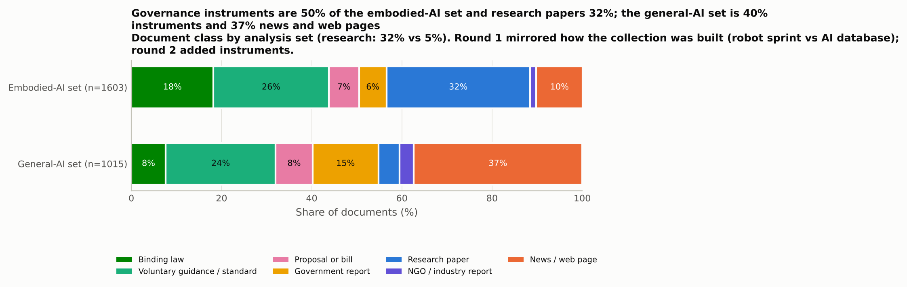

<em class="cap">Figure 01. Document classes in the embodied-AI set and the general-AI set, usable documents only (n in the axis labels).</em>

The embodied-AI set is 32% research outputs (509 of 1,603), 32% principal instruments (505) and 19% ancillary texts, catalogue pages and stubs of instrument class (305); academic issuers account for 32% of the set (516), national executives 17% (276), standards bodies 14% (228) and intergovernmental organisations 14% (217). The general-AI set is 37% communications (380 of 1,015) and 24% soft instruments (248), with 48 research outputs (Figure 1). The composition mirrors the two rounds, which is why Sections 5.5 to 5.7 compare within genre and within round.

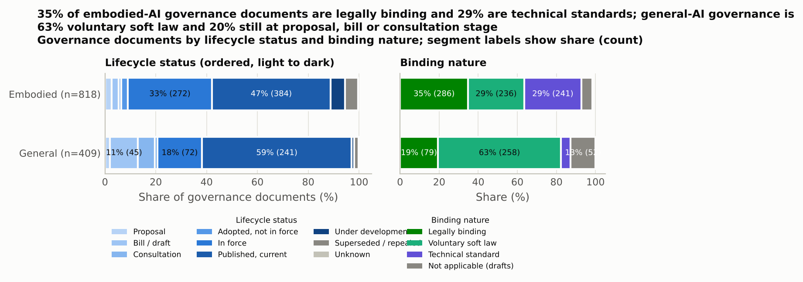

<em class="cap">Figure 04. Governance documents: lifecycle status (left) and binding nature (right), embodied-AI set vs general-AI set (n in the axis labels).</em>

*Table 33. Embodied-AI governance instruments by tier and capture quality (n=505; 'fraction seen' is the share of the text inside the v1 excerpt)*

| tier                                                           | doc_class           |   n |   substantive |   partial |   landing |   median_fraction_seen |
|:---------------------------------------------------------------|:--------------------|----:|--------------:|----------:|----------:|-----------------------:|
| general-AI instrument with embodied provisions (relevance 0-1) | Binding instrument  |  27 |            22 |         5 |         0 |                   0.09 |
| general-AI instrument with embodied provisions (relevance 0-1) | Soft-law instrument |  64 |            63 |         1 |         0 |                   0.51 |
| general-AI instrument with embodied provisions (relevance 0-1) | Proposal or draft   |   6 |             6 |         0 |         0 |                   0.33 |
| robot-specific instrument (relevance 2-3)                      | Binding instrument  | 168 |           153 |        15 |         0 |                   0.56 |
| robot-specific instrument (relevance 2-3)                      | Soft-law instrument | 176 |           112 |        64 |         0 |                   1    |
| robot-specific instrument (relevance 2-3)                      | Proposal or draft   |  64 |            48 |        16 |         0 |                   1    |

Of the 195 principal binding instruments, 132 are regulations or decrees, 60 statutes and 3 court decisions; 182 are in force, 9 superseded or repealed and 4 adopted but not yet in force. They are rules for machine classes: 107 mention drones, 67 autonomous road vehicles, 15 delivery robots, 13 industrial manipulators, 11 security or policing robots, and 9 or fewer each mobile logistics, agricultural, collaborative, surgical and care robots and autonomous weapons. The United States (56), the European Union (34), Japan (22), the United Kingdom (11) and Canada (9) supply 132 of the 195. Twenty-seven are general-sector or general-AI instruments that reach robots through a scope clause or product list (Executive Order 14110, revoked in January 2025, the Medical Devices Directive and Regulation, export-control lists, aircraft registration and noise rules, FAA reauthorisation acts, Japanese transport ordinances), while the AI Act, its 2026 amending regulation and the Machinery Regulation are rated robot-relevant for their product provisions. El Salvador's Robotic Technologies Law (2025, in force) is the only principal binding instrument with "robot" in its title that the collection has read; Hangzhou's 2026 embodied-robot regulations were verified by a collector but never fetched, and Beijing's development-zone measures were captured as a stub under 150 words. Table 33 gives the tiers by capture quality: 175 of the 195 are substantive captures and 20 partial, no catalogue page remains in the count, and 81 of the 310 soft and draft principal instruments are partial captures, mostly standards annotated on scope text.

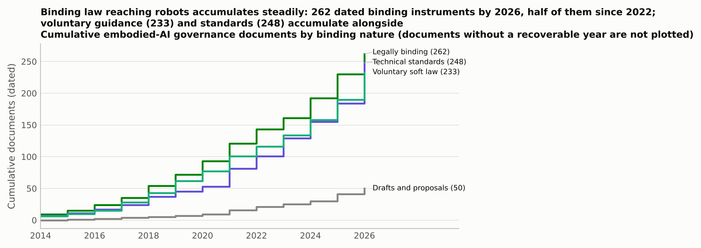

<em class="cap">Figure 06. Cumulative embodied-AI governance documents by binding nature.</em>

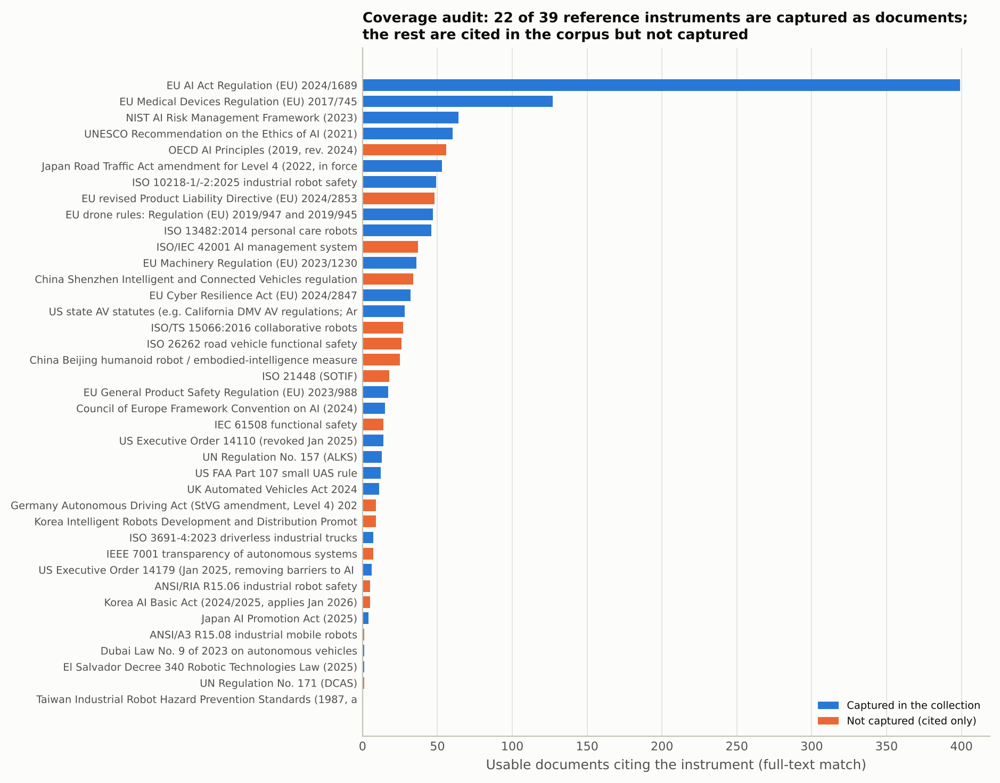

<em class="cap">Figure 41. Coverage audit: documents citing each reference instrument, coloured by whether the instrument itself was captured as a principal instrument with a content-analysed capture.</em>

Figure 6 accumulates dated embodied governance documents by binding nature on the all-texts unit: legally binding texts rise from 4 in 2012 to 262 by 2026, voluntary guidance to 233, technical standards to 248 and drafts to 50. The early part of the curve inherits the dating rule: 18 of the 195 principal binding instruments are dated before 2010, among them Japanese road-vehicle, road-traffic and aviation statutes of the 1950s and 1960s whose automated-driving provisions come from amendments of 2019 to 2023. The coverage audit (Figure 41, Table 25) uses the strict criterion of a principal instrument with a content-analysed capture: of 39 reference instruments and standards relevant to embodied AI, 22 are captured as documents in the collection, 16 are cited by documents in the corpus but were not captured, and 1 are neither captured nor cited; on the looser title-family match 31 are present. Seventeen remain missing on the strict criterion: Germany's 2021 autonomous-driving amendment, Korea's Intelligent Robots Act and AI Basic Act, the revised Product Liability Directive, Shenzhen's intelligent-connected-vehicle regulation, Beijing's humanoid-robot measures, UN Regulation 171, Taiwan's industrial-robot hazard-prevention standards, the OECD AI Principles as a document, and eight standards (ISO/TS 15066, IEC 61508, ISO 26262, ISO 21448, ISO/IEC 42001, IEEE 7001, ANSI/RIA R15.06, ANSI/A3 R15.08). A governance reviewer further listed instruments that a collector verified but the environment could not fetch: Hangzhou's robot regulations, three Shenzhen special-zone regulations, Hong Kong's autonomous-vehicle regulation, Korea's robot and autonomous-vehicle decrees, DoD Directive 3000.09, California SB 243, India's Drone Rules 2021, the EU Toy Safety Regulation and Directive, France's 2021 ordinance and decree on automated-vehicle liability, Switzerland's special-category aircraft ordinance, ANSI/A3 R15.06-2025 and GB/T 48317.1; these are the first targets of a third round. What the collection shows reliably is the *route* by which binding law reaches robots: sector law (aviation, road traffic, machinery and workplace safety, medical devices) and general AI law, not robotics statutes.

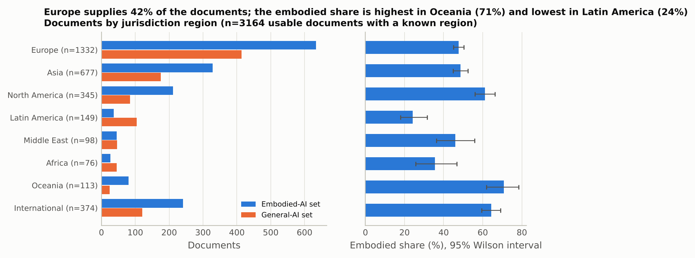

<em class="cap">Figure 07. Documents by jurisdiction region and set (left) and the embodied share within each region (right).</em>

Europe supplies 42% of usable documents (1,332 of 3,165) and 48% of them are embodied; Asia 677 (49% embodied); North America 345 (61%); the international layer 374 (64%); Latin America 149 (24%); Oceania 113 (71%); the Middle East 98 (46%); Africa 76 (36%) (V = 0.19). Principal embodied instruments are European (170), Asian (119), North American (102) and international (64) before Latin American (21), Oceanian (11), African (10) and Middle Eastern (8). Of 116 countries with a document, 58 jurisdictions hold a principal embodied instrument and 40 a principal binding one; the United States (83), the European Union (77), the international layer (65), China (55), Japan (46) and the United Kingdom (39) hold the most. Non-English documents are more often governance documents (68% of 792 against 49% of 2,373).

### 5.4 Which robots are governed and which are studied (Q2)

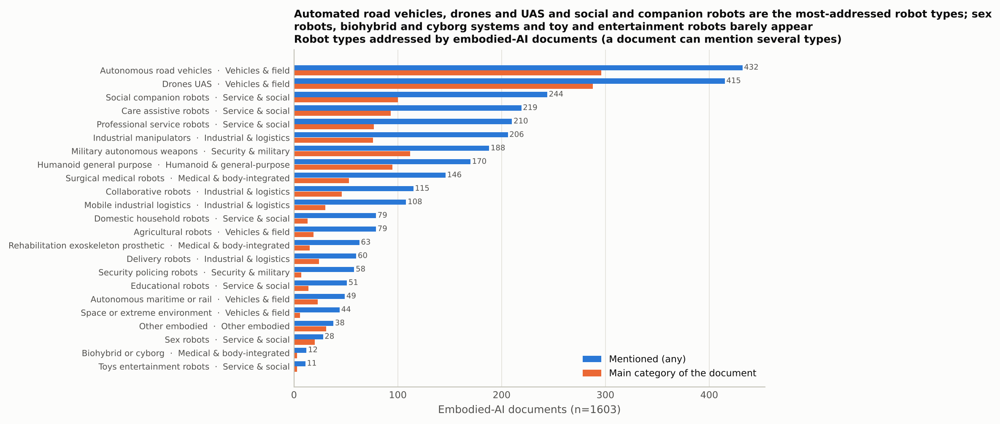

<em class="cap">Figure 11. Embodied-AI categories addressed: any mention and primary category (embodied-AI set).</em>

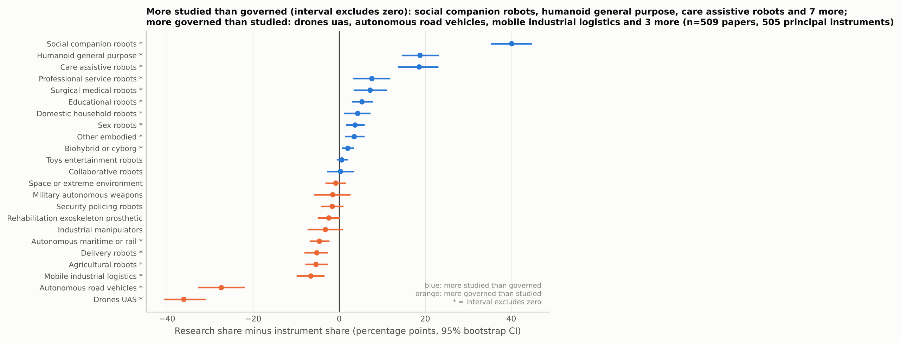

<em class="cap">Figure 40. Governance-gap index with 95% bootstrap intervals (research share minus principal-instrument share by robot type); the title names the categories whose interval excludes zero.</em>

*Table 22. Governance-gap index with 95% bootstrap confidence intervals (2,000 resamples of research outputs n=509 and governance instruments n=505 separately)*

| category                              | level1                     |   research_pct |   n_research |   instrument_pct |   n_instruments |   gap_index |   ci_low |   ci_high | ci_excludes_zero   |
|:--------------------------------------|:---------------------------|---------------:|-------------:|-----------------:|----------------:|------------:|---------:|----------:|:-------------------|
| social_companion_robots               | Service & social           |           43   |          219 |              3   |              15 |        40.1 |     35.5 |      44.6 | True               |
| humanoid_general_purpose              | Humanoid & general-purpose |           22.8 |          116 |              4   |              20 |        18.8 |     14.7 |      23   | True               |
| care_assistive_robots                 | Service & social           |           27.5 |          140 |              8.9 |              45 |        18.6 |     13.9 |      22.9 | True               |
| professional_service_robots           | Service & social           |           17.5 |           89 |              9.9 |              50 |         7.6 |      3.4 |      11.7 | True               |
| surgical_medical_robots               | Medical & body-integrated  |           14.5 |           74 |              7.3 |              37 |         7.2 |      3.5 |      11   | True               |
| educational_robots                    | Service & social           |            6.9 |           35 |              1.6 |               8 |         5.3 |      3.1 |       7.7 | True               |
| domestic_household_robots             | Service & social           |            7.7 |           39 |              3.4 |              17 |         4.3 |      1.3 |       7.1 | True               |
| sex_robots                            | Service & social           |            4.5 |           23 |              0.8 |               4 |         3.7 |      1.8 |       5.7 | True               |
| other_embodied                        | Other embodied             |            4.7 |           24 |              1.2 |               6 |         3.5 |      1.6 |       5.7 | True               |
| biohybrid_or_cyborg                   | Medical & body-integrated  |            2.2 |           11 |              0.2 |               1 |         2   |      0.8 |       3.3 | True               |
| toys_entertainment_robots             | Service & social           |            1.2 |            6 |              0.6 |               3 |         0.6 |     -0.4 |       1.8 | False              |
| collaborative_robots                  | Industrial & logistics     |            6.3 |           32 |              5.9 |              30 |         0.3 |     -2.6 |       3.3 | False              |
| space_or_extreme_environment          | Vehicles & field           |            3.1 |           16 |              4   |              20 |        -0.8 |     -3   |       1.4 | False              |
| military_autonomous_weapons           | Security & military        |           10.4 |           53 |             11.9 |              60 |        -1.5 |     -5.6 |       2.5 | False              |
| security_policing_robots              | Security & military        |            3.1 |           16 |              4.8 |              24 |        -1.6 |     -4   |       0.8 | False              |
| rehabilitation_exoskeleton_prosthetic | Medical & body-integrated  |            2.8 |           14 |              5.1 |              26 |        -2.4 |     -4.8 |      -0   | False              |
| industrial_manipulators               | Industrial & logistics     |           10   |           51 |             13.3 |              67 |        -3.2 |     -7.2 |       0.7 | False              |
| autonomous_maritime_or_rail           | Vehicles & field           |            1   |            5 |              5.5 |              28 |        -4.6 |     -6.7 |      -2.4 | True               |
| delivery_robots                       | Industrial & logistics     |            2.2 |           11 |              7.3 |              37 |        -5.2 |     -7.9 |      -2.8 | True               |
| agricultural_robots                   | Vehicles & field           |            2.4 |           12 |              7.7 |              39 |        -5.4 |     -7.7 |      -2.8 | True               |
| mobile_industrial_logistics           | Industrial & logistics     |            3.1 |           16 |              9.7 |              49 |        -6.6 |     -9.7 |      -3.6 | True               |
| autonomous_road_vehicles              | Vehicles & field           |           12.4 |           63 |             39.8 |             201 |       -27.4 |    -32.6 |     -22.1 | True               |
| drones_uas                            | Vehicles & field           |            6.3 |           32 |             42.4 |             214 |       -36.1 |    -40.6 |     -31.2 | True               |

Autonomous road vehicles are the most addressed type (432 embodied documents mention them), then drones (415), companion and social robots (244), care robots (219), professional service robots (210), industrial manipulators (206), autonomous weapons (188), humanoids (170), surgical robots (146) and collaborative robots (115). The governance-gap index compares 509 research outputs with 505 principal instruments (Figure 40, Table 22) and separates three groups. Studied far more than governed: social and companion robots (43% of research outputs, 3% of instruments; gap +40 points, bootstrap interval 36 to 45; 15 instruments, none binding), humanoids (+19, 15 to 23; 20 instruments), care robots (+19, 14 to 23), professional service and surgical robots (+8 and +7), educational, domestic and sex robots (+4 to +5). Near parity, with intervals including zero: autonomous weapons (−2, −6 to 3), collaborative robots, toys, space robots, security robots, rehabilitation devices and industrial manipulators (−3, −7 to 1). Governed far more than studied: drones (6% of research, 42% of instruments; −36, −41 to −31), autonomous road vehicles (12% and 40%; −27, −33 to −22) and mobile logistics, agricultural, delivery and maritime or rail robots (−5 to −7, all intervals excluding zero). The instrument side inherits the round-2 search terms, which named drones, automated driving and machinery far more often than service robots, so the drone and vehicle gaps are partly what the search made them. Social robots are European (27% of Europe's embodied documents) and North American (15%), humanoids have their highest shares in the Middle East (22%) and Asia (15%), and drones dominate Oceania (65%), Africa (63%) and Latin America (53%). Within the embodied set, social robots fall from 20% of documents in 2020 to 2022 to 12% in 2025 to 2026 and humanoids rise from 8% to 17% (Figure 42 in the report).

### 5.5 Considerations, tools and framings (Q3)

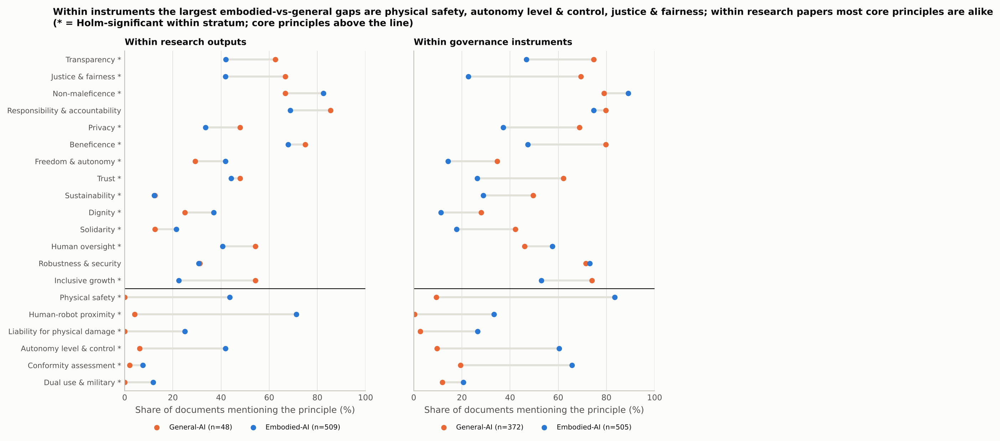

<em class="cap">Figure 39. Embodied vs general principle presence within research outputs and within governance instruments (genre-stratified).</em>

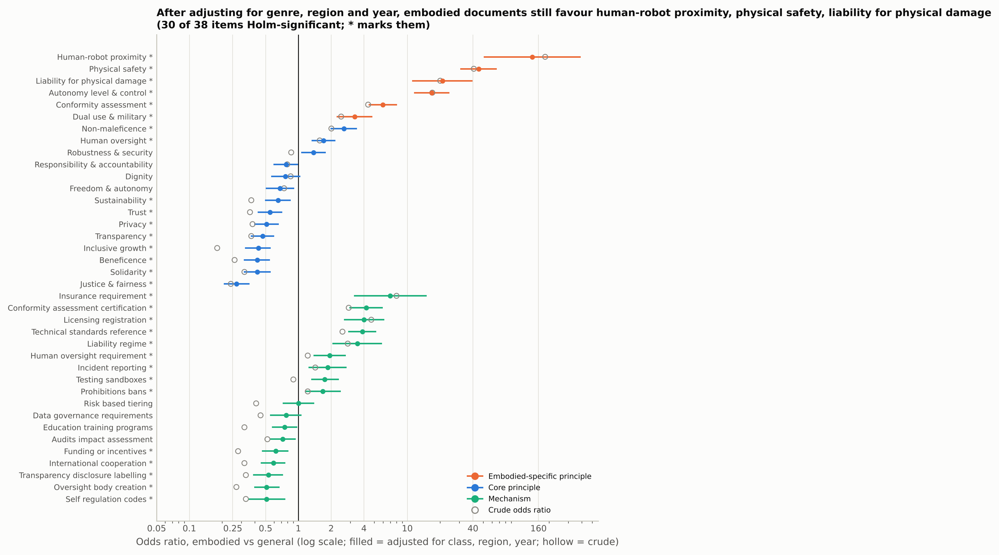

<em class="cap">Figure 38. Crude and covariate-adjusted odds ratios (embodied vs general) for principles and mechanisms, adjusting for document class, region and year.</em>

*Table 20. Embodied-AI set vs general-AI set: crude and covariate-adjusted odds ratios (logistic regression adjusting for document class, jurisdiction region, collection round and publication year; usable documents with a known year)*

| item                                           | group             |    n |   events |   events_embodied |   events_general |   sparse_cell |   crude_or |   adjusted_or |   ci_low |   ci_high |      p |   p_holm | significant_holm_05   |
|:-----------------------------------------------|:------------------|-----:|---------:|------------------:|-----------------:|--------------:|-----------:|--------------:|---------:|----------:|-------:|---------:|:----------------------|
| principle: Transparency                        | core              | 2526 |     1154 |               564 |              590 |             0 |       0.37 |          0.47 |     0.37 |      0.59 | 0      |   0      | True                  |
| principle: Justice & fairness                  | core              | 2526 |      991 |               409 |              582 |             0 |       0.24 |          0.27 |     0.21 |      0.35 | 0      |   0      | True                  |
| principle: Non-maleficence                     | core              | 2526 |     1916 |              1254 |              662 |             0 |       2.01 |          2.61 |     2.01 |      3.41 | 0      |   0      | True                  |
| principle: Responsibility & accountability     | core              | 2526 |     1544 |               915 |              629 |             0 |       0.79 |          0.77 |     0.6  |      0.98 | 0.0336 |   0.1345 | False                 |
| principle: Privacy                             | core              | 2526 |      929 |               433 |              496 |             0 |       0.38 |          0.51 |     0.4  |      0.65 | 0      |   0      | True                  |
| principle: Beneficence                         | core              | 2526 |     1527 |               760 |              767 |             0 |       0.26 |          0.42 |     0.32 |      0.54 | 0      |   0      | True                  |
| principle: Freedom & autonomy                  | core              | 2526 |      568 |               316 |              252 |             0 |       0.74 |          0.68 |     0.51 |      0.9  | 0.008  |   0.0644 | False                 |
| principle: Trust                               | core              | 2526 |      975 |               455 |              520 |             0 |       0.36 |          0.55 |     0.43 |      0.7  | 0      |   0      | True                  |
| principle: Sustainability                      | core              | 2526 |      637 |               276 |              361 |             0 |       0.37 |          0.65 |     0.5  |      0.84 | 0.0009 |   0.01   | True                  |
| principle: Dignity                             | core              | 2526 |      500 |               291 |              209 |             0 |       0.85 |          0.76 |     0.57 |      1.03 | 0.0765 |   0.2295 | False                 |
| principle: Solidarity                          | core              | 2526 |      598 |               241 |              357 |             0 |       0.32 |          0.42 |     0.32 |      0.55 | 0      |   0      | True                  |
| principle: Human oversight                     | core              | 2526 |      989 |               670 |              319 |             0 |       1.57 |          1.7  |     1.34 |      2.15 | 0      |   0.0002 | True                  |
| principle: Robustness & security               | core              | 2526 |     1298 |               774 |              524 |             0 |       0.86 |          1.38 |     1.08 |      1.76 | 0.0096 |   0.067  | False                 |
| principle: Inclusive growth                    | core              | 2526 |     1308 |               567 |              741 |             0 |       0.18 |          0.43 |     0.33 |      0.55 | 0      |   0      | True                  |
| principle: Physical safety                     | embodied-specific | 2526 |     1082 |              1036 |               46 |             0 |      40.75 |         45.18 |    31.2  |     65.42 | 0      |   0      | True                  |
| principle: Human-robot proximity               | embodied-specific | 2526 |      672 |               668 |                4 |             1 |     184.04 |        140.4  |    51.13 |    385.58 | 0      |   0      | True                  |
| principle: Liability for physical damage       | embodied-specific | 2526 |      343 |               330 |               13 |             0 |      20.04 |         20.96 |    11.23 |     39.12 | 0      |   0      | True                  |
| principle: Autonomy level & control            | embodied-specific | 2526 |      809 |               757 |               52 |             0 |      16.96 |         16.69 |    11.67 |     23.87 | 0      |   0      | True                  |
| principle: Conformity assessment               | embodied-specific | 2526 |      722 |               599 |              123 |             0 |       4.37 |          5.94 |     4.47 |      7.89 | 0      |   0      | True                  |
| principle: Dual use & military                 | embodied-specific | 2526 |      323 |               252 |               71 |             0 |       2.47 |          3.28 |     2.28 |      4.72 | 0      |   0      | True                  |
| mechanism: Audits impact assessment            | mechanism         | 2526 |      718 |               nan |              nan |           nan |       0.52 |          0.72 |     0.56 |      0.93 | 0.0106 |   0.067  | False                 |
| mechanism: Conformity assessment certification | mechanism         | 2526 |      381 |               nan |              nan |           nan |       2.9  |          4.19 |     2.98 |      5.88 | 0      |   0      | True                  |
| mechanism: Data governance requirements        | mechanism         | 2526 |      352 |               nan |              nan |           nan |       0.45 |          0.77 |     0.56 |      1.05 | 0.1013 |   0.2295 | False                 |
| mechanism: Education training programs         | mechanism         | 2526 |      710 |               nan |              nan |           nan |       0.32 |          0.75 |     0.58 |      0.96 | 0.0236 |   0.1181 | False                 |
| mechanism: Funding or incentives               | mechanism         | 2526 |      629 |               nan |              nan |           nan |       0.28 |          0.62 |     0.47 |      0.8  | 0.0003 |   0.004  | True                  |
| mechanism: Human oversight requirement         | mechanism         | 2526 |      344 |               nan |              nan |           nan |       1.22 |          1.94 |     1.4  |      2.68 | 0.0001 |   0.0009 | True                  |
| mechanism: Incident reporting                  | mechanism         | 2526 |      237 |               nan |              nan |           nan |       1.43 |          1.86 |     1.26 |      2.73 | 0.0017 |   0.0173 | True                  |
| mechanism: Insurance requirement               | mechanism         | 2526 |      128 |               nan |              nan |           nan |       7.96 |          6.98 |     3.28 |     14.86 | 0      |   0      | True                  |
| mechanism: International cooperation           | mechanism         | 2526 |      749 |               nan |              nan |           nan |       0.32 |          0.59 |     0.46 |      0.75 | 0      |   0.0004 | True                  |
| mechanism: Liability regime                    | mechanism         | 2526 |      178 |               nan |              nan |           nan |       2.84 |          3.47 |     2.08 |      5.78 | 0      |   0      | True                  |
| mechanism: Licensing registration              | mechanism         | 2526 |      387 |               nan |              nan |           nan |       4.67 |          4.01 |     2.66 |      6.06 | 0      |   0      | True                  |
| mechanism: Oversight body creation             | mechanism         | 2526 |      687 |               nan |              nan |           nan |       0.27 |          0.51 |     0.4  |      0.66 | 0      |   0      | True                  |
| mechanism: Prohibitions bans                   | mechanism         | 2526 |      266 |               nan |              nan |           nan |       1.22 |          1.68 |     1.17 |      2.42 | 0.0054 |   0.0484 | True                  |
| mechanism: Risk based tiering                  | mechanism         | 2526 |      310 |               nan |              nan |           nan |       0.41 |          1    |     0.73 |      1.38 | 0.984  |   0.984  | False                 |
| mechanism: Self regulation codes               | mechanism         | 2526 |      245 |               nan |              nan |           nan |       0.33 |          0.51 |     0.35 |      0.75 | 0.0005 |   0.0057 | True                  |
| mechanism: Technical standards reference       | mechanism         | 2526 |      876 |               nan |              nan |           nan |       2.54 |          3.86 |     2.92 |      5.09 | 0      |   0      | True                  |
| mechanism: Testing sandboxes                   | mechanism         | 2526 |      518 |               nan |              nan |           nan |       0.9  |          1.75 |     1.33 |      2.31 | 0.0001 |   0.0009 | True                  |
| mechanism: Transparency disclosure labelling   | mechanism         | 2526 |      424 |               nan |              nan |           nan |       0.33 |          0.53 |     0.39 |      0.71 | 0      |   0.0003 | True                  |

*Table 34. Core principles: Mantel-Haenszel odds ratios (embodied vs general) stratified by document class, with Holm correction*

| principle                       |   strata |   mh_odds_ratio |   ci_low |   ci_high |      p |   p_holm |
|:--------------------------------|---------:|----------------:|---------:|----------:|-------:|---------:|
| Transparency                    |        7 |            0.28 |     0.23 |      0.34 | 0      |   0      |
| Justice & fairness              |        7 |            0.16 |     0.13 |      0.2  | 0      |   0      |
| Non-maleficence                 |        7 |            1.78 |     1.45 |      2.18 | 0      |   0      |
| Responsibility & accountability |        7 |            0.55 |     0.46 |      0.67 | 0      |   0      |
| Privacy                         |        7 |            0.26 |     0.22 |      0.32 | 0      |   0      |
| Beneficence                     |        7 |            0.26 |     0.21 |      0.31 | 0      |   0      |
| Freedom & autonomy              |        7 |            0.4  |     0.31 |      0.5  | 0      |   0      |
| Trust                           |        7 |            0.29 |     0.24 |      0.36 | 0      |   0      |
| Sustainability                  |        7 |            0.43 |     0.35 |      0.52 | 0      |   0      |
| Dignity                         |        7 |            0.53 |     0.42 |      0.68 | 0      |   0      |
| Solidarity                      |        7 |            0.3  |     0.24 |      0.38 | 0      |   0      |
| Human oversight                 |        7 |            1.38 |     1.15 |      1.66 | 0.0003 |   0.0006 |
| Robustness & security           |        7 |            0.94 |     0.78 |      1.14 | 0.5592 |   0.5592 |
| Inclusive growth                |        7 |            0.29 |     0.24 |      0.35 | 0      |   0      |

The within-round comparison (Table 20b, Section 5.2) is the primary result for Q3: within round-1 instruments no core principle differs, within round-2 instruments ten are lower, and in both rounds and both genres the embodied-specific considerations differ sharply. The pooled analyses agree once that is known. Within principal instruments pooled over rounds (505 against 372; Figure 39, Table 21 in the report), all six embodied-specific considerations are higher in the embodied set (physical safety 83% against 9%, conformity assessment 66% against 19%, autonomy-level control 60% against 10%, dual use 21% against 12%), ten core principles are lower (from dignity, 11% against 28%, to justice and fairness, 23% against 69%), non-maleficence (89% against 79%) and human oversight (58% against 46%) are higher, and accountability and robustness do not differ; within research outputs (509 against 48) four considerations differ and inclusive growth is the only core principle that does (22% against 54%). Adjusting for class, region, collection round and year (Table 20, n = 2,526), the embodied-specific considerations keep large odds ratios (physical safety 45, liability 21, autonomy-level control 17, conformity assessment 6.0, dual use 3.3; the proximity ratio rests on four general-set events and is flagged, not interpreted); eight core principles are lower (odds ratios 0.27 for justice to 0.65 for sustainability), non-maleficence (2.6) and human oversight (1.7) are higher, and accountability, freedom, dignity and robustness do not differ after correction. The Mantel-Haenszel analysis stratified by class alone (Table 34), which does not adjust for round, finds eleven lower; the three the round covariate removes (accountability, freedom, dignity) are the ones Table 20b shows to be round-2 artefacts, and the remaining eight should be read as a property of harvested legal texts rather than of robot governance as such.

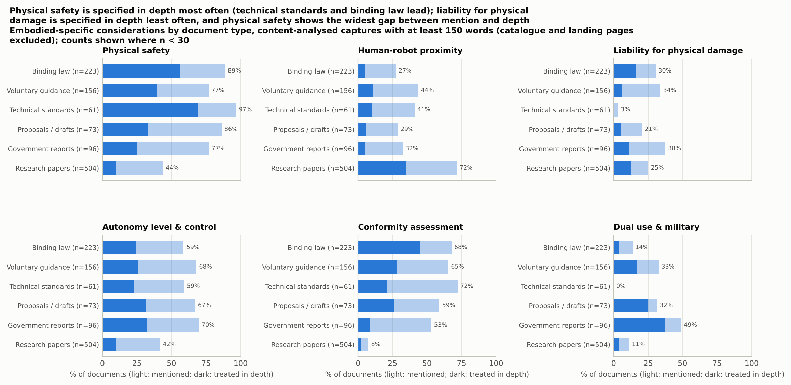

<em class="cap">Figure 23. Embodied-specific considerations by document type, content-analysed captures of at least 150 words only (catalogue and landing pages excluded): share mentioning (light) and treating in depth (dark); counts shown where n is below 30.</em>

*Table 09. Embodied-specific principles by instrument type (embodied-AI documents, content-analysed captures only; catalogue and landing pages excluded)*

| group                |   n | principle                           | label                         |   any_pct |   substantive_pct |
|:---------------------|----:|:------------------------------------|:------------------------------|----------:|------------------:|
| Binding instruments  | 195 | physical_safety                     | Physical safety               |      89.2 |              61.5 |
| Binding instruments  | 195 | human_robot_proximity               | Human-robot proximity         |      29.7 |               5.6 |
| Binding instruments  | 195 | liability_for_physical_damage       | Liability for physical damage |      33.3 |              17.9 |
| Binding instruments  | 195 | autonomy_level_control              | Autonomy level & control      |      61   |              24.6 |
| Binding instruments  | 195 | conformity_assessment_certification | Conformity assessment         |      70.3 |              47.2 |
| Binding instruments  | 195 | dual_use_military                   | Dual use & military           |      15.9 |               4.1 |
| Soft-law instruments | 207 | physical_safety                     | Physical safety               |      73.4 |              32.9 |
| Soft-law instruments | 207 | human_robot_proximity               | Human-robot proximity         |      37.7 |               9.7 |
| Soft-law instruments | 207 | liability_for_physical_damage       | Liability for physical damage |      27.5 |               4.8 |
| Soft-law instruments | 207 | autonomy_level_control              | Autonomy level & control      |      57   |              20.3 |
| Soft-law instruments | 207 | conformity_assessment_certification | Conformity assessment         |      60.9 |              24.6 |
| Soft-law instruments | 207 | dual_use_military                   | Dual use & military           |      25.1 |              13.5 |
| Technical standards  |  62 | physical_safety                     | Physical safety               |      95.2 |              67.7 |
| Technical standards  |  62 | human_robot_proximity               | Human-robot proximity         |      40.3 |               9.7 |
| Technical standards  |  62 | liability_for_physical_damage       | Liability for physical damage |       3.2 |               0   |
| Technical standards  |  62 | autonomy_level_control              | Autonomy level & control      |      59.7 |              22.6 |
| Technical standards  |  62 | conformity_assessment_certification | Conformity assessment         |      71   |              21   |
| Technical standards  |  62 | dual_use_military                   | Dual use & military           |       0   |               0   |
| Proposals / drafts   |  77 | physical_safety                     | Physical safety               |      84.4 |              32.5 |
| Proposals / drafts   |  77 | human_robot_proximity               | Human-robot proximity         |      27.3 |               5.2 |
| Proposals / drafts   |  77 | liability_for_physical_damage       | Liability for physical damage |      19.5 |               5.2 |
| Proposals / drafts   |  77 | autonomy_level_control              | Autonomy level & control      |      66.2 |              31.2 |
| Proposals / drafts   |  77 | conformity_assessment_certification | Conformity assessment         |      57.1 |              24.7 |
| Proposals / drafts   |  77 | dual_use_military                   | Dual use & military           |      32.5 |              24.7 |
| Research outputs     | 509 | physical_safety                     | Physical safety               |      43.6 |               9.4 |
| Research outputs     | 509 | human_robot_proximity               | Human-robot proximity         |      71.3 |              34.4 |
| Research outputs     | 509 | liability_for_physical_damage       | Liability for physical damage |      25   |              12.8 |
| Research outputs     | 509 | autonomy_level_control              | Autonomy level & control      |      41.8 |               9.6 |
| Research outputs     | 509 | conformity_assessment_certification | Conformity assessment         |       7.5 |               1.8 |
| Research outputs     | 509 | dual_use_military                   | Dual use & military           |      11.8 |               4.3 |

Figure 23 and Table 9 show which document types specify the embodied considerations, on content-analysed captures only. Among the 195 principal binding instruments, physical safety is mentioned in 89% and specified in depth in 62%, conformity assessment in 70% and 47%, autonomy-level control in 61% and 25%, liability for physical damage in 33% and 18%, proximity in 30% and 6%. Soft-law instruments other than standards (207 content captures) specify physical safety in 33% and autonomy-level control in 21%. Technical standards are a separate measurement: on 62 scope captures, physical safety is mentioned in 95% and specified in 68%, autonomy-level control in 60% and 23%, liability in 3% (never in depth) and dual use never; these shares describe what a scope statement says, not what a normative clause requires. Proposals and drafts (77) specify autonomy-level control most often (31%); research outputs (509) mention proximity in 71% and treat it in depth in 34%.

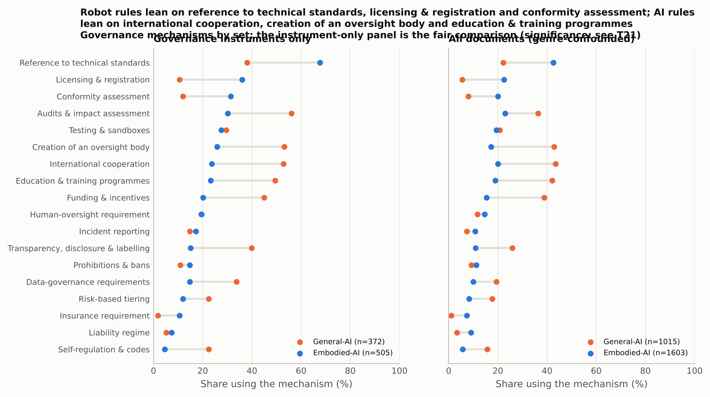

<em class="cap">Figure 24. Governance mechanisms by set: principal governance instruments only (left, the fair comparison) and all documents (right, genre-confounded).</em>

*Table 10. Governance mechanisms by set (all usable documents; instrument-only shares for governance documents, embodied n=822, general n=409)*

| mechanism                           |   embodied_pct |   general_pct |   embodied_instruments_pct |   general_instruments_pct | test       |      p |   p_holm |
|:------------------------------------|---------------:|--------------:|---------------------------:|--------------------------:|:-----------|-------:|---------:|
| technical_standards_reference       |           42.6 |          22.2 |                       67.6 |                      38.1 | chi-square | 0      |   0      |
| audits_impact_assessment            |           23   |          36.4 |                       30.2 |                      56   | chi-square | 0      |   0      |
| licensing_registration              |           22.4 |           5.5 |                       36   |                      10.5 | chi-square | 0      |   0      |
| conformity_assessment_certification |           20   |           8   |                       31.4 |                      12   | chi-square | 0      |   0      |
| international_cooperation           |           20   |          43.5 |                       23.7 |                      52.8 | chi-square | 0      |   0      |
| testing_sandboxes                   |           19.4 |          20.8 |                       27.5 |                      29.6 | chi-square | 0.4149 |   0.4149 |
| education_training_programs         |           19   |          42   |                       23.2 |                      49.4 | chi-square | 0      |   0      |
| oversight_body_creation             |           17.3 |          42.8 |                       25.8 |                      53.1 | chi-square | 0      |   0      |
| funding_or_incentives               |           15.4 |          38.8 |                       20.2 |                      45   | chi-square | 0      |   0      |
| human_oversight_requirement         |           14.6 |          11.7 |                       19.5 |                      19.3 | chi-square | 0.0415 |   0.1245 |
| prohibitions_bans                   |           11.2 |           9.2 |                       14.8 |                      10.8 | chi-square | 0.1052 |   0.2105 |
| transparency_disclosure_labelling   |           10.9 |          25.8 |                       15   |                      39.9 | chi-square | 0      |   0      |
| incident_reporting                  |           10.7 |           7.3 |                       17.2 |                      14.7 | chi-square | 0.0041 |   0.0164 |
| data_governance_requirements        |            9.9 |          19.4 |                       14.7 |                      33.7 | chi-square | 0      |   0      |
| liability_regime                    |            9.1 |           3.3 |                        7.4 |                       5.1 | chi-square | 0      |   0      |
| risk_based_tiering                  |            8.3 |          17.7 |                       11.9 |                      22.5 | chi-square | 0      |   0      |
| insurance_requirement               |            7.4 |           1   |                       10.6 |                       1.7 | chi-square | 0      |   0      |
| self_regulation_codes               |            5.7 |          15.7 |                        4.6 |                      22.5 | chi-square | 0      |   0      |

Among principal instruments (505 against 372; Table 21), embodied rules refer to technical standards (65% against 35%), use licensing and registration (44% against 10%), conformity assessment (42% against 12%) and insurance requirements (15% against 2%) more often, and audits, oversight bodies, international cooperation, education, funding, data governance, labelling obligations and self-regulation codes less often, all Holm-significant; incident reporting, prohibitions and liability regimes are modestly higher, and human-oversight requirements, risk-based tiering and testing or sandboxes do not differ at these sizes (Figure 24, left; Table 10 gives the shares among all governance documents). The adjusted models (Table 20) confirm insurance (7.0), conformity assessment (4.2), licensing (4.1), standards references (3.9) and liability regimes (3.5), add human-oversight requirements, incident reporting, testing and prohibitions (1.7 to 1.9), and confirm the lower use of oversight bodies, self-regulation, labelling, international cooperation and funding (0.51 to 0.62); risk-based tiering is at 1.00 after adjustment.

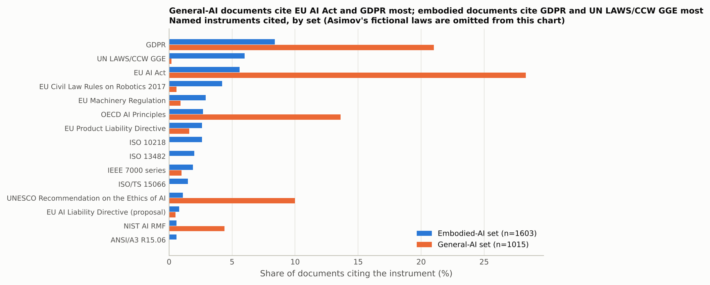

<em class="cap">Figure 29. Most cited named governance instruments, embodied-AI set vs general-AI set.</em>

The two sets cite different instruments (Figure 29): general-AI documents the AI Act (28%), the GDPR (21%) and the OECD principles (14%); embodied documents the GDPR (8%), the UN CCW process (6% against 0.2%), the AI Act (6%) and the Civil Law Rules on Robotics (4% against 0.6%); any named instrument is cited by 27% of embodied and 52% of general documents. Framing is ethics-led in Europe (36% of 546 framed embodied documents), risk-led in North America (31% of 164) and Oceania (64% of 53), split between innovation promotion and risk in Asia (38% and 34% of 260) and liability-led in the Middle East (59% of 41) (V = 0.24); of 480 embodied research outputs that take a stance, 56% take no regulatory position, 31% call for new regulation and 4% argue existing law suffices.

### 5.6 Regional comparison (Q4)

*Table 29. Regional divergence of principles and mechanisms on the same population (embodied documents in six regions): bias-corrected Cramer's V with bootstrap 95% CIs, Monte-Carlo chi-square where cells are sparse, Holm correction*

| item                                            | population                    |    n |   v_bias_corrected |   ci_low |   ci_high | test                     |      p |   p_holm |
|:------------------------------------------------|:------------------------------|-----:|-------------------:|---------:|----------:|:-------------------------|-------:|---------:|
| mechanism: Reference to technical standards     | embodied documents, 6 regions | 1576 |              0.353 |    0.31  |     0.398 | chi-square               | 0      |   0      |
| mechanism: Licensing & registration             | embodied documents, 6 regions | 1576 |              0.34  |    0.298 |     0.399 | chi-square               | 0      |   0      |
| principle: Beneficence                          | embodied documents, 6 regions | 1576 |              0.333 |    0.297 |     0.387 | chi-square               | 0      |   0      |
| principle: Trust                                | embodied documents, 6 regions | 1576 |              0.298 |    0.255 |     0.353 | chi-square               | 0      |   0      |
| mechanism: Liability regime                     | embodied documents, 6 regions | 1576 |              0.277 |    0.213 |     0.354 | chi-square               | 0      |   0      |
| principle: Freedom & autonomy                   | embodied documents, 6 regions | 1576 |              0.268 |    0.227 |     0.315 | chi-square               | 0      |   0      |
| principle: Privacy                              | embodied documents, 6 regions | 1576 |              0.262 |    0.219 |     0.306 | chi-square               | 0      |   0      |
| principle: Responsibility & accountability      | embodied documents, 6 regions | 1576 |              0.245 |    0.202 |     0.3   | chi-square               | 0      |   0      |
| principle: Liability for physical damage        | embodied documents, 6 regions | 1576 |              0.241 |    0.21  |     0.285 | chi-square               | 0      |   0      |
| principle: Inclusive growth                     | embodied documents, 6 regions | 1576 |              0.232 |    0.196 |     0.288 | chi-square               | 0      |   0      |
| principle: Human-robot proximity                | embodied documents, 6 regions | 1576 |              0.229 |    0.188 |     0.285 | chi-square               | 0      |   0      |
| principle: Dignity                              | embodied documents, 6 regions | 1576 |              0.224 |    0.186 |     0.28  | chi-square               | 0      |   0      |
| principle: Justice & fairness                   | embodied documents, 6 regions | 1576 |              0.223 |    0.185 |     0.277 | chi-square               | 0      |   0      |
| mechanism: Funding & incentives                 | embodied documents, 6 regions | 1576 |              0.216 |    0.177 |     0.262 | chi-square               | 0      |   0      |
| principle: Robustness & security                | embodied documents, 6 regions | 1576 |              0.199 |    0.156 |     0.257 | chi-square               | 0      |   0      |
| mechanism: Prohibitions & bans                  | embodied documents, 6 regions | 1576 |              0.184 |    0.129 |     0.26  | chi-square               | 0      |   0      |
| mechanism: Insurance requirement                | embodied documents, 6 regions | 1576 |              0.176 |    0.143 |     0.237 | chi-square               | 0      |   0      |
| principle: Sustainability                       | embodied documents, 6 regions | 1576 |              0.176 |    0.145 |     0.229 | chi-square               | 0      |   0      |
| principle: Transparency                         | embodied documents, 6 regions | 1576 |              0.173 |    0.132 |     0.236 | chi-square               | 0      |   0      |
| mechanism: Incident reporting                   | embodied documents, 6 regions | 1576 |              0.171 |    0.126 |     0.237 | chi-square               | 0      |   0      |
| mechanism: Risk-based tiering                   | embodied documents, 6 regions | 1576 |              0.164 |    0.102 |     0.241 | chi-square               | 0      |   0      |
| mechanism: Creation of an oversight body        | embodied documents, 6 regions | 1576 |              0.159 |    0.118 |     0.221 | chi-square               | 0      |   0      |
| principle: Conformity assessment                | embodied documents, 6 regions | 1576 |              0.151 |    0.111 |     0.207 | chi-square               | 0      |   0      |
| principle: Physical safety                      | embodied documents, 6 regions | 1576 |              0.149 |    0.11  |     0.202 | chi-square               | 0      |   0      |
| principle: Solidarity                           | embodied documents, 6 regions | 1576 |              0.137 |    0.091 |     0.188 | chi-square               | 0      |   0      |
| principle: Non-maleficence                      | embodied documents, 6 regions | 1576 |              0.134 |    0.089 |     0.196 | chi-square               | 0      |   0.0001 |
| principle: Human oversight                      | embodied documents, 6 regions | 1576 |              0.131 |    0.09  |     0.189 | chi-square               | 0      |   0.0001 |
| principle: Autonomy level & control             | embodied documents, 6 regions | 1576 |              0.128 |    0.091 |     0.187 | chi-square               | 0      |   0.0002 |
| mechanism: Education & training programmes      | embodied documents, 6 regions | 1576 |              0.124 |    0.083 |     0.183 | chi-square               | 0      |   0.0004 |
| mechanism: International cooperation            | embodied documents, 6 regions | 1576 |              0.107 |    0.071 |     0.167 | chi-square               | 0.0005 |   0.0044 |
| mechanism: Human-oversight requirement          | embodied documents, 6 regions | 1576 |              0.103 |    0.045 |     0.178 | chi-square               | 0.001  |   0.0077 |
| mechanism: Data-governance requirements         | embodied documents, 6 regions | 1576 |              0.097 |    0.06  |     0.146 | chi-square               | 0.0021 |   0.0144 |
| principle: Dual use & military                  | embodied documents, 6 regions | 1576 |              0.092 |    0.046 |     0.155 | chi-square               | 0.0038 |   0.0226 |
| mechanism: Testing & sandboxes                  | embodied documents, 6 regions | 1576 |              0.087 |    0.051 |     0.154 | chi-square               | 0.0062 |   0.0311 |
| mechanism: Conformity assessment                | embodied documents, 6 regions | 1576 |              0.07  |    0.019 |     0.138 | chi-square               | 0.034  |   0.1359 |
| mechanism: Audits & impact assessment           | embodied documents, 6 regions | 1576 |              0.059 |    0     |     0.137 | chi-square               | 0.0746 |   0.2237 |
| mechanism: Transparency, disclosure & labelling | embodied documents, 6 regions | 1576 |              0.054 |    0     |     0.147 | chi-square               | 0.1019 |   0.2237 |
| mechanism: Self-regulation & codes              | embodied documents, 6 regions | 1576 |              0.028 |    0     |     0.108 | chi-square (Monte Carlo) | 0.8803 |   0.8803 |

<em class="cap">Figure 31. Cosine distance between regional principle, topic and mechanism profiles (embodied documents; regions with at least 30), ordered by average-linkage clustering with n per region; distances below the split-half noise floor (T31b) are within sampling noise.</em>

On a common population (embodied documents, six regions with at least 30, n = 1,576; Table 29), regions differ most on references to technical standards (bias-corrected V 0.35, interval 0.31 to 0.40), licensing (0.34), beneficence (0.33, 0.30 to 0.39), trust (0.30) and liability regimes as a tool (0.28, 0.21 to 0.35), least on the physical-harm vocabulary (physical safety 0.15; non-maleficence, human oversight and autonomy-level control 0.13), and not detectably on four procedural tools (the conformity-assessment mechanism, audits, labelling, self-regulation; V 0.03 to 0.07, Holm p ≥ 0.14). Two qualifications apply. Regions differ in genre mix: research outputs are 48% of Europe's embodied documents, 30% of North America's, 26% of Asia's, 15% of Oceania's and none of the international layer's (Table 14), so part of the divergence on the ethical vocabulary is the divergence between research and regulation; the within-genre tables that separate the two (Table 29b) could not be built for the full region set, because the Middle East and Latin America hold fewer than ten embodied documents of one genre, and the regional "values" divergence is therefore reported only for the instrument layer (Section 6). And the instrument layer reflects which databases round 2 could harvest. Cosine distances (Figure 31, Table 23) place Europe and North America 0.038 apart (0.026 to 0.060), above both split-half noise floors (0.008 and 0.022; Table 31b), but only 0.010 apart on research outputs alone (Table 31), so their separation comes from the instrument layer; the international standards layer is nearest Asia (0.097) and farthest from Europe (0.198), the Middle East sits 0.070 from North America, within its own noise floor (0.082), and Oceania's drone-licensing law places it 0.174 from Europe.

### 5.7 Trends (Q5)

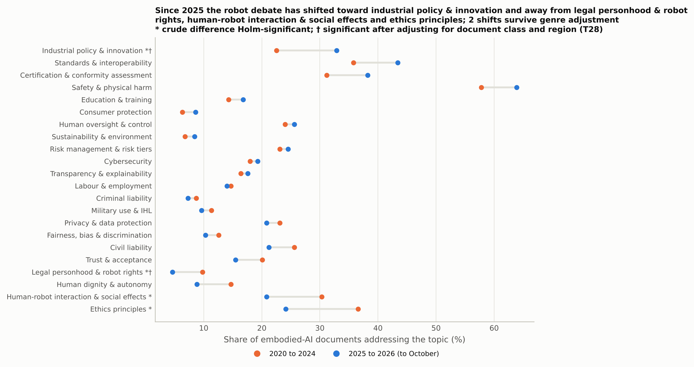

<em class="cap">Figure 34. Governance topics in 2025 to 2026 embodied documents compared with 2020 to 2024: * crude difference Holm-significant; † significant after adjusting for document class and region.</em>

*Table 28. Topic change 2025-26 vs 2020-24 in the embodied set: crude shares, research-only shares, and odds ratios adjusted for document class and region (n=1223)*

| topic                                    |   pct_2020_2024 |   pct_2025_2026 |   change_pp |   research_only_2020_2024 |   research_only_2025_2026 |   adjusted_or |   ci_low |   ci_high |      p |   p_holm |
|:-----------------------------------------|----------------:|----------------:|------------:|--------------------------:|--------------------------:|--------------:|---------:|----------:|-------:|---------:|
| Industrial policy & innovation           |            22.5 |            32.9 |        10.4 |                       8.7 |                      13.5 |          1.69 |     1.24 |      2.31 | 0.001  |   0.0267 |
| Other                                    |             4   |             5.9 |         1.8 |                       4   |                       4.3 |          1.62 |     0.92 |      2.84 | 0.094  |   1      |
| Children & vulnerable groups             |             5.9 |             6.5 |         0.6 |                      13.4 |                      12.1 |          1.58 |     0.95 |      2.65 | 0.0792 |   1      |
| Sustainability & environment             |             6.8 |             8.4 |         1.5 |                       4.7 |                       5   |          1.34 |     0.84 |      2.15 | 0.2175 |   1      |
| Consumer protection                      |             6.3 |             8.6 |         2.3 |                       5.4 |                       8.5 |          1.31 |     0.83 |      2.07 | 0.254  |   1      |
| Transparency & explainability            |            16.4 |            17.6 |         1.3 |                      23.5 |                      33.3 |          1.29 |     0.93 |      1.81 | 0.1291 |   1      |
| Certification & conformity assessment    |            31.2 |            38.2 |         6.9 |                       5.1 |                       5.7 |          1.28 |     0.96 |      1.71 | 0.0922 |   1      |
| Standards & interoperability             |            35.8 |            43.4 |         7.6 |                       8.7 |                      14.2 |          1.23 |     0.9  |      1.67 | 0.1948 |   1      |
| Education & training                     |            14.3 |            16.8 |         2.4 |                       9.7 |                      13.5 |          1.2  |     0.85 |      1.7  | 0.2934 |   1      |
| Trust & acceptance                       |            20.1 |            15.5 |        -4.6 |                      36.5 |                      38.3 |          1.2  |     0.83 |      1.72 | 0.3271 |   1      |
| Safety & physical harm                   |            57.8 |            63.9 |         6.2 |                      28.2 |                      41.1 |          1.16 |     0.88 |      1.53 | 0.3044 |   1      |
| Research ethics                          |             5.8 |             4.8 |        -0.9 |                      13.7 |                      12.1 |          1.16 |     0.66 |      2.04 | 0.6085 |   1      |
| Risk management & risk tiers             |            23.1 |            24.5 |         1.5 |                       9   |                      17.7 |          1.11 |     0.83 |      1.49 | 0.4785 |   1      |
| Labour & employment                      |            14.7 |            14   |        -0.7 |                      18.1 |                      14.9 |          1.11 |     0.78 |      1.6  | 0.5605 |   1      |
| Cybersecurity                            |            18   |            19.3 |         1.3 |                       6.1 |                      10.6 |          1.1  |     0.8  |      1.52 | 0.5641 |   1      |
| Intellectual property                    |             1.9 |             2.5 |         0.6 |                       1.1 |                       2.8 |          1.05 |     0.46 |      2.4  | 0.9125 |   1      |
| Human oversight & control                |            24   |            25.6 |         1.6 |                      15.5 |                      28.4 |          1    |     0.75 |      1.33 | 0.9943 |   1      |
| Fairness, bias & discrimination          |            12.6 |            10.3 |        -2.3 |                      18.4 |                      19.1 |          0.99 |     0.66 |      1.47 | 0.958  |   1      |
| Privacy & data protection                |            23.1 |            20.8 |        -2.3 |                      25.3 |                      21.3 |          0.96 |     0.71 |      1.3  | 0.7911 |   1      |
| Human-robot interaction & social effects |            30.3 |            20.8 |        -9.5 |                      63.9 |                      53.9 |          0.86 |     0.6  |      1.23 | 0.404  |   1      |
| Taxation & economic policy               |             1.9 |             1.5 |        -0.4 |                       2.2 |                       2.1 |          0.73 |     0.27 |      1.97 | 0.5396 |   1      |
| Civil liability                          |            25.6 |            21.2 |        -4.4 |                      33.2 |                      36.9 |          0.72 |     0.53 |      0.98 | 0.0364 |   0.873  |
| Military use & IHL                       |            11.3 |             9.6 |        -1.6 |                       7.6 |                       4.3 |          0.71 |     0.46 |      1.09 | 0.1183 |   1      |
| Human dignity & autonomy                 |            14.7 |             8.8 |        -5.9 |                      31.8 |                      26.2 |          0.68 |     0.44 |      1.04 | 0.075  |   1      |
| Criminal liability                       |             8.7 |             7.3 |        -1.4 |                       9.4 |                       7.1 |          0.67 |     0.42 |      1.06 | 0.0847 |   1      |
| Ethics principles                        |            36.6 |            24.1 |       -12.5 |                      69.3 |                      63.1 |          0.67 |     0.49 |      0.93 | 0.0179 |   0.447  |
| Legal personhood & robot rights          |             9.8 |             4.6 |        -5.2 |                      24.2 |                      14.9 |          0.39 |     0.22 |      0.7  | 0.0015 |   0.0397 |

*Table 30. Trend models (odds ratio per year) under five specifications: collapsed region and class covariates; excluding 2026; stated-date documents only; round-1 documents only; collection round as a covariate*

| outcome                                          | sensitivity                              |    n |   events |   odds_ratio_per_year |   ci_low |   ci_high |      p |
|:-------------------------------------------------|:-----------------------------------------|-----:|---------:|----------------------:|---------:|----------:|-------:|
| mechanism: Risk-based tiering                    | all years, collapsed covariates          | 1523 |      129 |                 1.1   |    1.029 |     1.176 | 0.0052 |
| mechanism: Risk-based tiering                    | excluding partial year 2026              | 1264 |      100 |                 1.106 |    1.018 |     1.201 | 0.0166 |
| mechanism: Risk-based tiering                    | documents with a stated date only        | 1297 |      116 |                 1.08  |    1.007 |     1.158 | 0.0316 |
| mechanism: Risk-based tiering                    | round-1 documents only                   |  663 |       37 |                 1.306 |    1.112 |     1.534 | 0.0011 |
| mechanism: Risk-based tiering                    | all years, collection round as covariate | 1523 |      129 |                 1.101 |    1.03  |     1.178 | 0.0048 |
| mechanism: Conformity assessment & certification | all years, collapsed covariates          | 1523 |      300 |                 1.049 |    1.002 |     1.099 | 0.042  |
| mechanism: Conformity assessment & certification | excluding partial year 2026              | 1264 |      241 |                 1.051 |    0.994 |     1.112 | 0.0826 |
| mechanism: Conformity assessment & certification | documents with a stated date only        | 1297 |      261 |                 1.066 |    1.013 |     1.122 | 0.0142 |
| mechanism: Conformity assessment & certification | round-1 documents only                   |  663 |       48 |                 1.262 |    1.1   |     1.449 | 0.0009 |
| mechanism: Conformity assessment & certification | all years, collection round as covariate | 1523 |      300 |                 1.049 |    1.002 |     1.1   | 0.042  |
| principle: Conformity assessment                 | all years, collapsed covariates          | 1523 |      584 |                 1.044 |    1.004 |     1.086 | 0.0327 |
| principle: Conformity assessment                 | excluding partial year 2026              | 1264 |      466 |                 1.037 |    0.989 |     1.088 | 0.1364 |
| principle: Conformity assessment                 | documents with a stated date only        | 1297 |      515 |                 1.042 |    0.999 |     1.088 | 0.0574 |
| principle: Conformity assessment                 | round-1 documents only                   |  663 |       91 |                 1.119 |    1.018 |     1.231 | 0.0195 |
| principle: Conformity assessment                 | all years, collection round as covariate | 1523 |      584 |                 1.046 |    1.005 |     1.088 | 0.0286 |
| principle: Dual use & military                   | all years, collapsed covariates          | 1523 |      248 |                 0.966 |    0.923 |     1.012 | 0.1447 |
| principle: Dual use & military                   | excluding partial year 2026              | 1264 |      217 |                 0.984 |    0.933 |     1.039 | 0.5687 |
| principle: Dual use & military                   | documents with a stated date only        | 1297 |      217 |                 0.969 |    0.922 |     1.019 | 0.2202 |
| principle: Dual use & military                   | round-1 documents only                   |  663 |      102 |                 0.907 |    0.843 |     0.976 | 0.0089 |
| principle: Dual use & military                   | all years, collection round as covariate | 1523 |      248 |                 0.966 |    0.923 |     1.012 | 0.1415 |
| principle: Physical safety                       | all years, collapsed covariates          | 1523 |     1016 |                 1.003 |    0.965 |     1.043 | 0.871  |
| principle: Physical safety                       | excluding partial year 2026              | 1264 |      837 |                 1.002 |    0.956 |     1.05  | 0.9308 |
| principle: Physical safety                       | documents with a stated date only        | 1297 |      889 |                 1.005 |    0.963 |     1.049 | 0.816  |
| principle: Physical safety                       | round-1 documents only                   |  663 |      315 |                 1.024 |    0.97  |     1.082 | 0.3916 |
| principle: Physical safety                       | all years, collection round as covariate | 1523 |     1016 |                 1.004 |    0.965 |     1.045 | 0.8394 |
| principle: Autonomy level & control              | all years, collapsed covariates          | 1523 |      749 |                 0.99  |    0.956 |     1.025 | 0.5637 |
| principle: Autonomy level & control              | excluding partial year 2026              | 1264 |      620 |                 0.985 |    0.945 |     1.027 | 0.4754 |
| principle: Autonomy level & control              | documents with a stated date only        | 1297 |      660 |                 0.987 |    0.95  |     1.024 | 0.4824 |
| principle: Autonomy level & control              | round-1 documents only                   |  663 |      274 |                 1.002 |    0.948 |     1.058 | 0.9465 |
| principle: Autonomy level & control              | all years, collection round as covariate | 1523 |      749 |                 0.99  |    0.957 |     1.025 | 0.5837 |
| principle: Human-robot proximity                 | all years, collapsed covariates          | 1523 |      657 |                 0.935 |    0.901 |     0.971 | 0.0005 |
| principle: Human-robot proximity                 | excluding partial year 2026              | 1264 |      567 |                 0.935 |    0.894 |     0.978 | 0.0032 |
| principle: Human-robot proximity                 | documents with a stated date only        | 1297 |      549 |                 0.921 |    0.883 |     0.96  | 0.0001 |
| principle: Human-robot proximity                 | round-1 documents only                   |  663 |      417 |                 1.004 |    0.946 |     1.065 | 0.8997 |
| principle: Human-robot proximity                 | all years, collection round as covariate | 1523 |      657 |                 0.935 |    0.9   |     0.971 | 0.0005 |
| principle: Liability for physical damage         | all years, collapsed covariates          | 1523 |      326 |                 0.947 |    0.909 |     0.986 | 0.009  |
| principle: Liability for physical damage         | excluding partial year 2026              | 1264 |      283 |                 0.958 |    0.913 |     1.006 | 0.0828 |
| principle: Liability for physical damage         | documents with a stated date only        | 1297 |      289 |                 0.943 |    0.903 |     0.986 | 0.0099 |
| principle: Liability for physical damage         | round-1 documents only                   |  663 |      159 |                 0.998 |    0.937 |     1.063 | 0.9502 |
| principle: Liability for physical damage         | all years, collection round as covariate | 1523 |      326 |                 0.947 |    0.909 |     0.986 | 0.009  |

Comparing 477 embodied documents from 2025 to 2026 with 746 from 2020 to 2024 (Table 16 in the report), crude shares rise for industrial policy (+10 points), standards (+8), certification (+7) and physical safety (+6) and fall for ethics principles (−13), human-robot interaction (−10), human dignity (−6) and personhood (−5); industrial policy, ethics principles, human-robot interaction and personhood are Holm-significant. Adjusted for document class and region (Table 28, n = 1,223), personhood falls (odds ratio 0.39, 0.22 to 0.70, Holm p = 0.04) and industrial policy rises (1.69, 1.24 to 2.31, p = 0.03; its research-only share moves from 9% to 14%), while ethics principles (0.67), civil liability (0.72), cybersecurity (1.10) and human oversight (1.00) do not change after correction; this model does not include collection round. The trend models (Table 17 in the report; 2015 to 2026, n = 1,496) give risk-based tiering an odds ratio of 1.10 per year (1.02 to 1.18) and the conformity-assessment mechanism 1.05 (1.00 to 1.11), neither Holm-significant pooled, with physical safety (1.00) and autonomy-level control (0.98) flat. Table 30 shows the pooled estimates understating the round-1 trends: within round-1 documents tiering rises at 1.31 per year (1.11 to 1.53) and conformity assessment at 1.26 (1.10 to 1.45), and dual use falls (0.91, 0.84 to 0.98), while with round as a covariate the three are 1.10, 1.05 and 0.97. The pooled declines of proximity and liability for physical damage (0.94 per year each in Table 17) are flat within round-1 documents (odds ratios 1.00, intervals 0.95 to 1.07 and 0.94 to 1.06; Table 30) and are composition effects, since the principal binding instruments that dominate the later years mention proximity in 30% of cases against 71% for research outputs (Table 9); they are not reported as trends. Within the embodied set, the terms "embodied AI" and "physical AI" appear in 1.0% of 2024 documents (2 of 194), 8.3% of 2025 documents (18 of 218) and 12.7% of 2026 documents (33 of 259) (Figure 33 in the report).

### 5.8 Consistency of the labels

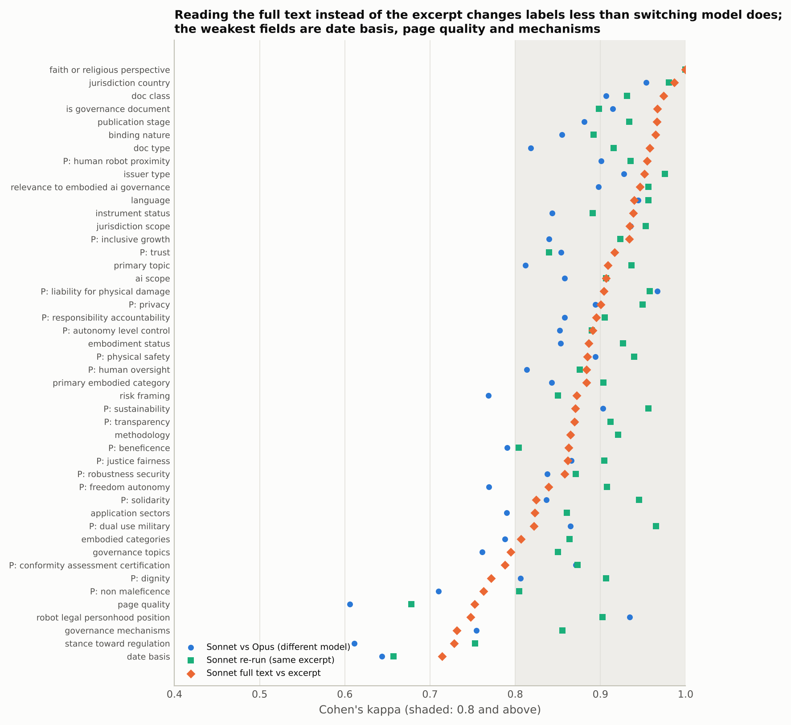

<em class="cap">Figure 43. Per-field kappa for three comparisons: different model on the same excerpt, same model re-run, and same model reading the full text instead of the excerpt.</em>

*Table 26. Per-field agreement and kappa against the v1 final annotations: independent model on the same excerpt (160 docs); same model re-run (161 docs); same model on the full text (160 docs); same model metadata-blind with the collector cover block stripped (160 docs); and, for governance documents only, the v2 blind extended-excerpt annotation (up to 110,000 characters)*

| field                                         | type        |   n |   agreement_inter_model |   kappa_inter_model |   agreement_retest |   kappa_retest |   agreement_fulltext |   kappa_fulltext |   agreement_blind |   kappa_blind |   agreement_gov_extended |   kappa_gov_extended |
|:----------------------------------------------|:------------|----:|------------------------:|--------------------:|-------------------:|---------------:|---------------------:|-----------------:|------------------:|--------------:|-------------------------:|---------------------:|
| issuer_type                                   | single      | 160 |                   0.944 |               0.928 |              0.981 |          0.976 |                0.962 |            0.951 |             0.975 |         0.968 |                    0.972 |                0.961 |
| date_basis                                    | single      | 160 |                   0.869 |               0.643 |              0.875 |          0.657 |                0.881 |            0.714 |             0.888 |         0.649 |                    0.903 |                0.694 |
| jurisdiction_country                          | single      | 160 |                   0.956 |               0.954 |              0.981 |          0.98  |                0.988 |            0.987 |             0.969 |         0.967 |                    0.997 |                0.997 |
| jurisdiction_scope                            | single      | 160 |                   0.956 |               0.935 |              0.969 |          0.953 |                0.956 |            0.934 |             0.969 |         0.954 |                    0.997 |                0.993 |
| doc_type                                      | single      | 160 |                   0.838 |               0.818 |              0.925 |          0.915 |                0.962 |            0.958 |             0.906 |         0.895 |                    0.92  |                0.905 |
| doc_class                                     | single      | 160 |                   0.931 |               0.906 |              0.95  |          0.931 |                0.981 |            0.974 |             0.938 |         0.915 |                    0.949 |                0.896 |
| is_governance_document                        | single      | 160 |                   0.969 |               0.915 |              0.962 |          0.898 |                0.988 |            0.967 |             0.956 |         0.882 |                    0.977 |               -0.005 |
| instrument_status                             | single      | 160 |                   0.938 |               0.843 |              0.956 |          0.891 |                0.975 |            0.939 |             0.938 |         0.846 |                    0.9   |                0.823 |
| binding_nature                                | single      | 160 |                   0.95  |               0.855 |              0.962 |          0.892 |                0.988 |            0.965 |             0.956 |         0.875 |                    0.917 |                0.831 |
| publication_stage                             | single      | 160 |                   0.931 |               0.881 |              0.962 |          0.934 |                0.981 |            0.966 |             0.969 |         0.944 |                    0.989 |                0.494 |
| ai_scope                                      | single      | 160 |                   0.906 |               0.858 |              0.938 |          0.907 |                0.938 |            0.907 |             0.919 |         0.876 |                    0.906 |                0.763 |
| embodiment_status                             | single      | 160 |                   0.912 |               0.853 |              0.956 |          0.927 |                0.931 |            0.886 |             0.919 |         0.861 |                    0.912 |                0.735 |
| primary_embodied_category                     | single      | 160 |                   0.906 |               0.843 |              0.944 |          0.903 |                0.931 |            0.883 |             0.881 |         0.789 |                    0.937 |                0.658 |
| primary_topic                                 | single      | 160 |                   0.831 |               0.812 |              0.944 |          0.937 |                0.919 |            0.909 |             0.912 |         0.902 |                    0.912 |                0.892 |
| robot_legal_personhood_position               | single      | 160 |                   0.988 |               0.935 |              0.981 |          0.902 |                0.944 |            0.748 |             0.988 |         0.936 |                    0.989 |                0.76  |
| risk_framing                                  | single      | 160 |                   0.806 |               0.768 |              0.875 |          0.85  |                0.894 |            0.872 |             0.938 |         0.925 |                    0.866 |                0.826 |
| stance_toward_regulation                      | single      | 160 |                   0.731 |               0.611 |              0.838 |          0.753 |                0.819 |            0.728 |             0.819 |         0.727 |                    0.892 |                0.548 |
| methodology                                   | single      | 160 |                   0.925 |               0.865 |              0.956 |          0.921 |                0.925 |            0.865 |             0.931 |         0.877 |                    1     |                1     |
| faith_or_religious_perspective                | single      | 160 |                   1     |               1     |              1     |          1     |                1     |            1     |             1     |         1     |                    1     |                1     |
| page_quality                                  | single      | 160 |                   0.825 |               0.606 |              0.862 |          0.678 |                0.9   |            0.752 |             0.881 |         0.713 |                    0.915 |                0.671 |
| language                                      | single      | 160 |                   0.975 |               0.945 |              0.981 |          0.956 |                0.975 |            0.94  |             0.962 |         0.917 |                    0.994 |                0.989 |
| relevance_to_embodied_ai_governance           | ordinal     | 160 |                   0.794 |               0.898 |              0.906 |          0.956 |                0.881 |            0.946 |             0.881 |         0.94  |                    0.869 |                0.882 |
| embodied_categories                           | multi-label | 160 |                   0.879 |               0.788 |              0.933 |          0.864 |                0.892 |            0.807 |             0.885 |         0.786 |                    0.888 |                0.6   |
| application_sectors                           | multi-label | 160 |                   0.848 |               0.79  |              0.912 |          0.861 |                0.868 |            0.823 |             0.863 |         0.774 |                    0.838 |                0.75  |
| governance_topics                             | multi-label | 160 |                   0.714 |               0.761 |              0.814 |          0.85  |                0.79  |            0.795 |             0.801 |         0.837 |                    0.758 |                0.719 |
| governance_mechanisms                         | multi-label | 160 |                   0.63  |               0.754 |              0.865 |          0.855 |                0.811 |            0.732 |             0.805 |         0.772 |                    0.745 |                0.693 |
| principle:transparency                        | ordinal 0-2 | 160 |                   0.844 |               0.87  |              0.894 |          0.912 |                0.844 |            0.869 |             0.919 |         0.932 |                    0.846 |                0.872 |
| principle:justice_fairness                    | ordinal 0-2 | 160 |                   0.862 |               0.866 |              0.9   |          0.905 |                0.85  |            0.862 |             0.919 |         0.921 |                    0.852 |                0.88  |
| principle:non_maleficence                     | ordinal 0-2 | 160 |                   0.794 |               0.71  |              0.888 |          0.805 |                0.838 |            0.763 |             0.894 |         0.809 |                    0.852 |                0.797 |
| principle:responsibility_accountability       | ordinal 0-2 | 160 |                   0.844 |               0.858 |              0.9   |          0.905 |                0.862 |            0.895 |             0.925 |         0.929 |                    0.826 |                0.843 |
| principle:privacy                             | ordinal 0-2 | 160 |                   0.881 |               0.894 |              0.944 |          0.949 |                0.888 |            0.9   |             0.906 |         0.898 |                    0.843 |                0.871 |
| principle:beneficence                         | ordinal 0-2 | 160 |                   0.856 |               0.79  |              0.881 |          0.804 |                0.906 |            0.863 |             0.888 |         0.847 |                    0.883 |                0.886 |
| principle:freedom_autonomy                    | ordinal 0-2 | 160 |                   0.862 |               0.769 |              0.956 |          0.908 |                0.888 |            0.839 |             0.925 |         0.864 |                    0.866 |                0.813 |
| principle:trust                               | ordinal 0-2 | 160 |                   0.888 |               0.854 |              0.888 |          0.839 |                0.919 |            0.916 |             0.919 |         0.911 |                    0.803 |                0.818 |
| principle:sustainability                      | ordinal 0-2 | 160 |                   0.931 |               0.903 |              0.969 |          0.956 |                0.906 |            0.87  |             0.956 |         0.939 |                    0.877 |                0.871 |
| principle:dignity                             | ordinal 0-2 | 160 |                   0.894 |               0.806 |              0.944 |          0.906 |                0.85  |            0.772 |             0.931 |         0.882 |                    0.872 |                0.828 |
| principle:solidarity                          | ordinal 0-2 | 160 |                   0.919 |               0.836 |              0.975 |          0.945 |                0.906 |            0.824 |             0.95  |         0.893 |                    0.877 |                0.815 |
| principle:human_oversight                     | ordinal 0-2 | 160 |                   0.856 |               0.814 |              0.888 |          0.876 |                0.875 |            0.883 |             0.894 |         0.877 |                    0.815 |                0.848 |
| principle:robustness_security                 | ordinal 0-2 | 160 |                   0.869 |               0.837 |              0.9   |          0.871 |                0.862 |            0.858 |             0.894 |         0.861 |                    0.835 |                0.836 |
| principle:inclusive_growth                    | ordinal 0-2 | 160 |                   0.825 |               0.84  |              0.919 |          0.923 |                0.912 |            0.934 |             0.912 |         0.932 |                    0.917 |                0.942 |
| principle:physical_safety                     | ordinal 0-2 | 160 |                   0.919 |               0.894 |              0.956 |          0.94  |                0.912 |            0.885 |             0.95  |         0.935 |                    0.937 |                0.871 |
| principle:human_robot_proximity               | ordinal 0-2 | 160 |                   0.906 |               0.901 |              0.938 |          0.935 |                0.956 |            0.955 |             0.944 |         0.942 |                    0.969 |                0.872 |
| principle:liability_for_physical_damage       | ordinal 0-2 | 160 |                   0.975 |               0.967 |              0.969 |          0.958 |                0.944 |            0.904 |             0.975 |         0.966 |                    0.972 |                0.786 |
| principle:autonomy_level_control              | ordinal 0-2 | 160 |                   0.925 |               0.852 |              0.956 |          0.89  |                0.938 |            0.891 |             0.975 |         0.923 |                    0.897 |                0.667 |
| principle:conformity_assessment_certification | ordinal 0-2 | 160 |                   0.956 |               0.871 |              0.975 |          0.873 |                0.919 |            0.788 |             0.981 |         0.889 |                    0.863 |                0.764 |
| principle:dual_use_military                   | ordinal 0-2 | 160 |                   0.975 |               0.865 |              0.994 |          0.965 |                0.956 |            0.822 |             0.988 |         0.932 |                    0.943 |                0.819 |

On round-1 samples, a second model agrees with the annotations at a median kappa of 0.85 over 46 fields (minimum 0.61, page quality; 11 fields below 0.80), a re-run at 0.91, full text at 0.88 (agreeing less on documents the excerpt truncated, median principle kappa 0.75 against 0.84), the metadata-blind input at 0.90 and the extended annotation of governance documents at 0.83. On the 160-document round-2 sample the second model agrees at a median kappa of 0.86 over single and ordinal fields and the re-run at 0.91, with level-2 (specified in depth) kappas of 0.81 and 0.89 and unweighted relevance kappas of 0.76 and 0.86 (Table S09b). The weak round-2 fields against the second model are page quality (0.53), stance toward regulation (0.65), publication stage (0.66), date basis (0.70), solidarity (0.72), instrument status (0.75) and document type (0.79); every other principle is at or above 0.79, and the multi-label fields average 0.81 (robot types), 0.80 (sectors), 0.71 (topics) and 0.70 (mechanisms) per label. Instrument status and class define the analysis sets, and their round-2 agreement is lower than in round 1 (0.84 and 0.91). The round-2 collectors' catalogue metadata agrees with the blind annotation on binding nature in 93% of 1,608 documents (kappa 0.85), on jurisdiction in 98% (1,624), on year within one year in 94% (1,542) and on document class in 77% (kappa 0.66; Table 57), a consistency check between model outputs rather than a validation. Lexicons over the full text agree with the annotations at median kappa 0.40 to 0.43 over 2,700 documents, with a Spearman correlation of 0.88 between lexicon and annotation differences across principles. The strict set (n = 1,374; Table 32 in the report) gives the same research share (32%), 168 binding instruments, a higher physical-safety share (71% against 67%) and the same social-robot gap (44% of research outputs against 16 instruments).

## 6. Discussion

**How many instruments govern robots is a question about the counting unit before it is a question about the world.** The same collection holds 810 legal texts, 505 principal instruments, 408 robot-relevant ones and 15 binding instruments that name AI. The texts that leave the count are the yearly renewals, exemptions, commencement orders, incorporation decisions and catalogue pages through which legal databases expose a regime; a harvest counts each once. The independent audit puts the earlier count's joint precision at 54%, and the rule-based unit agrees with the audit on three documents in four. What survives every unit is the route: binding law reaches robots through aviation and drone regulation, road-traffic and automated-driving law, machinery and workplace-safety rules and medical-device law, joined by general AI law that reaches robots through its product lists; the one robotics statute the collection has read is Salvadoran, and the one it has verified but not read is from Hangzhou.

**Collection strategy dominates coding.** With one codebook and one model, a topical web search by regional teams and a database-driven search by agents and scripts produced instrument counts an order of magnitude apart and opposite answers to whether robot rules share the ethical core of general-AI documents. Adjustment for genre did not protect the comparison, because within the instrument genre the embodied side became 88% round 2 and the general side 34%. The reviews of ethics guidelines (Jobin et al. 2019; Corrêa et al. 2023) and the policy observatories were each built by one strategy; their conclusions about binding law are conclusions about what that strategy reaches, and a corpus should report its findings by collection source before pooling them.

**The body is what distinguishes embodied governance; the ethical-core deficit is a property of harvested legal texts.** Within each round, within each genre and after adjustment, physical safety, autonomy-level control, conformity assessment, liability for physical damage and dual use remain the largest differences in the data, and embodied instruments carry a product-safety toolkit of standards references, licensing, conformity assessment, insurance and incident reporting. The claim that robots are governed with less transparency, fairness or privacy than software does not hold within round-1 instruments, where no core principle differs, and within round 2 it compares regulations harvested from legal databases with strategies and guidelines found by search. What can be said is narrower: legal texts, which is what the embodied instrument layer mostly is, mention fairness, trust and beneficence less than strategies and guidelines do, and non-maleficence and human oversight more. The harm-avoidance part of the convergence that guideline reviews found extends to the machine-class rules that govern robots; the rest is not yet separable from the kind of document each collection strategy returns.

**Specification lags mention, and binding law and standards are the specifiers.** Among the 195 principal binding instruments, physical safety is specified in depth in 62% and conformity assessment in 47%, but autonomy-level control, raised by 61%, is specified in 25%, and liability for physical damage in 18%. The vehicle laws in which autonomy levels are defined are in the collection; even so, most of the binding layer mentions the level of autonomy without specifying it. The standards' shares (68% physical safety in depth on 62 scope captures) describe public scope statements and are kept apart from the statutes.

**Research and rules point at different robots.** Vehicles, drones, weapons and medical devices inherited regimes; companion and social robots did not, and after two decades of research they have 15 principal instruments in this collection, none binding. The gap is widened by the round-2 search terms, written for drones, vehicles and machinery, and narrowed by the general regimes (product safety, toys, data protection, the AI Act's transparency and vulnerability provisions) that apply to social robots without naming them; it is a gap in robot-specific instruments and in the research community's engagement with existing law (4% of papers argue it suffices).

**Regions differ on tools; whether they differ on values cannot yet be separated from what each region's documents are.** Standards references, licensing and liability regimes vary most across the six regions and the physical-harm vocabulary least. The ethical vocabulary varies in between, but the regions with the highest research shares have the highest ethical-principle shares, and the within-genre check (Table 29b of the report) splits the question: within research outputs 2 of 14 core principles differ by region while the body items do; within principal instruments 12 of 14 core principles differ (beneficence V 0.43, sustainability and inclusive growth 0.34, trust 0.28), with the standards-heavy international layer at the low end and Asia's strategies at the high end. Europe and North America are distinguishable on all embodied documents and indistinguishable on research outputs, so what separates regions on values is the instrument layer each region's databases made harvestable, and within it the kind of instrument.

**The frontier.** After adjustment for class and region, the 2025 to 2026 shift is away from the personhood debate and toward industrial policy. The growth of risk tiers and conformity assessment is real within the first collection (about 31% and 26% per year) and diluted, not reversed, by the legal texts of the second; the pooled declines in proximity and liability vanish within the first collection (odds ratios 1.00) and are not reported as trends. The vocabulary of "physical AI" is arriving, at 13% of embodied documents in 2026.

## 7. Limitations

The collection is purposive, European and English-heavy (75% English), and its design confounds the embodied and general sets with genre and with collection round: round 1 found research and strategies, round 2 found legal texts without adding research, so every pooled comparison is reported next to its within-round and within-genre counterpart, and where those disagree the pooled result is treated as a composition effect. The instrument counts are lower bounds on recall (22 of 39 reference instruments captured; the verified-but-unread list of Section 5.3) and upper bounds on precision: the independent audit found 54% of the earlier binding set to be distinct, binding and substantive, and the rule-based unit that replaced that count agrees with the audit on 77% of the same documents, so about one principal binding instrument in four may still fail a reading. The collection over-represents jurisdictions with open legal APIs: the United States, the European Union and Japan supply 112 of the 195 principal binding instruments, Australia holds 47 embodied legal texts of which 6 are principal instruments, and the hosts that block the environment (EUR-Lex for 59 candidates, the Chinese NPC database 27, UNODA, Légifrance and the Korean law portal 17 each, Taiwan's law database 11; Table 52) are why France, Korea, Taiwan, Hong Kong and the Chinese provinces are thin. The reference list mixes robot-specific and general-AI instruments, and the gap index inherits the round-2 search terms; a split of the index by collection source was not computed.

All labels come from one proprietary model family. No person read or labelled any document; the round-2 collectors, the six adversarial reviewers of earlier drafts and the precision auditor were AI agents of the same family, so the collector-metadata agreement and the audit are model-against-model checks, and the human-validation protocol of supplement S4.5 remains unexecuted. The consistency checks bound instability, not validity; the round-2 sample shows instrument status (0.75) and document class, which define the analysis sets, agreeing less well than in round 1, and downstream estimates are not corrected for measurement error (Egami et al. 2023; Angelopoulos et al. 2023). The relevance field that defines the sets was produced by the same model as the outcomes, and the 547 documents excluded as not about AI were excluded by it. The Chinese, Japanese and Korean labels of the first annotation were produced from fragments and were replaced; the re-annotated labels carry the same model limits as the rest. The extended annotation still truncates the longest statutes at 110,000 characters, and a full-text pass for them is future work. Depth statistics rest on captures of at least 150 words, and the standards' shares describe scope pages fetched from a committee mirror, whose copyright status for this use (text mining of publicly posted abstracts, not redistributed) we state rather than resolve; the source texts of the collection are not redistributed for the same reason, so the released model inputs are the only way to inspect what the model saw. Consolidated statutes harvested from legal databases are dated at enactment or at the version the database served, so Figure 6 and the year covariates inherit dates that precede the provisions of interest; version dating is deferred to a third round, and the topic-change model (Table 28) adjusts for class and region but not for round. The within-genre regional divergence tables (Table 29b) could be computed only for regions with at least 20 documents of the genre, and the pooled declines of proximity and liability are flat within round-1 documents (Table 30), so the regional values claim is confined to the instrument layer and the declines are not reported as findings. The instrument scheme does not record whom an instrument binds, applicability dates or the legal effect of standards (harmonised, incorporated, mandatory), which a policy-grade inventory would need. Finally, the funnels are documented but not complete: 355 round-2 candidates have no text and are counted nowhere, and every collector agent exhausted its web-search budget part-way through its brief.

## 8. Conclusion

With 3,165 usable documents from eight regions collected by two strategies, a 39-field codebook, model annotation checked on both rounds, a documented counting unit, text-based AI-content tiers and an independent precision audit, this study gives a quantitative map of the governance of the machine classes in which embodied AI is deployed, and states where the collection and its labels end. The map shows a binding sectoral layer that reaches robots sideways and names AI rarely, a standards spine, a research discourse, a harm-avoidance and product-safety vocabulary that survives every stratification, an ethical-core deficit that does not, a social-robot gap, regional differences on tools that are measurable and on values that are not yet separable from genre, and a frontier moving away from personhood and toward industrial policy and "physical AI". Its most general result is about method: two collection strategies applied to the same question with the same codebook returned instrument counts an order of magnitude apart and reversed conclusions that adjustment for genre did not protect, so a governance corpus should report what it finds by how it found it. The release, the reviews, the audits and the change log allow each claim to be re-examined and the collection extended where it is still thin.

## References

Angelopoulos, A. N., Bates, S., Fannjiang, C., Jordan, M. I., & Zrnic, T. (2023). Prediction-powered inference. *Science*, 382(6671), 669–674.

Bergsma, W. (2013). A bias-correction for Cramér's V and Tschuprow's T. *Journal of the Korean Statistical Society*, 42(3), 323–328.

Bertolini, A. (2020). *Artificial Intelligence and Civil Liability*. Study for the European Parliament JURI Committee.

Broder, A. Z. (1997). On the resemblance and containment of documents. *Proceedings of Compression and Complexity of Sequences*, 21–29.

Bryson, J. J., Diamantis, M. E., & Grant, T. D. (2017). Of, for, and by the people: the legal lacuna of synthetic persons. *Artificial Intelligence and Law*, 25(3), 273–291.

Calo, R. (2015). Robotics and the lessons of cyberlaw. *California Law Review*, 103(3), 513–563.

Cohen, J. (1960). A coefficient of agreement for nominal scales. *Educational and Psychological Measurement*, 20(1), 37–46.

Corrêa, N. K., et al. (2023). Worldwide AI ethics: A review of 200 guidelines and recommendations for AI governance. *Patterns*, 4(10), 100857.

Egami, N., Hinck, M., Stewart, B. M., & Wei, H. (2023). Using imperfect surrogates for downstream inference: Design-based supervised learning for social science applications of large language models. *Advances in Neural Information Processing Systems*, 36.

European Parliament (2017). Resolution of 16 February 2017 with recommendations to the Commission on Civil Law Rules on Robotics (2015/2103(INL)).

Fjeld, J., Achten, N., Hilligoss, H., Nagy, A., & Srikumar, M. (2020). *Principled Artificial Intelligence*. Berkman Klein Center Research Publication 2020-1.

Fosch-Villaronga, E., & Heldeweg, M. (2018). "Regulation, I presume?" said the robot. *Computer Law & Security Review*, 34(6), 1258–1277.

Fosch-Villaronga, E., & Mahler, T. (2021). Cybersecurity, safety and robots: Strengthening the link between cybersecurity and safety in the context of care robots. *Computer Law & Security Review*, 41, 105528.

Gebru, T., et al. (2021). Datasheets for datasets. *Communications of the ACM*, 64(12), 86–92.

Gilardi, F., Alizadeh, M., & Kubli, M. (2023). ChatGPT outperforms crowd workers for text-annotation tasks. *Proceedings of the National Academy of Sciences*, 120(30), e2305016120.

Hagendorff, T. (2020). The ethics of AI ethics: An evaluation of guidelines. *Minds and Machines*, 30(1), 99–120.

Holder, C., Khurana, V., Harrison, F., & Jacobs, L. (2016). Robotics and law: Key legal and regulatory implications of the robotics age (Part I of II). *Computer Law & Security Review*, 32(3), 383–402.

Holm, S. (1979). A simple sequentially rejective multiple test procedure. *Scandinavian Journal of Statistics*, 6(2), 65–70.

ISO 10218-1 and ISO 10218-2. *Robotics — Safety requirements for industrial robots* (2011; revised 2025). ISO 13482:2014. *Robots and robotic devices — Safety requirements for personal care robots*. ISO/TS 15066:2016. *Robots and robotic devices — Collaborative robots*.

Jobin, A., Ienca, M., & Vayena, E. (2019). The global landscape of AI ethics guidelines. *Nature Machine Intelligence*, 1(9), 389–399.

Landis, J. R., & Koch, G. G. (1977). The measurement of observer agreement for categorical data. *Biometrics*, 33(1), 159–174.

Leenes, R., Palmerini, E., Koops, B.-J., Bertolini, A., Salvini, P., & Lucivero, F. (2017). Regulatory challenges of robotics. *Law, Innovation and Technology*, 9(1), 1–44.

Lutz, C., Schöttler, M., & Hoffmann, C. P. (2019). The privacy implications of social robots. *Mobile Media & Communication*, 7(3), 412–434.

Nevejans, N. (2016). *European civil law rules in robotics*. Study for the European Parliament JURI Committee.

OECD (2019). *Recommendation of the Council on Artificial Intelligence*, OECD/LEGAL/0449.

Ollion, É., Shen, R., Macanovic, A., & Chatelain, A. (2024). The dangers of using proprietary LLMs for research. *Nature Machine Intelligence*, 6, 4–5.

Palmerini, E., et al. (2014). *Guidelines on Regulating Robotics*. RoboLaw project deliverable D6.2.

Pangakis, N., Wolken, S., & Fasching, N. (2023). Automated annotation with generative AI requires validation. arXiv:2306.00176.

Priem, J., Piwowar, H., & Orr, R. (2022). OpenAlex: A fully-open index of scholarly works. arXiv:2205.01833.

Regulation (EU) 2023/1230 on machinery. *Official Journal of the European Union* L 165. Regulation (EU) 2024/1689 (Artificial Intelligence Act). *Official Journal of the European Union* L, 12 July 2024.

Reiss, M. V. (2023). Testing the reliability of ChatGPT for text annotation and classification: A cautionary remark. arXiv:2304.11085.

Republic of Korea (2008). *Intelligent Robots Development and Distribution Promotion Act*, Act No. 9014.

Rousseeuw, P. J. (1987). Silhouettes. *Journal of Computational and Applied Mathematics*, 20, 53–65.

Salvini, P., Paez-Granados, D., & Billard, A. (2021). On the safety of mobile robots serving in public spaces: Identifying gaps in EN ISO 13482:2014 and calling for a new standard. *ACM Transactions on Human-Robot Interaction*, 10(3), 1–27.

Schiff, D., Borenstein, J., Biddle, J., & Laas, K. (2021). AI ethics in the public, private, and NGO sectors. *IEEE Transactions on Technology and Society*, 2(1), 31–42.

Sharkey, A., & Sharkey, N. (2012). Granny and the robots. *Ethics and Information Technology*, 14(1), 27–40.

Solaiman, S. M. (2017). Legal personality of robots, corporations, idols and chimpanzees. *Artificial Intelligence and Law*, 25(2), 155–179.

Sparrow, R. (2007). Killer robots. *Journal of Applied Philosophy*, 24(1), 62–77.

Stöcker, C., Bennett, R., Nex, F., Gerke, M., & Zevenbergen, J. (2017). Review of the current state of UAV regulations. *Remote Sensing*, 9(5), 459.

Taeihagh, A., & Lim, H. S. M. (2019). Governing autonomous vehicles. *Transport Reviews*, 39(1), 103–128.

Thalken, R., Stiglitz, E. H., Mimno, D., & Wilkens, M. (2023). Modeling legal reasoning: LM annotation at the edge of human agreement. *Proceedings of EMNLP 2023*.

Törnberg, P. (2024). Best practices for text annotation with large language models. *Sociologica*, 18(2), 67–85.

UNESCO (2021). *Recommendation on the Ethics of Artificial Intelligence*.

van Wynsberghe, A. (2013). Designing robots for care. *Science and Engineering Ethics*, 19(2), 407–433.

Veale, M., & Zuiderveen Borgesius, F. (2021). Demystifying the Draft EU Artificial Intelligence Act. *Computer Law Review International*, 22(4), 97–112.

Wilson, E. B. (1927). Probable inference, the law of succession, and statistical inference. *Journal of the American Statistical Association*, 22(158), 209–212.

Winfield, A. F. T., & Jirotka, M. (2018). Ethical governance is essential to building trust in robotics and AI systems. *Philosophical Transactions of the Royal Society A*, 376(2133), 20180085.

## Appendix. Materials and availability

The release contains: the master table (`data/master_table.csv`) with the counting-unit, family and AI-content fields; per-document annotations with model, prompt hash, policy, cost and timestamp, and the exact model inputs for the round-2, extended round-1 governance, Chinese-Japanese-Korean repair and metadata-blind reliability runs (`annotations/<run>/_inputs/`; inputs for the first round-1 run and the other reliability runs were not stored); the run manifest (`data/run_manifest.json`); the counting-unit and tier script and the override files (`scripts/07c_v4_units_and_tiers.py`, `data/manual_overrides_v4.csv`, `data/overrides_applied.csv`); the reference list of the coverage audit; the reliability samples and per-field tables for both rounds; the precision-audit sample and report; the round-2 inventory of candidates without text; all tables, figures and their data; the dashboard; the codebook and taxonomies; the analysis report, the round-2 companion report, the document-discovery methods and the supplement (reliability including S4.7, rules and overrides in S8, version history in S10, the precision audit as S13, datasheet, human-validation protocol); the six reviews and the review-and-changes log; and all scripts. Source texts are not redistributed for copyright reasons; the stored model inputs are the record of what the model read. Temperature and seed are not controllable through the interface used, so re-runs reproduce the pipeline from the stored annotations onward, not the annotations themselves.
